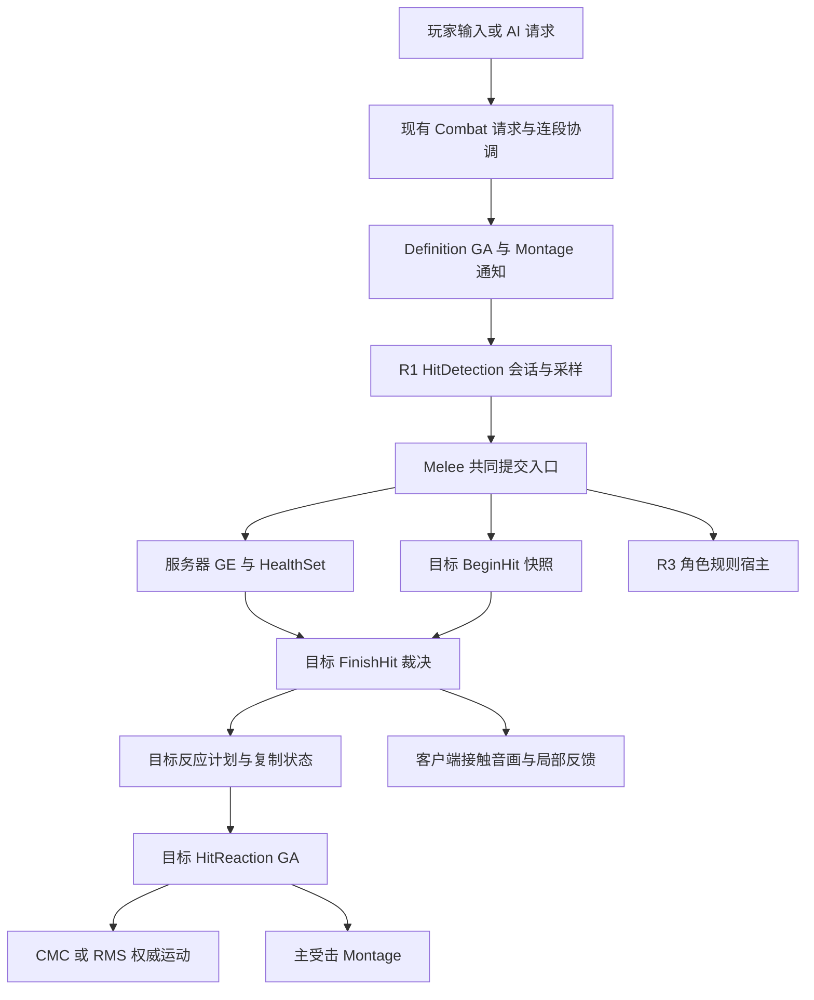

# ACT 战斗动画与受击反馈整合设计

> 2026-10-18：普通受击的当前裁决与运动契约见[目标侧削韧受击](poise-driven-hit-reactions.md)，本轮已授权并实现。本文原先按攻击力度选择强动作、整段受击根运动的部分属于历史方案；攻击／闪避与原 GAS 主链继续保留。实际交付与未验证边界见[本轮记录](../Validation/poise-driven-hit-reactions-2026-10-18.md)。

日期：2026-10-17；版本：v0.1；引擎：UE 5.5.4。

**状态：2026-10-17 用户已授权实现并执行测试。** 当前工作区为 `dev-Combat`，起始提交与用户指定封存基线相同，均为 `891fd70`。保留已有成果，不自动切分支、合并或提交；跑攻与切手按用户最新决定暂缓，参数、素材与消耗约束见 §14。

本文统一记录近期《鸣潮》式受击目标、配置简化评审、假人测试、受击原型、悟空战斗参考与受击专项审查的结论。实现状态与优先级见[实施与验收计划](act-combat-animation-feedback-plan.md)；逐项参考证据见[悟空工程审查](bmwukong-combat-reference-review-2026-10-17.md)。本文不是把参考工程整体迁入 Hodge 的方案。

## 1. 文档职责与阅读顺序

1. 本文：目标、架构、模块职责、接口契约、关键行为与设计取舍。
2. [实施与验收计划](act-combat-animation-feedback-plan.md)：当前进度、任务依赖、交付物、测试场景、停止与完成条件。
3. [受击核心设计](hit-reaction-system.md)：Body／Judgement、六类 Impact、服务器裁决和目标执行的底层契约。其历史阶段说明不作为当前完成证明。
4. [受击配置手册](../Guides/hit-reaction-configuration.md)、[攻击配置手册](../Guides/attack-ability-configuration.md)：已经存在的字段和作者入口。未来拟议能力不能写成当前可配置属性。
5. [10-16 修改前审计](hit-reaction-implementation-audit-2026-10-16.md)、[10-16 表现验证](../Validation/hit-presentation-2026-10-16.md)、[10-17 参考审查](bmwukong-combat-reference-review-2026-10-17.md)：分别记录历史快照、原型成果和参考事实，不互相覆盖。

设计整理时尚未重新读取正式资产；进入实现后已执行匹配构建并读取五段、Hero／Guardian／假人、E／R、Dash 与 AnimBP。逐项证据和本轮剩余项见[本轮验证](../Validation/act-combat-animation-feedback-2026-10-17.md)。源码事实、资产快照、运行观察与主观评价分别记录。

## 2. 目标、范围与不做项

### 2.1 体验目标

让命中瞬间明确、连续五段有节奏、身体反应与来源一致、强受击与运动有重量，受击后能自然恢复或衔接允许的动作；高抗打断目标保持出招可读性，同时仍有足够的接触反馈。

《鸣潮》作为高速 ACT 反馈方向；本地 BMWukong 中**悟空的普攻、闪避与棍法派生**作为可核查的动作编排参考。两者不是逐帧一致的产品承诺，网页描述、未经测量的实验参数也不当作原游戏真实数据。

### 2.2 首个完整样例

- 正式 Hero 五段顺序保持 **01 → 02 → 03 → 05 → 04**，针对一个可硬直的人形目标完成逐刀接触、失衡、终结刀运动和恢复。
- 一个高 Body 目标验证普通攻击只反馈、不非法打断；主动出招的 Guardian 单独验证，静止假人不能替代。
- 攻击侧完成一组“普攻 → 合法移动退出／方向闪避 → 闪避后攻击 → 返回连段”的衔接，再考虑一条悟空切手启发的角色专属派生。
- 玩家侧单独设计受击后的闪避、反击、移动开放时机，不用“敌人能被连续打”代替玩家恢复体验。

### 2.3 保持的架构与明确排除

保持 GAS、Experience／PawnData／GameFeature、现有 Init State、单一 Hodgepodge Runtime 模块、玩家 PlayerState ASC 与怪物 Pawn ASC 的所有权差异。保持服务器命中、伤害公式、Body／Judgement、R1 检测和 R3 角色规则分工，以及现有网络身份、预测、拒绝和清理机制。

本设计不恢复 Timeline，不引入第二套伤害计算、平行受击状态机或整套新战斗框架；不升级 UE，不直接复制 5.7 uasset 到 5.5，不顺手重构 ALS。完整共振度／破韧、全棍法、完整 Boss 机制、正式暴击／元素属性体系均另立任务。伤害跳字保持其独立本地表现职责，不驱动受击或玩法奖励。

## 3. 已有成果与讨论中的纠正

### 3.1 当前封存分支应继承的成果

- R1 已独立命中检测会话、来源、采样历史与姿势占用；检测组件不选受击动画或结算角色收益。
- R3 已把角色专属收益从公共近战结算中隔离；新增演出不把 Havoc／共鸣规则重新放回 Melee。
- 已有命中上下文、方向性轻 Additive、同级连续轻反馈重播抑制、较强轻反馈覆盖、公共接触音画与有界 HitId 去重。
- 同类、同 Montage、无运动变化的地面 HitStun 能保留 StartedAt，受击 GA 在条件成立时继续原实例；倒地／起身中的纯 HitStun 不直接跳回站立。
- 已按 Impact 显示／校验相关字段，保留 ReservedPoiseDamage 兼容；作者脚本默认不再按控制时长裁剪正式动画。
- 已有独立高血量假人和受击原型资产；10-16 记录了构建、151 项原生回归及部分 PIE／网络工程验证。这些是历史结果，本轮未复跑，不等于最终动作、音画和物理输入验收完成。

### 3.2 不能继续沿用的旧结论

- “正式五段只有第一段有 Reaction”是原型制作前的快照。封存原型已调整五段 Reaction，不能再据此判定当前缺接线。
- “轻反馈必须把 3.367 秒直接裁成 0.2 秒”不成立。旧动作并非已证明只剩静止尾帧；现有短动作原型另存，旧源资源保留。
- “AnimBP 权重一直是 0.35”不准确。早期节点存储值与暴露引脚编译值曾不一致，原型已修正；后续仍需匹配构建与实际运行核查。
- “所有重复强受击仍从零重播”不符合当前源码；真正剩余问题是其他转换以及延长控制后的持续姿态。
- “悟空敌人的局部 Rig 已解释其受击观感”不成立。所读 LYS_Dage AnimBP 的 Rig 未接最终姿态，其他角色需分别核实。
- “参考已有完整防无限硬直系统”证据不足。HitCount 有递增，但检查调用和部分恢复 Timer 路径有断线。
- “原型工程测试通过即手感完成”不成立。音色、火花遮挡、方向素材质量、真实操作与七项主观评分仍未整体验收。
- “更顺滑来自升级 UE、StateTree、Motion Matching 或某一个惯性化节点”没有证据支持；已读悟空主图也未使用 Motion Matching，先比较动作与实际执行链。

## 4. 参考依据与复用边界

### 4.1 Lyra 与本机引擎

本机 Lyra：`E:/Project/UProject/study/Epic/LyraStarterGame`。本轮整理再次核查下列链路，详细引用也保存在参考审查中：

- `LyraAbilitySystemComponent::AbilityInputTagPressed/Released/ProcessAbilityInput` 与 `LyraPlayerController::PostProcessInput`：输入采集、帧内处理、激活与取消的基础；继续复用 Hodge 已适配实现，不另造输入组件。
- `LyraPawnExtensionComponent`、`LyraPlayerState`、`LyraAnimInstance::InitializeWithAbilitySystem`：ASC Owner／Avatar 生命周期及 TagPropertyMap 动画绑定；Hodge 的现有初始化是实际入口。
- `LyraDamageExecution::Execute_Implementation`、`LyraHealthSet::PreGameplayEffectExecute/PostGameplayEffectExecute`：伤害资格、Context、Damage 元属性消费、Health 夹取和事件；不以表现重构替代这些职责。
- UE 5.5.4 `AbilityTask_PlayMontageAndWait::OnDestroy/StopPlayingMontage`：任务销毁是否停止自身 Montage 的条件与身份检查。Hodge Definition 自管网络与执行身份，不因参考使用 Task 就强制替换。

相关依赖继续使用现有 GameplayAbilities／GameplayTags／GameplayTasks、Engine／CharacterMovement／AnimGraphRuntime 与已有 Niagara、MotionWarping、Editor 工具。实际 Build.cs 可见性按实施切片核查，不为文档建议新增模块。Lyra 有 HitReact 素材和 DamageTaken Cue，但没有在已核查链中提供可直接替代本设计全部 ACT 编排的成熟实现；资产同名不能代替内部图核查。

### 4.2 BMWukong 的已核实机制

参考路径 `F:/WuKong/BMWukong`，UE 5.7.4。完整来源、时间轴和错误边界见[专项审查](bmwukong-combat-reference-review-2026-10-17.md)。

- 单招按普攻、闪避、其他派生、移动分别布置缓存与开放窗口；跑攻、方向闪避、连续轮次和切手拥有不同内容。
- 悟空轻受击样例完整 2 秒，但约 0.417 秒可闪避、0.580 秒可接普攻、0.752 秒开放移动／恢复；均为资产时间，不是 Hodge 推荐值。
- 玩家受击任务允许 GA 结束后保留 Montage，移动开放时针对具体 MontageInstance 禁用根运动；不能省略 Hodge 的取消、死亡与网络清理。
- LYS_Dage 以 Poise 和状态判断强受击资格，再按档位升级；动画含恢复事件和阶段韧性配置。普通轻受击完整约 1.467 秒，恢复事件约 0.672 秒。
- 正式强受击素材启用根运动，方向、摔退和恢复已经进入动作内容；完整根轨迹不等于实际胶囊位移。

不直接采用参考的 Pawn ASC 假设、非复制 LooseTag、本地编号、直接 Health 修改、所有 Montage 停止、缺少取消输出清理、Actor／全局时缩及未接通的状态路径。七个受击等级不映射为 Hodge 七种新 Impact，也不把 Poise 等同 BodyRank。

## 5. 总体架构、状态归属和现有接口

图表示职责关系，不把 BeginHit 与伤害画成无序并行执行。真实提交顺序仍为防御处理、BeginHit 快照、伤害与接受记录、FinishHit；角色收益沿原有受检结算回调执行。

### 5.1 唯一事实来源

- 服务器决定命中是否有效、伤害接受、判定与控制结果；客户端表现不能反向修改玩法结果。
- Combat 管理请求、输入缓存、连段节点、转换授权与动作账本；窗口属于具体执行，不是全局同名 Tag 即可代替。
- Definition GA 持有本次 Montage、通知 occurrence、Body 和执行资源；取消与派生交接按执行身份失效旧资源。
- HitDetection 持有会话、来源、历史采样和姿势租约；不因叠加视觉尾部继续采样旧刀。
- HitReactionComponent 协调目标快照、裁决、计划、Phase／Sequence 和复制；HitReaction GA 执行目标主动画与自有运动资源。
- RotationComponent／CMC 和现有 MotionWarping 路径仲裁方向与胶囊；AnimBP 只消费允许的快照并产生姿态，不新增第二条写 Rotation 的 Tick。
- 角色规则宿主处理阶段回能、暗流、共鸣等收益；音画重播抑制不能抑制独立伤害或收益结算。

### 5.2 现有接口与数据

- `BeginHit(Request, Source, SourceOrigin, Contact, ExecutionId, AttackPhase)` 建立目标命中事务与 Body 快照；`RecordDamage` 记录同身份的接受结果；`FinishHit(HitId)` 输出裁决。没有配置 Reaction 与合法判定但 Impacts 为空仍是两种情况。
- `FHodgeHitReactionResult`／`OnReactionResolved` 表达本次裁决；`FHodgeHitReactionState`／`OnReactionStateChanged` 表达持续阶段；`RequestGetUp`、`CancelReaction` 继续是受权限限制的控制入口。
- `FHodgeHitPresentation` 承载命中／执行身份、`FName AttackPhase`、位置、法线、来源方向、力度和可靠性。不是网页示意中已经存在的另一个 Context 类型，也不假定 AttackPhase 是 GameplayTag。
- `FHodgeComboTransition` 已有输入意图／事件二选一、RequiredWindowTags、来源状态条件、优先级与动作结束后续接许可。InputBufferSeconds 和 ComboRetentionSeconds 分别负责短期缓存和结束后记忆，不混为同一计时。
- `FHodgeHitReactionState` 已解析的 Montage／AirLoop／Landing／GetUp 字段继续保留；未来整理配置默认值不直接改变复制结构。

上述接口存在不代表它们已经支持本文全部新行为。反应覆盖、强动画变体、视觉尾部和分时恢复首先定义行为契约，再决定现有数据是否足够；本轮不宣布任何新 C++ 函数或可编辑字段已创建。

### 5.3 后续工程定位

- [Combat 协调器](../../Source/Hodgepodge/Private/Component/HodgeCombatComponentBase.cpp)与[ComboDefinition](../../Source/Hodgepodge/Public/Data/HodgeComboDefinition.h)：意图、窗口、转换、移动取消和连段记忆。
- [Definition GA](../../Source/Hodgepodge/Private/AbilitySystem/Abilities/HodgeGameplayAbility_Definition.cpp)与[Melee GA](../../Source/Hodgepodge/Private/AbilitySystem/Abilities/HodgeGameplayAbility_Melee.cpp)：本次动作、通知身份、共同结算和受检回调。
- [HitDetection](../../Source/Hodgepodge/Private/Component/HodgeHitDetectionComponent.cpp)与[角色规则](../../Source/Hodgepodge/Private/Combat/HodgeAttackRule.cpp)：分别持有检测职责和角色收益，不为表现重构重新合并。
- [受击类型](../../Source/Hodgepodge/Public/Combat/HodgeHitReactionTypes.h)、[Profile](../../Source/Hodgepodge/Public/Data/HodgeHitReactionProfile.h)、[目标组件](../../Source/Hodgepodge/Private/Component/HodgeHitReactionComponent.cpp)与[目标 GA](../../Source/Hodgepodge/Private/AbilitySystem/Abilities/HodgeGameplayAbility_HitReaction.cpp)：载荷、选择、裁决与执行。

此清单是定位入口，不代表每个文件都要修改。后续按单个行为缺口形成最小差异；同一项目类的非内联实现仍集中在主 cpp，不按表现、校验等功能拆实现文件。

## 6. 命中一次应协同的五类结果

一次有效接触可以分别产生：接触音画／局部姿态、强控制、位移、生命与角色资源、时间／镜头反馈。它们共享身份与时机，但不由“主 Montage 是否播放成功”统一决定。

### 6.1 接触接受与表现去重

保留 Body 快照在取消目标能力之前取得；攻击判定与攻击者自身 Body 独立。免疫、明确拒绝、非法配置与死亡分支各自诊断，不用“播放了火花”伪装造成有效伤害。

AcceptedDamage 表示该伤害处理被接受，不等于一律 ActualDamage > 0；与伤害跳字采用正的实际生命损失的策略分开。ExplicitControl 的特殊控制也必须通过自身权限和拒绝条件。

沿用服务器确认的 Unreliable 表现事件和有界 HitId 去重。一次独立接触一次公共表现；同一 AttackPhase 可有多次合法接触，不能按阶段名合并。HitId、ExecutionId、Occurrence／检测会话、HitGroup、AttackPhase、反应 Sequence 分别标识不同范围，不互相代用，也不因某身份未网络序列化就假定客户端可直接取得。

旧 LightFeedbackCue、GE Cue、通知音效与公共 ContactEffect／ContactSound 先盘点，明确每一效果由谁触发，避免双播。当前致死结果未进入本组件公共接触白名单，是待核查边界；先查其他死亡 Cue，再决定最终致死接触规则。

### 6.2 空间信息的可信度

有效 blocking Sweep、非初始穿透且向量合法时可使用碰撞接触点／法线；Overlap、ConfirmedTarget 或缺失 HitResult 使用明确目标锚点回退。命中 Capsule 不能称已经命中肩部蒙皮；缺物理材质不能伪造肉体或金属表面。

目标局部来源方向在接触时快照，不等 RPC 到达后重新按角色位置推算。未来需要攻击方向、骨骼或材料变体时，扩展现有数据的真实来源与有效标记，不仅增加字段名。

## 7. 受击动画选择、连续命中与覆盖

### 7.1 三层决策

1. **玩法准入**：攻击判定是否突破当前 Body，目标能否取消，Impact 是否受支持；不由表现力度决定。
2. **反应转换**：根据当前 Type／Phase、新 Impact、动作阶段和控制上限，决定延续、升级、替换或只做接触。
3. **姿态表现**：按来源方向、轻重表现、地面／空中／倒地姿态及骨架选择动作和混合。无需为每个方向新增 ImpactType。

现有六种 Impact 保留。轻反馈优先复用 AdditiveHitReact 独立 Group；强受击继续由目标自己的 ASC 主 Montage 执行。不能用四个普通 FullBody Montage 冒充局部 Additive。

### 7.2 覆盖规则的目标约束

以下是后续需要实现／验证的目标，不把尚不存在的完整矩阵描述为现状：

- 无反馈时收到轻接触：选择合法方向动作并播放。
- 同级短间隔接触：伤害与接触独立结算，优先延续现有局部动作；不从零机械重启。方向变化不自动取得主动作替换权。
- 较强表现到来：可以替换轻反馈，但不自动提高 AttackRank 或打断权限。
- 已处于地面硬直再中普通攻击：按当前冲击／失衡／恢复段决定持续姿态，不只延长 EndsAt。
- 合法重击、Launch 或 Slam：可以按玩法规则升级反应，明确旧运动和新动作的交接；不因“新命中”无条件撤销重档反应。
- 已倒地／起身再中纯 HitStun：保留当前姿态与必要计时，做允许的接触；不突然回到站立。是否允许重击重新击倒需另列明确规则。
- 空中再受击：优先 AirHit 等空中内容，不能重播地面起跳动作冒充空中衔接；遵守空中次数、时长、高度和速度限制。
- 高 Body 目标出招：低判定仍可有合法接触反馈，但不清理主能力、不移动胶囊、不改变 Body。
- 死亡、解绑、换 Pawn、强制取消：终止旧执行的玩法资源，旧回调不得复活状态；视觉尾部也须让位。

当前尚需重点复现：轻 HitStun 是否不合理替换正在执行的 Knockback；同 Montage 延续后是否出现动画已结束而控制仍延长。0.4 秒动画在 0.3 秒再命中、控制延至 0.7 秒只是风险示例，不是已完成实测。

进入受击不自动赋予 SuperArmor。恢复保护若需要，应作为明确的阶段规则，仅释放自身持有的 Body 计数，不能用通知结束时写回一个固定默认值清掉其他来源的抗打断。

### 7.3 动作内容与制作标准

先保留四向短 Additive 原型，再按真实缺口补 Medium／Heavy、退步恢复、空中受击、落地与起身。记录骨架、Additive 基准、有效受力区间、Slot、骨骼遮罩和实际权重；不靠权重从 0.35 拉到 1 掩盖素材问题。

方向依据接触，不为“第二刀必须不同”伪造反方向。确需姿态变体时，优先少量有意义的变体及稳定选择；随机并不保证不重复或连贯。恢复动作应回到可接管的姿态，不只回到源序列第 0 帧。

## 8. 攻击、闪避、派生与受击恢复的时间设计

### 8.1 五种时间分别维护

分开记录输入缓存区间、动作准入窗口、伤害检测区间、玩法控制占用、视觉尾部。运动有效段和朝向占用另列，不能把“进入后摇”当作所有资源已经交还。

通知采用动画源时间；实际播放还受 PlayRate、Section、同步、预测校正影响。控制截止使用服务器认可的时间基准；输入缓存和连段记忆沿现有世界时间契约。离线逐帧回放的采样时间不等于生产时间，也不能直接作为实时性能证据。

### 8.2 分意图窗口与有限缓存

沿用现有 ComboDefinition、Definition 和请求层，为普攻接段、角色专属重输入派生、闪避和移动分别定义允许区间。缓存写入／替换／消费／过期可观测，禁止无界排队和按住输入无限重触发。

已读正式五段快照中，Recovery、Cancel.Move、Cancel.NextAttack 在每刀内同刻开放。Hodge 已能提前接段／取消，不能据三四秒的完整片长推断必须等完整动画；差距在不同意图的节奏高度绑定，不是统一把所有窗口提前。

当前 Dash 主要通过 GAS、TagRelationship、资源和状态准入，不依赖旧普攻后摇窗口。若新样例要求某段禁止闪避，属于明确玩法变更，必须另行定义，不能把它描述成当前 bug 或为参考顺滑直接全局修改。

受击后的闪避、反击和移动分时开放是设计目标。现有 `bAllowWhileHitReacting` 是特定能力的准入例外，不能给所有攻击打开，也不能代替阶段窗口。先明确不可行动、可逃脱、可反击、可移动的条件，再通过当前 GAS／请求链落地；客户端不能自行解除服务器控制。

### 8.3 玩法结束与视觉尾部

研究的最小接缝是：先关闭旧刀检测、通知副作用、Body／方向／姿势占用和资源收益，再允许可接管的纯视觉恢复尾部延续。新动作可接管正确 Slot，死亡与强反应能停止尾部。

不全局设置 `bStopWhenAbilityEnds=false`，不删除所有 CurrentMontageStop，也不让旧 Montage 的迟到 Notify 提交伤害。当前阶段替换的 0.05 秒和自然退出混出是不同问题，分别选择过渡策略，不能把一个固定混出用于所有路径。

### 8.4 连段内容与动作入口

首批保留正式五段顺序和现有资源收益。跑攻起手、不同方向与轮次闪避、闪避后攻击和轻重切手需要适合进入姿态的内容，不能只把同一第一刀改快。派生规则留在角色配置／规则宿主，公共层只处理通用请求与合法转换。

ComboRetention 是否接回当前节点、重开首刀或进入派生需逐入口定义；动作取消不等于无条件清空或保留全部记忆。参考项目跳跃的输入到胶囊完整闭环尚未核实，Hodge 继续使用现有 Jump；不得根据动画资产存在就承诺完整悟空式跳跃派生。

精准闪避也只记录已找到的分支与命名，尚未证明正式授予、触发和奖励的完整闭环；它不随普通闪避衔接样例自动成为已实现功能。

## 9. 运动、根运动、转向与移动动画衔接

### 9.1 当前运动所有权

Hodge 强受击 Profile 要求原地 Montage，Impact／CMC／RMS 持有胶囊运动。Knockback 当前使用 ConstantForce、结束速度设零；Launch／AirHit／Slam 沿现有受限速度和实际落地推进。

2026-10-17 根运动复评：上述是当前实现约束，并非所有受击必须原地。地面踉跄/退步和触地后缓冲优先评估动画根运动，CMC 仍是最终移动执行者；空中保留重力与真实落地，动画根运动和 RMS 必须明确互斥。Fly_Fall 已由用户确认从触地冲击开始，实际落地才播放。共鸣解放新增 Launch 作为现有 Fly 链的测试入口；详见[复评与测试设计](hit-reaction-root-motion-evaluation-2026-10-17.md)。本轮未全量切换根运动，也不再制作程序旋转骨骼的替代动作。

优先在该约定内让冲击、退步、失衡、缓冲与恢复动作匹配真实轨迹。评估 StrengthOverTime 时按速度权重曲线积分校准目标位移，再处理碰撞、限速、迟到同步和停止策略；加曲线不保证原距离不变，碰撞后也不强行补足位移。

如未来采用受击 Montage 根运动，须单独设计新的唯一运动执行者、CMC 同步、预测恢复、取消与网络校正；不能与现有 RMS 双重驱动。5.7 素材先确定源文件、骨架、许可和 5.5 重建／重定向路线，不直接降版 uasset。

### 9.2 动作链与方向接管

- 地面：Impact → Stumble／BackStep → Recover。
- 挑飞：LaunchStart → AirborneLoop → 实际 Landing → Recover／Knockdown。
- 空中命中：Airborne → AirHit → Airborne／Slam；不重复整个地面挑飞。
- 倒地：HeavyImpact → Fall → Downed → GetUp；新轻击不恢复站立。

阶段由权威状态和实际运动推进，通知／Section 辅助表现；不能仅靠 Delay 假定落地。保留碰墙、天花板、斜坡、平台边缘和无落地时限。

朝向、攻击贴近和根运动修正走现有 MotionWarping／Rotation／CMC 链路，有界应用并处理目标销毁。两边已经存在距离匹配／Warp，不因学习参考重建 Locomotion。急停、Pivot、跑攻进入下一刀的脚位和速度需要素材与曲线校准，不以更大吸附掩盖脚滑。

Hodge 当前 AttackFacing 只做旋转 Warp，`bWarpTranslation=false`，不能称已实现接触距离校正或自动吸附。若后续增加位移适配，必须处理基础位移为零、极端缩放、墙体／悬崖、移动目标和目标失效；不照抄参考公式。

## 10. Profile、计时参数与配置简化

### 10.1 控制时间不等于动画长度

- DefaultDuration／请求 ControlDuration：仅地面 HitStun、Knockback 的实际控制路径使用；请求 0 表示采用目标默认值。
- Knockback 的 MoveDuration：仅规定运动有效段，须与控制与恢复分别观察，不能替代全部硬直计时。
- Knockdown：DownedDuration、起身策略和整链上限共同约束；不是每条默认时长决定倒地多久。
- Launch／AirHit／Slam：实际空中／落地状态、MaxAirborneDuration 和 MaxControlDuration 等约束；不暴露看似有效却不参与对应路径的控制时长。
- Montage 片长、Section、BlendIn／BlendOut 和内容恢复段是表现参数。控制短于片长可能截断恢复，控制长于片长可能空等；二者必须有明确衔接策略。

有效范围以现有 UPROPERTY 与 Validate 为准：时间／运动上限需有限且满足正值约束，ControlDuration 的 0 是特定回退语义，MaxAirHits 可为 0；不把编辑器 Clamp 当作运行时防御。PresentationStrength 当前 0.1～2，仅控制表现，不改伤害、判定或控制时长。

目标受击时长不直接定义攻击者的伤害窗口。伤害采样、重复命中与阶段结算继续由攻击方通知和原有身份／限流决定；延长目标硬直不能自动增加一刀伤害，保留恢复尾部也不能继续执行旧攻击通知。

### 10.2 已做与仍可精简的部分

按 Impact 隐藏无关字段、同步 Validate 与 BuildPlan 的使用范围已进入原型；Details 数组显示仍需原生编辑器验收。保留六种 Impact、各自安全限制、显式回退和“未配置／合法空 Impact”差别，不以字段更少作为完成指标。

ReservedPoiseDamage 当前不扣韧、不破韧；仅隐藏常规编辑入口，保留序列化、IsConfigured 和结果透传。真正制作共振度时再决定归属，不现在删除又重建。

公共 AirLoop／Landing／GetUp **仅作为候选默认值**，未来仍需条目覆盖与运行时特殊解析。迁移前逐目标记录空中 Knockdown、Launch 落地倒地、Slam、重新受击和 GetUp 的实际结果；保留旧 UPROPERTY、备份及运行时已解析引用，证明行为不变后再考虑退役兼容字段。

`configure_hit_stun_exit.py` 默认只读报告，不按 DefaultDuration 裁正式 Montage 或保存。底层裁剪工具只能显式调用，控制时间、素材内容和混出分别维护；不自动覆盖手工片段。

## 11. 五段演出、资源和假人基线

### 11.1 当前原型与后续目标

依据[10-16 表现记录](../Validation/hit-presentation-2026-10-16.md)，封存原型为：01／02 合法空 Impact 与局部反馈；03／05 HitStun；04 Knockback。PresentationStrength 分别为 0.65／0.8／1.15／1.0／1.6，终结刀仍用既有 120cm／0.2s 默认运动。这是已授权的 Reaction 配置变化，不称玩法完全未变，也不作为正式最终数值。

后续目标是首刀接触明确、第二刀避免机械重复、中段形成失衡与连续压制、终结刀有清楚高潮。真实方向不保证前两刀不同；目标不支持某 Impact 时遵守既有拒绝／降级，不提高攻击判定强行完成演出。每个窗口的 HitGroup、Strike 阶段与实际伤害次数逐项记录，资源阶段限流不作为接触去重。

### 11.2 素材缺口和临时资源

现有四向 0.2 秒 Additive 是可替换原型，原目录为 `/Game/Main/Character/Hero/Anim/HitReactions/PresentationPrototype`。Medium／Heavy、倒地局部反馈、退步恢复和完整空中／落地／起身仍需精修或补齐。

接触原型复用了 NS_BlockImpact 与 SW_HitBody1，不等于已经有 Light／Medium／Heavy 三套正式音色和表面方案。当前火焰式火花偏大、可能遮挡动作；下一轮需结合镜头和敌人动作缩小或替换，不能仅提高力度缩放。

临时素材独立保存，注明来源、骨架、用途与替换条件；左右镜像仅在骨架和姿态适合时采用，前后不能只改方向冒充。正式资源修改前备份自身及被引用对象，Profile 副本不保护共享 Sequence／Montage 本体。

### 11.3 高血量假人

沿用[假人工具](../Guides/hit-reaction-dummy.md)：独立 Stats／PawnData／AbilitySet／Profile，出生 Health 与 MaxHealth 为 1,000,000，无无敌、免疫或自动回血；不主动攻击，保留 Possess、CharacterMovement 和碰撞。默认地图为 `/Game/Tests/Combat/L_HitReactionDummy`。

使用真实装备、Melee、通知与 GE 触发独立反应，不能直接调用内部裁决冒充战斗。100 万量级 float 步长约 0.0625，微量伤害研究应另选合理血量。假人只负责长时间观察，不能替代正式 Guardian 主动出招、高 Body、死亡末刀和真实玩家输入场景。

## 12. 联机、生命周期与可观测性

服务器维护判定、反应计划、控制截止与运动；拥有者按既有预测链表现和校正；模拟代理消费状态与 Montage／CMC 复制，不重新裁决。持续反应可在相关性重入时重建，不能依赖一次性接触事件恢复全状态。

新 Montage、旧视觉尾部和回调同时存在时，必须验证 Avatar、ExecutionId、Sequence、Occurrence／MontageInstance 身份。完成、取消、被打断、死亡、解绑、重生、换 Pawn、目标销毁均配对释放各自 Tag、委托、Timer、句柄、RMS、PendingLaunch、方向／姿势租约。旧 Pawn 的回调不能清理新动作。

记录输入时间、缓存状态、窗口、选择的转换及失败原因；记录 HitId、ExecutionId、AttackPhase、AttackRank、BodyRank、Outcome、Sequence／Phase、选中动画、播放位置／权重、胶囊位置速度、接触可靠性和混合／替换原因。getter 的最近结果不能代替同帧所有接触日志；Montage 权重不等于分骨 Additive 权重。

既有“Client 共鸣回路释放前普攻窗口异常”继续单列为未定位／未修复问题；不因本设计整理将其关闭，也不拿自动激活测试替代物理输入复现。

## 13. 可选 HitStop、镜头和程序化局部反馈

先验收无 HitStop 的纯动作，再加接触声音／火花，最后才评估适量镜头冲击。过去提到的轻击 0～25ms、终结刀 35～60ms、重击 45～80ms 只保留为未来实验起点，不是首版必须实现或参考游戏测量值。

禁止全局 TimeDilation；不未经隔离验证暂停权威 GAS Montage、Notify、CMC 或服务器时间。参考 Actor CustomTimeDilation 不是成熟的本地 HitStop。无法证明隔离时暂缓，不能用顿帧掩盖动作衔接问题。CameraShake 只影响合适的本地镜头，不强迫旁观玩家震动。

局部 Control Rig 仅作为有证据支持的后续候选，先比较现有 Additive 在目标骨架上的效果与成本。所读 Rig 为插值偏移与 IK，不宣称真实物理弹簧；接入必须核对最终姿态和线程／LOD／性能，不能凭参数输入已连线就计为生效。

## 14. 验收原则与未定事项

构建、原生断言、蓝图配置、真实输入、多人同步、性能与主观画面分别验收，完整清单见[计划](act-combat-animation-feedback-plan.md)。正式画面需要同场景正常速度及慢放对照；离线 60Hz 连续帧不等于实时 60fps 或实况收音。

七项主观目标为接触感、方向一致、连续动作、运动重量、高抗反馈、恢复自然、画面可读性，各至少 4／5；由用户评分，未经评分不代填。性能不从代码行数、蓝图或 C++ 形式推定。

2026-10-17 用户确认本轮开始实现：暂不制作跑攻和切手，消耗与素材沿用现有项目。玩家地面轻硬直暂定控制 0.4 秒，最新强受击后 0.2 秒可闪避、0.3 秒可接明确标记的普攻、0.4 秒恢复移动；均在目标 Profile 配置，后续由用户调参。窗口不免除 GAS 费用、冷却、授予和连段授权，不扩展到击退、空中、倒地或死亡。

连续强受击重置恢复等待时间，动画可以继续而不重播；动画起播时间不能充当恢复资格时钟。行动成功提交后仅服务器解除当前 Sequence 的控制，客户端等待原有状态复制；新受击或旧 Pawn 的迟到请求不得解除新控制。恢复闪避先验证现有方向与素材再提交费用，等待权威解锁后继续既有朝向确认与运动，不重复扣费。无输入时服务器自然释放移动控制，纯视觉恢复尾部不继续占用运动、方向或伤害。

正式各刀强度仍沿用 §11.1；最初的强动画变体和持续／恢复片段保留在 ACTPrototype 作为历史样例。后续用户明确拒绝程序生成动作并授权分阶段动画根运动，当前路线由下节取代。破韧、HitStop 和新增镜头系统仍不在本批范围，编译通过不代表最终美术完成。

## 15. 后续确认：现有 Behit 与逐阶段根运动

以项目已有 `Wuwa/Anim/BaseAnim` 素材为来源，使用项目副本与 Montage，不再生成脊柱旋转关键帧。Hero／假人的强受击与局部反馈退出旧程序原型引用；旧资产及迁移前备份保留，不立即删除。Guardian 骨架不同，维持原有配置，不强行复用 Hero 动作。

地面 HitStun 使用 S_L/R 或 B_L/R，地面 Knockback 使用 B_L/R；该阶段由动画 Root Motion 经 CMC 执行，清空外部击退 RMS。地面小／大动作、真实落地的 Fall、StandUp 保留完整原片段。根运动轨迹按素材提供，不再承诺原 KnockbackDistance 一定等于实际位移。

Launch 使用 Fly_Start，空中 AirHit 使用 Push_Start，进入下落后使用对应 Loop，真实接地后使用对应 Fall。AirLoopTransitionTime 是进入下落 Loop 前的最短时间，还必须满足实际离地及竖直速度不再向上；不以 Start 片长预测落地。空中维持 CMC 弹道，禁止动画 Root Motion 与续空速度双重驱动。Slam 暂借 Push 空中／落地素材，不称独立下砸动作已完成。

同级密集命中在 GroundReplayInterval 内续播，达到间隔的独立新命中允许重入左右受力动作；更重命中可覆盖，更轻命中不压掉重反馈。正式普攻顺序 01→02→03→05→04 的左右暂配 L/R/L/R/L，强度保持 0.65/0.8/1.15/1.0/1.6。01／02 新增 0.16／0.18 秒 HitStun，这是明确的控制配置变化，不声称全部玩法行为不变。

控制释放后可由组件接管具体 Montage 实例的根运动恢复尾部，仍由 CMC 消费其位移，并持有服务器姿势更新租约。输入、新动作、新受击、死亡、解绑、离地或期限到达时清理；不能因根运动自身产生的速度误判为主动移动。取消旧实例先禁用其根运动再混出，不能拖动新动作。尾部不持有受控标签、伤害或收益权限。

控制长于完整片段时只保持最后姿态，不循环根位移。普通空中 HitStun 转为 AirHit 表现但不提交新 Launch，不消耗 MaxAirHits；显式 AirHit 运动才占用续空次数。恢复资格中的“无位移”是无外部运动请求，不能误读为根运动胶囊静止。

完整资产、接口、可调项和实际测试边界见[实施记录](../Validation/authored-behit-root-motion-2026-10-17.md)及[配置手册第 12 节](../Guides/hit-reaction-configuration.md#12-2026-10-17-现有-behit-与分阶段根运动)。跑攻、切手、Client 共鸣回路前连段故障仍按原约定暂缓。
