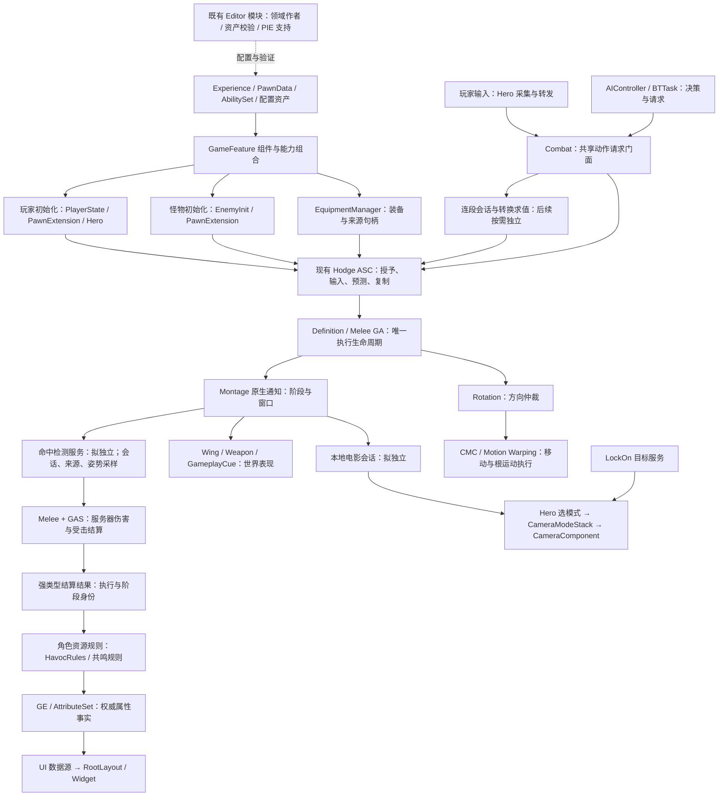

# Hodgepodge 架构与可维护性审查及分阶段重构方案

日期：2026-10-15；同日全面复审。性质：基于当前工作区的源码审查与待实施方案。本次只更新文档，没有实施业务重构、修改资产或重新执行运行验证。

> 后续实施更新（2026-10-15）：R9 配置来源／自毁链路与 R5 分阶段受检授予已实现，Editor/Game 构建、143 项原生测试、单人与双人 Listen PIE 回归通过。详见 [实现与验证记录](../Validation/game-data-grant-contracts-2026-10-15.md)。下文问题证据保留原审查基线；其他重构阶段仍待实施，阶段 0 的完整行为和性能基线尚未建立。

> 后续实施更新（2026-10-16）：R1 独立检测服务与 R3 可选角色规则已实施，正式 13 个收益 Definition 已迁移。Editor/Game 构建、149 项原生、30 项资产、17 项单人核心以及单人／Listen 客户端／PIE Dedicated 各 6 项命中收益回归通过；12 个相关蓝图编译无错误。[实现与验证边界](../Validation/combat-detection-role-rules-2026-10-16.md)。旧字段／门面仅留兼容；Client 普攻窗口疑似异常按用户要求记录并暂缓，其他阶段没有实施。

阅读入口：目标与范围见 §1；R1～R9 的证据见 §4；责任与生命周期见 §5；实施顺序见 §7；逐领域必要性、影响、风险和验收见 §11；性能与维护收益的判定见 §12。§10 分别记录首轮审查和本次复审，历史资产查询及测试记录不算本轮重新执行。

## 1. 总体判断与边界

当前项目需要渐进式整理，但不需要推翻 Lyra 路线或重建 GAS。主要问题是：公共战斗执行逐渐吸收角色专属规则，Combat、Hero 和编辑器工具承担了过多职责，不同能力授予入口的成功语义也没有完全收敛。新增功能往往需要同时改输入、ASC、GA、Combat、资源和 UI，变更范围不断扩大。

最值得优先处理的是 GameData 配置事实来源、授予契约一致性、公共层与角色规则解耦，以及命中检测从 Combat 中独立。不是按文件长短拆文件，也不是把所有逻辑改成组件、接口或消息总线。

本方案遵守以下约束：

- 维持 `Hodgepodge` 单一业务 Runtime 模块和已有 `HodgeAbilityEditor` 工具模块；下文“模块”主要指职责边界，不指新增 UBT 模块。
- 一个项目自有类的非内联实现保留在一个主 `.cpp`。拆分必须形成独立职责类，禁止重新引入 `_Combo.cpp`、`_Montage.cpp` 或 include `.cpp`。
- 保留 Experience、PawnData、GameFeature、Init State、PlayerState 所有的玩家 ASC、Pawn 所有的怪物 ASC。
- 保留玩家与 AI 的共享战斗请求入口、Montage 原生通知、CameraModeStack、旋转仲裁和 Motion Warping。
- 不引入 CommonGame／CommonUser；不重构第三方 ALS、RiderLink；不批量重命名已有蓝图、属性、Tag 和资产。
- 保留用户全部未提交修改。本次不提交、不删除、不迁移业务代码或资产。

本轮不把 Guardian 行走问题、攻击吸附、美术表现等历史需求重新纳入重构。也不因本报告而启动库存、Encounter 或新的能力框架。

### 1.1 可验收的目标

- 配置只有一个可追踪的来源；全局 GameData 返回配置资产，必要依赖失败有诊断，不用新建空对象伪装可用。
- 授予成功对应已完成的校验与提交；PlayerState 基础授予、怪物初始化、装备和 GameFeature 各自拥有资源账本，阶段差异明确。
- 公共攻击执行不再直接结算 Havoc 等角色专属规则；增加另一个角色时，优先新增其规则和配置，而不是修改通用命中流程。
- Combat 的请求与连段、检测会话、角色规则具有可独立验证的边界；保持现有请求身份、伤害去重和服务器权威。
- 输入、镜头、武器、翼和 UI 的生命周期能独立结束；死亡、取消、换 Pawn 后不残留占用，也不被旧回调恢复。
- 作者工具按职责演进，生产资产受保护；Runtime 构建不依赖作者工具的编辑器实现。
- 行为、性能、资产兼容性可与基线比较。以调用链、资源归属和回归结果验收，不以文件变短、类变多或无依据的完成百分比验收。

### 1.2 范围分级

**本轮计划的必要工作：** R9 的正确性修复；R5 的授予盘点与分阶段契约；R7 的作者职责边界；R1 的检测会话独立；R3 的角色规则隔离；R2 的电影与角色输入会话；相关日志、失效文档和回归基线。

**有明确前置条件的后续工作：** R6 的初始化依赖收敛；R4 的协议辅助提纯；Combo 会话是否独立；UI 角色资源适配；头文件与依赖缩减；实测发现的空闲 Tick 优化；实验类迁移或归档。它们进入核查范围，不代表全部要立即改写。

**以保留和回归保护为主：** 现有几何算法、属性重建协调器、旋转仲裁、CMC／Motion Warping、Defense／HitReaction、LockOn、武器／翼表现、CameraModeStack、UI 根布局与共享数据源。只有本次职责迁移实际触及的接缝才调整，不另起一轮全面重写。

## 2. 审查方法与事实范围

### 2.1 已核查内容

读取项目约定、`.uproject`、Build.cs、Config，统计整个 `Source` 的 `.h/.cpp/.cs`；重点追踪 Combat、Hero、ASC、Definition/Melee GA、EnemyInit、Equipment、GameFeature 授予、Camera、旋转、编辑器工具及相关测试。对本机 Lyra 的对应输入、能力、初始化、装备、相机和 GameFeature 调用链进行对照。

首轮审查另通过当时运行的编辑器执行 AssetRegistry 只读查询，核对正式动画蓝图父类、部分实验蓝图父类和实验地图引用；当时没有编译、保存或改写资产，查询后脏地图和脏内容包均为空。本次全面复审未重新执行该资产查询，不能据此推定当前资产字段或脏包状态。

没有逐个审查全部 Blueprint 图、全部软引用、Cook 收集结果或所有插件实现；没有采集 Unreal Insights、网络带宽、内存和帧耗时。因此下文区分“源码已确认的结构问题”和“需要后续资产／性能验证的候选项”。

### 2.2 首轮规模快照

`Source` 中 Hodgepodge 当前有 426 个上述类型文件，共 74,616 行；剔除空行和注释后的词法近似值为 42,784 行。Lyra 对应 `Source` 为 478 个文件、51,061 行、近似 35,915 行。

该比较**不能证明 Hodgepodge 比整个 Lyra 更大或更复杂**：Lyra 的 GameFeature 插件代码不在这组统计内，两者玩法范围不同，中文注释也明显影响总行数。近似值不是圈复杂度或覆盖率，仅用于筛选审查对象。

Hodge 当前 Runtime 生产代码 380 个文件、近似 34,645 行；Runtime 测试 36 个文件、近似 4,604 行；Editor 8 个文件、近似 3,513 行；另有两个 Target 文件。测试源码检出 132 个 `IMPLEMENT_SIMPLE_AUTOMATION_TEST` 注册位置，**不代表本轮执行或通过 132 项测试**。

重点文件的总行数／近似有效行数：

- `Component/HodgeCombatComponentBase.cpp`：1,525／1,270。
- `Component/HodgeHeroComponent.cpp`：1,391／890。
- `AbilitySystem/HodgeAbilitySystemComponent.cpp`：1,295／866。
- `Character/HodgeCombatCharacter.cpp`：1,140／638。
- `AbilitySystem/Abilities/HodgeGameplayAbility_Definition.cpp`：583／497。
- `AbilitySystem/Abilities/HodgeGameplayAbility_Melee.cpp`：502／422。
- Editor `HodgeAnimationAuthoringLibrary.cpp`：1,511／1,378。
- Editor `HodgeUIAuthoringLibrary.cpp`：1,654／1,371。

反例也很重要：Hodge `SActorCanvas.cpp` 约 600 行有效内容，Lyra 对应约 559 行；Hodge PlayerController 约 436 行，Lyra 对应约 484 行。不能仅因它们总行数较高就要求拆分。当前没有统一的“超过 N 行必须拆”标准。

统计工具及原始结果位于 `Saved/ArchitectureAudit/metrics.py`、`source-metrics.json`，均为本地审计产物，不作为业务源码提交。

### 2.3 对补充审查报告的纠偏

以下是本次读取源码得到的结论，不把外部报告的描述直接当作项目事实：

- GameData 新建空实例及无 GC 强持有的问题成立，补为 R9；动态 GE 辅助接口受影响，不等于所有 GameplayTag 机制失效。
- Rotation、LocomotionPolicy、HitReaction 均直接继承 UPawnComponent，而非 HodgeActorComponentBase；Rotation 已默认关闭并在绑定／解绑时开关 Tick，HitReaction 已有状态开关，三者 Tick 均承担实际职责。取消“给这三个组件统一补门控、关闭基类即可修复”的建议。
- PawnExtension 的权威 Avatar ensure 后继续解绑，Lyra 中存在相同结构；已判空的分支不能据此认定为空指针解引用。是否拒绝接管须先定义冲突恢复策略，暂不加入立即 return 的修复。
- HodgeGameplayAbility 的标签检查主体与 Lyra 对应覆盖逻辑一致，承担关系映射和死亡失败反馈；覆盖引擎函数本身不是删除依据。静态临时容器仅作为有重入证据时的专项候选。
- “绑定当前”“初始化完成”“允许行动”的条件不同，不统一替换成带死亡检查的万能 Ready 查询。
- 当前 Get-Content 总行数为 HodgeGameplayAbility 839、LyraGameplayAbility 545，Editor 两个作者库为 1,511／1,654。原报告中的 698／447、1,512／1,650 不作为本方案数据。
- Source 中 [HODGE-DBG] 为 64 个匹配行、5 个文件，含注释；不是 66 条运行日志。PlayerController 的力反馈 static 是命名空间内控制台变量存储，不是函数级临时状态。Combat 的 Havoc／EnemyInit include 位于 cpp，不能误报为公共头直接包含。
- 根 CODE_REVIEW.md 中 Timeline 入口和部分检查契约确已过时，应按当前原生通知与执行协议改写；零 C++ 引用及空目录不作为删除反射类或资产的依据。
- Config/DefaultGame.ini 的 CopyrightNotice 含报告提到的文字，多个文件头与该字段内容一致。调整项目版权说明与清理无效注释分开判断，不从这句文字推导文件质量，也不自动批量改版权或第三方声明。
- 本文没有按全部验收项计算实施完成率。“尚未实施本方案”是状态描述，不用工作区没有源码修改推导仓库从未进行过重构。

## 3. Lyra 基准与当前差距

以下 Lyra 路径均相对 `E:/Project/UProject/study/Epic/LyraStarterGame`，Hodge 路径相对本项目。

### 3.1 模块与配置组合

Lyra 的 `Source` 保持 LyraGame／LyraEditor 分工，同时在 `Plugins/GameFeatures` 中用 ShooterCore、ShooterMaps、TopDownArena、ShooterTests 等按玩法组织可选内容。不是“每一个组件都是一个模块”。

Hodge 已有 Runtime／Editor 分工，但一部分实验作者工具仍在 Runtime，多个领域作者工具又集中进少数超大 Editor 类。应先修职责边界。只有未来真正存在独立装卸、资产归属和团队发布需求时，才另行评估 GameFeature 插件；本轮不引入额外模块。

### 3.2 输入与能力

Lyra `Source/LyraGame/Character/LyraHeroComponent.cpp:343` 的输入按下／松开基本转发到 ASC；`DetermineCameraMode` 和 `SetAbilityCameraMode` 保留简单模式选择及 Spec 所有权。`AbilitySystem/LyraAbilitySystemComponent.cpp:279`、`:321` 负责输入队列和激活策略。

Hodge 继续使用这条主链是正确的，但 Hero 已加入 Dash/Sprint 输入会话、暗流长按资格判断和电影镜头会话；ASC 又直接接入连段授权、Definition 变体、预测校正和蒙太奇同步。ACT 比 Lyra 射击示例需要更多逻辑，不能直接还原为 Lyra 的简版；应将这些逻辑限定在清晰的扩展边界。

### 3.3 初始化与能力授予

Lyra `Character/LyraPawnExtensionComponent.cpp:213` 使用 Init State 链协调，`:280` 监听其他 Feature 状态，ASC 注册回调采用注册后立即补偿查询。`Equipment/LyraEquipmentManagerComponent.cpp:68`、`:109` 配对保存／撤销授予句柄。

Hodge 的 EnemyInit、受检 AbilitySet 和装备提交路径已经补上普通怪物与失败确认需求。它们是应该保留的项目适配，不应倒退为 Lyra 原始宽松授予。差距在于 GameFeature 入口尚未统一使用这些结果，以及公共 Combat 和 Character 仍具体识别 EnemyInit 与玩家初始化细节。

### 3.4 目标数据与网络

Lyra `Weapons/LyraGameplayAbility_RangedWeapon.cpp:446` 注册 TargetData 回调，`:477` 处理数据，EndAbility 配对解绑和消费。适合复用其 Spec／PredictionKey 归属、预测作用域和生命周期。

但该文件中 `bIsTargetDataValid = true` 是示例中的实际代码，不能当作本项目安全校验已经完成；连续近战、连段记忆、取消回滚、旧动作通知隔离也不是这段射击代码已经解决的完整问题。Hodge 必须保留自己的 Avatar、ExecutionId、MontageInstanceId 等验证。

### 3.5 相机与 UI

Lyra `Camera/LyraCameraComponent.cpp::GetCameraView` 通过模式栈统一求值；Hero 请求临时模式。Hodge 软锁和电影镜头继续接入现有栈，方向正确。

Lyra `UI/Subsystem/LyraUIManagerSubsystem` 继承 CommonGame 的 `UGameUIManagerSubsystem`，依赖 CommonLocalPlayer、GameUIPolicy、PrimaryGameLayout。Hodge 当前没有这套依赖，不能只复制该子类；现有 UIManager、RootLayout 和数据源应继续复用，不以“对齐 Lyra”为由再引入第二套 UI 框架。

### 3.6 全局数据与 Pawn 前基础授予

Lyra `System/LyraGameData.cpp::Get` 返回 AssetManager.GetGameData；AssetManager 负责按配置加载并通过 GameDataMap 持有。Hodge 已有同职责加载与 UPROPERTY 缓存，缺口在 HodgeGameData.Get 绕过了它，不需要新建全局数据子系统。

Lyra `Player/LyraPlayerState.cpp::PostInitializeComponents` 以 PlayerState 为 Owner、GetPawn() 为 Avatar 初始化 ActorInfo，再注册 Experience 回调；SetPawnData 授予基础 AbilitySet。Hodge 沿用此时序，GetPawn() 此时允许为空。Hodge 的原生测试 Hodge.Resonance.PlayerStateBeforePawn 也明确断言 Avatar 为空时可以初始化持久资源。

因此现有 TryGiveToAbilitySystem 不能无条件替换所有旧调用：GrantInternal 的受检模式要求有效 Avatar，bForInitialization 还拒绝 OnSpawn 能力；而 HodgeHavocRules 本身使用 OnSpawn，ASC 在新 Pawn 绑定时会再尝试激活。需要在同一授予执行循环内表达不同生命周期的前置条件，保留 Avatar 到达后的激活时机，不把怪物启动限制直接套给玩家持久能力。Lyra 原始宽松流程也不能作为 Hodge 受检提交、失败传播或跨来源冲突管理的完整答案。

## 4. 具体问题、证据与处理建议

### R1：Combat 同时承担调度、连段、检测、网络补偿与角色模式，P1

**已确认。** `Source/Hodgepodge/Private/Component/HodgeCombatComponentBase.cpp`：

- `AcquirePoseLease`（70）、`ResolveSource`（110）、`CreateDetectionSession`（222）、`SampleDetection`（352）管理姿势更新占用、检测来源、检测会话和几何采样。
- `InputPressed`（555）、转换选择、输入缓存和连段记忆负责图执行。
- `ServerMoveCancel`、`ServerReturnToEntry`（1189）处理预测取消和服务器补偿。
- `RequestStandaloneAbility`（1364）及动作请求账本服务玩家和 AI。
- `Configure`（476）直接注册 `HodgeHavocTags::DarkSurge`；初始化回调和行动就绪查询又直接依赖 EnemyInit、HeroCharacter 与 PlayerState。

这些责任共享一个状态空间和销毁流程，新增翅膀采样、角色形态或 AI 就绪条件都会扩大同一类的修改范围。这是当前最明显的维护热点。

**推荐拆法：** 第一刀仅独立命中检测职责，拟新增 `UHodgeHitDetectionComponent`，迁移检测来源、会话、几何历史和姿势占用。现有 `Combat` 方法保留为代理，通知、GA 和蓝图调用入口先不变。初版新组件不自行复制、不新增战斗 RPC，不另建伤害或去重系统。

保持现有 `FHodgeHitDetectionBatch`、执行身份、HitGroup＋AttackPhase 去重语义。将姿势占用迁移给检测服务时，GA 仍通过旧代理申请，最终只有一个网格更新策略账本。不能让新旧两个组件分别恢复 `VisibilityBasedAnimTickOption`。

第二刀再评估把连段求值与记忆提成独立非复制会话对象；Combat 保留共享请求门面和原网络入口。没有稳定边界前，不把它一口气拆成六七个互相依赖的 Manager。

**验收：** GA／通知不再直接操作检测内部容器；静态／Follow／武器／骨骼／WingMesh 的判定等价；同刀去重、专服骨骼更新、取消清理不变；同一实例只运行一种检测实现。

### R2：公共 Hero 累积角色技能和电影会话，P1

**已确认。** `HodgeHeroComponent.cpp:791` 输入分支区分锁定、Dash 和普攻长按；`:1217` 刷新电影镜头；`:1276` 起维护 Sprint 会话；`:1357`～`:1391` 直接查询 HavocRules、HavocSet、暗涌状态并提交灭音。

其中暗流长按、暗涌清理等近期功能进入公共链路，属于这轮迭代新增的耦合。它能实现当前角色，不适合作为所有角色继续扩展的最终边界。

**推荐拆法：** Hero 保留 Init State、输入绑定、原始移动／视角意图及既有公开转发接口。优先把电影镜头占用、源 Montage 匹配、重入保护和恢复状态提成独立本地会话对象，仍由 Hero 选择 CameraMode。随后将 Havoc 的按住资格与提交放回现有角色规则能力或其独立输入会话中。

不要为了共用“长按”而强行合并 Circuit 和 Dash/Sprint：它们的提交、空中继续、落地衔接、松开和消费条件不同。能复用时间与身份数据时复用，策略保持独立。AbilityTask 的输入释放可复用 GAS 机制，但不能直接替代全部逻辑：普通攻击按下即出招，长按识别仍需跨该动作持续，后摇阻塞期间也要保留原始意图。

**验收：** Hero 不再 include HavocSet/HavocRules；按下普攻立即响应、松开不补发第二刀、UI 阻塞／死亡／换 Pawn 清理正常；短按 Dash 完整播放、空中继续、窗口内落地接 Sprint 不回归。镜头多次释放、取消和旧回调不清理新会话。

### R3：公共 Melee 与 Definition 含角色专属收益规则，P1

**已确认。** `HodgeGameplayAbility_Melee.cpp:415`～`:439` 在生命伤害结算中直接处理 ResonanceSet、HavocRules、DarkSurge 和强化普攻收益；`:495` 处理 Havoc CastCommitted。`Data/HodgeAbilityDefinition.h` 同时包含通用蒙太奇／判定、`DarkFlowGainPerPhase`、`DarkFlowGainOnCast`、`bEnhancedNormalAttack` 及共鸣能量配置。

问题是公共攻击层需要了解具体角色资源和被动。不是说属性、GE、GA 或数据驱动本身冗余；暗流燃料与大招能量的语义确实不同，不能统一成一个只剩 Current／Max 的资源系统。

**推荐拆法：** Melee 只负责命中资格、服务器伤害提交、受击事务和实际生命伤害确认，再发布带执行身份的强类型结算结果。现有 `HavocRules` 订阅并处理角色资源、入态和拢音；共鸣能量由独立资源规则处理，优先小对象或现有生命周期宿主，不立即建设通用资源平台。

字段迁移后，通用 Definition 引用可选的规则配置。旧字段先作读取适配，迁移全部正式资产并校验后再停用；新旧两条规则不得同时结算。普通 NPC 没有玩家资源 Set 时，不创建 Set，不授予玩家被动。

有效伤害确认必须保留现有 SettlementId 关联，不用简单的“命中事件”代替，否则免疫、零伤害、死亡、嵌套伤害及 GE 回调重入会改变回能。阶段账本归属唯一，阶段回能与角色级每秒一次拢音限流分别保存。

**验收：** 通用 Melee／Combat 不直接依赖 Havoc 类型或暗涌具体标签；每有效阶段一次回能、空挥施放回能、共享 E 冷却、燃料归零退出、死亡清空和 R 不变均保持当前规格。

### R4：ASC 与 Definition 执行协议耦合，P2，高风险后置

**已确认。** ASC `AbilityInputTagPressed`（317）先处理变体和 Combat 连段，再进入 Lyra 输入队列；`ProcessDeferredComboRequest`（959）等待服务器真实窗口；`OnRep_ReplicatedAnimMontage`（1172）适配表现；`RetireAttackFacingData`（1264）处理迟到数据。Definition GA 同时管理转向 TargetData、Montage 身份、预测移动取消、通知资源、翼／武器／镜头清理，`EndAbility`（358）横跨多个模块。

这里有大量**必要复杂度**。把自定义蒙太奇复制全部删掉、把连段改成普通事件广播、或者只用 SpecHandle 替换 ExecutionId，都可能重新引入客户端延迟、旧通知清理新动作和移动取消回滚问题。

**推荐拆法：** ASC 保留 GAS 适配、原 RPC／复制字段和输入处理；先提取不改变传输格式的纯身份验证、授权决策辅助，再考虑由 AbilityTask 封装攻击转向数据等待和配对解绑。Definition 保留统一执行生命周期，通过域专用句柄请求／释放资源。每次只搬一个协议单元。

先列明现有身份关系，而非新增第二套协议：Avatar → Spec／PredictionKey → ExecutionId → MontageInstanceId／OccurrenceId。它们各自解决不同生命周期，不能简单合并为一个 GUID。结构化视图可以引用既有值，不等于这些字段全部新增网络复制。

**验收：** 一致的激活／结束／拒绝路径，TargetData 提前到达和迟到被处理；100～150ms 延迟及少量丢包场景下无重复授权、重复扣资源、窗口绕过或卡住；拥有者／模拟代理蒙太奇和取消行为保持正确。未取得对照证据前不删除旧复制适配。

### R5：能力授予存在宽松／受检两套调用语义，P0/P1

**已确认。** `Data/HodgeAbilitySet.cpp:263` 的旧 `GiveToAbilitySystem` 复用 `GrantInternal(..., false)`，`:271` 的 `TryGiveToAbilitySystem` 则预校验、返回结果并管理 Pending 句柄。EnemyInit 与 Equipment 已用受检入口。

但 `GameFeatures/GameFeatureAction_AddAbilities.cpp:311` 按 Actor 去重，`:392` 通过 `SetPtr.Get()` 读取软引用，`:396` 仍调用旧入口，最后记录 Actor 已扩展。当前公开配置允许多条 AbilitiesList 命中同一 Actor，却没有按 EntryIndex 区分结果。

必须准确区分两点：

- `GrantedAbilitySets` 已声明 `AssetBundles="Client,Server"`，Experience 也有 Bundle 加载链。**不能把 `Get()` 本身定性为必现漏授予**；它依赖预加载契约。需要测试冷加载、直接激活、资源缺失／取消是否都满足该契约。
- 同一 Action 的重叠条目共用 Actor 级记录，以及提交时不检查受检结果，是源码可以确认的接口风险。是否影响当前正式玩法，还需核对实际 Action 配置。

**推荐改法：** 保留唯一 `GrantInternal`，统一需要可靠成功语义的调用者使用受检接口。GameFeature 按 `(Actor, EntryIndex)` 记录，或聚合全部匹配项后一次提交；撤销精确对应来源。必要资源未驻留时，明确等待／失败，不能提交完成记录；不在每次授予时无条件同步加载掩盖预加载缺口。

所有权仍分别属于 EnemyInit、EquipmentManager、GameFeature。Instant GE 和 OnSpawn 副作用不能假装通用可回滚；继续使用 `bHasIrreversibleEffects` 的失败停止语义。旧 void 接口在调用者和反射／资产引用迁移完成后才能移除，不另复制一套授予循环。

**复审补充：** PlayerState.SetPawnData 也是旧入口生产调用者，传入 nullptr 而不保存基础授予句柄，并在循环结束后发送 NAME_HodgeAbilityReady。这表示当前事件没有表达逐项授予的受检成功；不是已经证明正式资产漏授予。迁移须覆盖 Pawn 前 Owner-only 阶段和 Pawn 已绑定阶段，明确基础授予的 PlayerState 生命周期，不能把它改成每次 Pawn 绑定重授。先校验整批配置、记录真实提交与失败，再发布相应就绪事实；基础句柄不由 Equipment／GameFeature 撤销，Actor 销毁时的清理也不等于支持 Experience 热切换。详见 §3.6、§11.2。

**优先级：** 若正式 Experience 依赖这些扩展能力，属于阻塞重构的 P0；若不依赖，完成配置盘点后按 P1 收敛，不因此重建全部 Experience 热切换。

**验收：** 同 Actor 两条配置均授予一次；失败不标成功、不重复副作用；停用只撤销本来源；冷加载／迟注册／重复通知／卸装／换 Pawn 均有测试。

### R6：初始化协调出现双向具体依赖，P1

**已确认。** Combat 在 ASC 初始化和 OnRegister 中直接调用 EnemyInit.TryInitialize（1255、1269），行动就绪又识别 EnemyInit 与玩家 PlayerState（1292）。EnemyInit 的 `HasValidCombatDependencies` 反向读取 Combat.CanExecuteAbilities。CombatCharacter `TryInitializeAttributesAndEquipment`（1104）显式 Cast Enemy 后转交 EnemyInit。

这是职责耦合，**本轮没有证明它造成无限递归或重复授予**：EnemyInit 已有防重入、有限追加检查、分阶段提交以及失败终止；当前装备也已经具备 Pending 提交和失败清理。不能再把早期“怪物被 PlayerState 分支直接跳过”当作现存结论。

**推荐改法：** EnemyInit 保留唯一怪物初始化协调权；Combat 发布自身依赖就绪／失效，EnemyInit 用事件加立即查询推进。公共行动入口查询统一的行动资格契约，由既有玩家初始化和 EnemyInit 提供各自适配；仅在两种实现确实需要时引入窄接口，不加万能 ReadyManager。

回调多次触发可能是正确的晚注册补偿，不能作为“重复代码”直接删。Init State 不倒退；运行时技能移除、死亡、受击继续由当前依赖与 Tags 拒绝请求。

**验收：** 延迟 Experience、晚注册、徒手／装备怪、ASC 冲突、缺 StatProfile、重 Possess、初始化中销毁都不误报 Ready；重复通知不恢复生命／重复装备；每次 Possess 只成功启动一次 BT。

### R7：编辑器工具按迭代需求堆积，P1，运行时扰动较小但须保护资产

**已确认。** `HodgeAnimationAuthoringLibrary` 除动画还制作敌人行为树（1315）、导航边界（1442）和 Experience 组件（1463）；同时负责翅膀、Dash/Pivot、受击、Warp、Havoc 和解放资产。`HodgeUIAuthoringLibrary` 同时处理 Widget 图生成、迁移、布局、资产检查以及 PIE 行为队列；`FDesignerGraph` 从 544 行起混在角色 UI 制作代码中。

**推荐拆法：** 在已有 Editor 模块中按独立类分成动画作者、AI 作者、UI 作者和 PIE 验证支持；共享最小图节点连接工具，领域逻辑各自保留。旧反射函数先转发，迁移 Tools 调用再退役。分两批实施，不先移动全部文件或更名公开类。

`/Game/Main/...` 路径校验一部分是防止误改资产的安全范围，不能机械删除。通用作者接口接收目标资产与显式参数；一次性迁移脚本保留范围保护、只读预检、变更清单及可重复执行条件。禁止作者操作在无确认的测试中重建正式 WidgetTree。

**验收：** 工具只修改传入／白名单内资产；有预检和结果报告；重复运行不重复通知、不删除手工布局；无 PIE 时资产作者可运行；Runtime Game 构建不需要 Editor 作者实现。

### R8：实验代码、生产依赖及注释债务，P2

**已确认的候选，不等于可直接删除。** Runtime `CodexText` 内含 Survivor、LocomotionLab 和 Grounded 作者工具；`HodgeGroundedAuthoring.cpp` 已通过 `WITH_EDITOR` 保护，不是无条件 Runtime 依赖 Editor 的证据。当前 Build.cs 的 UnrealEd／AnimGraph 等也受 `Target.bBuildEditor` 保护。

首轮只读资产查询确认以下事实（本次全面复审未重新查询）：

- 正式 `/Game/Main/Character/Hero/Anim/ABP_Pover_Base` 父类是 `HodgeAnimInstance`；正式移动层父类是 Engine.AnimInstance。
- `/Game/CodexText/AnimInstance/ALS/ABP_ALS_Lab` 和备份仍继承 `HodgeALSLocomotion`，`ABP_ALS_Grounded` 仍继承 `HodgeGroundedLocomotion`。
- `DefaultEngine.ini:5` 的 EditorStartupMap 是 `/Game/CodexText/L_MainMenu`。
- 抽查的三张实验地图在 AssetRegistry 中没有包引用者，但代码 `OpenLevel`、配置和动态路径不一定被该查询覆盖，所以“零引用者”不等于可删除。

先将作者职责移入 Editor，并建立实验入口／打包范围清单；决定保留还是归档实验场景后，才移除确认不再需要的 Runtime 类。跨模块迁移 UCLASS 会改变 Script 路径，必须核对蓝图父类、Python 反射入口和 CoreRedirects，不能仅剪切 `.cpp`。

注释和小型冗余可单独整理：Hero 有明确标注“定位后删除”的大量 `[HODGE-DBG]` Warning；`ServerReturnToEntry` 相邻两次检查重复条件；Equipment.PostReplicatedChange 仍保留旧注释代码块；Experience 文件头声称不处理停用，而下方 EndPlay 实际包含插件停用及 Action 卸载。

建议删除已确认失效的注释代码，临时诊断转领域日志／Verbose 或显式调试开关，同步修正过时 TODO。保留版权、关键生命周期原因和必要中文注释；修复“准备serveKnee方向”“本次得到的T”等无意义模板注释，不再逐行翻译普通语句。Experience 的 EndPlay 清理不等于已经支持任意运行时热切换，两者应分别描述。

不因没有 C++ 调用者而删除 UFUNCTION／UPROPERTY。当前公开依赖也不能一律改 Private：先检查 Public 头暴露类型和模板，再逐项缩小依赖，最后验证 Editor 与 Game。

### R9：GameData Getter 绕过配置资产并缺少 GC 持有，P1，先行正确性修复

**源码已确认。** Data/HodgeGameData.cpp::Get 使用 static 裸指针和 NewObject 创建原生 UHodgeGameData，构造函数未填三个 GE 软引用。它没有读取 DefaultGame.ini 中的 /Game/Main/Data/DA_Dafult_GameData.DA_Dafult_GameData，也没有通过 UPROPERTY、强指针或 Root 持有该新对象。

现有 AssetManager.GetGameData 已按配置加载，并通过 UPROPERTY(Transient) GameDataMap 持有资产；Lyra 对应 Getter 正是转交该入口。建议恢复这一事实来源，保留当前资产路径和拼写，不新增单例，不用 AddToRoot 延长错误空对象的寿命。

**影响：** HealthComponent.DamageSelfDestruct 取不到配置的伤害 GE 时提前返回；CombatCharacter.FellOutOfWorld 仅调用该流程。ASC 的 Add／RemoveDynamicTagGameplayEffect 同样无法取得配置 GE。本次文本检索未找到这两个辅助方法的其他 C++ 调用者，不能扩大成所有动态标签失效。裸指针还存在对象被 GC 回收后的悬垂访问风险，实际崩溃尚未复现。

**修复风险：** 恢复 Getter 会暴露真实资产缺项、错误 Effect 类和加载时机问题；代码修改小，不代表功能验收只需改一行。正式资产中三个字段的当前值未在本轮读取，未执行自毁或标签运行测试。配置错误应明确报错，不回退到空对象。

**验收：** Getter 与 AssetManager 指向同一配置资产，GC 后仍有效；已正确配置的自毁 GE 能进入服务器死亡链；动态 GE 辅助方法能成对增加／移除指定 Tag；缺失配置有定位明确的诊断。执行 Editor／Game 常规构建、相关原生回归与实际 PIE。若本次运行基线证实它阻断正式测试流程，先修复再继续对应结构迁移；P1 是缺陷优先级，不把尚未验证的全部影响一律标成发布级 P0。

## 5. 目标架构与接口边界

### 5.1 目标关系图

图中“拟独立”是待实施职责。现有组件和协议继续工作；箭头表示请求或依赖方向，事件结果单独回传。



授予句柄和初始化责任仍按来源分配。图中的玩家初始化和怪物初始化是生命周期差异，不代表两套技能执行流程。服务器伤害不依赖本地相机或 UI，专服命中可以依赖不可见骨骼采样，但不能依赖客户端表现完成。

### 5.2 需要固定的接口契约

以下均为建议边界，不是声称项目已经存在同名接口。优先复用现有类型和句柄。

**动作请求：** 输入为 AbilityTag／ComboIntent 与当前请求身份；输出为既有 `FHodgeCombatActionRequestState` 及终结通知。玩家输入和 AI 决策保持同一执行门面；AI 不模拟 EnhancedInput、不伪造客户端预测。

**检测服务：** 输入为 ExecutionId、OccurrenceId、现有检测配置及来源；返回检测句柄和 `FHodgeHitDetectionBatch`。Begin／Sample／End 验证执行身份；结束动作统一释放其检测及姿势占用。现有 Combat 公共函数代理至新服务，调用者逐批迁移。

**结算结果：** 拟新增强类型结果，包含 SourceASC／Avatar、Spec／ExecutionId、HitGroup／AttackPhase、SettlementId、服务器实际接受的生命伤害。同步／作用域内分发时不保留栈上 EffectSpec 指针；若需延迟，保存拥有明确生命周期的值或句柄，并重新验证 Avatar 和执行。形态规则自行判断是否有资格处理。

**就绪与行动：** 初始化 Ready、当前依赖有效、当前可行动分别查询。依赖变化事件只提示重新查询，不替代持久状态；注册后立即补偿查询。提供方失效时失败关闭，禁止回落到无条件可行动。

**表现占用：** 相机、方向、武器和翅膀继续使用各自现有句柄；以 ExecutionId 和源对象绑定，释放幂等。各域可形成小型作用域包装，但不建设一个把所有资源塞入 `UObject*` 数组的万能清理器。

**授予结果：** 使用现有 `FHodgeAbilityGrantResult`、已授予句柄和不可逆副作用标记。成功必须是验证后已提交；等待、非法配置、失败及失效分别诊断。

### 5.3 推荐模式及限制

- **门面＋适配器：** 保留 Combat／Hero／ASC 现有公开入口，内部逐步转发，减少蓝图和网络改动。
- **组合／策略：** 角色特有资源与输入条件由已有规则能力和可选数据承担；出现第二种实现需求时才提升成公共接口。
- **有限状态会话：** 复用既有动作、输入和电影会话，明确所有者与结束条件；不另外创建全局玩法状态机。
- **来源账本与分步提交：** AbilitySet、装备和 GameFeature 各管句柄，失败保留真实结果；不可逆效果禁止伪回滚。
- **强类型事件＋事件驱动初始化：** 窄范围通知与立即查询，按生命周期解绑。避免无差别全局消息总线隐藏调用关系。

目录先不搬迁。独立类放入当前匹配的 Public／Private 分类，语义边界稳定后再考虑少量目录调整，避免大量 include 改名掩盖功能差异。

### 5.4 状态、资源和生命周期归属

以下是迁移必须保持或补齐的归属约束，不表示拟议的新类已经实现：

- AssetManager 持有配置 GameData；GameData 是共享配置，不保存每个 Pawn 的可变战斗状态。
- PlayerState 持有玩家 ASC、持久属性集、成长和基础授予。AttributeCoordinator 协调当前 Avatar 的属性重建及 LifeGeneration；换 Pawn 不重新创建资源集，也不因为重复就绪通知补满生命或能量。
- PawnExtension 负责当前 Pawn 与既有 ASC 的绑定／解绑通知；玩家 Owner 仍是 PlayerState，怪物 Owner 仍是自身 Pawn。旧 Pawn 只能清理自己的占用，不能清除已接管 ASC 的新 Avatar。
- EnemyInit 拥有怪物基础属性、基础授予和默认装备准备的协调权；AIController 拥有 Possess 周期与行为树启停，BTTask 拥有本次动作请求和朝向占用。Combat 不接管第二份怪物初始化流程。
- EquipmentManager 拥有每件装备的属性效果、能力句柄、实例与表现 Actor；GameFeature 按上下文／条目拥有自己的扩展资源；PlayerState 基础授予不混进两者的撤销账本。
- Combat 拥有对外动作请求及连段调度，GA 拥有一次激活／执行生命周期。请求结束与 GA 结束的映射继续明确，不能只以 Montage 播完推断成功。
- 拟独立检测服务持有当前 Pawn 的来源、Session、历史几何和姿势占用；角色主 Mesh 的更新策略只有一个账本。武器、翼和 GA 经代理请求这份占用，不能分别恢复同一个网格设置。
- 角色规则的宿主可随 PlayerState ASC 存续，但收益资格和模式会话绑定当前 Avatar／Execution；重绑定时解绑旧观察者并重置相应的 Pawn 会话，不把旧死亡回调作用到新角色。
- Rotation、LockOn、Defense、HitReaction、武器和翼各自保留现有的状态来源与句柄。它们通过当前执行身份配对释放，不再复制一份伤害、方向或死亡事实。
- 电影会话和 UI 属于本地玩家的表现生命周期。Hero 选择 CameraMode，CameraComponent 求值并应用最终视图；UI 数据源观察 ASC／Pawn，不能成为权威资源的写入者。
- 若采用 UObject 会话，宿主需以反射强引用或其他明确强持有保证 GC 生命周期；异步来源用弱引用并校验身份。Outer 关系本身不作为保活证明；纯值会话无须包装成可 Tick UObject。

配置资产与持久化存档分开：本轮只维持现有成长／重绑定状态，不新增 SaveGame 格式、跨关卡恢复或无缝旅行承诺。事件表达通知，当前状态由原持有者重新查询；事件不替代属性复制，也不替代 GAS／RPC 的权限校验。

## 6. 可以移除、需要迁移与必须保留的内容

### 可优先整理的源码冗余

- `ServerReturnToEntry` 中紧邻重复的校验，保留第一处完整权限／身份检查。
- Equipment 中已失效且不参与编译的旧注释代码块。
- 重复文件头、逐行翻译、模板化无意义注释与已经不准确的 TODO；不改变中文注释要求。
- 确认完成定位后的临时 Warning 诊断，保留领域错误和可开启的调试输出。

这些只能算小型清理，不能声称它们会显著改善运行性能。

### 迁移验证后才可移除

- GameFeature 等可靠调用者使用的旧宽松授予入口；确认调用和反射引用归零后再移除兼容层。
- 原 Melee／Combat／Hero 中的 Havoc 直接处理分支；新规则验证等价后一次切换，不双跑副作用。
- 已完成全部调用迁移的 Editor 旧作者门面；先检索 Tools 和蓝图节点。
- 确认归档、配置与动态调用均解除的实验 Runtime 类和资产；当前不能整目录删除 CodexText。

### 明确保留

- Spec、PredictionKey、ExecutionId、MontageInstanceId 和通知发生次序等必要身份。
- 服务器授权、客户端拒绝／回滚、模拟代理蒙太奇同步。
- 同刀去重、实际伤害确认、阶段回能账本和角色级限流。
- 初始化重复调用的幂等保护、注册后补偿和失败诊断。
- CameraModeStack、RotationComponent、CMC 与 Motion Warping 的分工。
- Editor-only 资产校验及 Runtime 中确有生产引用的类。

## 7. 分阶段实施计划

阶段序号表示依赖顺序，不是启动所有修改的指令。P0 在此表示必须先满足的基线／正确性阻塞条件；P1 为已确认缺陷或高收益职责调整；P2 为满足证据和前置条件后进行的收敛。不是将所有结构问题都定为发布阻断故障。当前没有用户指定截止时间。

每阶段独立可交付，上一阶段验收后才进入依赖它的阶段；发现现存行为缺陷应另记修复，不能悄悄算进“无行为改变重构”。测试环境缺失时保留明确未验证项，先完成独立的源码／文档准备，不据此虚报阶段完成。纯文档和纯注释整理不必等待全部运行基线。

### 阶段 0：冻结基线与引用清单，前置门槛

目标：建立可比较的当前行为，区分既有缺陷和重构回归。

步骤：记录当前分支／工作区差异和资产版本；盘点正式 Experience/GameFeature 的扩展授予依赖、生产地图和实验入口；列出四类生产授予调用者、是否已有 Avatar、OnSpawn／Instant GE、基础属性集重复情况；读取正式 GameData 的三个 GE 字段；复跑受影响原生测试并记录逐项结果；在正式测试地图录制单人、Listen 远端和 Dedicated PIE 的代表流程，并固定性能采样条件。保留目前未提交工作，不先批量格式化。

资源：UE 5.5.4、现有 Native Automation、Editor 校验库、PIE 测试脚本、资产引用查询、版本化测试配置。

交付：基线报告、失败清单、身份／资源归属表、正式资产集合。验收：每个后续阶段都有可复跑入口；既有失败明确登记，基线未通过或结论不清的项目不宣称回归通过。GameData 若阻断死亡场景，记录修复前证据后进入阶段 1A，不要求先让已知故障场景通过；修复后再冻结该场景的可用基线。

### 阶段 1：GameData 修复、授予契约与诊断整理，P1／按实际影响升级阻塞项

目标：恢复全局配置来源、消除授予的错误成功风险，同时降低日常阅读噪声。

步骤：1A 独立修复 R9 并验证配置资产、自毁和 GC；1B 按 §3.6 先固定 Owner-only／Avatar-bound 授予条件和基础来源账本，再迁移 PlayerState 与 GameFeature 调用者，确认 Bundle 契约、重叠条目和精确撤销；覆盖缺资源、重复能力／属性集和部分失败；1C 将明确临时诊断降级或加调试开关，修正 CODE_REVIEW 的失效入口。三个部分分别形成可审查变更，未来是否提交仍按用户授权，不自动提交。

影响：GameData、AssetManager 调用链、AbilitySet、PlayerState、GameFeature Action、EnemyInit／Equipment 的兼容性及相关初始化测试；不在这一阶段搬移战斗 RPC、重做动画通知或调整技能数值。

验收：Pawn 前资源初始化保留，Pawn 到达后 OnSpawn 激活时序正确；重复事件不重复授予，多条配置不互相覆盖，冷加载失败不报成功，不可逆副作用失败停止；GameData 取到真实资产；Editor／Game 构建和相关自动化通过。若当前玩法不依赖扩展授予，允许把该非阻塞部分与阶段 2 调整顺序，但不能跳过玩家基础授予时序评估或标成已解决。

### 阶段 2：Editor 作者与实验边界，P1；实验删除按条件决定

目标：让动画、AI、UI 的修改互不扩大工具类职责。

步骤：先拆 AI 作者和 PIE 验证支持，再提通用图工具；保留原反射转发入口；迁移少量调用验证；盘点 Runtime 作者类跨模块影响；按单类迁移，必要时加精确 Redirect。实验保留／归档决策未确定前不删除地图和父类。

验收：既有工具输出等价、无无关资产脏化、重复运行稳定；运行时 Game 构建通过；所有迁移蓝图编译通过；不将路径保护全部取消。

### 阶段 3：命中检测独立，P1

目标：把检测会话、来源解析、采样调度和姿势占用从 Combat 移出，继续复用现有 HodgeHitDetection 几何层和战斗执行协议。

步骤：新服务复用现有数据；Combat 入口转发；先迁移会话容器，再迁移采样和姿势占用；验证身体、武器、翼 Box 和固定大范围单次检测；最后迁移直接调用者，删除旧内部副本。

验收：命中目标集合、每刀次数和伤害结果对照一致；取消／死亡／换 Pawn 后无 Session 与姿势占用泄漏；Dedicated PIE 不因不可见网格停止采样；无双采样、双伤害或新增逐帧对象分配。未完成此阶段前不同时重构 Melee 结算协议。

### 阶段 4：角色规则与 Hero 会话解耦，P1

目标：增加另一种角色资源时不再修改通用近战命中流程。

步骤：明确结算结果契约；将 Havoc 规则迁入已有被动；保留旧字段读取适配并校验资产；单路径切换；再独立本地电影会话和暗流输入会话。Dash/Sprint 是否继续拆分按实际收益决定，不为了对称强拆。

验收：公共近战层没有 Havoc include／具体模式标签；暗流、E 替换、R、每阶段回能和每秒限流全部通过；普通怪物不被授予玩家资源；电影镜头只影响本地拥有者，重播、拒绝、死亡和回归锁定正常。

### 阶段 5：初始化依赖和执行协议收敛，P1／P2，分开验收

目标：去掉公共层对具体角色初始化类的识别，收窄 ASC／GA 执行辅助。

步骤：以事件＋立即查询替代 Combat 对 EnemyInit 的直接推进；保留唯一协调者；先提纯验证辅助，再按需用 AbilityTask 收拢 TargetData 等待。RPC、复制字段和旧协议先不改；每次迁移一个单元。

验收：初始化、重 Possess、失效回调、网络校正矩阵通过；无挂起请求和旧执行占用；连续连段、移动取消、受击、死亡、武器／翼淡出、软锁和 Dash/Sprint 无回归。通过当前完整场景测试后才删除适配分支。

R6 的完整结构迁移后置，不意味着前期允许不定义就绪契约；阶段 1、3 开始前须先明确接口含义，晚到依赖或具体初始化问题若已阻断验收，则提前做最小修复。阶段 5 中 R6 协调边界和 R4 协议提纯独立评审，不一次同时修改两套时序。

首轮 14～24 个工作日估算未覆盖本次深化的 PlayerState 基础授予迁移等工作，不再作为当前总工期。阶段 0 完成后，按正式资产数量、失败用例、工具保护及联机复现成本重新估算；先完成阶段 0～1，再按已验证收益逐阶段决定后续工作。阶段 2 与 3 无强技术先后依赖，作者边界优先便于后续迁移；若检测已阻断近期开发，可在基线与授予前置条件满足后调整两者顺序。

依赖主线：阶段 0 → 阶段 1A／1B → 阶段 3 → 阶段 4 的结算规则 → 阶段 5 的高风险协议提纯。电影会话可在其本地输入／相机基线稳定后独立迁移；不要与收益结算同时切换。实验删除、UI 适配和 Tick 优化按证据单独排期，不隐藏在主线拆分类中。

## 8. 风险与降低风险的办法

### 8.1 蓝图、反射和资产路径

风险：移动 UCLASS、删属性或改模块导致父类和节点失效。措施：优先保持原类名／函数／字段；入口代理；先查询包引用、Class 标签、配置、Tools 与动态路径；需要 Redirect 时逐项编译并重新打开相关资产，最后执行 Cook 引用检查。零 C++ 调用不是删除依据。

### 8.2 网络、预测和生命周期

风险：拆分后请求身份传播遗漏、旧 Timer 回调取消新动作、复制 ActorComponent 未注册或服务器入口变化。措施：首轮不迁移 RPC 与复制属性；新逻辑留在同 Owner，保存原身份；测试提前／迟到数据、拒绝、丢包、换 Pawn 和重入。取消和死亡分别验证，不误取消死亡能力。

### 8.3 命中与资源副作用

风险：新旧双跑重复伤害／回能，结果事件迟到，回滚 Instant GE 不完整。措施：影子对比只允许纯计算／只读决策；伤害、GE、扣资源和授予只有一个执行路径。切换点以实例／会话创建时固定，活动动作中不切实现；失败保留诊断，明确不可逆效果。

### 8.4 更新顺序和专服表现依赖

风险：组件拆分改变角色姿势→翅膀姿势→采样顺序，专服停止刷新骨骼；把清理放到 AnimNotifyEnd 后在取消时丢失。措施：明确 TickGroup／Prerequisite 和 PoseLease 所有者；动作 EndAbility 仍是最终兜底清理；同时验证无渲染／不可见角色，而非只测 Listen 主机。

### 8.5 性能与抽象膨胀

风险：为了“解耦”新增大量 Tick、全局广播、轮询和每帧 UObject 分配。措施：优先非复制会话对象／纯辅助，只有真实 Actor 生命周期或采样需要才用组件；事件驱动并有界重试；用 Insights 对照固定场景采样，不凭行数声称性能提升。新增组件不默认常开 Tick。

阶段 0 建立固定硬件、角色数量、网络模式及采样窗口，再约定 CPU／内存／带宽预算；建议将稳定可重复的约 5% 以上回退列为调查门槛，而非脱离噪声与场景的绝对验收值。此数值为拟议门槛，尚未实测或冻结。

### 8.6 特性开关与兼容层寿命

对命中抽取、收益规则切换等高风险项，可使用仅开发／测试可配的实现选择；默认保持旧路，按测试角色逐步切换。每个开关注明负责人、适用范围、移除条件和目标阶段，禁止长期形成两套生产事实来源。测试完成再统一默认并删除旧实现；网络两端不得临时选择不兼容协议。

不是每次提纯函数都加开关。纯作者工具拆分和无行为注释清理不需要额外运行时分支。

### 8.7 授予前置条件、同步重入与失败恢复

风险：将所有授予都要求 Avatar-ready，令玩家 Pawn 前资源初始化失败；或为了通过玩家授予而放宽怪物／装备的身份约束。措施：按调用阶段表达前置条件，复用唯一执行循环；原生测试覆盖 Pawn 前与 Pawn 后、OnSpawn、回调中换 Avatar 和销毁。预校验整批不等于执行过程中不会重入；每个产生外部副作用的边界后仍须验证当前身份。

配置、加载、授予、可行动分别报告。失败前有 Instant GE／OnSpawn 的不可逆副作用时，停止该初始化或来源，不重试到成功为止；未成功的 Pending 资源不发布进正式账本或 FastArray。恢复依据已保存句柄和权威状态，不能通过重新执行初始化补偿未知副作用。

### 8.8 文档、资产迁移与既有工作区

风险：旧 CODE_REVIEW 或配置手册引导后续实现重新引入 Timeline；一轮大量文件搬迁与用户已有变更冲突；代码切换成功而正式资产仍读旧字段。措施：每个切片列明源码、反射入口、Tools、资产和对应文档，旧字段适配有移除清单；只改本阶段必要文件，保留用户改动。运行时选择固定后，新旧字段不能各自触发收益。回退只恢复本阶段可识别的变更及配套资产版本，不对整个工作区执行 reset 或批量重存。

## 9. 验证矩阵与交付标准

### 9.1 原生单元与契约测试

复用当前 `Private/Tests` 中 EnemyAI、CombatActionRequest、MeleeRouting、HitDetection、WingBoxHit、Havoc、ResonanceEnergy、CharacterRotation、AttackWarp、DashAir、MovementAction、CinematicCamera、LockOn 和 UI 测试。新测试围绕对外契约和曾有风险，不逐行镜像实现。

重点新增：GameData 配置资产身份／GC／缺项诊断，PlayerState Pawn 前授予及 Pawn 后 OnSpawn 时序，同 Actor 重叠 GameFeature 条目、受检失败不提交、资源未驻留、依赖晚到、事件订阅／解绑、执行身份隔离、检测迁移前后结果一致、规则迁移无重复收益。覆盖失败和取消，不只覆盖正常激活。Hodge.Resonance.PlayerStateBeforePawn 已有源码，须扩展契约覆盖，不能为了受检入口而删除其 Pawn 前断言。

### 9.2 资产与集成测试

正式 Experience、PawnData、AbilitySet、Definition、Montage、AnimBP 和 Widget 编译／校验；装备怪与徒手怪；基础／强化五段、普通 E／破命共享 CD、R、灭音燃料；角色／武器／翼判定同刀去重；死亡／驱散／换 Pawn；正式 UI 使用 Layout 数据源且无重复实例。

作者工具另验重复执行、非法资产拒绝、无关资产不脏化。引用迁移后的资产必须实际重开，不能只看到源码编译成功。

### 9.3 端到端与网络

单人 PIE、双人 Listen 的远端客户端、Dedicated Server PIE 分开记录。输入与相机验证只发生在本地拥有者；服务端伤害和资源权威不依赖本地表现；模拟代理能看见正确动画／翼／武器。测试延迟／丢包、反复重生、控制器重新 Possess、取消与服务器拒绝。

Dedicated PIE 不等于独立 Server 可执行构建；当前项目没有因本报告增加 Server Target，也不把 Game 构建等同 Cook／打包通过。

### 9.4 每阶段必须提供的记录

- 需求／风险编号 R1～R9 及 §11 对应领域、测试标识、使用资产、网络角色和环境。
- 预期、实际、通过／失败／阻塞／未执行、完整命令及日志／报告位置。
- 失败根因、是否为基线缺陷、修复或回退路径；不通过则保留上阶段默认实现。
- 本阶段新增兼容层／开关及退出条件；未解决项继续列入下一阶段。

不承诺未经测量的百分比测试覆盖率。若以后需要覆盖率，先确定工具、可执行配置和生产代码分母；本轮只有测试注册统计，没有覆盖率测量。

## 10. 审查交付与实际验证记录

### 10.1 首轮审查记录

已完成：源码规模统计、关键调用链核查、本机 Lyra 对照、部分资产父类／引用查询、重构边界、优先级、实施计划、风险和验收方案。

实际执行的主要命令／方式：

```powershell
git status --short
git status --porcelain=v1 -uall
rg --files Source
rg -n '<相关函数或类型>' Source Config
rg --files 'E:/Project/UProject/study/Epic/LyraStarterGame/Source'
rg --files 'E:/Project/UProject/study/Epic/LyraStarterGame/Plugins/GameFeatures'
& E:/Python/python.exe Saved/ArchitectureAudit/metrics.py
& E:/Python/python.exe Tools/HitReaction/mcp_execute.py Saved/ArchitectureAudit/asset_refs.py
```

以上 rg 为多次定向检索，示例占位符表示检索模式，不是要求直接执行该占位命令。部分初次假设路径不存在，已用 `rg --files` 纠正后读取实际路径，没有将未找到文件当成缺少功能。

首轮修改仅为本设计审查文档和 Saved 下可忽略的只读审计工具／结果；没有修改业务代码、Config、蓝图或美术资产，没有提交。

文档已检查差异空白、代码围栏闭合、Mermaid 架构图和 R1～R8 条目完整性。将文档创建前后 `git status --porcelain=v1 -uall` 比对，新增条目只有本文，既有条目无移除；详细检查结果在 `Saved/ArchitectureAudit/document-check.json`。Git 提示未来可能将 LF 转为 CRLF，不影响本次内容校验。

首轮未执行 Editor／Game 构建、原生功能测试、蓝图编译、PIE、联机、Cook 或性能测试。已有历史通过记录不作为当轮验证。阶段 0 的运行基线仍待真正开始实施时建立。

### 10.2 本次全面复审的范围

基于 HEAD b702482 和现有未提交工作，重新读取项目约定、本文、uproject、两份 Build.cs、Config 和关键生产调用者；补查 PlayerState Pawn 前授予、属性协调器、装备 Pending 提交、EnemyInit／AI 请求、UI 数据源与根布局、武器／翼姿势依赖、作者工具和测试源码。复核本机 Lyra 的 GameData、PlayerState、PawnExtension、GameFeature、Equipment、Hero、Camera 和 TargetData 清理。实际检索使用 git status／diff、rg、Get-Content；未把磁盘上存在原生测试等同本轮运行通过。

本次交付是本文的目标、范围、证据纠偏、R9、授予时序补充、职责与生命周期、阶段调整，以及 §11～§13 的全面复审。没有修改 Source、Config、Tools、二进制资产或第三方插件，没有提交。文档验证命令和结果在本次交付时单独记录；旧 document-check.json 的首轮结果不用于证明本次新增内容已通过。

本次同样未执行 Editor／Game 构建、原生测试、蓝图编译、PIE、联机、Cook 或性能测量，也未重读正式二进制资产字段。所有新服务、会话类、授予阶段参数和结算结果契约均为拟议边界，不是已实现接口。

本次实际执行 git diff --check -- Docs/Design/architecture-refactor-review-2026-10-15.md、git diff --numstat -- Docs/Design/architecture-refactor-review-2026-10-15.md，以及 git diff --name-only -- Source Config Tools。通过 E:/Python/python.exe -X utf8 - 执行内联文档检查：R1～R9、17 个领域、阶段 0～5、33 个本地源码链接、每项影响／风险／验收内容、代码围栏配对及差异空白均通过；Source／Config／Tools 无跟踪文件差异。Mermaid 沿用原图，围栏存在但本次未执行渲染验证。

开始与结束的 git status --porcelain=v1 对比只新增本文的修改标记，原有状态条目无移除；这不表示用户已有修改被本轮验证。检查结果保存在忽略目录 Saved/ArchitectureAudit/reassessment-document-check.json，不入业务源码。

## 11. 全部关键领域的复审与处理边界

本节覆盖本方案涉及的 17 个领域，不宣称逐行审计全部项目或第三方代码。R 编号表示问题归属；“必要”表示计划应处理，“条件”表示先取得证据，“保留”表示重点回归其接缝。每个领域同时考虑功能、性能和维护成本，不用结构变化代替收益证明。

### 11.1 全局配置与 AssetManager：P1，必要，R9，阶段 1A

**必要性与目标：** 恢复 GameData 单一事实来源，避免启动已加载正确资产、运行时 Getter 却返回另一个空实例。复用 AssetManager 现有 GetGameData、配置路径及反射缓存。

**影响范围：** HodgeGameData、HodgeAssetManager、HealthComponent 自毁入口、ASC 动态 GE 辅助接口，以及正式 DA_Dafult_GameData。Heal 字段也属于同一配置契约，但本轮没有据此认定治疗玩法已出错。

**风险与应对：** 真实字段未配置、类不匹配或过早访问会在恢复后暴露。先确认引擎／AssetManager 已初始化及真实资产内容；缺项报告具体路径与字段。不要改成 CDO、错误路径默认对象或另一份同步加载缓存。

**影响与验收：** 预期纠正功能来源和 GC 生命周期；不预期逐帧性能收益。确认两个 Getter 返回同一资产、GC 后仍有效，自毁和辅助标签成对操作符合配置，错误路径明确失败。详见 R9。

### 11.2 所有能力授予入口与来源撤销：P1／按实际影响升级，必要，R5，阶段 1B

**必要性与目标：** 将“已尝试”与“已成功提交”区分清楚，覆盖全部生产调用者，保留一套授予执行循环。不是强制所有生命周期使用完全相同的前置条件。

**影响范围：** AbilitySet 的 GrantInternal／ValidateBatchForGrant／两个入口；PlayerState.SetPawnData；EnemyInit 的基础授予；EquipmentList.AddEntry；GameFeatureAction_AddAbilities 的 GrantedAbilities、GrantedAttributes、GrantedAbilitySets 三类分支。只检查 AbilitySet 分支不能证明整个 GameFeature 条目已可靠提交。

**四类阶段与归属：**

- PlayerState 基础授予：Owner／服务器权限／ASC 注册有效即可进入阶段评估，Avatar 可尚未出现；资源属于 PlayerState 生命周期。能力 Spec 已授予与 OnSpawn 已激活分别判断；Pawn 到达后继续由既有 ASC 机制激活，不每次重绑定重复授予。
- EnemyInit：需要本次怪物的 Owner＝Avatar、完整依赖和受控 bootstrap；继续保留禁止不合适 OnSpawn 的初始化校验、BaseHandles 与失败终止。
- Equipment：需要当前 Pawn／ASC 绑定，Pending 成功后才进入 FastArray；属性效果、授予句柄、生成 Actor 一起归属装备实例；撤销使用授予时的 ASC，不能仅查换 Pawn 后的当前 ASC。
- GameFeature：按上下文、Actor／条目及授予 ASC 记录来源；角色可能是 PlayerState 或 Pawn，前置条件按实际 ActorClass 与配置阶段确定。两个条目匹配同一 Actor 必须各有确定结果；同一来源的重复通知不能再次产生副作用。

**迁移决策：** 推荐在现有受检路径内显式表达授予阶段／上下文，复用结果和 Pending 账本；具体参数类型待实施时确定。全部推迟至 Pawn-ready 会改变资源初始化与晚注册时序；一律放宽 Avatar 要求会破坏怪物／装备约束，这两种简化均不采用。PlayerState 的基础来源需要持有适合其寿命的账本或明确不可单独撤销的契约，不能宣称已支持切换 PawnData／Experience。

**风险与应对：** 宽松入口曾跳过的重复核心属性集在受检模式下可能成为错误，先盘点正式 AbilitySets，不能靠删验证过关。整批预校验后仍检查同步 OnGiveAbility／GE 回调中的身份变化。Instant GE、OnSpawn 已造成的外部结果不具备通用回滚；失败终止并保留诊断，不再次盲目授予。

**影响与验收：** 启动／装备路径增加有限预检，避免战斗每帧校验全部资产。保留 Hodge.Resonance.PlayerStateBeforePawn，并覆盖新 Pawn OnSpawn、重复集、重叠条目、缺失资源、部分失败、卸装及旧来源撤销。未确认正式资产配置前不一律将 R5 定为发布级 P0。

### 11.3 Experience、GameFeature 组合与软资源加载：P1 契约；P2 条件性改写

**必要性与目标：** 分清资源加载完成、插件激活成功、授予提交和角色允许行动。复用 Experience 的 Client／Server／Equipped Bundle、CallOrRegister 回调与 EndPlay 清理。

**影响范围：** ExperienceManager、ExperienceDefinition／ActionSet、GameFeature Action、AssetManager、PawnData 及 GameMode／PlayerState 的加载回调。正式资产中的必需／可选依赖本轮未重新读取，盘点属于阶段 0。

**具体风险：** OnGameFeaturePluginLoadComplete 当前只递减计数，没有基于 Result 传播失败；这要求核实必要插件失败后的就绪含义，不据此直接断言正式 Experience 必然错误加载。Lyra 同职责示例也不能替代本项目所需的失败策略。Get() 依赖预加载，直接激活 Action、冷启动、取消和插件缺失时须分别验证；不要每次授予都同步加载来掩盖契约缺口。

**建议与验收：** 确认哪些依赖缺失应阻止进入正式玩法，哪些允许降级，并让诊断与就绪事实一致。必需来源失败不发送虚假的能力成功信号；迟注册立即补偿，重复加载通知幂等，停用只撤本来源。保持现有 EndPlay 语义，本轮不扩成任意运行时 Experience 热切换或通用重试框架。

### 11.4 Combat 请求门面与 Combo：P1 门面收窄；P2 条件性拆分，R1／R4

**必要性与目标：** Combat 继续提供玩家／AI 共用请求门面，让检测容器和角色模式规则退出它的状态空间；不将已经统一的动作请求重新拆成玩家、AI 两套执行器。

**影响范围：** Combat 的输入、图求值／缓冲／记忆、Standalone 请求账本、ASC 的延迟连段授权、BTTask 终结通知，以及 ComboDefinition。动作的 RequestId 与 ExecutionId 不是同一种身份，不能合并后丢失拒绝、取消或同步完成结果。

**风险与应对：** 事件可能在提交函数返回前同步触发；BTTask 已用 AttemptId、bSubmitting 和返回快照补偿，迁移时必须保留。先通过检测代理缩小 Combat；只有剩余 Combo 状态仍有独立生命周期与测试收益时，再提成非复制会话值／对象。不加第二个 Tick、RPC 或全局动作总线。

**影响与验收：** 主要收益是缩小新功能修改面，不承诺自动降低 CPU。覆盖缓冲边界、记忆失效、模式退出、独立技能、请求同步拒绝／完成、取消只作用于本请求；玩家和 AI 得到一致的终结语义。

### 11.5 命中检测、来源与姿势占用：P1，必要，R1，阶段 3

**必要性与目标：** 新组件迁出 Session、来源解析、历史几何、采样调度和 PoseLease；HodgeHitDetection 已有几何与查询策略继续复用，不重复建设碰撞算法或伤害提交。

**影响范围：** Combat 检测入口、FHodgeHitDetectionBatch、Melee 路由、AnimNotify、角色／装备／WingMesh 来源、GA／Weapon 的姿势申请。Body、Follow、骨骼、武器、翼 Box 与固定范围单次判定都在迁移清单中。

**风险与应对：** 同刀重复检测、历史几何沿用旧来源、专服骨骼不刷新、姿势策略重复恢复、采样时序提前。保留 ExecutionId／OccurrenceId、来源有效性和窗口清理；一个账本管理同一主 Mesh；显式保持 TickGroup／Prerequisite。Combat 先代理，逐步迁移调用方，同一会话固定一种实现。

**影响与验收：** 对比同一输入轨迹的候选／接受目标集合、每刀伤害次数、最终伤害和采样次数；几何计算可纯影子比较，权威伤害只能执行一次。取消、死亡、来源销毁、换 Pawn 与不可见专服角色之后无残留 Session／PoseLease；采样不新增逐帧 UObject 分配。

### 11.6 Hero、原始输入与角色输入会话：P1，必要，R2，阶段 4 分批

**必要性与目标：** Hero 保留 Init State、输入绑定、通用移动视角和转发；移出 Havoc 按住资格／提交及电影会话内部状态。Dash／Sprint 不因同样使用长按而强行合并。

**影响范围：** InitializePlayerInput、AbilityInputTagPressed／Released、ResetGameplayInput、Circuit Hold、Dash／Sprint 输入交接、UI 输入阻塞、PawnExtension 解绑。原始按住意图与“是否允许激活能力”是不同事实。

**风险与应对：** 后摇或 UI 阻塞吞掉松开、普通攻击等长按才出手、解除菜单后补发攻击、旧 Timer 触发新 Pawn。会话持有当前 Pawn／输入世代／来源及句柄；按下立即走原攻击路径，长按判定跨动作保留必要原始意图；Reset、死亡、失去控制器和换 Pawn 统一终止相关本地会话。

**影响与验收：** 玩家体感属于必须保持的行为，不能以类拆完代替测试。覆盖短按、阈值前后松开、长按耗尽、空中 Dash、落地接 Sprint、菜单开合、输入映射重复注册和重 Possess。拆分后不增加第二份输入轮询或服务器输入模拟。

### 11.7 Melee、角色资源与属性协调：P1 规则隔离，属性体系保留，R3

**必要性与目标：** 通用 Melee 只确认有效结算，由现有 HavocRules 和独立共鸣规则处理专属收益；暗流、共鸣、生命／基础攻击仍保留不同语义。AttributeCoordinator 的属性重建和生命策略不并入新资源 Manager。

**影响范围：** Melee／Definition、HavocRules、HavocSet／ResonanceSet、GE、Definition 的角色字段、PlayerState、AttributeCoordinator 和 UI 观察者。正式技能资产的字段迁移属于这项工作，不能只删 C++ include。

**风险与应对：** 免疫／零伤害仍回能，同阶段多目标重复收益，服务器回调重入导致错 SettlementId，旧 Avatar 的常驻被动影响新角色。结算载荷保留服务器实际接受伤害与执行／阶段身份；同步分发不保留栈上 Spec 指针；阶段账本和每秒限流分开；模式清理仍由已有规则宿主负责。

**兼容选择：** 先用可选角色配置配合旧字段读取适配，按资产迁移清单停用旧路径；若当前只有一个真实规则实现，不提前建通用资源插件。新旧配置同时存在时制定唯一优先来源和校验报错规则，不两边叠加执行。

**影响与验收：** 维护收益是新增角色无需改通用结算；事件数量和观察者数量需有界，不为每个命中永久注册委托。保留每阶段回能、空挥施放收益、强化普攻、E 共享 CD、燃料退出和 R；普通 NPC 不需要玩家属性集；重绑定不重复补满资源，装备属性重建与生命策略保持现有规格。

### 11.8 ASC、Definition GA、基础 GA 与网络协议：P2，高风险后置，R4

**必要性与目标：** 将纯身份判断、授权决策和等待／解绑接缝收窄，仍由 ASC 适配 GAS、GA 执行能力。不是删除项目为连续近战增加的必要协议。

**影响范围：** ASC 输入队列、Definition Spec 映射、延迟连段请求、TargetData、Montage 复制、移动取消与服务器校正；Definition.EndAbility 的方向、检测、镜头、武器和翼清理。

**风险与应对：** Spec 可复用而某次执行已结束；同 Montage 再播放并非同一实例；迟到数据与服务器拒绝可能清理新动作。首轮保持原 RPC、复制字段、ASC Owner 和执行身份；先提纯辅助，必要时再由 AbilityTask 管一组等待和消费，按 Lyra 的回调注册／EndAbility 解绑机制最小适配。

**明确保留：** 基础 GA 的关系标签检查、失败反馈和激活组机制，不因文件总行数替换成 Super。静态临时容器若有实际重入问题，再改作用域与持有方式；不将所有 static 或跨实例配置都视为错误。

**影响与验收：** 保持网络带宽及预测体验，先不改变线协议。执行提前／迟到 TargetData、100～150ms 延迟与记录明确的丢包配置、预测拒绝、移动取消及模拟代理 Montage 矩阵；无重复激活、扣资源、错窗口、旧回调和悬挂请求。任一结果无对照证据时保留旧适配。

### 11.9 PawnExtension、EnemyInit、玩家属性就绪与 AI：P1，必要边界，R6，分阶段

**必要性与目标：** 去掉 Combat 对具体 EnemyInit 的主动推进和身份识别，保留玩家／怪物不同的 ASC 所有权与既有协调者。初始化状态完成、依赖当前有效、允许行动分别表达。

**影响范围：** PawnExtension、Hero、PlayerState／AttributeCoordinator、EnemyInit、CombatCharacter、Combat、EnemyAIController 与 BTTask。不是只抽一个 IsAvatarBound 就完成初始化收敛。

**风险与应对：** 晚注册事件丢失、事件同步重入、错误来源反复重试、ASC 被新 Pawn 接管后旧 Pawn 清理新资源。事件＋注册后立即查询，查询持久事实；保留幂等、防重入、有限追加检查、PossessGeneration 和请求身份。权威 Avatar 冲突先确定拒绝／恢复结果，暂不机械改变 Lyra 式 ensure 的控制流。

**影响与验收：** 主收益是依赖方向可理解，不是减少所有回调。覆盖无 PlayerState 怪物、徒手／装备怪、Experience 晚到、缺 StatProfile、ASC 冲突、初始化中销毁、重复通知和重 Possess；失败不误报 Ready、不重授能力或恢复生命，每 Possess 周期只启动一次合法 BT。Lyra 的机器人走玩家框架，不能当本项目普通怪物初始化的完整替代实现。

### 11.10 旋转、移动、LockOn、防御和受击：保留为主，P2 条件性优化

**必要性与目标：** 保持现有仲裁顺序和状态来源，防止检测／GA 拆分引入第二个方向或控制状态执行者。未证明这些系统需要重新拆类。

**影响范围：** CharacterRotation、LocomotionPolicy、CMC 扩展、Motion Warping、LockOn、Defense、HitReaction、Dash／Sprint 与相关网络状态。Rotation、LocomotionPolicy、HitReaction 直接继承 UPawnComponent，Tick 分别有朝向／请求清理、速度／失效会话清理、受击计划／表现职责。

**风险与应对：** 取消了“无用 Tick”后转向停滞或受击不恢复，速度修正来源失效不清理，软锁与根运动同时写旋转。逐项列明写入者、覆盖优先级和退出路径；仅在实测空闲开销明显且能列全唤醒条件时增加门控。bCanEverTick、bStartWithTickEnabled 与运行时 SetComponentTickEnabled 不是等价替换。

**影响与验收：** 需要改善时单独记录性能对照，不混入结构迁移。复跑 CharacterRotation、AttackWarp、Movement、DashAir、LockOn、HitReaction 相关现有测试，并在网络中验证控制、死亡、击飞／倒地、冲刺取消及解除锁定。不要通过停掉必要采样换取较低 Tick 计数。

### 11.11 武器、翼、动画通知与表现占用：P1 配套迁移，表现系统保留

**必要性与目标：** 配合 R1／R2／R4 调整检测服务与清理入口，保持武器／翼表现自身句柄、淡入淡出和动画时钟。世界表现的可见状态不能决定服务器能否命中。

**影响范围：** WeaponInstance 的 HandRequests／PoseLease、WingComponent 的主 Mesh／WingMesh 更新依赖、HodgeCombatAnimNotifies、Definition.EndAbility，以及表现配置和 Montage 通知。

**风险与应对：** 角色姿势→翼姿势→采样顺序改变；NotifyState 被截断未收到 End；同一通知在不同动画实例重复派发；收刀／淡出 Timer 作用到新动作。保留 MontageInstanceId／OccurrenceId 与执行身份；EndAbility 做最终兜底，NotifyEnd 只释放自己那次资源；姿势占用统一迁移而不是新旧各有一份。

**影响与验收：** 正式 Montage 通知不要求为拆分类重新制作。覆盖 Wing、Wing.BoxHitGeometry、WeaponPresentation、Combat.DetectionRouting 等现有测试和专服不可见采样；武器独立表现不得改变判定几何，取消／重播／旧回调不恢复新动作状态，姿势恢复到占用前策略且无泄漏。

### 11.12 相机、UI 数据源与玩家本地生命周期：P1 电影抽取；P2 UI 条件性适配

**必要性与目标：** R2 将电影会话状态退出 Hero，仍使用已有 CameraModeStack；UI 继续经 UIManager／PrimaryGameLayout／共享 DataSource 观察权威数据。DataSource 直接识别 Havoc 是后续多角色显示的适配候选，不等于需要重做整个 UI 框架。

**影响范围：** Hero 的电影占用与失败执行记录、Cinematic／LockOn CameraMode、LocalPlayer／Controller 更换、UI 根布局异步加载与 DataSource 的 StateChanged／PawnChanged／Shutdown、角色资源 Widget。输入暂停／恢复与 Hero.ResetGameplayInput 是必须保留的跨域接缝。

**风险与应对：** 旧根布局异步回调创建重复 UI，旧 Pawn 委托更新新 UI，电影退出恢复了过期控制器朝向，菜单关闭误补发能力。保留弱引用、当前 Controller 校验、根加载取消、委托配对和相机会话身份。只有出现第二种真实资源展示或修改面明显扩大时，再为资源显示提可选提供方；不让 Widget 自己直接授予 GE。

**占位处理：** HodgeTaggedWidget 的 HiddenByTags 查询仍是假值占位；先查正式资产是否依赖该能力。若依赖，单列功能补全及状态绑定回归；若未使用，记录待办，不把它写成已完成，也不为本次重构强行启用。

**影响与验收：** 相机只在本地拥有者求值，服务器伤害不依赖 UI。覆盖电影取消／重复释放／锁定返回、两个本地玩家隔离、控制器更换、重生、异步加载后失效、菜单按住期间开合。现有 UI 与 CinematicCamera 测试继续作为契约入口；Lyra 的 CommonGame 管理器不直接迁入。

### 11.13 编辑器作者库与验证工具：P1，必要，R7，阶段 2

**必要性与目标：** 在 HodgeAbilityEditor 内按 AI 作者、动画作者、UI 作者、PIE 验证支持形成独立类；图节点连接／查找可提最小共享辅助。资产验证与资产改写保持不同操作入口。

**影响范围：** 两个 AuthoringLibrary、CombatValidationLibrary、Tools 中 Python 反射调用、蓝图作者节点和相关正式资产。先处理跨域职责，不以每个作者函数都独立成一个类为目标。

**风险与应对：** UFUNCTION／Script 路径变化，工具默认清空手工 WidgetTree，后台 PIE 队列污染后续会话。保留旧函数转发，调用迁移后再退役；明确预检、白名单／目标参数、变更报告、PIE 环境与队列清理；迁移脚本重复运行不重建手工内容。路径保护先保留，通用参数化与正式资产改写权限分开处理。

**影响与验收：** 降低不同作者功能相互影响，减少 Runtime 暴露作者依赖；资产操作风险高于纯 C++ helper 拆分。先在隔离测试资产验证，再迁移正式调用；非法输入不改包、无关资产不脏化、重复执行等价、旧 Tools 可过渡，Game 构建不链接 Editor 作者实现。

### 11.14 CodexText 实验、反射父类与打包范围：P2，清单必要，迁移／删除有条件，R8

**必要性与目标：** 分清正式 Runtime、实验 Runtime、纯作者代码和实验资产，减少长期误用与发布混入。目录叫实验不代表其中没有生产引用。

**影响范围：** Survivor、ALS／Grounded／LocomotionLab、作者类、实验地图、DefaultEngine.ini 的启动地图、蓝图父类、动态 OpenLevel 和 Cook 收集配置。首轮 AssetRegistry 查询只作历史证据，本轮未重新读取。

**风险与应对：** 把 Runtime UCLASS 移入 Editor 导致 Script 路径和蓝图父类失效，删掉动态加载入口，把 WITH_EDITOR 已保护代码误报为无条件编辑器依赖。先追踪引用与实际用途；纯作者先迁，仍作蓝图父类的 Runtime 类保留或先迁父类／Redirect，实验地图归档决定单独记录。

**影响与验收：** 可读性与发布边界收益明确，包体收益要看实际 Cook 收集后测量。源码零引用、AssetRegistry 零包引用者均不是充分删除条件；实验清单与入口解除、受影响资产重开编译、Game 构建和按目标平台 Cook 验证后才可退役。第三方 ALS／RiderLink 不顺手整理。

### 11.15 公共头、模块依赖、GC 与委托：随切片落实，P2 专项收敛

**必要性与目标：** 在既有单一 Runtime 模块内建立可读的职责依赖，降低无关重编译和生命周期风险。头文件数量／长度只是筛查线索。

**影响范围：** Combat／Hero／ASC／Character 的 Public 头、Build.cs 可见性、新会话持有与跨域句柄，以及初始化、资源、相机和 UI 委托。公开字段、继承、按值类型、模板和反射要求完整声明时，不能全部改前置声明。

**风险与应对：** Unity 或 Editor 构建掩盖缺 include／链接依赖；弱引用没保活，强引用循环或遗漏解绑；新全局监听比直接调用更难理解。每个切片同时核实头文件类型、导出、UPROPERTY／强持有和清理路径；缩小 Public 依赖前检查公开类型，不通过 Runtime 反向依赖 Editor 实现。

**影响与验收：** 编译收益须按同一文件改动、配置和缓存条件实测；GC／解绑以生命周期场景检验。按需运行普通 Editor／Game 构建、必要的非 Unity 诊断及对象销毁用例，不为纯文档改动运行这些编译。不加新业务 UBT 模块，也不拆同类 cpp 片段。

### 11.16 日志、注释、文档与自动化守卫：P2，必要，R8，跨阶段小批处理

**必要性与目标：** 清除误导性的成功消息、临时 Warning 和失效入口，让后续开发遵循当前原生通知、授予与生命周期契约。注释解释原因，保留必要中文契约和版权。

**影响范围：** Hero 等临时诊断、LogTemp、CODE_REVIEW、配置手册／知识库的当前状态入口、过渡字段和兼容层登记。旧 Timeline 资料可保留为有日期的历史说明，但不能继续作为当前实现检查清单。

**风险与应对：** 全局降级日志掩盖真实错误，批量删注释去掉时序原因，硬性行数阈值逼出伪拆分。先按配置错误／依赖等待／运行失败分级，使用可过滤的领域分类；只整理已确认失效内容。已有 LogHodgeInputModifiers／LogUIExtension 等按需沿用，不声称仓库完全没有日志分类。

**守卫建议：** 对新增角色专属 include／Tag 进入公共攻击层、cpp 实现片段、Runtime 无条件 Editor 依赖、公开反射入口删除等提供可审查的增量检查；LogTemp／临时标记／文件增长先告警并允许说明。所有 Tick 不能简单白名单放行，include 数量和总行数不能作为自动拒绝的正确性标准。现有 CI 配置未在本轮审计，不声称这些检查已部署；优先形成可本地运行、输出明确的检查再接入实际 CI。

**影响与验收：** 主要提高排障与维护效率，不承诺因日志数量减少就改善帧率。文档链接指向实际接口，实施状态和测试日期准确；兼容层登记负责人、来源、目标阶段和移除条件，不把大量未跟踪 skill 文件当本次架构缺陷并擅自删除。

### 11.17 测试、性能基线与阶段交付：必要，所有 R 编号的前置与退出条件

**必要性与目标：** 能判断行为变化来自既有缺陷、正确性修复还是结构回归，给每项收益提供证据。132 个原生测试注册点不是执行结果，也不是百分比覆盖率。

**影响范围：** 现有 Native Automation、正式 Experience／PawnData／技能／Montage／Widget、Tools 中集成脚本、PIE 网络角色和性能场景。允许原生 fixture 测契约，但其模拟就绪／直接调用不替代真实资产、RPC 和动画通知测试。

**风险与应对：** 测试依赖原作者函数名，测试只验证内部容器或开关而没有外部结果，影子运行产生双重副作用，历史成功被误记成本轮通过。迁移测试调用而保留对外行为断言；固定资产、身份、网络模式、命令与日志；按切片做最小相关回归，再进入受影响的集成／网络矩阵。

**影响与验收：** 构建、原生测试、资产编译、单人、Listen 远端、Dedicated PIE、独立进程和 Cook 各自记录。文档阶段只验证文档；实现阶段按真实变更执行必要构建和测试。已知基线失败单列，关键未验证项不勾成完成。性能与维护的观测项详见 §12。

## 12. 功能、性能与可维护性影响的判定

### 12.1 功能影响与允许变化

R9 及授予错误成功修复允许改变已确认错误行为，但必须记录触发条件、修复前证据和修复后结果。检测抽取、会话搬移、作者职责拆分以功能等价为目标；角色技能数值、输入手感、冷却、伤害次数、资源变化和 UI 信息不得被“顺手优化”。配置无效时从静默跳过变成显式失败属于契约变化，需核对正式资产并写明迁移要求。

阶段基线至少包含：代表攻击与独立技能的实际次数／结果，伤害与回能、E／R／暗流模式，移动取消／冲刺／锁定／受击／死亡，换 Pawn 资源和相机／UI 状态，AI 请求成功／拒绝／取消，以及作者输出和改动资产集合。每次只改变一种有外部副作用的执行来源。

### 12.2 性能验证场景和观测项

先记录硬件、UE／代码与资产版本、配置、角色数量、可见性、网络角色和采样时间。客户端热身后用固定动作脚本取重复样本，另做冷加载；不把编辑器首轮资源加载尖峰与热缓存执行混比。按实际使用选择 Unreal Insights／已有统计与网络工具，尚未采样的指标保留为空，不填猜测值。

- **GameData／授予：** 冷启动、Experience 加载、单次装备与重生时间，主线程同步加载、授予／失败／重试次数、能力与属性集数量。新增预检应在初始化或配置变更时执行，不进入命中热路径。
- **检测／表现：** 相同角色与攻击数量下的采样次数、Overlap／Sweep 次数、骨骼更新、Game Thread／Animation 耗时、分配和活跃 Session／PoseLease。尾部尖峰和重复查询单独记录；正确性优先于减少采样次数。
- **网络／会话：** 同一场景的 RPC／复制流量、拒绝和校正次数、动作确认延迟；服务端无渲染时仍有相同权威结果。新本地对象原则上不增加复制量，若实际增加需解释来源。
- **空闲／多角色：** 无战斗、持续战斗、反复死亡／重生、多个敌人、多个 LocalPlayer 分别观察 Tick 时间、活跃委托／Timer、UObject 数和 GC 后的存活趋势。新增组件的常驻开销计入基线，不能只报告单个函数变快。
- **作者与发布：** 作者工具的处理时间、修改／脏化资产集合及重复执行结果；实验剥离的包体与加载收益通过实际 Cook 结果比较，文件从 Source 移走不代表包体已下降。

保持 §8.5 的拟议回退调查门槛：约 5% 的稳定可重复退化应调查，最终预算由基线噪声与场景决定；零测量不宣称达标。若新增间接调用、广播或对象使总成本变高，优先用纯值会话、直接窄接口和按需更新缩减复杂度，不牺牲取消／身份校验。

### 12.3 维护收益及其代价

不规定“每文件最多几行”或任意减少百分比。用以下可观察结果复审设计：

- 新增另一种资源规则时，公共 Melee／Combat 不新增角色类型与专属标签分支；相关资产和独立规则即可表达。
- 新增一种检测来源时，主要改检测服务／配置，Combo 与相机无需了解其几何；现有几何算法不出现第二份副本。
- 修改一个作者领域时，不要求同时理解另一个领域的 Widget 图、行为树或 PIE 队列；公开转发入口有明确退役清单。
- 每个状态可指出唯一事实来源、修改入口、最终执行者及释放路径；取消、死亡和换 Pawn 的审查无需跨多个隐式全局容器猜测顺序。
- 回归测试主要围绕公开行为，内部类拆分不导致所有测试重写；故障日志能定位来源、资产、执行身份和失败阶段。

代价是多几个职责类、句柄传递、资产迁移与一段有限兼容期。若拆分只增加双向调用、转发层和测试负担，却没有缩小以上修改面，应保留原类并仅提纯局部函数。未出现第二种真实实现时，不为“未来扩展”建立大接口体系。

### 12.4 执行切片与停止条件

每个切片必须给出受影响文件／资产、旧入口到新入口的调用图、状态与资源所有者、迁移步骤、失败和回退方案、实际验证结果。反射或默认子对象变化遵守保存关闭编辑器、常规构建、冷启动与资产重开流程；不强制终止含未保存工作的编辑器。

以下情况停止推进依赖该结果的下一切片：伤害或回能重复；Pawn 前资源初始化被破坏；旧 Avatar 能改变新 Avatar；必要配置失败仍报成功；网络拒绝留下活跃资源；专服检测依赖本地表现；作者工具改脏范围外资产；存在无法解释的稳定性能回退。停止的是相关结构迁移，不是回退用户全部工作或用永久兼容开关掩盖失败。

阶段 0～1 完成后再确定后续切片的实际工作量和执行顺序。本次交付不自动开始业务实现，也不要求以批准整套长期计划作为当前文档复审的前置条件。

## 13. 关键核查依据与实施前待确认项

### 13.1 Hodgepodge 证据入口

- 配置与全局数据：[GameData Getter](../../Source/Hodgepodge/Private/Data/HodgeGameData.cpp)、[AssetManager](../../Source/Hodgepodge/Private/Data/HodgeAssetManager.cpp)、[DefaultGame.ini](../../Config/DefaultGame.ini)。
- 授予阶段：[PlayerState](../../Source/Hodgepodge/Private/Core/PlayState/HodgePlayerState.cpp)、[AbilitySet](../../Source/Hodgepodge/Private/Data/HodgeAbilitySet.cpp)、[GameFeature 授予](../../Source/Hodgepodge/Private/GameFeatures/GameFeatureAction_AddAbilities.cpp)、[装备提交](../../Source/Hodgepodge/Private/Equipment/HodgeEquipmentManagerComponent.cpp)、[Pawn 前资源测试](../../Source/Hodgepodge/Private/Tests/HodgeResonanceEnergyTests.cpp)。
- 初始化与属性：[PawnExtension](../../Source/Hodgepodge/Private/Component/HodgePawnExtensionComponent.cpp)、[EnemyInit](../../Source/Hodgepodge/Private/Component/HodgeEnemyInitComponent.cpp)、[AttributeCoordinator](../../Source/Hodgepodge/Private/AbilitySystem/Stats/HodgeAttributeCoordinator.cpp)、[AI 请求任务](../../Source/Hodgepodge/Private/AI/HodgeBTTask_ExecuteAbility.cpp)。
- 战斗与角色规则：[Combat](../../Source/Hodgepodge/Private/Component/HodgeCombatComponentBase.cpp)、[几何层](../../Source/Hodgepodge/Private/Combat/HodgeHitDetection.cpp)、[Melee](../../Source/Hodgepodge/Private/AbilitySystem/Abilities/HodgeGameplayAbility_Melee.cpp)、[HavocRules](../../Source/Hodgepodge/Private/AbilitySystem/Abilities/HodgeGameplayAbility_HavocRules.cpp)。
- 执行与输入：[ASC](../../Source/Hodgepodge/Private/AbilitySystem/HodgeAbilitySystemComponent.cpp)、[Definition GA](../../Source/Hodgepodge/Private/AbilitySystem/Abilities/HodgeGameplayAbility_Definition.cpp)、[基础 GA](../../Source/Hodgepodge/Private/AbilitySystem/Abilities/HodgeGameplayAbility.cpp)、[Hero](../../Source/Hodgepodge/Private/Component/HodgeHeroComponent.cpp)。
- 帧更新与表现：[Rotation](../../Source/Hodgepodge/Private/Component/HodgeCharacterRotationComponent.cpp)、[LocomotionPolicy](../../Source/Hodgepodge/Private/Component/HodgeLocomotionPolicyComponent.cpp)、[HitReaction](../../Source/Hodgepodge/Private/Component/HodgeHitReactionComponent.cpp)、[Wing](../../Source/Hodgepodge/Private/Component/HodgeWingComponent.cpp)、[Weapon](../../Source/Hodgepodge/Private/Equipment/HodgeWeaponInstance.cpp)、[动画通知](../../Source/Hodgepodge/Private/Animation/HodgeCombatAnimNotifies.cpp)。
- 本地界面：[UIManager](../../Source/Hodgepodge/Private/UI/Subsystem/HodgeUIManagerSubsystem.cpp)、[共享数据源](../../Source/Hodgepodge/Private/UI/Data/HodgeGameplayUIDataSource.cpp)、[Tag 可见性占位](../../Source/Hodgepodge/Private/UI/HodgeTaggedWidget.cpp)。
- 工具边界：[动画／AI 作者库](../../Source/HodgeAbilityEditor/Private/HodgeAnimationAuthoringLibrary.cpp)、[UI 作者库](../../Source/HodgeAbilityEditor/Private/HodgeUIAuthoringLibrary.cpp)、[Runtime 构建规则](../../Source/Hodgepodge/Hodgepodge.Build.cs)、[Editor 构建规则](../../Source/HodgeAbilityEditor/HodgeAbilityEditor.Build.cs)。

### 13.2 Lyra 的复用与适配边界

下列路径均相对 E:/Project/UProject/study/Epic/LyraStarterGame：

- System/LyraGameData、LyraAssetManager：直接复用配置加载与强持有方案，Hodge 仅恢复 Getter；依赖既有 AssetManager 配置和 PrimaryAsset 扫描。
- Player/LyraPlayerState 与 Character/LyraPawnExtension：复用 Owner 初始化、PawnData 授予、Avatar 绑定、解绑及注册后立即通知；Hodge 补充授予结果、PlayerState 资源和怪物独立所有权，不用玩家机器人路径替代 EnemyInit。
- AbilitySystem/LyraAbilitySet、Equipment/LyraEquipmentManagerComponent、GameFeatures/GameFeatureAction_AddAbilities：复用来源句柄和服务器授予／撤销机制。原示例仍有宽松授予、Actor 级去重和 SetPtr.Get，不能作为受检失败恢复的完整实现；Hodge 已有 Pending 和不可逆副作用语义应保留。
- Character/LyraHeroComponent、Camera/LyraCameraComponent／LyraCameraMode：复用输入转发和模式栈；Hodge 的长按、电影会话和软锁按现有需求适配，不复制另一套最终视图写入者。
- Weapons/LyraGameplayAbility_RangedWeapon：复用按 Spec／PredictionKey 注册、EndAbility 消费 TargetData 和解绑的生命周期。示例目标数据校验不完整，不能替代近战身份、窗口、实际伤害和去重规则。
- AbilitySystem/Abilities/LyraGameplayAbility：关系标签检查和死亡反馈是既有模式；Hodge 保留对应逻辑。UI/Subsystem/LyraUIManagerSubsystem 依赖 CommonGame，Hodge 保留现有 CommonUI 接入，不引入 CommonGame／CommonUser。

上列 Source 路径均从 Source/LyraGame 起算，单独的模块／函数引用见 §3；它们是本轮已读的职责与生命周期依据，不表示 Lyra 已实现本项目连续近战、翼采样或 Havoc 角色规则。

### 13.3 会改变实施决策的待确认项

- 正式 Experience／ActionSet／GameFeature 的具体条目、重叠 ActorClass、必要 Bundle 驻留和插件失败策略；据此确定 R5 的实际阻塞性。
- 正式 PawnData／AbilitySets 中 OnSpawn、Instant GE、核心属性集和重复 Definition 配置；据此细化 Owner-only 授予契约与资产迁移，不能先删旧入口。
- DA_Dafult_GameData 的三个 GE 字段及实际自毁／辅助标签用例；据此验证 R9 修复后的真实结果。
- 正式技能／Montage／AnimBP／Widget 与实验父类的最新引用，包括 Tools、配置、动态路径和 Cook；首轮引用查询不能永久代替复查。
- 代表场景的行为与性能基线、真实网络条件、现有 CI 能力和回归执行成本；据此确定门槛与工作量，不凭静态审查承诺性能提升或完成日期。

这些待确认项属于阶段 0 与对应切片的必要输入；不妨碍完成本次源码和方案复审，也不把它们写成已经核实或已经通过。
