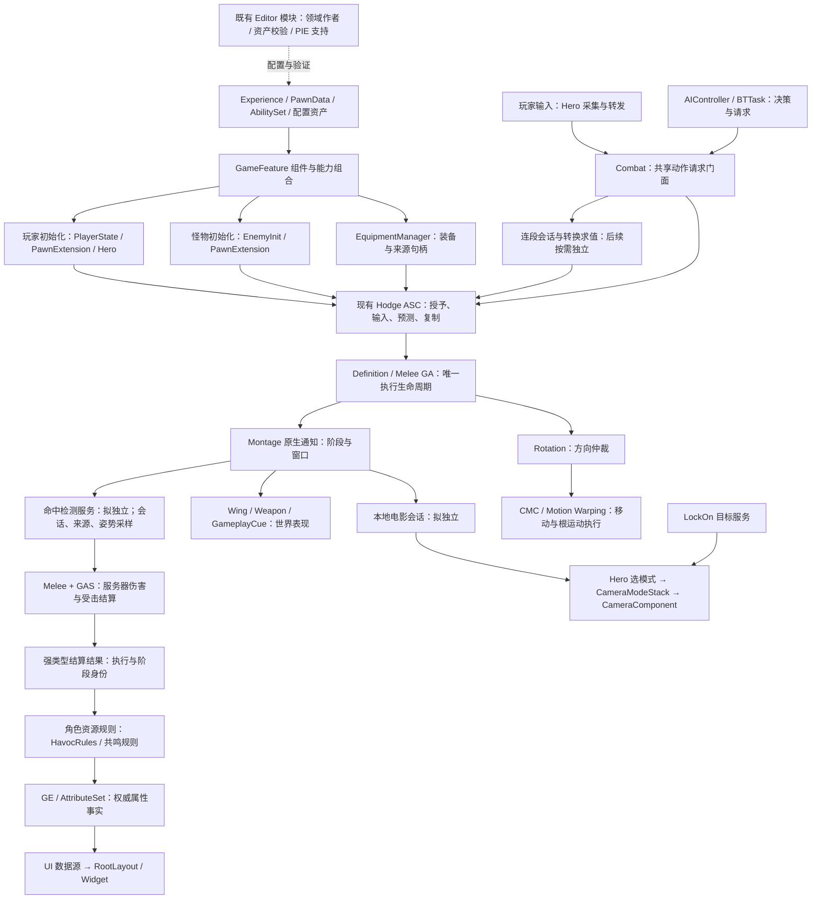

# Hodgepodge 架构与可维护性审查及分阶段重构方案

日期：2026-10-15。性质：当前工作区的只读审查与待实施方案，不代表已经完成重构或运行验证。

## 1. 总体判断与边界

当前项目需要渐进式整理，但不需要推翻 Lyra 路线或重建 GAS。主要问题是：公共战斗执行逐渐吸收角色专属规则，Combat、Hero 和编辑器工具承担了过多职责，不同能力授予入口的成功语义也没有完全收敛。新增功能往往需要同时改输入、ASC、GA、Combat、资源和 UI，变更范围不断扩大。

最值得优先处理的是授予契约一致性、公共层与角色规则解耦，以及命中检测从 Combat 中独立。不是按文件长短拆文件，也不是把所有逻辑改成组件、接口或消息总线。

本方案遵守以下约束：

- 维持 `Hodgepodge` 单一业务 Runtime 模块和已有 `HodgeAbilityEditor` 工具模块；下文“模块”主要指职责边界，不指新增 UBT 模块。
- 一个项目自有类的非内联实现保留在一个主 `.cpp`。拆分必须形成独立职责类，禁止重新引入 `_Combo.cpp`、`_Montage.cpp` 或 include `.cpp`。
- 保留 Experience、PawnData、GameFeature、Init State、PlayerState 所有的玩家 ASC、Pawn 所有的怪物 ASC。
- 保留玩家与 AI 的共享战斗请求入口、Montage 原生通知、CameraModeStack、旋转仲裁和 Motion Warping。
- 不引入 CommonGame／CommonUser；不重构第三方 ALS、RiderLink；不批量重命名已有蓝图、属性、Tag 和资产。
- 保留用户全部未提交修改。本次不提交、不删除、不迁移业务代码或资产。

本轮不把 Guardian 行走问题、攻击吸附、美术表现等历史需求重新纳入重构。也不因本报告而启动库存、Encounter 或新的能力框架。

## 2. 审查方法与事实范围

### 2.1 已核查内容

读取项目约定、`.uproject`、Build.cs、Config，统计整个 `Source` 的 `.h/.cpp/.cs`；重点追踪 Combat、Hero、ASC、Definition/Melee GA、EnemyInit、Equipment、GameFeature 授予、Camera、旋转、编辑器工具及相关测试。对本机 Lyra 的对应输入、能力、初始化、装备、相机和 GameFeature 调用链进行对照。

另通过正在运行的编辑器执行 AssetRegistry 只读查询，核对正式动画蓝图父类、部分实验蓝图父类和实验地图引用；没有编译、保存或改写资产，查询后脏地图和脏内容包均为空。

没有逐个审查全部 Blueprint 图、全部软引用、Cook 收集结果或所有插件实现；没有采集 Unreal Insights、网络带宽、内存和帧耗时。因此下文区分“源码已确认的结构问题”和“需要后续资产／性能验证的候选项”。

### 2.2 规模快照

`Source` 中 Hodgepodge 当前有 426 个上述类型文件，共 74,616 行；剔除空行和注释后的词法近似值为 42,784 行。Lyra 对应 `Source` 为 478 个文件、51,061 行、近似 35,915 行。

该比较**不能证明 Hodgepodge 比整个 Lyra 更大或更复杂**：Lyra 的 GameFeature 插件代码不在这组统计内，两者玩法范围不同，中文注释也明显影响总行数。近似值不是圈复杂度或覆盖率，仅用于筛选审查对象。

Hodge 当前 Runtime 生产代码 380 个文件、近似 34,645 行；Runtime 测试 36 个文件、近似 4,604 行；Editor 8 个文件、近似 3,513 行；另有两个 Target 文件。测试源码检出 132 个 `IMPLEMENT_SIMPLE_AUTOMATION_TEST` 注册位置，**不代表本轮执行或通过 132 项测试**。

重点文件的总行数／近似有效行数：

- `Component/HodgeCombatComponentBase.cpp`：1,525／1,270。
- `Component/HodgeHeroComponent.cpp`：1,391／890。
- `AbilitySystem/HodgeAbilitySystemComponent.cpp`：1,295／866。
- `Character/HodgeCombatCharacter.cpp`：1,140／638。
- `AbilitySystem/Abilities/HodgeGameplayAbility_Definition.cpp`：583／497。
- `AbilitySystem/Abilities/HodgeGameplayAbility_Melee.cpp`：502／422。
- Editor `HodgeAnimationAuthoringLibrary.cpp`：1,511／1,378。
- Editor `HodgeUIAuthoringLibrary.cpp`：1,654／1,371。

反例也很重要：Hodge `SActorCanvas.cpp` 约 600 行有效内容，Lyra 对应约 559 行；Hodge PlayerController 约 436 行，Lyra 对应约 484 行。不能仅因它们总行数较高就要求拆分。当前没有统一的“超过 N 行必须拆”标准。

统计工具及原始结果位于 `Saved/ArchitectureAudit/metrics.py`、`source-metrics.json`，均为本地审计产物，不作为业务源码提交。

## 3. Lyra 基准与当前差距

以下 Lyra 路径均相对 `E:/Project/UProject/study/Epic/LyraStarterGame`，Hodge 路径相对本项目。

### 3.1 模块与配置组合

Lyra 的 `Source` 保持 LyraGame／LyraEditor 分工，同时在 `Plugins/GameFeatures` 中用 ShooterCore、ShooterMaps、TopDownArena、ShooterTests 等按玩法组织可选内容。不是“每一个组件都是一个模块”。

Hodge 已有 Runtime／Editor 分工，但一部分实验作者工具仍在 Runtime，多个领域作者工具又集中进少数超大 Editor 类。应先修职责边界。只有未来真正存在独立装卸、资产归属和团队发布需求时，才另行评估 GameFeature 插件；本轮不引入额外模块。

### 3.2 输入与能力

Lyra `Source/LyraGame/Character/LyraHeroComponent.cpp:343` 的输入按下／松开基本转发到 ASC；`DetermineCameraMode` 和 `SetAbilityCameraMode` 保留简单模式选择及 Spec 所有权。`AbilitySystem/LyraAbilitySystemComponent.cpp:279`、`:321` 负责输入队列和激活策略。

Hodge 继续使用这条主链是正确的，但 Hero 已加入 Dash/Sprint 输入会话、暗流长按资格判断和电影镜头会话；ASC 又直接接入连段授权、Definition 变体、预测校正和蒙太奇同步。ACT 比 Lyra 射击示例需要更多逻辑，不能直接还原为 Lyra 的简版；应将这些逻辑限定在清晰的扩展边界。

### 3.3 初始化与能力授予

Lyra `Character/LyraPawnExtensionComponent.cpp:213` 使用 Init State 链协调，`:280` 监听其他 Feature 状态，ASC 注册回调采用注册后立即补偿查询。`Equipment/LyraEquipmentManagerComponent.cpp:68`、`:109` 配对保存／撤销授予句柄。

Hodge 的 EnemyInit、受检 AbilitySet 和装备提交路径已经补上普通怪物与失败确认需求。它们是应该保留的项目适配，不应倒退为 Lyra 原始宽松授予。差距在于 GameFeature 入口尚未统一使用这些结果，以及公共 Combat 和 Character 仍具体识别 EnemyInit 与玩家初始化细节。

### 3.4 目标数据与网络

Lyra `Weapons/LyraGameplayAbility_RangedWeapon.cpp:446` 注册 TargetData 回调，`:477` 处理数据，EndAbility 配对解绑和消费。适合复用其 Spec／PredictionKey 归属、预测作用域和生命周期。

但该文件中 `bIsTargetDataValid = true` 是示例中的实际代码，不能当作本项目安全校验已经完成；连续近战、连段记忆、取消回滚、旧动作通知隔离也不是这段射击代码已经解决的完整问题。Hodge 必须保留自己的 Avatar、ExecutionId、MontageInstanceId 等验证。

### 3.5 相机与 UI

Lyra `Camera/LyraCameraComponent.cpp::GetCameraView` 通过模式栈统一求值；Hero 请求临时模式。Hodge 软锁和电影镜头继续接入现有栈，方向正确。

Lyra `UI/Subsystem/LyraUIManagerSubsystem` 继承 CommonGame 的 `UGameUIManagerSubsystem`，依赖 CommonLocalPlayer、GameUIPolicy、PrimaryGameLayout。Hodge 当前没有这套依赖，不能只复制该子类；现有 UIManager、RootLayout 和数据源应继续复用，不以“对齐 Lyra”为由再引入第二套 UI 框架。

## 4. 具体问题、证据与处理建议

### R1：Combat 同时承担调度、连段、检测、网络补偿与角色模式，P1

**已确认。** `Source/Hodgepodge/Private/Component/HodgeCombatComponentBase.cpp`：

- `AcquirePoseLease`（70）、`ResolveSource`（110）、`CreateDetectionSession`（222）、`SampleDetection`（352）管理姿势更新占用、检测来源、检测会话和几何采样。
- `InputPressed`（555）、转换选择、输入缓存和连段记忆负责图执行。
- `ServerMoveCancel`、`ServerReturnToEntry`（1189）处理预测取消和服务器补偿。
- `RequestStandaloneAbility`（1364）及动作请求账本服务玩家和 AI。
- `Configure`（476）直接注册 `HodgeHavocTags::DarkSurge`；初始化回调和行动就绪查询又直接依赖 EnemyInit、HeroCharacter 与 PlayerState。

这些责任共享一个状态空间和销毁流程，新增翅膀采样、角色形态或 AI 就绪条件都会扩大同一类的修改范围。这是当前最明显的维护热点。

**推荐拆法：** 第一刀仅独立命中检测职责，拟新增 `UHodgeHitDetectionComponent`，迁移检测来源、会话、几何历史和姿势占用。现有 `Combat` 方法保留为代理，通知、GA 和蓝图调用入口先不变。初版新组件不自行复制、不新增战斗 RPC，不另建伤害或去重系统。

保持现有 `FHodgeHitDetectionBatch`、执行身份、HitGroup＋AttackPhase 去重语义。将姿势占用迁移给检测服务时，GA 仍通过旧代理申请，最终只有一个网格更新策略账本。不能让新旧两个组件分别恢复 `VisibilityBasedAnimTickOption`。

第二刀再评估把连段求值与记忆提成独立非复制会话对象；Combat 保留共享请求门面和原网络入口。没有稳定边界前，不把它一口气拆成六七个互相依赖的 Manager。

**验收：** GA／通知不再直接操作检测内部容器；静态／Follow／武器／骨骼／WingMesh 的判定等价；同刀去重、专服骨骼更新、取消清理不变；同一实例只运行一种检测实现。

### R2：公共 Hero 累积角色技能和电影会话，P1

**已确认。** `HodgeHeroComponent.cpp:791` 输入分支区分锁定、Dash 和普攻长按；`:1217` 刷新电影镜头；`:1276` 起维护 Sprint 会话；`:1357`～`:1391` 直接查询 HavocRules、HavocSet、暗涌状态并提交灭音。

其中暗流长按、暗涌清理等近期功能进入公共链路，属于这轮迭代新增的耦合。它能实现当前角色，不适合作为所有角色继续扩展的最终边界。

**推荐拆法：** Hero 保留 Init State、输入绑定、原始移动／视角意图及既有公开转发接口。优先把电影镜头占用、源 Montage 匹配、重入保护和恢复状态提成独立本地会话对象，仍由 Hero 选择 CameraMode。随后将 Havoc 的按住资格与提交放回现有角色规则能力或其独立输入会话中。

不要为了共用“长按”而强行合并 Circuit 和 Dash/Sprint：它们的提交、空中继续、落地衔接、松开和消费条件不同。能复用时间与身份数据时复用，策略保持独立。AbilityTask 的输入释放可复用 GAS 机制，但不能直接替代全部逻辑：普通攻击按下即出招，长按识别仍需跨该动作持续，后摇阻塞期间也要保留原始意图。

**验收：** Hero 不再 include HavocSet/HavocRules；按下普攻立即响应、松开不补发第二刀、UI 阻塞／死亡／换 Pawn 清理正常；短按 Dash 完整播放、空中继续、窗口内落地接 Sprint 不回归。镜头多次释放、取消和旧回调不清理新会话。

### R3：公共 Melee 与 Definition 含角色专属收益规则，P1

**已确认。** `HodgeGameplayAbility_Melee.cpp:415`～`:439` 在生命伤害结算中直接处理 ResonanceSet、HavocRules、DarkSurge 和强化普攻收益；`:495` 处理 Havoc CastCommitted。`Data/HodgeAbilityDefinition.h` 同时包含通用蒙太奇／判定、`DarkFlowGainPerPhase`、`DarkFlowGainOnCast`、`bEnhancedNormalAttack` 及共鸣能量配置。

问题是公共攻击层需要了解具体角色资源和被动。不是说属性、GE、GA 或数据驱动本身冗余；暗流燃料与大招能量的语义确实不同，不能统一成一个只剩 Current／Max 的资源系统。

**推荐拆法：** Melee 只负责命中资格、服务器伤害提交、受击事务和实际生命伤害确认，再发布带执行身份的强类型结算结果。现有 `HavocRules` 订阅并处理角色资源、入态和拢音；共鸣能量由独立资源规则处理，优先小对象或现有生命周期宿主，不立即建设通用资源平台。

字段迁移后，通用 Definition 引用可选的规则配置。旧字段先作读取适配，迁移全部正式资产并校验后再停用；新旧两条规则不得同时结算。普通 NPC 没有玩家资源 Set 时，不创建 Set，不授予玩家被动。

有效伤害确认必须保留现有 SettlementId 关联，不用简单的“命中事件”代替，否则免疫、零伤害、死亡、嵌套伤害及 GE 回调重入会改变回能。阶段账本归属唯一，阶段回能与角色级每秒一次拢音限流分别保存。

**验收：** 通用 Melee／Combat 不直接依赖 Havoc 类型或暗涌具体标签；每有效阶段一次回能、空挥施放回能、共享 E 冷却、燃料归零退出、死亡清空和 R 不变均保持当前规格。

### R4：ASC 与 Definition 执行协议耦合，P2，高风险后置

**已确认。** ASC `AbilityInputTagPressed`（317）先处理变体和 Combat 连段，再进入 Lyra 输入队列；`ProcessDeferredComboRequest`（959）等待服务器真实窗口；`OnRep_ReplicatedAnimMontage`（1172）适配表现；`RetireAttackFacingData`（1264）处理迟到数据。Definition GA 同时管理转向 TargetData、Montage 身份、预测移动取消、通知资源、翼／武器／镜头清理，`EndAbility`（358）横跨多个模块。

这里有大量**必要复杂度**。把自定义蒙太奇复制全部删掉、把连段改成普通事件广播、或者只用 SpecHandle 替换 ExecutionId，都可能重新引入客户端延迟、旧通知清理新动作和移动取消回滚问题。

**推荐拆法：** ASC 保留 GAS 适配、原 RPC／复制字段和输入处理；先提取不改变传输格式的纯身份验证、授权决策辅助，再考虑由 AbilityTask 封装攻击转向数据等待和配对解绑。Definition 保留统一执行生命周期，通过域专用句柄请求／释放资源。每次只搬一个协议单元。

先列明现有身份关系，而非新增第二套协议：Avatar → Spec／PredictionKey → ExecutionId → MontageInstanceId／OccurrenceId。它们各自解决不同生命周期，不能简单合并为一个 GUID。结构化视图可以引用既有值，不等于这些字段全部新增网络复制。

**验收：** 一致的激活／结束／拒绝路径，TargetData 提前到达和迟到被处理；100～150ms 延迟及少量丢包场景下无重复授权、重复扣资源、窗口绕过或卡住；拥有者／模拟代理蒙太奇和取消行为保持正确。未取得对照证据前不删除旧复制适配。

### R5：能力授予存在宽松／受检两套调用语义，P0/P1

**已确认。** `Data/HodgeAbilitySet.cpp:263` 的旧 `GiveToAbilitySystem` 复用 `GrantInternal(..., false)`，`:271` 的 `TryGiveToAbilitySystem` 则预校验、返回结果并管理 Pending 句柄。EnemyInit 与 Equipment 已用受检入口。

但 `GameFeatures/GameFeatureAction_AddAbilities.cpp:311` 按 Actor 去重，`:392` 通过 `SetPtr.Get()` 读取软引用，`:396` 仍调用旧入口，最后记录 Actor 已扩展。当前公开配置允许多条 AbilitiesList 命中同一 Actor，却没有按 EntryIndex 区分结果。

必须准确区分两点：

- `GrantedAbilitySets` 已声明 `AssetBundles="Client,Server"`，Experience 也有 Bundle 加载链。**不能把 `Get()` 本身定性为必现漏授予**；它依赖预加载契约。需要测试冷加载、直接激活、资源缺失／取消是否都满足该契约。
- 同一 Action 的重叠条目共用 Actor 级记录，以及提交时不检查受检结果，是源码可以确认的接口风险。是否影响当前正式玩法，还需核对实际 Action 配置。

**推荐改法：** 保留唯一 `GrantInternal`，统一需要可靠成功语义的调用者使用受检接口。GameFeature 按 `(Actor, EntryIndex)` 记录，或聚合全部匹配项后一次提交；撤销精确对应来源。必要资源未驻留时，明确等待／失败，不能提交完成记录；不在每次授予时无条件同步加载掩盖预加载缺口。

所有权仍分别属于 EnemyInit、EquipmentManager、GameFeature。Instant GE 和 OnSpawn 副作用不能假装通用可回滚；继续使用 `bHasIrreversibleEffects` 的失败停止语义。旧 void 接口在调用者和反射／资产引用迁移完成后才能移除，不另复制一套授予循环。

**优先级：** 若正式 Experience 依赖这些扩展能力，属于阻塞重构的 P0；若不依赖，完成配置盘点后按 P1 收敛，不因此重建全部 Experience 热切换。

**验收：** 同 Actor 两条配置均授予一次；失败不标成功、不重复副作用；停用只撤销本来源；冷加载／迟注册／重复通知／卸装／换 Pawn 均有测试。

### R6：初始化协调出现双向具体依赖，P1

**已确认。** Combat 在 ASC 初始化和 OnRegister 中直接调用 EnemyInit.TryInitialize（1255、1269），行动就绪又识别 EnemyInit 与玩家 PlayerState（1292）。EnemyInit 的 `HasValidCombatDependencies` 反向读取 Combat.CanExecuteAbilities。CombatCharacter `TryInitializeAttributesAndEquipment`（1104）显式 Cast Enemy 后转交 EnemyInit。

这是职责耦合，**本轮没有证明它造成无限递归或重复授予**：EnemyInit 已有防重入、有限追加检查、分阶段提交以及失败终止；当前装备也已经具备 Pending 提交和失败清理。不能再把早期“怪物被 PlayerState 分支直接跳过”当作现存结论。

**推荐改法：** EnemyInit 保留唯一怪物初始化协调权；Combat 发布自身依赖就绪／失效，EnemyInit 用事件加立即查询推进。公共行动入口查询统一的行动资格契约，由既有玩家初始化和 EnemyInit 提供各自适配；仅在两种实现确实需要时引入窄接口，不加万能 ReadyManager。

回调多次触发可能是正确的晚注册补偿，不能作为“重复代码”直接删。Init State 不倒退；运行时技能移除、死亡、受击继续由当前依赖与 Tags 拒绝请求。

**验收：** 延迟 Experience、晚注册、徒手／装备怪、ASC 冲突、缺 StatProfile、重 Possess、初始化中销毁都不误报 Ready；重复通知不恢复生命／重复装备；每次 Possess 只成功启动一次 BT。

### R7：编辑器工具按迭代需求堆积，P1，低风险收益较大

**已确认。** `HodgeAnimationAuthoringLibrary` 除动画还制作敌人行为树（1315）、导航边界（1442）和 Experience 组件（1463）；同时负责翅膀、Dash/Pivot、受击、Warp、Havoc 和解放资产。`HodgeUIAuthoringLibrary` 同时处理 Widget 图生成、迁移、布局、资产检查以及 PIE 行为队列；`FDesignerGraph` 从 544 行起混在角色 UI 制作代码中。

**推荐拆法：** 在已有 Editor 模块中按独立类分成动画作者、AI 作者、UI 作者和 PIE 验证支持；共享最小图节点连接工具，领域逻辑各自保留。旧反射函数先转发，迁移 Tools 调用再退役。分两批实施，不先移动全部文件或更名公开类。

`/Game/Main/...` 路径校验一部分是防止误改资产的安全范围，不能机械删除。通用作者接口接收目标资产与显式参数；一次性迁移脚本保留范围保护、只读预检、变更清单及可重复执行条件。禁止作者操作在无确认的测试中重建正式 WidgetTree。

**验收：** 工具只修改传入／白名单内资产；有预检和结果报告；重复运行不重复通知、不删除手工布局；无 PIE 时资产作者可运行；Runtime Game 构建不需要 Editor 作者实现。

### R8：实验代码、生产依赖及注释债务，P2

**已确认的候选，不等于可直接删除。** Runtime `CodexText` 内含 Survivor、LocomotionLab 和 Grounded 作者工具；`HodgeGroundedAuthoring.cpp` 已通过 `WITH_EDITOR` 保护，不是无条件 Runtime 依赖 Editor 的证据。当前 Build.cs 的 UnrealEd／AnimGraph 等也受 `Target.bBuildEditor` 保护。

本轮资产查询确认：

- 正式 `/Game/Main/Character/Hero/Anim/ABP_Pover_Base` 父类是 `HodgeAnimInstance`；正式移动层父类是 Engine.AnimInstance。
- `/Game/CodexText/AnimInstance/ALS/ABP_ALS_Lab` 和备份仍继承 `HodgeALSLocomotion`，`ABP_ALS_Grounded` 仍继承 `HodgeGroundedLocomotion`。
- `DefaultEngine.ini:5` 的 EditorStartupMap 是 `/Game/CodexText/L_MainMenu`。
- 抽查的三张实验地图在 AssetRegistry 中没有包引用者，但代码 `OpenLevel`、配置和动态路径不一定被该查询覆盖，所以“零引用者”不等于可删除。

先将作者职责移入 Editor，并建立实验入口／打包范围清单；决定保留还是归档实验场景后，才移除确认不再需要的 Runtime 类。跨模块迁移 UCLASS 会改变 Script 路径，必须核对蓝图父类、Python 反射入口和 CoreRedirects，不能仅剪切 `.cpp`。

注释和小型冗余可单独整理：Hero 有明确标注“定位后删除”的大量 `[HODGE-DBG]` Warning；`ServerReturnToEntry` 相邻两次检查重复条件；Equipment.PostReplicatedChange 仍保留旧注释代码块；Experience 文件头声称不处理停用，而下方 EndPlay 实际包含插件停用及 Action 卸载。

建议删除已确认失效的注释代码，临时诊断转领域日志／Verbose 或显式调试开关，同步修正过时 TODO。保留版权、关键生命周期原因和必要中文注释；修复“准备serveKnee方向”“本次得到的T”等无意义模板注释，不再逐行翻译普通语句。Experience 的 EndPlay 清理不等于已经支持任意运行时热切换，两者应分别描述。

不因没有 C++ 调用者而删除 UFUNCTION／UPROPERTY。当前公开依赖也不能一律改 Private：先检查 Public 头暴露类型和模板，再逐项缩小依赖，最后验证 Editor 与 Game。

## 5. 目标架构与接口边界

### 5.1 目标关系图

图中“拟独立”是待实施职责。现有组件和协议继续工作；箭头表示请求或依赖方向，事件结果单独回传。



授予句柄和初始化责任仍按来源分配。图中的玩家初始化和怪物初始化是生命周期差异，不代表两套技能执行流程。服务器伤害不依赖本地相机或 UI，专服命中可以依赖不可见骨骼采样，但不能依赖客户端表现完成。

### 5.2 需要固定的接口契约

以下均为建议边界，不是声称项目已经存在同名接口。优先复用现有类型和句柄。

**动作请求：** 输入为 AbilityTag／ComboIntent 与当前请求身份；输出为既有 `FHodgeCombatActionRequestState` 及终结通知。玩家输入和 AI 决策保持同一执行门面；AI 不模拟 EnhancedInput、不伪造客户端预测。

**检测服务：** 输入为 ExecutionId、OccurrenceId、现有检测配置及来源；返回检测句柄和 `FHodgeHitDetectionBatch`。Begin／Sample／End 验证执行身份；结束动作统一释放其检测及姿势占用。现有 Combat 公共函数代理至新服务，调用者逐批迁移。

**结算结果：** 拟新增强类型结果，包含 SourceASC／Avatar、Spec／ExecutionId、HitGroup／AttackPhase、SettlementId、服务器实际接受的生命伤害。同步／作用域内分发时不保留栈上 EffectSpec 指针；若需延迟，保存拥有明确生命周期的值或句柄，并重新验证 Avatar 和执行。形态规则自行判断是否有资格处理。

**就绪与行动：** 初始化 Ready、当前依赖有效、当前可行动分别查询。依赖变化事件只提示重新查询，不替代持久状态；注册后立即补偿查询。提供方失效时失败关闭，禁止回落到无条件可行动。

**表现占用：** 相机、方向、武器和翅膀继续使用各自现有句柄；以 ExecutionId 和源对象绑定，释放幂等。各域可形成小型作用域包装，但不建设一个把所有资源塞入 `UObject*` 数组的万能清理器。

**授予结果：** 使用现有 `FHodgeAbilityGrantResult`、已授予句柄和不可逆副作用标记。成功必须是验证后已提交；等待、非法配置、失败及失效分别诊断。

### 5.3 推荐模式及限制

- **门面＋适配器：** 保留 Combat／Hero／ASC 现有公开入口，内部逐步转发，减少蓝图和网络改动。
- **组合／策略：** 角色特有资源与输入条件由已有规则能力和可选数据承担；出现第二种实现需求时才提升成公共接口。
- **有限状态会话：** 复用既有动作、输入和电影会话，明确所有者与结束条件；不另外创建全局玩法状态机。
- **来源账本与分步提交：** AbilitySet、装备和 GameFeature 各管句柄，失败保留真实结果；不可逆效果禁止伪回滚。
- **强类型事件＋事件驱动初始化：** 窄范围通知与立即查询，按生命周期解绑。避免无差别全局消息总线隐藏调用关系。

目录先不搬迁。独立类放入当前匹配的 Public／Private 分类，语义边界稳定后再考虑少量目录调整，避免大量 include 改名掩盖功能差异。

## 6. 可以移除、需要迁移与必须保留的内容

### 可优先整理的源码冗余

- `ServerReturnToEntry` 中紧邻重复的校验，保留第一处完整权限／身份检查。
- Equipment 中已失效且不参与编译的旧注释代码块。
- 重复文件头、逐行翻译、模板化无意义注释与已经不准确的 TODO；不改变中文注释要求。
- 确认完成定位后的临时 Warning 诊断，保留领域错误和可开启的调试输出。

这些只能算小型清理，不能声称它们会显著改善运行性能。

### 迁移验证后才可移除

- GameFeature 等可靠调用者使用的旧宽松授予入口；确认调用和反射引用归零后再移除兼容层。
- 原 Melee／Combat／Hero 中的 Havoc 直接处理分支；新规则验证等价后一次切换，不双跑副作用。
- 已完成全部调用迁移的 Editor 旧作者门面；先检索 Tools 和蓝图节点。
- 确认归档、配置与动态调用均解除的实验 Runtime 类和资产；当前不能整目录删除 CodexText。

### 明确保留

- Spec、PredictionKey、ExecutionId、MontageInstanceId 和通知发生次序等必要身份。
- 服务器授权、客户端拒绝／回滚、模拟代理蒙太奇同步。
- 同刀去重、实际伤害确认、阶段回能账本和角色级限流。
- 初始化重复调用的幂等保护、注册后补偿和失败诊断。
- CameraModeStack、RotationComponent、CMC 与 Motion Warping 的分工。
- Editor-only 资产校验及 Runtime 中确有生产引用的类。

## 7. 分阶段实施计划

以下为单名熟悉 UE／GAS 工程师的工作日粗估，不是截止日期或承诺；含代码审查与相关测试，不含正式美术调试。当前没有用户指定截止时间。每阶段独立可交付，上一阶段验收后才进入依赖它的阶段；发现现存行为缺陷应另记修复，不能悄悄算进“无行为改变重构”。

### 阶段 0：冻结基线与引用清单，P0，约 1～2 日

目标：建立可比较的当前行为，区分既有缺陷和重构回归。

步骤：记录当前分支／工作区差异和资产版本；盘点正式 Experience/GameFeature 的扩展授予依赖、生产地图和实验入口；复跑受影响原生测试并记录逐项结果；在正式测试地图录制单人、Listen 远端和 Dedicated PIE 的代表流程。保留目前未提交工作，不先批量格式化。

资源：UE 5.5.4、现有 Native Automation、Editor 校验库、PIE 测试脚本、资产引用查询、版本化测试配置。

交付：基线报告、失败清单、身份／资源归属表、正式资产集合。验收：每个后续阶段都有可复跑入口；既有失败明确登记，基线未通过或结论不清的项目不宣称回归通过。

### 阶段 1：授予契约与低风险整理，P0/P1，约 2～4 日

目标：消除扩展授予的错误成功风险，同时降低日常阅读噪声。

步骤：先确认 Bundle 契约和重叠条目配置；接入受检授予、按条目管理结果、精确撤销；覆盖缺资源和部分失败；将明确临时诊断降级或加调试开关；删除已确认注释冗余，修正过时说明。可靠授予与纯注释清理分别提交／审查。

影响：AbilitySet 调用方、GameFeature Action、相关初始化测试；不改技能时间轴和动画资产。

验收：重复事件不重复授予，多条配置不互相覆盖，冷加载失败不报成功，不可逆副作用失败停止；Editor／Game 构建和相关自动化通过。若当前玩法不依赖扩展授予，允许把非阻塞部分与阶段 2 调整顺序，但不能标成已解决。

### 阶段 2：Editor 作者与实验边界，P1，约 2～3 日

目标：让动画、AI、UI 的修改互不扩大工具类职责。

步骤：先拆 AI 作者和 PIE 验证支持，再提通用图工具；保留原反射转发入口；迁移少量调用验证；盘点 Runtime 作者类跨模块影响；按单类迁移，必要时加精确 Redirect。实验保留／归档决策未确定前不删除地图和父类。

验收：既有工具输出等价、无无关资产脏化、重复运行稳定；运行时 Game 构建通过；所有迁移蓝图编译通过；不将路径保护全部取消。

### 阶段 3：命中检测独立，P1，约 3～5 日

目标：把几何／姿势采样从 Combat 调度中移出，保留战斗执行协议。

步骤：新服务复用现有数据；Combat 入口转发；先迁移会话容器，再迁移采样和姿势占用；验证身体、武器、翼 Box 和固定大范围单次检测；最后迁移直接调用者，删除旧内部副本。

验收：命中目标集合、每刀次数和伤害结果对照一致；取消／死亡／换 Pawn 后无 Session 与姿势占用泄漏；Dedicated PIE 不因不可见网格停止采样；无双采样、双伤害或新增逐帧对象分配。未完成此阶段前不同时重构 Melee 结算协议。

### 阶段 4：角色规则与 Hero 会话解耦，P1，约 3～5 日

目标：增加另一种角色资源时不再修改通用近战命中流程。

步骤：明确结算结果契约；将 Havoc 规则迁入已有被动；保留旧字段读取适配并校验资产；单路径切换；再独立本地电影会话和暗流输入会话。Dash/Sprint 是否继续拆分按实际收益决定，不为了对称强拆。

验收：公共近战层没有 Havoc include／具体模式标签；暗流、E 替换、R、每阶段回能和每秒限流全部通过；普通怪物不被授予玩家资源；电影镜头只影响本地拥有者，重播、拒绝、死亡和回归锁定正常。

### 阶段 5：初始化依赖和执行协议收敛，P2，约 3～5 日

目标：去掉公共层对具体角色初始化类的识别，收窄 ASC／GA 执行辅助。

步骤：以事件＋立即查询替代 Combat 对 EnemyInit 的直接推进；保留唯一协调者；先提纯验证辅助，再按需用 AbilityTask 收拢 TargetData 等待。RPC、复制字段和旧协议先不改；每次迁移一个单元。

验收：初始化、重 Possess、失效回调、网络校正矩阵通过；无挂起请求和旧执行占用；连续连段、移动取消、受击、死亡、武器／翼淡出、软锁和 Dash/Sprint 无回归。通过当前完整场景测试后才删除适配分支。

完成上述范围约需 14～24 个工作日；存在资产引用迁移或基线缺陷时应重新估算。建议先批准并完成阶段 0～1，之后根据真实收益决定剩余阶段，不同时启动全部结构调整。

## 8. 风险与降低风险的办法

### 8.1 蓝图、反射和资产路径

风险：移动 UCLASS、删属性或改模块导致父类和节点失效。措施：优先保持原类名／函数／字段；入口代理；先查询包引用、Class 标签、配置、Tools 与动态路径；需要 Redirect 时逐项编译并重新打开相关资产，最后执行 Cook 引用检查。零 C++ 调用不是删除依据。

### 8.2 网络、预测和生命周期

风险：拆分后请求身份传播遗漏、旧 Timer 回调取消新动作、复制 ActorComponent 未注册或服务器入口变化。措施：首轮不迁移 RPC 与复制属性；新逻辑留在同 Owner，保存原身份；测试提前／迟到数据、拒绝、丢包、换 Pawn 和重入。取消和死亡分别验证，不误取消死亡能力。

### 8.3 命中与资源副作用

风险：新旧双跑重复伤害／回能，结果事件迟到，回滚 Instant GE 不完整。措施：影子对比只允许纯计算／只读决策；伤害、GE、扣资源和授予只有一个执行路径。切换点以实例／会话创建时固定，活动动作中不切实现；失败保留诊断，明确不可逆效果。

### 8.4 更新顺序和专服表现依赖

风险：组件拆分改变角色姿势→翅膀姿势→采样顺序，专服停止刷新骨骼；把清理放到 AnimNotifyEnd 后在取消时丢失。措施：明确 TickGroup／Prerequisite 和 PoseLease 所有者；动作 EndAbility 仍是最终兜底清理；同时验证无渲染／不可见角色，而非只测 Listen 主机。

### 8.5 性能与抽象膨胀

风险：为了“解耦”新增大量 Tick、全局广播、轮询和每帧 UObject 分配。措施：优先非复制会话对象／纯辅助，只有真实 Actor 生命周期或采样需要才用组件；事件驱动并有界重试；用 Insights 对照固定场景采样，不凭行数声称性能提升。新增组件不默认常开 Tick。

阶段 0 建立固定硬件、角色数量、网络模式及采样窗口，再约定 CPU／内存／带宽预算；建议将稳定可重复的约 5% 以上回退列为调查门槛，而非脱离噪声与场景的绝对验收值。此数值为拟议门槛，尚未实测或冻结。

### 8.6 特性开关与兼容层寿命

对命中抽取、收益规则切换等高风险项，可使用仅开发／测试可配的实现选择；默认保持旧路，按测试角色逐步切换。每个开关注明负责人、适用范围、移除条件和目标阶段，禁止长期形成两套生产事实来源。测试完成再统一默认并删除旧实现；网络两端不得临时选择不兼容协议。

不是每次提纯函数都加开关。纯作者工具拆分和无行为注释清理不需要额外运行时分支。

## 9. 验证矩阵与交付标准

### 9.1 原生单元与契约测试

复用当前 `Private/Tests` 中 EnemyAI、CombatActionRequest、MeleeRouting、HitDetection、WingBoxHit、Havoc、ResonanceEnergy、CharacterRotation、AttackWarp、DashAir、MovementAction、CinematicCamera、LockOn 和 UI 测试。新测试围绕对外契约和曾有风险，不逐行镜像实现。

重点新增：同 Actor 重叠 GameFeature 条目、受检失败不提交、资源未驻留、依赖晚到、事件订阅／解绑、执行身份隔离、检测迁移前后结果一致、规则迁移无重复收益。覆盖失败和取消，不只覆盖正常激活。

### 9.2 资产与集成测试

正式 Experience、PawnData、AbilitySet、Definition、Montage、AnimBP 和 Widget 编译／校验；装备怪与徒手怪；基础／强化五段、普通 E／破命共享 CD、R、灭音燃料；角色／武器／翼判定同刀去重；死亡／驱散／换 Pawn；正式 UI 使用 Layout 数据源且无重复实例。

作者工具另验重复执行、非法资产拒绝、无关资产不脏化。引用迁移后的资产必须实际重开，不能只看到源码编译成功。

### 9.3 端到端与网络

单人 PIE、双人 Listen 的远端客户端、Dedicated Server PIE 分开记录。输入与相机验证只发生在本地拥有者；服务端伤害和资源权威不依赖本地表现；模拟代理能看见正确动画／翼／武器。测试延迟／丢包、反复重生、控制器重新 Possess、取消与服务器拒绝。

Dedicated PIE 不等于独立 Server 可执行构建；当前项目没有因本报告增加 Server Target，也不把 Game 构建等同 Cook／打包通过。

### 9.4 每阶段必须提供的记录

- 需求／风险编号 R1～R8、测试标识、使用资产、网络角色和环境。
- 预期、实际、通过／失败／阻塞／未执行、完整命令及日志／报告位置。
- 失败根因、是否为基线缺陷、修复或回退路径；不通过则保留上阶段默认实现。
- 本阶段新增兼容层／开关及退出条件；未解决项继续列入下一阶段。

不承诺未经测量的百分比测试覆盖率。若以后需要覆盖率，先确定工具、可执行配置和生产代码分母；本轮只有测试注册统计，没有覆盖率测量。

## 10. 本次审查交付与实际验证

已完成：源码规模统计、关键调用链核查、本机 Lyra 对照、部分资产父类／引用查询、重构边界、优先级、实施计划、风险和验收方案。

实际执行的主要命令／方式：

```powershell
git status --short
git status --porcelain=v1 -uall
rg --files Source
rg -n '<相关函数或类型>' Source Config
rg --files 'E:/Project/UProject/study/Epic/LyraStarterGame/Source'
rg --files 'E:/Project/UProject/study/Epic/LyraStarterGame/Plugins/GameFeatures'
& E:/Python/python.exe Saved/ArchitectureAudit/metrics.py
& E:/Python/python.exe Tools/HitReaction/mcp_execute.py Saved/ArchitectureAudit/asset_refs.py
```

以上 rg 为多次定向检索，示例占位符表示检索模式，不是要求直接执行该占位命令。部分初次假设路径不存在，已用 `rg --files` 纠正后读取实际路径，没有将未找到文件当成缺少功能。

当前修改仅为本设计审查文档和 Saved 下可忽略的只读审计工具／结果；没有修改业务代码、Config、蓝图或美术资产，没有提交。

文档已检查差异空白、代码围栏闭合、Mermaid 架构图和 R1～R8 条目完整性。将文档创建前后 `git status --porcelain=v1 -uall` 比对，新增条目只有本文，既有条目无移除；详细检查结果在 `Saved/ArchitectureAudit/document-check.json`。Git 提示未来可能将 LF 转为 CRLF，不影响本次内容校验。

本轮未执行 Editor／Game 构建、原生功能测试、蓝图编译、PIE、联机、Cook 或性能测试。已有历史通过记录不作为本轮验证。阶段 0 的运行基线仍待真正开始实施时建立。

**建议的下一步：先完成基线和 GameFeature 授予契约，再独立命中检测；优先阻止公共层继续加入新角色专属规则。** 这样能降低后续迭代成本，同时保住已经打通的动作、预测、相机和 AI 链路。
