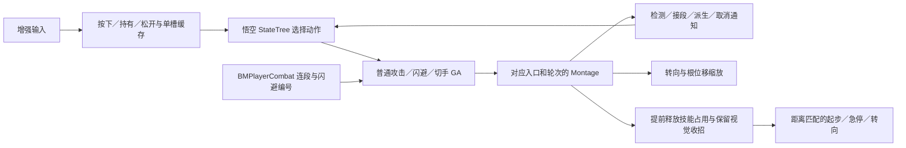

# BMWukong 悟空动作手感审查与 Hodge 对齐方案

> 讨论整合后的目标、架构与接口见[ACT 战斗动画与受击反馈总设计](act-combat-animation-feedback-design.md)，任务进度、依赖和验收见[实施计划](act-combat-animation-feedback-plan.md)。本文保留参考工程事实与推断边界，不代表整体迁移已获实施或验证。

日期：2026-10-17。状态：只读研究与后续实施建议，尚未修改玩法代码或正式资产。

参考工程：`F:/WuKong/BMWukong`，`.uproject` 声明 5.7，本机实际读取引擎为 UE 5.7.4、CL 51494982。用户已明确以**悟空的普攻、闪避和棍法派生**为主要目标，杨戬只作为差异旁证。

Hodge 对照基线：用户在审查期间确认采用 `codex/combat-refactor-hit-reaction-paused-20261016`、`891fd70`。最初 `main ab360d3` 的源码检查已按该决定重新复核，不能把主线缺少的 R1／R3／受击原型再次列为当前基线的未实现项。本文没有合并、切换或提交任何分支。

## 1. 判断与目标

这个工程值得作为 Hodge 动作制作标准。当前证据支持的重点是：**每招分别安排输入采集、命中、接段、派生、闪避和移动恢复，配合专门制作的动作、方向处理及根运动，让动作之间能够自然交接。**

不能把效果归因于“UE 5.7 比较新”“换成 StateTree”“加一个惯性化节点”。悟空玩家 ABP 使用传统状态机、SequenceEvaluator、距离匹配、方向／步幅修正、Slot 和骨骼分层；所读主图没有 Motion Matching 节点。Hodge 的实际 Linked Layer 也已经接入起步、停止、Pivot 的距离匹配及方向／步幅修正，并非只有简单 Idle／Run 混合。

本轮目标是查清可借鉴的机制和当前差距，不声称已经实测参考工程全部招式，不把静态图接线当作手感验收。后续对齐应保留 Hodge 的 UE 5.5.4、GAS、PlayerState ASC、Experience、现有战斗请求、命中检测和网络身份链，以一组正式动作的连续表现作为交付单位。

## 2. 核查方式与证据边界

### 2.1 本轮实际读取

- 阅读参考工程自有 C++、插件／模块描述、配置、关键蓝图／StateTree 文本、默认对象与角色组装，追踪真实调用者。
- 使用 UE 5.7.4 Python commandlet 只读加载、导出和反射查询：三批为 55、14、10 条记录，共 75 个不同资产。包括悟空玩家 ABP、普攻 GA、闪避 GA、切手 GA、取消／缓存通知、受击 GA，以及正式攻击和四向闪避 Montage。
- 显式读取 GA 数组，确认普通攻击数组和四方向各三次闪避的实际引用；没有从文件名或空白 CDO 文本推断已配置。
- 使用 UE 5.5.4 只读查看 Hodge 21 个旧有配置／图／Montage，再补读真正承载运动求值的 `ABP_Pover_LocomotionBase`。新增反射字段的限制见下文。
- 核查本机 Lyra 的输入、能力互斥、Jump、动画绑定、运动距离查询和 Montage Task；未把射击示例的近战技能当作完整 ACT 派生系统。

原始导出、读取脚本、资产 SHA256 和日志位于本机忽略目录 `Saved/BMWukongReference/2026-10-17/`。参考工程既有 `Saved/Architecture/` 文本用于 StateTree 等补充核查；它们是先前导出证据，不等同于本轮重新运行全部状态。

### 2.2 需要明确保留的限制

1. **没有本轮实机操控、正常／慢放录屏、输入延迟测量、多人或性能测试。** 可以证明配置和接线存在，尚不能证明全部组合都在运行中无缝。
2. 参考工程第一批读取虽然完成 55 个目标资产的导出，commandlet 仍因依赖中的两个 `Unknown structure` 错误退出 1：`BP_Bullet_Base.BulletData` 和 `AN_InvokeBulletBehavior` 的 DataTable 输出结构。该次日志还报告 686 条警告，包含无效 GameplayCue 标签；不能写成“项目编译／运行正常”。受击补充批次退出 0；最终反射查询无脚本条目异常，但依赖错误仍使该进程退出 1。
3. 反射读取脚本曾误用 UTF-8 读取含中文的 UTF-16 T3D。已修复 BOM 解码并重新查询，最终 10 条反射记录无该异常；不使用早期缺项作为资产结论。
4. **Hodge 目前 DLL 仍来自主线构建，与封存源码的新反射布局不匹配。** 实际查询证明加载的 `HodgeHitReactionProfile` 没有 `DirectionalLightFeedback`、`ContactEffect`、`ContactSound` 属性。因此本次导出不能认证这些新字段的当前保存值，也不能据“未导出字段”认定未配置。后续用匹配当前分支的常规构建重新读取；本轮不为研究任务重编译或重存原型资产。
5. `DA_LightCombo`、`DT_LightCombo`、五个正式普攻 Montage、SprintProfile 和 Locomotion Linked Layer 在主线与封存分支的 Git LFS SHA 相同，可以对照其已有字段。新的受击／力度字段和 ABP 主图差异必须另行区分。
6. 参考工程原有 `.uproject`、`DefaultUnLuaEditor.ini` 未提交修改的哈希保持不变，没有保存正式参考资产。

## 3. 悟空的真实动作链

`BP_Player_Wukong` 使用 `ST_Player_Wukong_New`。`GA_Wukong_Atk_ComboA` 实际读取原生 `BMPlayerCombat` 的 `LightAtkIndex`，不是看到 `AC_PL_Combat` 里有同名变量就认定后者控制正式普攻。工程保留多套旧／备选图，必须跟踪真实连接。

普攻数组实际为：`q1、q1_follow、q2、q3、q4、q5`。原生 `UpdateLightAtkIndex` 在首次索引 0 后设为 2，其余按 `Index % (Length - 1) + 1` 更新。因此第一段起手与后续循环中的起手变体不同；这已经超出“一份第一刀素材循环播放”的内容量。

主要依据：`BMPlayerCombat.cpp::UpdateLightAtkIndex`、`GA_Wukong_Atk_ComboA` 的实际 EventGraph 与本轮 `reference-reflection.json`。不能仅根据数组顺序推断所有战斗分支都按固定五段运行，还要考虑状态与重置任务。

## 4. 核心差异一：按后续意图分别安排窗口

以下均为 Montage 源时间，单位秒，保留约三位小数。播放倍率、RateScale、命中时缩会改变实际经过时间；不是实测输入延迟，也不是建议直接复制给 Hodge 的数值。

### 4.1 悟空普通第一刀

正式资产：`/Game/0Main/Character/Player/Wukong/Anims/AM/Attack/ComboA/AM_Wukong_ComboA_q1`。

- 完整长度 2.383；资源 BlendIn／Out 各 0.100、Sinusoidal。
- 转向修正 0.082～0.273；前向根位移缩放 0.133～0.270。
- 命中检测 0.233～0.333。
- 约 0.233 起有不同意图的输入预采集，不同缓存窗口存在重叠。
- 闪避取消从 0.367 开放。
- 切手技约 0.416～0.672；下一段普攻约 0.417～0.918。
- 棍花／法术／蓄力约 0.664～0.669 开放。
- 约 0.918 发送 ResetAtk；0.919 开始移动取消／根运动释放窗口。

**第一刀不是锁住玩家 2.383 秒。** 接刀和闪避较早开放，普通移动恢复较晚，完整尾部仍承担收招演出。不同操作拥有不同的允许点，而不是统一把“后摇”当作一个开关。

### 4.2 悟空第四刀不是套用第一刀比例

`AM_Wukong_ComboA_q4` 长 2.600 秒，存在多段命中。闪避窗口为约 0.750～1.006 和 1.168～结束，中间保留不能依该窗口闪避的区间；下一段普攻约 1.250～1.499，移动取消约 1.588 开放。

这说明作者按一刀内部的动作节奏安排保护段和接续段。不能用“整段播放到 50% 后全部允许”概括，也不应直接对 Hodge 全部窗口统一提前。

### 4.3 Hodge 当前正式五段

正式顺序仍是 `01 → 02 → 03 → 05 → 04`。当前资源的 Recovery、Cancel.Move、Cancel.NextAttack 三个窗口，在每刀内部均从同一时刻开放并延至尾部：

- 01：总长 3.167，末次检测结束 0.367，三窗口从 0.600 开放。
- 02：总长 3.433，末次检测结束 0.567，三窗口从 0.800 开放。
- 03：总长 3.400，末次检测结束 0.433，三窗口从 0.700 开放。
- 05：总长 4.067，末次检测结束 0.633，三窗口从 0.830 开放。
- 04：总长 4.667，末次检测结束 0.867，三窗口从 1.200 开放。

这些数据不能推出“Hodge 每刀必须等三四秒”。它同样有提前接段和取消。值得调整的是**三种控制权当前高度绑定**，而悟空会按后续意图区分节奏。第一刀 Hodge 的移动窗口甚至早于上述悟空样例，故“全改得更早”不是可靠方案。

Hodge Dash 准入另走 GAS TagRelationship、消耗、冷却和受击等限制，不能把它误画成必须等待 `Cancel.Move` 或旧 `AttackCancelWindow`。是否要为特定攻击保留不可闪避区间，属于后续玩法选择，会改变当前体验，应单独决定。

## 5. 核心差异二：技能占用结束与画面收招结束分开

悟空普攻、闪避和所读劈棍切手 GA 的 `PlayMontageAndWait` 设置 `bStopWhenAbilityEnds=false`；既可在 OnCompleted 结束，也监听 ResetAtk 提前 EndAbility。

`ANS_PL_CancelEvent_ResetAtk` 的父类 `ANS_PL_SendStateTreeEvent` 同时调用 StateTree Event 和 GAS GameplayEvent。结合第一刀约 0.918 的通知，可证明其玩法技能可以先退出，动画剩余部分继续呈现。

`BMANS_PlayerMoveCancel` 针对实际 MontageInstance 配对调用 `PushDisableRootMotion/PopDisableRootMotion`，使尾部根运动不再与重新允许的移动争夺控制。该原生 Notify 构造设置 `bIsNativeBranchingPoint=true`，不能仅看资产里 Queued 字样就认定没有走 BranchingPoint。

Hodge 当前 `PrepareTransition` 先结束旧执行再激活新执行，Definition 管理自身 Montage、窗口、方向与网络身份，归属清楚。应保留这些机制，研究如何使“可接续／可移动的玩法结束”与“视觉尾部及下一姿态过渡”更协调。

**不能全局把 Hodge 改成能力结束后不停止 Montage。** 必须同时保证检测与收益不再执行、旧 Notify 失效、姿势与朝向占用已交还、新动作能够接管 Slot、死亡和强受击能清理尾部、服务器与模拟代理一致。悟空原图多个 Interrupted／Cancelled／BlendOut 输出没有接清理逻辑，不宜原样作为 Hodge 的生命周期范本。

另外，Hodge Montage 文件的 BlendIn 为 0.25，并不代表实际攻击按 0.25 播放。Definition／ASC 会应用自己的混合设置；当前已有字段是 BlendIn／Stop 默认 0.1、NaturalBlendOut 配置 0.2。后续应读取运行中真正使用的值，不能把资源面板数字与最终执行值混为一谈。

## 6. 核心差异三：不同入口有专门动作和派生规则

### 6.1 跑攻与循环第一刀

悟空普攻 GA 检查 Sprinting，冲刺起手使用独立 `AM_Wukong_ComboA_q1_sprint`，播放后将下一段索引设为 2。它有自己的根运动和通知：检测约 0.518～0.634，闪避约 0.667、接段约 0.716 开放。

因此跑攻不是普通第一刀简单提速，也不是只改变角色的 CMC 速度。`q1_follow`、`q1_sprint` 等动作解决了不同进入姿态和动量，代码只负责选择。

### 6.2 棍法切手

悟空 StateTree 的 LightAtk 中，重攻输入结合 QieShou 窗口、输入行为／缓存、棍法与相关 SpEffect 条件进入切手。所读劈棍 Q1、Q2 分别使用独立 `AM_Wukong_ComboA_z_01`、`AM_wukong_comboa_z_02`，Q2 还明确重置普攻索引。

可迁移的设计是“当前动作阶段允许什么后续动作、需要什么资源／角色条件、使用哪个衔接素材、结束后保留或重置哪段记忆”。不能把重击连接到任意普攻帧，也不能仅加一条表边就期待姿态自然。

### 6.3 Hodge 当前内容缺口

当前 `DT_LightCombo` 仅使用 `InputIntent.Attack.Light`：

- 普通链 `01 → 02 → 03 → 05 → 04 → 01`。
- DarkSurge 增强链 `Enhanced01 → 02 → 03 → 04 → 05 → 01`，入口按状态分流。
- 普通 01／02／03／05 允许在结束后的有效记忆内续接；普通 04→01 不允许结束后续接。
- **这张正式表没有重击、跑攻起手、闪避后攻击或空中派生的输入边。** 其他独立技能存在，不等于这几类接续已经完成。

现有边已经支持输入／事件、执行局部窗口、来源条件、优先级和结束后续接。优先扩充实际动作内容与合法转换，不再引入第二套 ComboGraph 或玩家 StateTree。

## 7. 核心差异四：连续闪避有方向与轮次内容

本轮反射确认悟空 `AMDodgeF/B/L/R` 四组数组各有 01／02／03 三个 Montage，真实 GA 用方向标签和 `DodgeIndex` 选择，播放后更新编号。前向／后撤还有不同的转向处理，左右使用侧向素材。

前向 01 的完整长度 1.583，资源混入／混出各 0.150、CircularOut；0～约 0.415 有无敌通知，约 0.583 允许下一次闪避，约 0.750～0.920 允许 Combo，约 1.002 开放移动取消。无敌、精准识别、再次闪避、攻击和移动不是同一个窗口。

精准闪避存在独立窗口和 StateTree 分支，但已读 `PreciseDodgeCheck` 使用 `Tests.GenericTag.One`，尚未找到其正式赋予闭环。不能把“存在精准闪避命名”直接当作所有实战条件完整。

Hodge 已有预测 Dash、RMS 位移、短按退出、长按 Sprint、速度交接和 Sprint Pivot；正式 Profile 目前引用前／后两份 Dash。最直接的内容差距是侧闪与连续轮次、每种闪避接攻击的衔接动作，以及这些动作各自的准入／恢复节奏。

不必首批就制作十二份闪避：先选前／侧／后代表动作和一个连续闪避接续样例，证明方向、脚步与胶囊相符，再决定需要哪些独立素材。不能用突然旋转角色把前闪强行伪装成侧闪。

## 8. 转向、贴近与移动接回

### 8.1 悟空攻击根运动修正

`BMANS_PlayerAttackRotation` 使用有界时间窗的旋转 SkewWarp，有锁定／非锁定目标方向选择；不是整个动作随鼠标无限转向。

`BMANS_PlayerAttackScale` 根据 `RootPosX` 曲线区间的原始位移、向预计终点做的球检测、胶囊半径与偏移，计算前向根运动缩放。它是在动作已有位移上适配接触距离，不等于每帧把角色瞬移吸附到敌人身上。原实现对零基础位移、极端值等防护不足，不能照抄公式与默认距离。

Hodge 当前 AttackFacing Modifier 明确只 WarpRotation、`bWarpTranslation=false`；现有目标位置用角色自身位置。所以已有攻击朝向，不等于已完成攻击接触距离调整。若后续需要，应沿既有 MotionWarping／执行身份／CMC 重放机制增加有界距离校正，保留墙体、悬崖、目标移动和目标失效回退。

这属于新增玩法边界，先前攻击吸附设计仍是草案。本轮只提出差距，尚未启用自动索敌或位移吸附。

### 8.2 两边都有距离匹配，不应重建移动系统

悟空 ABP 的实际执行链包括 Start 的 `AdvanceTimeByDistanceMatching`、Cycle 的 `SetPlayrateToMatchSpeed`、Stop 的预测停止距离与 `DistanceMatchToTarget`、Pivot 的预测位置与距离推进，Start／Cycle／Pivot 的 OrientationWarping、StrideWarping 有实际 Pose 连线。

Hodge `ABP_Pover_LocomotionBase` 的 Start、Stop、Pivot 同样有这些距离匹配、预测停止／转向和有输出连线的 Warp 节点；主 ABP 还有惯性化与层混合基础。不能把缺口写成“先为 Hodge 新建距离匹配系统”。

真正要比较的是正式动画有没有正确距离曲线和适配骨架、实际速度／加速度／制动参数是否匹配、攻击释放根运动时运动层接到了什么速度和方向、选中的起步／急停／Pivot 是否与上一个动作末姿相容。两边结构相似不等于参数和素材自动同样自然。

## 9. 受击交互专项细审与跳跃边界

### 9.1 当前封存原型已完成的部分要保留

当前分支已有独立 HitDetection（R1）、攻击结算与角色规则分离（R3）；受击原型已有接触上下文、真实 Sweep／Overlap 回退、方向性轻反馈、轻反馈同级重播抑制和更强覆盖、合法接触公共音画和 HitId 去重。

同类、同 Montage、无运动变化的地面 HitStun 已保留起播时间；受击 GA 的 `bContinuePresentation` 条件成立时继续播放。倒地／起身的纯 HitStun 也不会简单跳回站立。因此不能沿用主线旧结论，要求再做一遍相同修复。

悟空 SL1 受击是四方向各三份素材并随机选择，较重 SL4 有朝向处理，SL7 继承该路径。敌人 StateTree 另有轻到重的升级；这是不同宿主的两条链，不能混称同一实现。可借其素材变体、力度层级和选择规则，不需要照搬七档受击状态。随机本身不保证连续不重复，也不能保证动作自然。

Hodge 尚需打磨的重点是：真实状态切换时仍有 0.05 秒停止路径，Knockback 仍是恒力与结束设零，空中／落地／起身素材没有因 P0 完成就自动达到参考水准。原型新字段的真实保存值须在匹配 DLL 后读取，本轮不以缺失导出作否定。

### 9.2 局部受击与命中时缩不能想当然

受击专项已继续读取 AI AnimBP、Rig 父子资产和实际姿态连线。参考 AICombat 向 AnimInstance 的 `HitControlRig` 接口传命中骨骼与 `-ImpactNormal`；`AC_AI_ControlRigHit` 主要负责骨骼部位映射。但是，**已核查的 `ABP_LYS_Dage` 中 ControlRig 的 Source 与 Pose 引脚均未连接，最终输出绕过该节点**。有参数连线不等于参与最终动画，不能把这个敌人的实际观感归功于该 Rig。

它引用的是 `CR_Hit_psd_xiezijing_01a`，父级为 `CR_Hit_AI_BigBoss_Base`。Rig 内有按部位的骨骼偏移、累积插值恢复和手脚 IK 处理，可作为候选局部反馈技术研究；所读实现不足以称为物理弹簧或全套物理受击，也不能证明其他敌人的最终图同样旁路。Hodge 第一批不以迁入这套 Rig 为前提。

参考命中检测和 AICombat 有 Actor `CustomTimeDilation` 加 Timer 恢复，其他旧图还有全局时缩调用。它不是已隔离好的本地视觉 HitStop，不能直接搬入 Hodge 的权威 Notify、GAS Montage 和预测移动链。先保持无时缩基线，音画时序和动作接触合格后再单独评估。

### 9.3 跳跃还不能给出完整复刻结论

已读悟空控制器中 Jump／StopJumping 节点的执行引脚未连接，实际 Jump 输入写入输入状态；所读 StateTree 无 Jump 状态，正式 GA 目录未定位独立 Jump GA。ABP 有跳起、顶点、下落／落地动画支持，但未找到输入到胶囊跳跃的完整执行闭环。

这不代表运行中一定不能跳，而是**本轮证据不足以解释用户观察到的全部跳跃效果**。后续应对实际角色做一次跳跃输入追踪，再决定哪些实现迁入。Hodge 当前 Lyra 风格 Jump 已有预测准入和松开清理，不为研究结论不完整而直接重写 CMC。

### 9.4 攻击如何把受击信息交给敌人

已沿 `AC_CommonWeaponTrace::ProcessingHitResultGraph`、`ApplyGameplayEffect`、`CalcHitDirection` 和 `AC_AI_Combat::SetHitInfo` 核对执行引脚。正常分支的主要顺序如下：

1. 遍历命中结果，按 Actor 忽略集合去重。
2. `ApplyConstantGE` 向目标／自己应用基础命中与攻击成功 GE；随后检查无敌和预判招架分支。
3. 普通命中向目标 AICombat 提交骨骼名和反向接触法线，供局部动画接口使用。
4. 遍历攻击配置的目标 GE 和自身 GE，再解析前后左右方向并施加方向 GE。
5. 分别执行命中声音、特效和相机反馈，并处理攻击者的 Actor 时缩及恢复 Timer。

这里把伤害、韧性扣减、受击等级、方向和音画放在同一攻击配置中编排，但不是一个数值决定全部结果。正式 `DT_PL_AttackData` 的例子：

- `q1_01`：伤害 GE 等级 2、韧性伤害 GE 等级 2、受击 `sl1`。
- `q4_01`：伤害 GE 等级 2、韧性伤害 GE 等级 1、受击 `sl1`，轻档命中音画。
- `q5_01`：伤害 GE 等级 5、韧性伤害 GE 等级 4、受击 `sl3`，SuperStrong 档命中音画。

这些是 **GE 的等级参数，不是最终伤害数值或直接的硬直秒数**。反射查询确认 `GE_Hit_PLHitEnemy_Damage` 直接通过曲线修改 Health，`GE_Hit_PoiseDamage` 通过另一条曲线修改 Poise；`GE_Hit_sl1/sl4/sl7` 自身没有属性修饰器，主要用短时标签表达命中等级。`GE_Hit_sl1` 的标签持续约 0.2 秒，也不等于受击动画只有 0.2 秒。

`CalcHitDirection` 对部分较重等级另有位置推导分支，普通分支使用接触法线相对目标旋转解析方向。因此其“方向”不完全等于攻击者到目标的位置差，也不是每条路径都使用同一种几何依据。

对 Hodge 的适配结论：继续保留现有服务器结算和 `BeginHit → 伤害处理 → FinishHit` 裁决，不复制参考工程直接改 Health 的伤害入口。参考中的基础 GE 先于无敌判断、局部接口先于最终伤害确认，均不应直接成为 Hodge 正式接触成功的依据。可借鉴的是逐刀独立配置强度、类型和反馈，以及目标按自身状态选择动画。

### 9.5 敌人强受击：先取得进入资格，再按等级切换

正式路径为 `ST_LYS_Dage → Hit → BeHit → SL1 / SL2 / SL5 → STT_AI_PlayBeHitMontage`。BeHit 的进入条件同时要求 `Poise <= 0` 和当前没有 `AI.BeHit` 标签；已读 `STC_CheckAttribute` 的比较分支，确认不是仅凭枚举名称猜测小于等于。

进入 BeHit 后添加受击状态、移除 `CombatActing`。子级按以下范围选择：

- SL1：`sl1`。
- SL2：`sl2/sl3/sl4` 共用中档反应。
- SL5：`sl5/sl6/sl7` 共用重档反应。

现有显式跳转包括 SL1 到 SL2、SL1 到 SL5、SL2 到 SL5，未见同级命中直接指回自身的跳转。**SL1 到 SL2 的已保存条件只列出 `sl2`，并未列全 `sl3/sl4`**；不能把这份图描述成完整无遗漏的等级矩阵，也不能把静态未见自跳转等同于实测所有重复命中都不重播。

播放任务先增加 AICombat 的 `HitCount`、重置攻击连段计数，再由方向标签选择对应 Montage 数组。LYS_Dage 的 SL1／SL2 四向数组各只有一项，左向还复用了正向之一；SL5 四向均指向同一动作。**“四方向各三份随机”只适用于已读的悟空 SL1 玩家 GA，不适用于这个敌人。**

任务用普通 `PlayMontage` 回调代理播放，`bShouldStopAllMontages=true`。OnCompleted 接 FinishTask，同时等待 `AI.ResetAtk` 事件结束任务；已读原图的 OnInterrupted／OnBlendOut 没有配套连线。Hit 父状态收到 ResetAtk 且满足战斗状态时返回 `AIState-Combat`。由此可以确认恢复事件参与行为切换，但异常中断、所有 LooseTag 的最终移除及长期重复循环仍需实机验证，不能原样作为 Hodge 的资源清理范本。

这一组织方式的价值是：**命中一次、取得强受击资格、升级反应和重新开始动画，是四种不同决策。** Hodge 已有 Body／Judgement，不需要为了采用该原则立即增加参考工程的完整 Poise 属性系统。

### 9.6 敌人恢复期也有内容：不是统一等完整片长

补读了该敌人七个正式受击 Montage 及七个源 AnimSequence。下面时间均为资产时间轴秒数，未换算实际播放倍率、Actor 时缩、碰撞与取消，不是测得的实机失控时长。

- `AM_LYS_Dage_bh_dep01_sl1_df_hr`：完整长约 **1.467 秒**，`AN_AI_ResetAtk` 实际 LinkValue 约 **0.672 秒**；EndLink 仍约 0.667 秒，报告采用实际事件链接值并保留这一细小差异。
- `AM_LYS_Dage_bh_dep01_sl2_df_hr`：完整长 **1.5 秒**，ResetAtk 在 **1.0 秒**。
- `AM_LYS_Dage_bh_dep01_sl5_df_hf`：完整长 **3.25 秒**，ResetAtk 在约 **2.917 秒**。

三者 BlendOut 都为约 **0.25 秒 HermiteCubic**。不同效果并非全部来自更长 BlendOut，而是恢复事件、动作内容和等级时序本身不同。`AN_AI_ResetAtk` 同时向 StateTree 和 GAS 发送恢复事件；事件发出后何时有下一个动作接管，仍取决于行为选择和 Slot 播放，不能把剩余片长当作必然完整保留的时间。

中档和重档动作还含 `ANS_SetSuperarmor`：中档前向样例从开头持续约 **0.835 秒**，SuperArmorLevel 为 **6**；重档样例在约 **0–2.000 秒**和 **2.039–2.502 秒**使用等级 **8**。其 Begin 用 `GE_OverridePoise` 写入曲线对应的 Poise，End 对敌人恢复默认等级对应的值。这是**按动画阶段改变韧性状态**，不是单纯禁止播放 Montage，也不是 Hodge BodyRank 的同名映射。

可借鉴“冲击、持续失衡、恢复阶段有不同的再受击与行动规则”。不能直接移植 Begin／End 覆盖默认值的实现：重叠窗口、被打断、死亡、其他来源抗打断及联机清理需要配对身份和明确所有权。Hodge 已有状态与 Body 契约，应先在这些边界中表达。

此外，`HitCount` 确实在受击播放任务里递增；AICombat 也保存阈值检查、重置韧性和恢复逻辑。但是 `ContinuousHitCheck` 的所读调用节点执行入口断开，部分由 Poise 变化引出恢复 Timer 的曲线查询也未接执行线。因此目前只能称“存在计数和规划”，**不能称已经核实了一套完整可靠的防无限硬直／自动反击系统**。正式角色行中的阈值或恢复秒数也不能单独证明运行时会触发。

### 9.7 悟空自己受击：闪避、反击、移动分时开放

`GA_Wukong_bh_sl1` 按四向标签选择数组，再随机选一份动画。SL4 另有朝向处理，SL7 继承该路径。已读重档样例主要通过完整动作表达摔退和恢复，不能把它们直接等同于 Hodge 的 Launch／落地状态机。

以 `/Game/0Main/Character/Player/Wukong/Anims/AM/BeHit/NewBeHit/AM_wukong_bh_sl1_front_01_rda` 为例：

- 总片长 **2.0 秒**。
- **0.087–0.417 秒**：第一段输入缓存检查。
- **0.417 秒**起：开放闪避取消窗口。
- **0.434–0.580 秒**：另一段缓存检查。
- **0.580–0.752 秒**：开放普通攻击衔接窗口。
- **0.584 秒**起：部分其他动作窗口。
- **0.752 秒**起：ResetAtk 及移动取消窗口。

所以角色不必僵等两秒才重新行动；闪避与攻击也不必等到普通移动完全开放。窗口仍需结合输入、状态和资源条件，不代表无条件保证激活。输入条件图的 AND／OR、缓存标记消费必须逐条核实，不能概括成“按住或缓存任一即可”。

玩家受击 Montage Task 采用 `bStopWhenAbilityEnds=false`，等待 ResetAtk 事件或播放完成结束 GA。底层移动取消通知对**实际 MontageInstanceID**执行 `PushDisableRootMotion/PopDisableRootMotion`，在开放移动时交还根运动，而不是全局停掉角色动画。这使“玩法占用释放”和“视觉恢复尾部”可以分离；已读多个 Interrupted／Cancelled／BlendOut 回调仍缺清理，不宜照搬。

重档恢复时机也不同：SL4 样例约 2.0 秒才开放闪避、约 3.0 秒接普攻、约 3.17 秒开放移动；SL7 样例约 4.25／5.75／5.92 秒。它没有把所有受击都套上同一 0.4 秒控制值。以上仍是资产时序，不能作为直接给 Hodge 的推荐数值。

### 9.8 位移为什么更像动作：素材中已有节奏，但不能双重驱动

已读七个敌人受击源动画均启用 Root Motion，ABP 配置为 `RootMotionFromMontagesOnly`；动作本身包含后退、侧向失衡、转身或较大的摔退轨迹。悟空已读 SL4／SL7 源动画同样启用根运动。相应 Montage 还有阶段性朝向／MotionWarping 配置。

这意味着它的作者内容并非“站立后仰姿势 + 一个匀速胶囊推力”。其实际运动仍受播放片段、Warp、朝向、碰撞、根运动禁用窗口和提前退出影响；本轮提取的整段根轨迹不能当作游戏内真实击退距离，更不能把大位移数值直接给 Hodge。

Hodge 当前 [Profile 校验](../../Source/Hodgepodge/Private/Data/HodgeHitReactionProfile.cpp)明确要求强受击 Montage 为 in-place，由 Impact／CharacterMovement 执行胶囊移动；[受击 GA](../../Source/Hodgepodge/Private/AbilitySystem/Abilities/HodgeGameplayAbility_HitReaction.cpp)的 Knockback 使用 ConstantForce，结束速度设零。两者是**不同的位移所有权约定**，不能直接把悟空根运动受击动画塞进现有 Profile，更不能保留 RMS 再叠一份 Montage 根运动。

优先保留现有权威运动，制作与曲线匹配的原地失衡／退步／恢复动作，再评估击退强度曲线与总位移校准；如果以后决定采用受击根运动，应单独设计所有权、网络校正、碰撞与退出，不在一次素材替换中暗改契约。Hodge 现有 RotationComponent／CMC 已持有受击朝向逻辑，也不再加第二条 Tick 旋转入口。

### 9.9 与 Hodge 891fd70 的真正差距及优先级

**P0：补全反应之间的覆盖规则。** 当前纯 HitStun 对倒地／起身已有保护，但没有覆盖全部“当前阶段 × 新 Impact × 判定强度”的明确矩阵。合法普通 HitStun 可能替换正在进行的地面 Knockback 并清理运动，是否应该如此需要明确定义。角色能否从受击派生闪避、反击、移动也需分时表达；不能直接开放所有 Controlled 状态的行动。

**P0：解决不重播之后的持续表现。** 当前同类地面 HitStun 保留 StartedAt，但新命中仍可能延长 EndsAt。存在“0.4 秒片长在 0.3 秒再中一刀，控制延续到 0.7 秒，动画却已播完”的风险。这个例子是源码推演，尚未实机重现。需要决定延续哪一段失衡、如何叠加新接触、何时进入恢复，不能只用不重启 Montage 或无限延长控制处理。

**P0：做出方向与力度一致的正式动作样例。** 当前四向选择主要服务轻 Additive，强反应 `FindAnimation` 仍按 ImpactType 选单一条目。优先补最少的方向／力度素材和稳定选择规则，结合正式五段验证接触点、声音和动作。不要为减少重复先堆大量随机素材，也不新增十几个玩法 ImpactType。

**P1：分开控制结束与视觉恢复。** 当前受击 GA 在 EndAbility 停止自身 Montage，真实阶段替换另有 0.05 秒混出。可以研究受控的视觉尾部与不同转换混合，但必须保持旧执行的控制、运动、Tag 和回调清理；不能把所有 CurrentMontageStop 删除，或全局设成不随 Ability 结束而停止。

**P1：制作运动与脚步一致的击退、空中与落地。** 先用现有 RMS／CMC 完成一组可对照的动作和轨迹，再考虑新的根运动路线；恢复期抗打断可以沿 Body 状态研究，不以完整共振度／破韧为前置任务。

**P2：再评估局部 Rig 和命中时缩。** 现有方向 Additive、命中上下文和网络身份先复用。只有简单方案在目标骨架上效果不足且有实测证据，再考虑骨骼级程序修正。当前参考的 Actor 时缩不能直接视为本地、隔离、联机安全的 HitStop。

另有两处需单列正确性核查：[FinishHit](../../Source/Hodgepodge/Private/Component/HodgeHitReactionComponent.cpp)在目标 Health <= 0 时返回 Dead，而本组件公共接触反馈白名单未含 Dead，致死刀可能缺本条链的接触音画；这不代表其他死亡 Cue 也不存在。AcceptedDamage 当前检查本次伤害处理是否被接受，并非一律要求 ActualDamage > 0；不能仅凭枚举名推断所有零生命损失路径都不产生受击。

建议最小样例为“正式五段打人形目标：轻档连续接触 → 中档失衡 → 终结刀击退 → 恢复行动”，另用高 Body 目标验证不打断仍有接触反馈；玩家侧单独验证受击后闪避、反击与移动的开放先后。本轮只给出审查与建议，不修改正式数值，不新增破韧，不迁移正式资源。

### 9.10 专项证据与实际验证结果

相对前文三批资产读取，本次继续只读加载／反射 **60 个不同资产**：首批 7、继续批 35、敌人 Montage 7、其源 AnimSequence 7、恢复通知／父任务 4。反射补查 GE Modifiers，避免默认对象文本导出省略数组导致“没有修饰器”的误判；正式攻击表使用 CSV 导出，不用外部旧参数表代替现有 uasset。

实际命令模式为：`F:/UE_5.7/Engine/Binaries/Win64/UnrealEditor-Cmd.exe F:/WuKong/BMWukong/BMWukong.uproject -run=pythonscript -script=<Saved 下只读脚本> -unattended -NullRHI -nosplash -nosound -nosourcecontrol -abslog=<读取日志>`。本次执行过 `inspect_hit_interaction.py`、`inspect_hit_interaction_continued.py`、`inspect_hit_final.py` 和 `inspect_hit_exit.py`。

首批 DataTable JSON 导出触发 UE JsonWriter 断言，改用 CSV 后读完目标表；最终 Montage 读取首次因脚本缺少 re 导入未完成源动画部分，修正后重读，最终资产清单无脚本条目异常。这些读取不是编译或游戏测试。继续批进程因既有 BulletTrace 两个 Unknown structure 错误退出 1，报告 649 个警告；最终重读和退出通知批同样因这两个依赖错误退出 1，报告各 592 个警告，包含无效 Cue 标签。没有将非零退出码写成项目验证通过。

本轮 60 个被读正式资产的读取前后 SHA256 一致。参考工程原有 `.uproject` 与 `DefaultUnLuaEditor.ini` 改动保持原样；Hodge 分支仍为 891fd70，只更新本文，未保存正式蓝图／动画、未编译资产、未执行 PIE、录屏、骨骼逐帧可视检查或联机测试。当前 Hodge DLL 不匹配封存分支的新反射字段，未用其缺字段导出否定分支已有原型配置。

证据保存在忽略目录 `Saved/BMWukongReference/2026-10-17/HitInteraction/`：`asset-manifest.json`、`asset-continued-manifest.json`、`enemy-hit-montages.json`、`gameplay-effect-details.json`、`exit-notify-manifest.json` 及同名蓝图 T3D、CSV 和读取日志。它们是可复查的本机审查证据，不作为正式源文件提交。

## 10. Lyra 核查与迁移约束

本机参考根目录 `E:/Project/UProject/study/Epic/LyraStarterGame`，实际复核：

- `LyraAbilitySystemComponent.cpp::AbilityInputTagPressed/Released/ProcessAbilityInput`：帧内输入聚合和激活策略；`LyraPlayerController::PostProcessInput` 统一处理。
- `AddAbilityToActivationGroup/CancelActivationGroupAbilities`：互斥与取消分组；Hodge 已有相关适配，不改回纯本地整数状态。
- `LyraHeroComponent`、`LyraPawnExtensionComponent`、`LyraPlayerState`：玩家持久 ASC 与 Avatar 初始化／解绑；继续沿用 Hodge 已迁入链路。
- `LyraGameplayAbility_Jump`、`LyraCharacterMovementComponent`：跳跃准入、停止、地面距离及模拟代理基础。
- `LyraAnimInstance`：ASC TagPropertyMap 和地面距离；不能仅凭这个 C++ 文件推断整张动画图。
- 受击专项补查 `LyraDamageExecution::Execute_Implementation` 与 `LyraHealthSet::PreGameplayEffectExecute/PostGameplayEffectExecute`：复核伤害资格、Damage 元属性消费、Health 夹取和事件广播；这些基础继续复用。Lyra 本机还存在前后左右、轻中重 HitReact 素材和 `GCNL_Character_DamageTaken`，但仅找到资产名不代表已核查其 Cue 图选择，更不等于具备本节敌人等级升级、恢复护甲和玩家分时脱离的完整 ACT 交互。
- UE 5.5.4 `AbilityTask_PlayMontageAndWait`：完成／混出／取消／销毁时对自身 Montage 的处理。Hodge Definition 的自管身份与预测恢复有额外职责，不能仅为统一形式换成普通 Task。

Lyra 的 ShooterCore 有近战蓝图资产，但本次源码核查没有找到可直接提供悟空式完整派生、单招分意图窗口和棍法动作库的成熟链。已存在的框架继续复用，ACT 编排与内容主要参考本工程。

参考工程将 StateTree、Pawn ASC、非复制 LooseTag 和本地编号组合使用；GA 标注 LocalPredicted 不等于整套输入、取消和根运动已经联机验证。Hodge 保留 PlayerState ASC、ExecutionId、服务器窗口校验、迟到请求拒绝、模拟代理和预测失败恢复。

UE 5.7 的 `.uasset` 不能作为 5.5 的直接迁移包承诺。源码机制逐项适配，数据与通知在 5.5 中重建；需要动画素材时另行确定兼容的源文件、骨架及重定向方案。本轮没有复制正式悟空资源、升级 Hodge 引擎或安装新插件。版本原则见 [Epic 资产版本说明](https://dev.epicgames.com/documentation/unreal-engine/versioning-of-assets-and-packages-in-unreal-engine)。

## 11. 建议的实施顺序与完成标准

### 第一批：匹配基线与动作转换清单，P0

输出当前封存分支匹配构建后的真实 Profile／Definition／Montage 快照，恢复既有原型的正确读取；录制 Hodge 五段、移动取消、连续闪避和闪避后攻击的原始表现。既有 Client 共鸣回路前连段窗口异常继续单列，需实际重现后才能说定位或修复。

为站立、跑动、攻击有效段、攻击恢复段、闪避前中后、受击、空中／落地分别列出允许的后续动作和记忆策略。输入采集、可执行、检测结束、控制释放、视觉结束分开记录。

完成标准：正式资产、实际播放设置和网络行为可追溯；不用历史测试或旧 DLL 的空字段冒充当前事实。当前阶段不执行该批构建或录屏。

### 第二批：五段与一组闪避／派生的垂直切片，最高制作优先级

建议先完成 `普通五段 → 指定阶段移动退出 → 方向闪避 → 闪避后攻击 → 返回轻攻击链`，再加入一条“轻攻击中重输入”的角色专属派生。无正式重攻击素材时，先明确缺口和临时动作范围，不用增加硬直或大幅提高播放倍率掩盖。

沿现有 ComboDefinition 配置分意图窗口和条件；专属收益与角色规则留在当前规则宿主，不回塞 Melee。为不同进入姿态选合适素材，明确接续／重置规则。输入失败需要区分过早、过期、条件不满足和服务器拒绝，不无界缓存。

完成标准：正式角色、实际输入下能连续演示；缓冲早按不丢、有效窗口可接、禁止段不穿透、旧通知无额外伤害、新动作不被旧回调清理。拥有者和模拟代理分别验证，不能只在服务器视角判断顺滑。

### 第三批：收招余韵与根运动交接，P0／P1

在第二批样例上细化“结束玩法占用后是否保留视觉尾部”的最小接缝，按执行身份切断检测、窗口、规则和方向占用，明确新 Slot 与移动层接管。保持强受击／死亡可强制接管；不把所有结束事件统一变成不停止动画。

完成标准：攻击停止输入能自然收招，移动退出不滑冰，下一动作不先回 Idle，取消后无残留检测／根运动，客户端拒绝恢复无旧执行复活。先验证必要性再扩成共享接口。

### 第四批：跑攻、接触距离与连续闪避素材，P1

先制作跑攻入口与后续连段接续，再按需要补前／侧／后及连续轮次。攻击距离校正只在明确的根运动窗口内有界应用，复用现有朝向与重放链；没有必要时保留原根位移。

完成标准：近、中、远距离和侧向目标下动作与胶囊一致，不穿墙、不被目标突然销毁带走、不把大范围吸附当作顺滑。跑攻进入下一刀的脚位、方向和动量连续。

### 第五批：移动素材校准、受击恢复与空中动作，P1／P2

利用两边已经存在的距离匹配和 Warp，校准 Hodge 正式曲线、步态参数、急停／Pivot 和攻击后的重新起步。继续打磨已有受击原型的真实状态过渡和运动；跳跃在参考执行链核实后再列入具体制作，不一次性重做全部运动系统。

完成标准：脚步与胶囊轨迹一致；弱到强受击、落地与起身不突跳；控制时间、运动时间、视觉恢复分别验收。是否增加时缩、完整多棍法和精准闪避另行安排。

## 12. 后续验收应观察什么

- 以同一角色、目标、相机和帧率分别保留修改前后正常速度／慢放视频，至少检查起手、接段、移动取消、闪避接攻、跑攻和受击返回。
- 同时记录输入时间、缓存写入／消费／过期、窗口开始／结束、ExecutionId、选择的边与 Montage、播放位置／倍率、根运动与移动速度，避免只凭“感觉没接上”调整全部窗口。
- 30／60／高帧率下复核窗口越界与根运动；普通单人、Listen 拥有者／主机、Dedicated PIE 的模拟代理和延迟／丢包分别验证。不要把预测回滚造成的跳变误当动画素材问题。
- 检查旧 Pawn、动作取消、死亡／复活、目标销毁、连续输入和同时轻重输入；检测与收益次数、移动和方向占用均不能泄漏。
- 代码／资产验证与主观手感分开：没有实机视频与用户比较，不宣称已达到悟空参考效果；性能只用真实测量结果，不从蓝图或 C++ 的形式推断。

## 13. 主要定位入口

参考 C++：`BMComponents/BMInputSystem.cpp`、`BMPlayerCombat.cpp`，`BMAnimNotify/BMANS_CheckInputBuffer.cpp`、`BMANS_PlayerMoveCancel.cpp/.h`、`BMANS_PlayerAttackRotation.cpp`、`BMANS_PlayerAttackScale.cpp`。

参考正式资产：`BP_Player_Wukong`、`BPC_Player`、`ST_Player_Wukong_New`、`GA_Wukong_Atk_ComboA`、`GA_Wukong_Dodge`、`GA_Wukong_Atk_QieShou_PiGun_q1/q2`、`ANS_PL_CancelWithInputBuffer`、`ANS_PL_SendStateTreeEvent`、`ABP_PL_Wukong_Main_New`。

Hodge 当前源码：

- [连段与动作入口](../../Source/Hodgepodge/Private/Component/HodgeCombatComponentBase.cpp)：`SelectTransition`、`UpdateMoveCancel`、`PrepareTransition`、`WindowsChanged` 和服务器取消校验。
- [Definition 执行与通知身份](../../Source/Hodgepodge/Private/AbilitySystem/Abilities/HodgeGameplayAbility_Definition.cpp)：Montage、预测恢复、Notify 资源与结算规则。
- [Dash](../../Source/Hodgepodge/Private/AbilitySystem/Abilities/HodgeGameplayAbility_Dash.cpp)、[Sprint](../../Source/Hodgepodge/Private/AbilitySystem/Abilities/HodgeGameplayAbility_Sprint.cpp) 与既有运动交接。
- [攻击朝向与重放](../../Source/Hodgepodge/Private/Component/HodgeAttackMotionWarpingComponent.cpp)、[当前旋转 Modifier](../../Source/Hodgepodge/Private/Animation/HodgeRootMotionModifier_AttackFacing.cpp)。
- [检测组件](../../Source/Hodgepodge/Private/Component/HodgeHitDetectionComponent.cpp)、[角色攻击规则](../../Source/Hodgepodge/Private/Combat/HodgeAttackRule.cpp)、[受击组件](../../Source/Hodgepodge/Private/Component/HodgeHitReactionComponent.cpp)、[受击 GA](../../Source/Hodgepodge/Private/AbilitySystem/Abilities/HodgeGameplayAbility_HitReaction.cpp)。

本次只交付此审查记录。后续实现采用本文列出的分批范围，不自动恢复全部历史待办，也不把已经在封存基线里的 R1／R3／受击 P0 重做一次。
