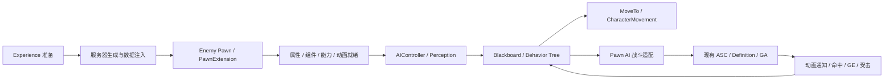

# 敌人 AI 现状评估、Lyra 对照与开发路线

> 2026-10-11：本文保留现状审计与早期候选方案。多轮评审后的首版范围、接口语义和初始化契约以[普通怪物 AI 整合设计](enemy-ai-system.md)为准；下文较完整的组件体系与阶段计划不代表 v0.1 全部必做。

日期：2026-10-10。项目：Hodgepodge。引擎：UE 5.5.4。排查基线：06cd38f。

Lyra 对照目录：`E:/Project/UProject/study/Epic/LyraStarterGame`，本机项目 EngineAssociation 为 5.5。

## 1. 结论与本轮范围

**敌人系统属于部分完成：已有可复用的角色、GAS 和战斗执行基础；正式 ACT 敌人的自主决策链路尚未接通。** 不应把整个敌人系统称为“完全没做”，也不能把自动 Possess、受击探针或 ALS 示例称为已完成的敌人 AI。

本轮完成现状审计、实际资产核查、Lyra 源码与九份 AI 资产对照，以及分阶段实施与验收方案。未实现新的敌人 AI、未修改 C++／蓝图／配置，未将实验内容迁入 Main。下文新增类、接口、黑板键和参数均是**建议设计，当前尚不存在**。

“继续未完成任务”按当前敌人 AI 评估任务收尾；不据此宣称整个项目的历史待办已完成。进入编码前以第一阶段原型为交付边界，避免同时承诺普通怪、Boss、群体战术和全部地图。

## 2. 实际排查范围与证据

- 阅读根 AGENTS.md、AI_DEVELOPMENT.md、`.uproject`、Runtime Build.cs、相关配置，以及角色、PawnExtension、Experience、GAS、属性、战斗、移动、旋转、受击和死亡代码。
- 搜索项目自有源码中的 AIController、行为树、黑板、感知、StateTree、导航、目标选择、阵营及生成入口；另区分第三方 ALS 和编辑器 MCP 作者工具。
- 使用 UE PythonScript Commandlet 查询 `/Game` 下 **2447 项磁盘资产**。其中 BehaviorTree、BlackboardData、StateTree、EnvQuery 均为 **0**。不能仅依靠 BT／BB 文件命名得出这个结论。
- 导出 **83 份 Blueprint／AnimBlueprint／GameplayAbilityBlueprint** 的文本，未发现 AI MoveTo、RunBehaviorTree、AIPerception、StateTree、PawnSensing 等调用。读取敌人原生类与探针默认值、探针组件模板。
- 在隔离 Commandlet 中加载 `/Game` 下八份地图并读取已加载 Actor；正式 ThirdPersonMap 未发现敌人、AIController、NavMeshBoundsVolume 或 RecastNavMesh。另有一个导航体积的外部 Actor 包属于 ALS Playground，不能算正式地图导航已配置。World Partition 未加载区域的运行表现仍需后续 PIE 验证。
- 在本机 Lyra 中阅读相关 C++，并成功导出 ShooterCore 的控制器、生成组件、四个服务、装饰器、行为树及黑板九份资产。

原始数据、导出文本和日志位于 `Saved/EnemyAIAudit`；它们是审计产物，不纳入源码提交。机器可读摘要见[本轮审计结果](../Validation/enemy-ai-audit-results-2026-10-10.json)。

### 2.1 已有敌人基础

[`AHodgeEnemyCharacter`](../../Source/Hodgepodge/Private/Character/HodgeEnemyCharacter.cpp) 已实际实现：

- 自动 AI Possess，放置和动态生成均适用；当前默认控制器仍是 `/Script/AIModule.AIController`。
- Pawn 自身持有 ASC，Owner／Avatar 都是敌人 Pawn；ASC 开启复制，GameplayEffect 使用 Minimal 复制模式。
- 原生 HealthSet、CombatSet；通过 EnemyPawnData 初始化属性，服务器授予 AbilitySets。
- PawnExtension 绑定 ASC，重复初始化保护、延迟重试、EnemyPawnData 的 OnRep、销毁时解绑与撤销授予。

父类 [`AHodgeCombatCharacter`](../../Source/Hodgepodge/Private/Character/HodgeCombatCharacter.cpp) 提供移动、旋转仲裁、生命、受击、防御、死亡及复制基础。现有命中通知、Melee GA、DamageExecution、GameplayCue 和关系映射可以继续复用。

已有原生测试 `Hodge.HitReaction.EnemyPawnDataInitialization` 验证 Pawn 所有权、属性初始化及重复调用不增加 AttributeSet。**测试源码存在不代表本轮已重新执行该测试。**

### 2.2 当前敌人资产是探针与动画框架

`/Game/CodexText/HitReactionValidation/BP_EnemyProbe`：

- 继承 HodgeEnemyCharacter，使用默认 AIController。
- 已添加 HodgeCombatComponentBase 模板；没有自主感知、追击或决策图。
- EnemyPawnData 引用玩家属性配置、实验受击 Profile 与 AS_ReactionProbe；没有默认武器、ComboDefinition 或关系映射。
- AS_ReactionProbe 含 HitReaction GA 和两份实验动作 Definition，**没有授予 Death GA**。不能作为正式敌人的完整能力包。
- 使用主角网格和主角 AnimBP，属于验证夹具。

`/Game/Main/Character/EnemyBase/ABP_Enemy_Base` 和 `ALI_Enemy` 已存在。主 AnimBP 有 Linked Anim Layer、`UpperBobySlot`／`FullBobySlot` 和骨骼混合；TargetSkeleton 为空，父类为普通 AnimInstance，未发现具体 locomotion StateMachine。它是动画结构基础，不能据此认定敌人移动和受击动画已经适配完成。已有 Slot 拼写应保持，改名前需核对引用。

Gruntling、Troll、Frost Giant 等模型和移动／攻击／受击／死亡动画已导入 `Content/Assets/Enemies`，但素材存在不等于 Main 中已配置可运行敌人。

### 2.3 正式自主 AI 缺口

尚未发现项目自有的以下闭环：

- AIController 子类及感知回调；行为树、黑板、StateTree 或 AI 行为状态管理。
- 目标候选、敌友过滤、最后可见位置、仇恨与目标切换。
- NavMesh 场景配置、追击／巡逻／回家、不可达处理。
- 近战攻击选择、攻击距离与角度判断、GAS 调度及执行完成等待。
- AI 在受击／死亡后中止和恢复决策、群体攻击协调。
- 正式敌人生成、敌人专属 PawnData／AI Profile／能力包及端到端 AI 测试。

Runtime 已依赖 AIModule，但没有项目自有 NavigationSystem／StateTree 接入；模块依赖本身不是功能证据。引擎导航和行为树能力仍可作为开发基础。

### 2.4 两类独立示例

[`AHodgeSurvivorMode`](../../Source/Hodgepodge/Private/CodexText/HodgeSurvivor.cpp) 有真实的简单敌人逻辑：GameMode 生成普通 Actor，Tick 中向 Hero 直线移动，近距离扣血。它没有采用 HodgeEnemyCharacter、NavMesh、感知、战斗 GAS 或行为树，属于另一套生存玩法原型。

ALS 插件有 `AAlsAIController`、`/ALS/ALSExtras/AI/BT_Als`、`BB_Als` 及 AICharacter 示例。它们不在正式 Hodge 敌人链路中，不应为开发敌人而修改第三方插件。MCP 插件的行为树／感知作者接口属于 Editor 工具，同样不是 Runtime 敌人行为。

## 3. 对照本机 Lyra 的具体实现

### 3.1 玩家机器人与普通怪物的所有权不同

Lyra 的 `ALyraPlayerBotController` 继承 AModularAIController，设置 `bWantsPlayerState=true`；队伍由关联 PlayerState 提供，解除 Possess 时清理旧 Pawn 的 ASC Avatar。

`ULyraHeroComponent` 在 DataInitialized 阶段使用 PlayerState ASC，输入初始化跳过 Bot 对 LocalPlayer 的要求。PlayerState 根据 PawnData 授予 AbilitySets 并发送 LyraAbilitiesReady 扩展事件。HodgeHeroComponent／PlayerState 已保留同类结构，并增加属性就绪检查。

**建议保留两条清楚的路线：**

- 若未来需要“电脑控制的玩家角色”，按 Lyra PlayerBot 的 PlayerState ASC、GameMode RestartPlayer 和玩家重生链路实现。
- 本次普通 ACT 敌人继续采用已存在的 Enemy Pawn ASC。复用 PawnExtension、AbilitySets、关系映射与 Init State 原则，补齐敌人就绪条件；不为了表面一致而创建无用途的 PlayerState，或同时保留两个 ASC。

这一区别是对现有架构的适配，不是重新建立第二套伤害系统。

### 3.2 Experience 和模块化生命周期

LyraBotCreationComponent 监听 `CallOrRegister_OnExperienceLoaded_LowPriority`，只有服务器创建机器人。TeamCreationComponent 在 HighPriority 回调创建队伍。生成后通过 GameMode 初始化控制器、RestartPlayer 并推进 PawnExtension。

Hodge 已有高／普通／低优先级 Experience 回调，GameState／Character 已注册组件接收者。未来敌人生成组件应沿用这些机制，等待配置、阵营与组件请求准备完成，再由服务器生成敌人。不同功能不能各自用固定 Delay 猜测初始化完成。

但普通敌人的生成不应直接复刻 Lyra 的玩家 RestartPlayer：当前 HodgeGameMode 对无专属 PlayerState PawnData 的控制器会回退到 Experience.DefaultPawnData，实际是 Hero 配置。敌人应显式取得自身定义，并在延迟生成期间注入 EnemyPawnData。

当前 `Exp_HodgeDefaultExperience` 的 AddComponents 已核实：

- HodgeCombatComponentBase 注入 **HodgeCombatCharacter**，覆盖敌人子类，服务器和客户端均启用。
- HodgeEquipmentManagerComponent 注入 **HodgeHeroCharacter**，当前不覆盖普通敌人。

因此不能再给敌人重复添加战斗组件；使用武器装备的敌人需要补敌人范围的装备组件配置。没有启用该 Experience 的隔离测试地图，则必须显式提供必要组件。

### 3.3 决策与技能执行分开

Lyra 原生 PlayerBotController 没有实现完整射击行为。实际决策位于 ShooterCore：

- `B_AI_Controller_LyraShooter`：读取图确认有 WaitForExperienceReady、RunBehaviorTree、StartLogic／StopLogic、Possess／UnPossess、死亡绑定和队伍感知更新。
- `BT_Lyra_Shooter_Bot`：使用移动、EQS、条件分支和服务；黑板含 SelfActor、TargetEnemy、MoveGoal、OutOfAmmo。
- `BTS_SetFocus`：从黑板目标设置／清除 Controller Focus。
- `BTS_Shoot`：检查武器和弹药，通过 SendGameplayEventToActor 发送 `InputTag.Weapon.Fire`；还包含选择装备槽的事件。
- `BTS_ReloadWeapon`：通过 GameplayEvent 发送 `InputTag.Weapon.Reload`。

本项目借鉴“决策提出动作请求，能力系统完成动作”，不复刻弹药、武器拾取或持续射击服务。ACT 动作有前摇、承诺点、命中窗、后摇与受击中断，第一版应以一次请求等待一次执行结果为单位。

**Lyra 使用了 GameplayEvent，不代表本项目任意 InputTag 发事件就能启动技能。** 第一版独立攻击优先按现有 ASC Definition 查询取得 SpecHandle，再通过合法激活入口请求；若采用 GameplayEvent，需要显式配置 GA 的 AbilityTriggers 和事件载荷。ComboCoordinated 必须走战斗协调器授权，不能绕过现有 IsAuthorized 检查。

### 3.4 队伍、感知与死亡

Lyra 的 TeamAgentInterface／TeamSubsystem 统一解析 PlayerState、Controller、Pawn 与 Instigator，并广播队伍变化；BotController 更新感知监听者。Hodge 中有复制 Team 字段和伤害过滤，但队伍接口、赋值和通知仍有注释代码，不能当作完整阵营系统。

建议参考 Lyra 的一致性与解绑方式，统一敌友解析给 AI 选敌和 DamageRules 使用；对 Pawn 所有权的普通敌人支持独立阵营来源。NoTeam 是未知／未配置，不能直接作为“所有对象都是敌人”的依据。

Lyra 的死亡停机与解除 Possess 清理值得沿用，但其玩家机器人不会因为死亡停机就自动具备 ACT 怪物的倒地／挑飞恢复。Hodge 的实际受击 Tag／Phase 是控制权来源，AI 只消费这些结果。

## 4. 开发前需要处理的接入问题

### 4.1 ASC 已绑定不等于敌人可以攻击

EnemyCharacter 先调用 PawnExtension.InitializeAbilitySystem，广播 ASC 就绪，之后才初始化属性并授予 AbilitySets。因此仅监听 OnAbilitySystemInitialized 就立即启动行为树，会出现能力或属性尚未准备好的窗口。

建议新增可查询的敌人就绪结果／事件，条件至少包括 Controller、PawnData、ASC Owner／Avatar 正确、属性完成、所需组件注册、能力授予及动画资源可用。它应接入 Init State 或统一 readiness 汇合点，重复调用幂等，解绑后失效。当前 PawnExtension.GameplayReady 本身没有完整检查这些敌人条件。

### 4.2 默认武器初始化仍有玩家假设

`AHodgeCombatCharacter::TryInitializeAttributesAndEquipment()` 获取 ASC Owner 的 AHodgePlayerState；没有 PlayerState 就直接返回。`InitializeDefaultEquipment()` 本身支持非 PlayerState 装备，但当前敌人初始化没有调用这条自动路径。

需将“玩家持久属性协调”与“Pawn 通用装备准备”分开，保持玩家行为和敌人自身属性初始化，同时给敌人建立合法调用时机、重复调用保护和撤销流程。若第一版采用自身骨骼作为攻击来源，也必须配置对应 HitSources，而不是等待武器字段自动解决。

### 4.3 寻路和动作朝向不能绕过现有组件

- 受击组件已经调用 AAIController.StopMovement，MovementComponent.ApplyRequestedMove 也阻断强受击控制；但没有行为树暂停／恢复和重新寻路闭环。
- 目前攻击状态对输入加速度的约束不能证明 AI 路径请求已停；攻击开始应明确结束自己的 MoveTo，受击取消的请求不能被误判为永久不可达。
- Controller.SetFocus 不会自动取代 Movement 驱动。追击使用移动朝向，攻击由当前旋转仲裁请求动作朝向，必要时战斗侧移选择 Controller 驱动。
- 当前 RotationComponent 的非 GA Source 必须是 Pawn 本身或 Pawn 内对象。Controller 直接把自己作为 Source 传入会被拒绝；建议由 Pawn 上的 AI 战斗适配组件持有朝向句柄。
- 延续现有攻击约束：本轮方案不新增攻击旋转锁，不在 AI Tick 直接写 ActorRotation 或反复切换 CharacterMovement 的旋转开关。

### 4.4 GAS 伤害感知需要桥接

当前生命伤害在 GE／HealthSet 中消费；未发现 AISense_Damage.ReportDamageEvent。不能假设玩家造成 GAS 伤害后，UE 的 AI Damage Sense 自动收到事件。

可在服务器订阅已有 HealthSet.OnDamageAccepted，将实际伤害来源提供给仇恨／感知适配层，或明确报告 Damage Sense。被闪避、免疫及零生命伤害不应被错误记为有效伤害；纯控制是否增加仇恨另设策略。

### 4.5 动画与遗留资产

第一只正式怪物必须有匹配骨架的 AnimBP、移动资源、攻击蒙太奇、HitReactionProfile 和 Death GA。不能直接把主角的动画或试验 Probe 配置当成成品。

广泛加载资产时发现旧 `/Game/Main/Character/Hero/GA_Attack` 的 PlayTimeline 异步节点失效，导致第二次全量资产导出 Commandlet 退出 1；数据导出仍完成。正式五段 BasicAttack 是另一组资产，本轮未证明旧资产完全无引用，也没有顺手修复或删除。应另做引用核查后迁移／停用，不据此判定 AI 模块编译失败。

## 5. 建议架构与接口边界

首版采用 **AIController + AI Perception + Blackboard + Behavior Tree**；首版不同时引入 StateTree 和另一套手写高层状态机。Behavior Tree 在本机 Lyra 中有完整可对照实例，现有模块也具备 AIModule。EQS 放到战斗站位迭代再引入。

以下是拟新增职责，不是当前可配置资产或可调用接口：

- `AHodgeEnemyAIController`：服务器 Possess、感知与黑板，受击／死亡通知，行为树生命周期。借鉴 ModularAIController 的 Receiver／Ready／EndPlay 行为；项目未依赖 ModularGameplayActors，不能直接加入其基类而不处理依赖。
- `UHodgeEnemyAIProfile`：行为树、感知、搜索／回家、目标保持及攻击选择参数。通过敌人的数据定义引用，可考虑在 PawnData 中新增可选 AI Profile 字段；不把 AI 配置硬塞进 HeroComponent。
- `UHodgeEnemyCombatComponent`：Pawn 上的 AI 适配层，缓存 ASC／CombatComponent，提出合法动作请求、保存执行上下文、等待完成并管理自己的朝向请求。复用 HodgeCombatComponentBase 和 Melee GA，不再次结算伤害。
- `UHodgeBTTask_ExecuteAbility`：请求一次动作并等待结果；处理激活失败、取消和异步回调解绑。
- 目标选择逻辑：首版可在控制器中实现，候选规则扩展后再提取组件；不为只有一个使用者的原型先建立庞大服务框架。
- `UHodgeEnemySpawnComponent`：后续放在 GameState／关卡 Encounter 范围，由 Experience 准备后在服务器生成，处理卸载、死亡和生成额度。
- 阵营适配：参考 Lyra TeamAgentInterface／TeamSubsystem 的查询和变化通知，复用现有 Team 字段；第一版只实现必要查询与通知，后续需要多人队伍信息时再扩充。

建议接口语义：

- `TryStartBrain()`：条件不满足只等待，成功后不重复启动；失去 Pawn／ASC／配置后停机。
- `RequestAttack(AbilityTag, Target, Context)`：返回 RequestId 和 Accepted／NotReady／Blocked／InvalidTarget／Unavailable 等结果；Accepted 只表示已接受，不表示完成。
- `OnAttackFinished(RequestId, SpecHandle, ExecutionId, Outcome)`：只处理当前 Pawn 代和当前执行，旧回调不能结束新攻击。
- `CancelAttack(RequestId, Reason)`：遵守 GAS 的取消规则和死亡豁免；BT Abort 不得无条件取消 Death 或不可取消阶段。
- `ReevaluateAfterControl()`：控制解除后重新验证目标、地面、路径与攻击资格，再决定追击或攻击。

若用非实例化 BTTask，不能将每个敌人的目标或 RequestId 存入共享 Task UObject；应使用 NodeMemory 或节点实例化。先绑定完成监听再激活，覆盖技能同步结束的情况；所有失败／Abort／UnPossess／EndPlay 路径都要解绑。

建议最小黑板键：TargetActor、LastKnownLocation、HomeLocation、HasLineOfSight、CanAct、InAttackRange、ReturnHome。AI 不应把这些键作为生命、受击 Phase 或攻击 GA 状态的第二份权威数据；它们是对现有状态的决策视图。

参数按厘米、秒和角度统一单位：SightRadius／LoseSightRadius、视野半角、攻击进入／退出距离、攻击朝向容差、目标切换宽限、丢失目标记忆时长、LeashRadius、回家到达距离、寻路重试间隔及次数。距离边界加滞回，防止追击／攻击每帧切换；具体数值随首只怪物的胶囊与攻击动画测量，不把未经验证的数值写死为标准。



## 6. 分阶段、可执行的开发计划

每阶段验收通过后再进入下一阶段；预计工作量需要根据人员、素材和需求重新估算，本轮没有约定截止日期。下列先后关系是阶段节点，不是交付时间承诺。

### 阶段 0：需求定义与敌人接入就绪

**目标：**选一只地面近战普通怪，固定一个攻击、一个玩家和一个测试场景，先验证身体能移动、攻击、受击和死亡。

行动：确定怪物模型／骨架、移动和攻击资源；定义视野、攻击距离、前后摇、丢失目标、强控恢复、死亡与是否复活；明确服务端决策。补齐敌人 readiness、阵营最小规则、必要装备组件与装备初始化、Death／HitReaction 能力包和正式 PawnData。复用已覆盖敌人的 Combat 组件请求，检查没有重复组件。

交付：需求与状态规则、正式敌人 BP／PawnData／能力包／动画配置、初始化原生测试。这里创建的字段和接口应随实现一起提供，不能只要求策划配置不存在的字段。

验收：放置和动态生成均得到一个合法 ASC；属性和 Spec 不重复；晚到 PawnData／组件可正常完成准备；没有 PlayerState 仍正常初始化；缺配置给出原因且不启动 AI；销毁、重新 Possess 无旧委托。人工触发攻击能实际命中，强控与死亡正常。

### 阶段 1：感知、巡逻和追击原型

**目标：**不依赖攻击，验证“发现 → 追击 → 丢失 → 搜索 → 回家”。

行动：实现 AIController 生命周期与最小 BT／BB；在隔离测试地图添加 NavMeshBoundsVolume 并确认 Agent 尺寸、连通性和可达范围；配置 Sight，必要时加 Damage 感知；从有效候选中选择目标，保留最后可见位置。路径失败使用有次数和间隔的重试，未知／死亡／已销毁对象不可作为目标。

交付：可视化 BT／BB、可配置 AI Profile、导航测试关卡、感知／目标边界测试。

验收：不会隔墙发现玩家；遮挡后不持续读取不可见目标的精确位置；墙角绕行、目标不可达、目标销毁和越出追击范围均有结果；两名玩家中的任一名都能被选中，不能固定 Player0；停止追击释放自己设置的 Focus。

### 阶段 2：单次攻击与控制／死亡闭环

**目标：**首个完整 ACT 敌人原型。

行动：距离和角度合格后 StopMovement；Pawn 适配层请求攻击朝向及 Standalone Definition，BTTask 等待 GAS 实际结束；通过现有动画通知结算命中。加入失败退避、后摇、强控及死亡高优先级分支。受击组件负责物理和动画反应，AI 禁止再次启动 MoveTo／攻击；控制解除后重新决策。

交付：攻击 Task、执行上下文、受击／死亡事件桥接、第一套正式动作资源和端到端探针。

验收：攻击只激活一次；激活被阻塞不死循环；敌人攻击可被玩家闪避；轻反馈不错误停机；允许的强受击中断攻击，霸体等拒绝控制时继续执行；挑飞／倒地期间不寻路，落地／起身完成才恢复；死亡不被 AI 的 Abort 或新攻击取消。等待时目标死亡／更换、GA 同步结束、旧回调晚到均不污染下一次执行。

### 阶段 3：多人、生命周期与回归

**目标：**证明正式链路在复制与加载时序下工作，而不是只在单人看起来正常。

行动：服务器执行决策、路径和伤害，客户端接收敌人表现；检查 Minimal ASC 下未拥有敌人的客户端如何取得动画与受击状态，不能依赖客户端获得完整 AbilitySpec／GE 明细。加入 Experience 卸载、敌人直接销毁、重新生成、玩家重生、阵营改变和攻击中断测试。

交付：Editor／Game 常规构建结果、相关原生测试、蓝图编译报告、单人与双客户端 0／100ms 测试报告及失败样本。

验收：双方看到一致的移动、攻击和受击；伤害只由服务器结算且不重复；玩家重生后旧 Avatar 不再作为目标；晚到状态不恢复已死亡敌人；结束无命中会话、姿势租约、委托、定时器或组件请求泄漏。沿用已有 Combat／HitReaction／Facing／Movement 回归，不能只测新增 AI。

### 阶段 4：战斗决策与多敌人迭代

**目标：**从“能打”发展到有战斗节奏。

行动：按距离、朝向、视线、动作可用性和权重选择攻击；增加后撤、侧移、绕行、远程角色；需要站位评分时再引入 EQS。加入服务器攻击名额／令牌，限制同时进攻者；受击、死亡、目标切换与超时均释放名额。加目标保持与仇恨衰减，避免多个玩家之间来回抖动。

验收：多个敌人不会全部无间隔围殴；狭窄入口和路径失败不会无限重试；攻击多样性不导致忽略冷却／阻塞；目标切换可解释且有调试数据。Boss 阶段、特殊空中追击等另开明确需求，不塞入首版通用树。

### 阶段 5：规模、资源校验与发布验证

行动：分级更新目标／决策，限制 EQS 和路径重算；根据预算实测 10／30／更多敌人；验证导航 Agent、地图流送、资源异步加载及实例生命周期。根据具体碰撞策略选择避让方案，不直接同时开启多套避让。补资源 DataValidation，错误资源阻止上线而不是运行时猜测。

验收：报告 GameThread、AI／导航耗时、网络复制和动画更新预算；完成目标平台 Cook／打包及独立进程联机。PIE Listen Server 成功不等于已支持 Dedicated Server 可执行目标，当前项目没有相应 Server Target。

## 7. 测试组织与责任

- 程序：初始化、阵营与目标规则、AIController、GAS 适配、异步／网络测试及日志。
- 玩法设计：发现／脱战／攻击承诺点、技能选择和多敌人节奏参数。
- 动画／技术美术：匹配骨架、移动动画、蒙太奇 Slot／Group、通知窗口及过渡。
- 关卡／测试：NavMesh 范围、遮挡、不可达区域、流送及多人场景。人手较少时可由同一人承担，但每阶段都应有明确验收记录。

原生测试覆盖正常初始化、缺数据、重复初始化、目标无效、距离滞回、队伍变化、激活失败、请求代号及旧回调隔离。PIE 验证真正的感知、路径、蒙太奇、命中和复制；这些行为不能仅用纯函数测试代替。覆盖率需采用实际工具采集；没有采集时不提供推测百分比。

## 8. 本轮实际命令、结果与未验证项

主要命令：`rg --files`、`rg -n`、`Get-Content`、`git status --short --branch`，以及：

```powershell
& 'E:/UE/UE_5.5/Engine/Binaries/Win64/UnrealEditor-Cmd.exe' 'E:/Project/Git/Hodgepodge/Hodgepodge.uproject' -run=pythonscript '-script=E:/Project/Git/Hodgepodge/Saved/EnemyAIAudit/inspect_assets.py' -unattended -NullRHI -nosplash -nosound '-abslog=E:/Project/Git/Hodgepodge/Saved/EnemyAIAudit/InspectAssets2.log'
& 'E:/UE/UE_5.5/Engine/Binaries/Win64/UnrealEditor-Cmd.exe' 'E:/Project/Git/Hodgepodge/Hodgepodge.uproject' -run=pythonscript '-script=E:/Project/Git/Hodgepodge/Saved/EnemyAIAudit/inspect_integration.py' -unattended -NullRHI -nosplash -nosound '-abslog=E:/Project/Git/Hodgepodge/Saved/EnemyAIAudit/InspectIntegration3.log'
& 'E:/UE/UE_5.5/Engine/Binaries/Win64/UnrealEditor-Cmd.exe' 'E:/Project/UProject/study/Epic/LyraStarterGame/LyraStarterGame.uproject' -run=pythonscript '-script=E:/Project/Git/Hodgepodge/Saved/EnemyAIAudit/inspect_lyra.py' -unattended -NullRHI -nosplash -nosound '-abslog=E:/Project/Git/Hodgepodge/Saved/EnemyAIAudit/InspectLyra.log'
```

- Hodge 首次资产审计退出 0；后续完整资产导出退出 1，定位为旧 GA_Attack 的 PlayTimeline 编译错误，Python 数据与 83 份导出完成。
- 最终 Experience／能力包属性核查退出 0，数据无读取错误；保留引擎启动／资产校验警告。
- Lyra 九份目标资产核查退出 0，数据无读取错误。没有修改 Lyra 源码或资产。
- 本轮没有 C++ 改动，未运行 Editor／Game 构建、AI 原生测试、AI PIE／联机或打包；只读加载和导出不等于 AI 行为测试通过。
- 新增本评估文档与审计摘要；没有自动提交 Git，日志、缓存和导出均留在 Saved。

实现参考以本机源码与资产为准。引擎概念可参见 Epic UE 5.5 的[行为树概述](https://dev.epicgames.com/documentation/en-us/unreal-engine/behavior-tree-in-unreal-engine---overview?application_version=5.5)、[AI Perception](https://dev.epicgames.com/documentation/en-us/unreal-engine/ai-perception-in-unreal-engine?application_version=5.5)和[基础导航](https://dev.epicgames.com/documentation/en-us/unreal-engine/basic-navigation-in-unreal-engine?application_version=5.5)。
