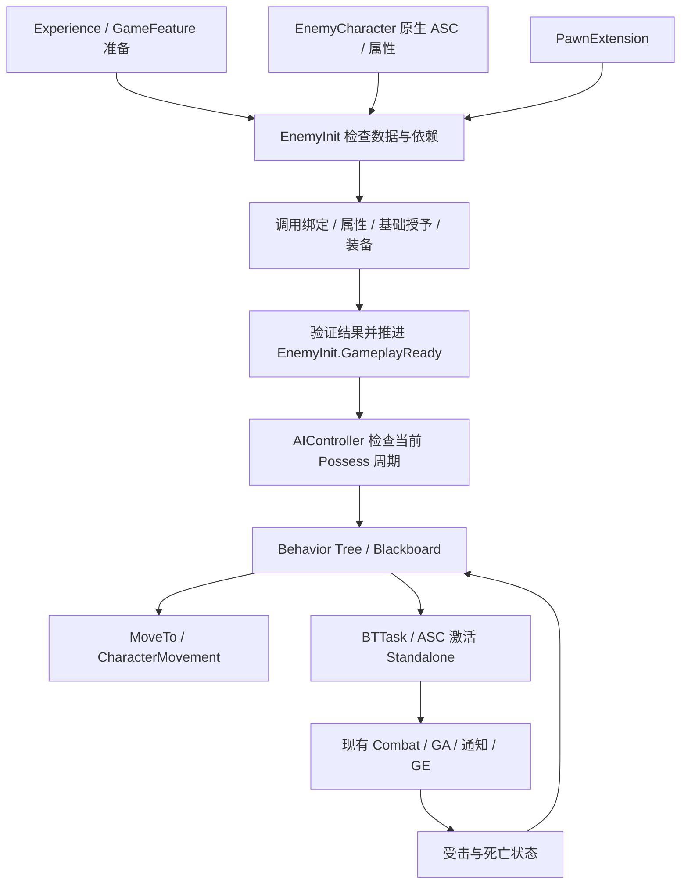

# Hodgepodge 普通怪物 AI 与 Experience／GAS 集成设计

版本：v0.1 实施契约。日期：2026-10-11。适用引擎：UE 5.5.4。

状态：**v0.1 已实现并完成本轮验证。** 新增接口见第 18 节，正式 Guardian 资源及操作步骤见 [配置手册](../Guides/enemy-ai-configuration.md)。Editor／Game 常规构建通过，57 项原生测试通过，7 份 Guardian 蓝图编译无错误／警告；单人 PIE 14 项、Listen Server 18 项端到端检查通过。验证方式及未验证范围见 [实施报告](../Validation/enemy-ai-implementation-2026-10-11.md)。

实现前源码基线为 `06cd38f`；2026-10-10 的[敌人 AI 审计](enemy-ai-development-assessment.md)与[机器可读结果](../Validation/enemy-ai-audit-results-2026-10-10.json)保持历史事实。本轮新增代码和正式资源不反写为当时已经存在。

阅读建议：第 1～5 节用于了解背景、现状与方案取舍；第 6～13 节是程序实现契约；第 14～16 节用于验收与后续任务安排。首版以第 7 节四项契约和第 14 节十项验收为边界。

## 1. 背景与目标

### 1.1 背景

项目已打通玩家攻击、动画通知命中、伤害、受击、装备以及移动与旋转的主要链路。普通敌人已有 Pawn 所有权 ASC 和基础属性初始化，但自主感知、寻路、战斗决策及可靠的初始化到 AI 启动链路尚未接通。

项目大量参考 Lyra，因此普通怪物应沿用 Experience、GameFeature、PawnData、GAS 和 Init State 的组织原则。普通怪物与 Lyra 玩家机器人具有不同的状态持久性和所有权，不直接复制其 PlayerState／RestartPlayer 流程。

### 1.2 首版目标

在服务器权威下，让一只预放置普通近战怪物完成：

1. 等待 Experience 与自身数据准备。
2. 正确绑定 ASC，初始化属性，授予基础能力并准备必要装备。
3. EnemyInit 完成 GameplayReady 后，由 AIController 启动行为树。
4. 获取有效玩家目标、使用导航追击，通过 GAS 执行一次 Standalone 攻击。
5. 根据已有受击状态限制动作，死亡时停止正常决策。
6. 在 Listen Server 中至少验证一个远端客户端的移动、攻击、受击和死亡表现。

第一阶段先交付初始化与测试，再接行为树及攻击，避免一次性重构整个 AI、GAS 或 Experience。

### 1.3 首版不包含

- 独立 EnemySpawnComponent、Encounter／波次框架、对象池和存活 Pawn 的任意重置。
- 通用 AI 动作请求框架、完整 Combo AI、Boss 阶段与群体战术。
- 复杂部分授予恢复、任意玩法副作用回滚、完整 GameFeature 异步停用和 Experience 热切换。
- 完整 StateTree／EQS 方案、玩家锁定目标服务与锁定 CameraMode。
- 独立 Dedicated Server 构建／发布验收和大规模性能承诺。

这些内容保留扩展边界，但不作为首版必做组件。

## 2. 实现前基线与证据边界

本节记录实施前审计，用于解释改动原因。现在的实现见第 18 节与实施报告：原生控制器已替换，敌人装备注入已补齐，固定初始化 Timer 已移除。

### 2.1 已有可复用基础

[`AHodgeEnemyCharacter`](../../Source/Hodgepodge/Private/Character/HodgeEnemyCharacter.cpp) 已创建原生 EnemyAbilitySystem、HealthSet 和 CombatSet，启用 ASC 复制和 Minimal GE 复制模式，配置自动 AI Possess；OwnerActor／AvatarActor 均为敌人 Pawn。

现有初始化通过 EnemyPawnData 配置属性和基础 AbilitySets，使用 PawnExtension 绑定 ASC，并处理延迟重试、复制到达和 EndPlay 清理。它是实际代码，不是空类；但当前默认控制器仍为引擎 AIController。

父类 [`AHodgeCombatCharacter`](../../Source/Hodgepodge/Private/Character/HodgeCombatCharacter.cpp) 提供移动、旋转、生命、受击、防御及死亡基础。现有 CombatComponent、Melee GA、Definition、动画通知、GE 和 GameplayCue 继续作为战斗执行系统。

当前 Experience 的组件配置已核实：

- CombatComponent 注入 HodgeCombatCharacter，覆盖敌人子类。
- EquipmentManager 注入 HodgeHeroCharacter，尚未覆盖普通敌人。

因此不能重复添加战斗组件；使用装备的怪物需补充明确的装备组件覆盖范围。

### 2.2 已有资产不等于正式 AI

2026-10-10 审计读取 `/Game` 下 2447 项资产，BehaviorTree、BlackboardData、StateTree、EnvQuery 数量均为 0；正式 ThirdPersonMap 已加载 Actor 中未发现敌人和导航体积。这是当时的审计结果，不替代之后的地图运行验证。

`BP_EnemyProbe`／`DA_EnemyPawnData` 位于 CodexText 受击验证目录，使用主角网格、实验受击配置和默认 AIController。其能力包不包含 Death GA，不作为完整正式怪物配置。

Main 的 ABP_Enemy_Base／ALI_Enemy 有 Linked Layer、Slot 和骨骼混合框架，但没有完成具体怪物的移动与动画适配。导入的 Gruntling、Troll、Frost Giant 素材可供后续选择，素材存在不表示成品已配置。

Survivor 的 GameMode Tick 直线追逐和 ALS 的 AIController／BT／BB 是两套独立示例。MCP 的 AI 作者接口属于编辑器工具，均不能算作正式 Hodge 敌人 AI。

### 2.3 已确认的接入问题

1. PawnExtension.GameplayReady 不直接确认敌人的属性、技能、装备与扩展准备。
2. EnemyCharacter 在属性初始化与 AbilitySets 授予前广播 ASC 绑定通知；不能用该通知启动 AI。
3. TryInitializeAttributesAndEquipment 要求 PlayerState Owner，普通怪物会跳过自动装备准备。
4. AbilitySet 授予函数返回 void，存在跳过无效条目的路径，调用返回不能证明全部必需内容成功。
5. AddAbilities 的幂等记录只有 Actor 粒度，多条匹配配置有冲突风险；未加载软引用被跳过后也可能留下已扩展记录。
6. 敌友接口与变化通知仍不完整；NoTeam 不能直接当作所有对象均敌对。

第五项是代码支持的条件性风险，尚未证明当前正式 Experience 已发生漏授予。现有 Client／Server AssetBundle 机制是正常预加载契约的一部分，需要检查其覆盖和加载结果。

## 3. 核心概念与定义

- **Experience**：组织整场游戏所需配置、GameFeature 和 Actions；不逐只拥有怪物的 ASC 生命周期。
- **GameFeature Action**：按类型注入组件或授予模式扩展，持有自己创建的请求与授予句柄。
- **PawnData**：描述角色类、属性、能力包、装备、关系映射及受击等配置。怪物必须使用自身数据，不能回退为 Hero 默认数据。
- **PawnExtension**：保存通用 PawnData、关联 ASC ActorInfo、应用关系映射并协调通用 Init State。
- **EnemyInit Feature**：新增的怪物初始化协调入口。调用现有系统、验证结果并推进自己的状态，不复制其业务实现。
- **Init State**：按 Feature 记录初始化阶段，不是怪物当前的攻击、眩晕或死亡状态机。
- **ASC 绑定通知**：表示 ActorInfo 关联完成；不承诺所有战斗资源已准备。
- **EnemyInit.GameplayReady**：本次有效初始化周期完成。首版 AI 启动的初始化前提。
- **战斗依赖有效**：当前 ASC／Avatar、组件、必要技能与装备仍满足要求；是运行时查询。
- **动作许可**：当前普通 AI 请求是否允许提交；具体技能仍由 GAS 进行最终检查。
- **初始化周期**：与当前 Pawn、ASC 和配置快照关联。重复通知属于同一周期；首版不支持随意修改快照并重新初始化。
- **Possess 周期**：AIController 每次拥有 Pawn 的独立生命周期；旧周期通知和技能回调不得影响新周期。
- **授予批次**：某个来源在某个上下文中创建的 Spec、持续 GE 与额外 AttributeSet 记录；用精确句柄撤销。
- **Standalone Definition**：独立攻击执行路由；无需 Combo 协调器的连段授权，但仍依赖现有战斗执行条件。
- **ComboCoordinated Definition**：需要 CombatComponent 授权的连段动作；后续 AI 接入不能绕过该授权。

对外不另存一份独立更新的 `bEnemyCombatReady`。内部可以保存步骤完成记录、防重入标志和失败原因，但初始化就绪结果应由 EnemyInit Feature 的状态推导。

## 4. Lyra 对照与适配原则

本机参考目录：`E:/Project/UProject/study/Epic/LyraStarterGame`。相关 C++ 和九份 ShooterCore AI 资产已在前期实际读取／导出。

### 4.1 玩家机器人与普通怪物

LyraPlayerBotController 设置 bWantsPlayerState，玩家机器人的 ASC 位于 PlayerState，队伍、玩家生成和重生也走玩家链路。LyraHeroComponent 跳过 Bot 的 LocalPlayer 输入要求，但仍依赖 PlayerState。

Hodge 普通怪物保留 Pawn ASC：随怪物生命周期创建与销毁，不为模仿 Bot 创建无用途的 PlayerState，也不保留两份 ASC。

未来若需要电脑控制的玩家角色，可另走 PlayerBot 路线。普通怪物的动态生成则显式注入敌人数据；直接 RestartPlayer 可能取得 Experience 默认 Hero PawnData。

### 4.2 Experience 与组件扩展

LyraBotCreationComponent 等待低优先级 Experience Loaded，在服务器创建 Bot；TeamCreationComponent 使用高优先级回调。Hodge 已有同类回调与组件接收者机制，继续复用。

首版不新增生成组件，保留自动 Possess：Controller 可以先存在，AI 逻辑等待 EnemyInit。高／普通／低优先级只保证通知顺序，异步依赖仍需验证实际结果。

### 4.3 行为树与 GAS

Lyra 原生 BotController 不包含完整射击决策；ShooterCore 的控制器蓝图等待 Experience、启动／停止 Brain，行为树结合 MoveTo、EQS 和服务选行为。

BTS_Shoot／BTS_ReloadWeapon 使用 GameplayEvent 发起 Fire／Reload，BTS_SetFocus 消费黑板目标设置 Focus。Hodge 借鉴决策与执行分离，不复制射击、弹药与装备拾取流程。

GameplayEvent 必须匹配 GA 的 AbilityTriggers。不能因为事件名称包含 InputTag，就认为会自动触发本项目的输入或连段路径。

### 4.4 阵营与生命周期

参考 Lyra TeamAgent／TeamSubsystem 的统一查询、变化通知及解绑原则；普通敌人应支持自身阵营来源。首版只完成玩家与敌人的必要过滤，完整队伍／仇恨体系后续实现。

参考 Lyra 的 Possess／UnPossess 与死亡停机，但 Hodge 的强控、挑飞、倒地和恢复由已有受击系统决定，AI 只消费状态。

## 5. 方案对比与取舍

### 5.1 Pawn ASC 与 PlayerState ASC

Pawn ASC 与普通怪物已有实现一致，生命周期直接，首版采用。PlayerState ASC 适用于玩家机器人、持久玩家属性和跨 Pawn 重生；普通怪物不因此增加 PlayerState。

### 5.2 完整组件体系与精简首版

早期候选体系包括独立生成组件、AI Profile、战斗适配组件和通用请求框架，扩展性较强，但同时引入多条初始化与回收依赖。

最终首版新增 EnemyInit 与 EnemyAIController，在第一次攻击实现时补最小 BTTask；复用 Combat、Equipment 与 GAS。生成、复杂 Profile 和群体协调在出现明确需求后提取。

### 5.3 Behavior Tree、StateTree 与手写状态机

首版采用 AIController、AI Perception、Blackboard、Behavior Tree：本机 Lyra 有实际对照资源，现有模块依赖 AIModule。

StateTree 保留为未来评估选项；不在首版同时引入另一套高层状态机。手写少量控制器生命周期状态可以使用，但不重复维护完整的追击／攻击行为系统。EQS 在需要站位评分时再引入。

### 5.4 事件推进与固定轮询

最终方向为事件驱动，加当前状态查询。Extension Event 不保存任意过去事件；AddExtensionHandler 对符合条件的现有 Actor 有 ExtensionAdded 发现补偿，但不能据此推断自定义 Ready 已补发。

注册后立即查询、OnRep／Possess／资源完成等事件再次检查，解决晚注册。现有 0.1 秒 Timer 在事件覆盖验证完成后逐步撤除，不先删除重试保障再等待补齐入口。

### 5.5 Init State 与独立 Ready 布尔值

EnemyInit 自己注册并推进四阶段，AI 以该 Feature 的 GameplayReady 为前提。管理器记录和通知状态，组件负责检查与推进。

独立 Ready 布尔值容易与 Init State 漂移，不采用。运行时依赖失效、强控和死亡使用查询及 GAS 状态，不将初始化状态倒退。

### 5.6 部分恢复与预校验加失败停止

复杂分项恢复需要处理已经执行的 GE、自动激活和外部副作用，首版不实现。

采用必需配置预校验、授予结果确认、步骤成功记录与失败停止。部分失败保留精确句柄，清理可撤销资源并阻止 GameplayReady，不直接重跑整份 AbilitySet。

### 5.7 Standalone、Combo 和 GameplayEvent

首版通过 ASC 查询已授予的 Standalone Spec 并激活；CombatComponent 提供执行条件、姿势和命中功能。当前没有独立公开的 CombatComponent“通用 Standalone 激活入口”，不能将拟新增接口当成现有能力。

ComboCoordinated 后续沿用协调器授权。GameplayEvent 作为显式配置的另一入口，不代替所有类型的能力激活。

## 6. 最终架构与职责

### 6.1 已有系统

- ExperienceManager：资源、GameFeature 和 Actions 的加载与激活。
- PawnExtension：通用数据、ASC 关联与关系映射。
- EnemyCharacter：原生 ASC／AttributeSet、角色配置和角色基础。
- EquipmentManager：装备创建／卸载、装备能力授予与句柄。
- AbilitySet／ASC：实际授予与撤销、技能激活和复制。
- CombatComponent／Definition／Melee GA：授权、执行、动画通知命中和伤害。
- Health／HitReaction／Rotation／Movement：生命、控制、朝向仲裁和移动执行。

### 6.2 拟新增的最小部分

- **UHodgeEnemyInitComponent**：原生挂在 EnemyCharacter，尽早注册 EnemyInit Feature；是敌人初始化的唯一协调入口。
- **AHodgeEnemyAIController**：服务器感知、黑板、行为树以及每次 Possess 的绑定周期。
- **UHodgeBTTask_ExecuteAbility**：首个 Standalone 攻击 Task，等待本次 GAS 执行结果，不另建完整动作框架。

首版行为树资源可直接配置在敌人 AIController 蓝图上；暂不强制创建独立 AI Profile 数据体系。必须随编码提供真正的属性与配置指南，不能要求配置尚不存在的字段。



## 7. 冻结的四项契约

1. **Init State**：EnemyInit 注册、查询并推进自己的 Feature；AI 启动以 EnemyInit.GameplayReady 为初始化前提，不使用 PawnExtension 的 Ready 代替。
2. **TryInitialize**：唯一协调入口，可重复触发、防重入、按步骤确认成功；永久配置错误停止自动重试。
3. **能力授予**：基础、装备、GameFeature 分别管理精确句柄；成功可验证，部分失败不重复授予；授予循环保留在共享系统。
4. **AIController**：每次 Possess 独立周期，行为树成功启动后才标记 Running；解绑使旧回调失效。

新增接口均为语义契约，最终反射声明与调用方式按相邻代码实现，不将以下示意视为已经可编译的源码。

## 8. EnemyInit 生命周期与接口语义

### 8.1 Feature 状态推进

**Spawned**：Pawn 和必要原生对象存在。EnemyCharacter 负责创建对象，EnemyInit 负责报告自己已到达该阶段。

**DataAvailable**：必要 Experience 已 Loaded，怪物自身 PawnData 与必需资源可用；服务器 Controller 已存在。客户端不要求未复制给它的 AIController，也不等待完整 AbilitySpec。

**DataInitialized**：服务器完成 ASC 关联、属性、基础能力、必要装备以及声明为必需的扩展。客户端完成本地数据、ASC 和必要表现组件的绑定，不声称服务端授予已由客户端执行。

**GameplayReady**：EnemyInit 的首版初始化依赖与完成验证全部满足。由 EnemyInit 调用状态链推进后发布给管理器；首版不在此处再引入一套隐含的装备或授予操作。

**AI Running**：服务器 AIController 的运行状态，独立于 Init State。

PawnExtension.DataInitialized 等待所有 Feature 的 DataAvailable。因此 EnemyInit.DataAvailable 不得反向等待 PawnExtension.DataInitialized、已授予全部能力或默认装备完成。先报告数据可用，再协调后续准备，避免循环。

### 8.2 唯一执行入口与迁移

EnemyCharacter 现有 InitializeEnemyAbilitySystem 必须迁移或委托给 EnemyInit，不保留两套属性／授予执行逻辑。首版保留原生子对象名字和必要兼容入口；旧函数的返回含义与现有测试、蓝图调用一起核对。

PawnExtension 的 OnAbilitySystemInitialized 继续表示绑定完成，不能延迟改名为全战斗就绪。AI 改为监听 EnemyInit 的目标状态。

EnemyInit 调用现有装备准备，不直接生成武器或重复授予装备能力；调用后验证真实实例和必要能力。DefaultWeaponDefinition 为空时，装备条件为“不要求”，徒手来源仍需合法 HitSources。

### 8.3 TryInitialize 结果

建议返回可区分的结果：

- **Waiting**：依赖正在到达／加载，记录等待原因，由相关事件再次推进。
- **Ready**：当前初始化周期已到达 EnemyInit.GameplayReady。
- **Failed**：已确认配置或不可恢复操作错误，记录步骤与原因，本周期不自动重试。ASC 身份冲突、服务器绑定了其他 PawnData、缺少必需 StatProfile、非法等级／Definition 都属于此类，绝不标记 Ready；资源尚未到达仍为 Waiting。
- **Invalidated**：Pawn／ASC／初始化周期在过程中失效，停止继续操作并进入清理。

结果不等于额外的 Ready 事实来源；Ready 由 Feature 状态确认。内部步骤记录用于防重执行，例如属性已提交、各基础批次已完成及装备已验证。

CanChangeInitState 主要做无副作用判断。TryInitialize 调用系统并验证结果，再请求推进状态；不得因进入一个状态就假定异步授予完成。HandleChangeInitState 可以处理确定的本地切换，但不能在操作失败后仍发布完成状态。

### 8.4 防重入与成功提交

1. 执行前记录当前 Pawn／ASC／配置周期，并设置执行中标志。
2. 执行中再次收到请求，记录需要重新检查，不递归执行，也不永久丢弃请求。
3. 外部调用返回后重新检查绑定与周期是否仍有效。
4. 本步骤已验证成功才记录完成，后续重试跳过它。
5. 基础配置完成预校验后才执行可能改变属性／授予的操作。
6. 全部首版条件满足后请求 GameplayReady；通知发布前完成记录已经提交。
7. Failed／Invalidated／EndPlay 不再继续初始化，解绑监听并清理本周期可撤销资源。

特别验证“属性初始化成功后发生其他失败”“受伤后收到重复通知”：不得重新应用初始化 GE 或补满生命。

### 8.5 事件入口与数据归属

TryInitialize 可由 BeginPlay、Possess、PawnData OnRep、Experience Loaded、依赖 Feature 到达、组件注册和资源完成触发。注册监听后立即查询现有状态；定时器不是最终推进依据。

首版保留 EnemyPawnData 的资产兼容入口，PawnExtension 作为已绑定配置的读取入口。服务器不允许误用 Hero 默认 PawnData；配置不一致应报告原因。客户端双份数据可能乱序到达，暂时不一致视为等待，不能立即当成永久配置错误。

后续收敛 PawnData 复制来源时，需完成蓝图／序列化引用、OnRep 和测试迁移；不能直接删掉现有属性。

### 8.6 初始化与运行时查询

拟提供三个分开的查询：

```cpp
// 当前有效周期的 EnemyInit 是否已经完成初始化。
bool IsGameplayReady() const;

// 当前 ASC、必要组件、技能及装备是否仍然有效。
bool HasValidCombatDependencies() const;

// 是否允许提交普通 AI 动作；具体技能仍由 GAS 最终检查。
bool CanExecuteAIAction() const;
```

后两项面向服务器决策。客户端以自身表现绑定与复制状态驱动动画／UI，不将同名 Init State 解释为拥有完整服务端战斗资格。

死亡、强控、暂停或必要资源撤销不让初始化阶段倒退。完成后失去 Controller／ASC／能力时，运行查询拒绝动作并暂停相关请求。初始化期间销毁或死亡则取消尚未完成的流程，不能继续发布 Ready。

首版不支持在存活 Pawn 上任意替换 ASC／PawnData 或对象池重置。发生非预期绑定替换时停止动作并报错，不自动重新应用整套基础数据。

## 9. 属性、能力与装备的集成契约

### 9.1 授予归属

- **原生 HealthSet／CombatSet**：EnemyCharacter 创建；不作为临时授予资源移除。
- **基础 AbilitySets**：EnemyInit 协调共享 API 授予并保存自身句柄，怪物销毁时清理。
- **装备 AbilitySets**：EquipmentManager 管理，卸装／替换时清理；EnemyInit 只验证结果。
- **Experience 扩展**：对应 Action 实例与 Context 管理，停用时只撤销自身资源。
- **初始化属性 GE**：EnemyInit 协调一次性应用；当前 StatProfile 要求 Instant，不保证可逆。

同一能力不能无意同时配在基础与装备来源中。同类能力由不同来源合法授予时，应按句柄区分，不能按 AbilityClass 全局删除。

### 9.2 共享授予 API 的最小补充

现有 GiveToAbilitySystem 返回 void，并有配置无效时跳过条目的路径。编码需在共享 AbilitySet 实现中提供预校验与可验证结果；不在 EnemyInit 复制授予循环。

建议保留旧入口兼容已有玩家调用，新增受检入口或结果机制；同一类成员实现继续集中在主 cpp。结果应区分未执行与执行后失败，并保留本批次实际创建的句柄及失败原因。

预校验包括资源有效、等级、Definition 合法性、必需 GA、基础 AttributeSet 冲突、重复条目和启动期激活策略。当前 AbilitySet 已有核心属性重复防护，应复用；GameFeature 直接授予属性的路径另行核对。

预校验覆盖基础能力包，以及初始化必需装备定义与其能力包，不能让装备授予绕过启动期副作用约束。装备仍由 EquipmentManager 执行实际授予，EnemyInit 通过结果查询验证，不自行接管装备句柄。EquipmentList.AddEntry 必须调用受检授予入口，拒绝空 AbilitySet，全部成功后才提交 FastArray Entry；失败撤销本候选句柄及装备 Actor，不能只检查返回了实例。

授予后验证实际 Spec、Definition 关联、所需属性及效果结果；不只统计数组长度或认为函数返回就是全部成功。校验失败不进入 GameplayReady。

### 9.3 预校验、失败停止与回滚限制

首版不实现整份 AbilitySet 的复杂部分恢复。必须在副作用前尽量完成所有必需配置预校验；执行中的不可恢复失败停止当前周期，保留已经发生的记录，不直接重跑整份集合。

可清理资源包括本次新增的能力、可移除的持续 GE 和额外 AttributeSet；清理前处理仍活动的本来源技能。Instant GE、已生成 Actor 或外部伤害等副作用不能承诺自动回滚。

失败怪物保持禁止普通行动并报告诊断，由测试／关卡管理决定销毁或重新生成；首版不“自动重置回血再试”。

### 9.4 OnSpawn 与授予回调

现有 OnGiveAbility 会通知蓝图并尝试激活 OnSpawn 能力。行为树没运行不代表授予期间不会出现技能副作用。

首版基础初始化包不允许依赖授予期间产生的外部战斗副作用。需要自动激活的能力应显式推迟至初始化提交后，或证明其属于安全的内部绑定／初始化；不为此重构全部 GAS 激活政策。

任意授予回调可能造成重入、死亡、解绑或销毁，返回后必须校验周期。此类行为进入测试，不只测试正常完成路径。

### 9.5 默认装备准备

拆开 PlayerState 专属 AttributeCoordinator 与 Pawn 通用装备准备。沿用 InitializeDefaultEquipment 的非 PlayerState EquipItem 分支，提供必要的调用／查询入口，不暴露内部字段给 AIController。

配置武器时要求正确 EquipmentManager、有效实例、挂接来源以及必需能力；空武器配置不等待实例。重复初始化确认既有实例，不重复装备；初始化中移除管理组件不得留下错误就绪。

## 10. Experience 与 GameFeature 扩展边界

### 10.1 首版假设

**v0.1 普通怪物的必需战斗技能来自基础或装备 AbilitySets，不依赖 GameFeature 额外提供的必需技能。** 因此完整 AddAbilities 改造可排在后续；首版仍等待 Experience 的公共组件与模式资源准备。

如果实现时改变此假设，扩展加载／授予确认必须前移到 P0，不能让 EnemyInit 一边等待必需扩展，一边将确认机制延期。

### 10.2 资源预加载契约

GrantedAbilitySets 已标记 Client／Server Bundle，ExperienceManager 加载相关资源集合。SetPtr.Get 是消费预加载结果，不能单凭该调用断定漏加载已发生，也不直接将全部 Get 改为同步加载。

当扩展成为必需时，验证 Bundle 覆盖、加载失败／取消、冷启动及打包结果。缺失必需资产不能标记授予成功；已经部分执行的扩展按精确记录清理，不整批重授予。

### 10.3 发现、绑定、授予完成

- ExtensionAdded：发现并检查 Actor。
- ASC 绑定可用：能够取得正确的当前 ASC。
- 授予确认：当前来源的必需内容实际完成。

三者不能混为同一个瞬时事件。注册后查询、事件触发重查，保留可查询的结果，支持晚注册；不能等待自定义历史 Ready 事件自动重放。

Actor／EntryIndex 记录应位于 Action 实例和 Context 内，并关联授予时的 ASC。多个匹配条目独立确认和撤销；同 Actor 的第一次授予不能阻止后续合法条目。

普通怪物复用已有 UHodgeAbilitySystemComponent；授予前确认其当前 ActorInfo。不能在尚未绑定时通过通用组件兜底误建第二份 ASC，或创建基础 UAbilitySystemComponent 后再假定它是 Hodge 类型。

### 10.4 停用与热切换

停用时先禁止新的相关请求，处理本来源执行，再撤销能力／持续效果／额外属性并释放请求；不先移除技能仍依赖的属性。

基础 Death／HitReaction 不应因可选模式扩展停用而被无关清理。必要能力若被移除，运行依赖查询失效，暂停动作而不倒退 Init State。

当前 Experience 的完整异步停用与实际资源卸载仍有缺口。无缝热切换、复杂资源撤销与对象池属于后续独立设计与验收。

## 11. AIController 与行为树生命周期

### 11.1 Possess 与启动

EnemyCharacter 的原生 AIControllerClass 设置为 HodgeEnemyAIController。正式敌人蓝图同时明确配置该类或子类，并验证保存后的默认值，不能只设置 AutoPossessAI。

OnPossess 先生成本次周期，绑定 EnemyInit 状态通知，再立即查询。已就绪和晚到就绪使用同一启动检查。

启动要求：服务器、当前 Pawn 与周期有效、EnemyInit.GameplayReady、当前依赖有效、怪物未死亡、BT／BB 资源有效。未满足时保持 Waiting；配置已确认无效时 Failed，而不是每次通知都调用 RunBehaviorTree。

运行态可用 Waiting／Starting／Running／Stopped 表达，不属于 Init State。只有 RunBehaviorTree 成功且调用返回后周期仍有效，才提交 Running；启动期间的重入也必须受保护。

同一周期成功启动一次；强控恢复通常通过分支条件／Brain 恢复，不反复创建同一树。

### 11.2 UnPossess 与死亡

OnUnPossess 停止 Brain 与移动，清除自身 Focus，解绑通知并使旧周期失效。技能任务的回调同样解绑，不能影响后来拥有的新 Pawn。

死亡停止正常 AI 决策，已有 Health／Death GA 管理死亡动画和销毁。停止 Brain 或 BT Abort 不得无条件取消 Death GA，也不能为了清理 AI 过早销毁其依赖。

### 11.3 最小决策树

优先处理死亡／不可行动，再选择当前攻击、追击或等待／简单巡逻。建议最少使用 TargetActor、HasLineOfSight、LastKnownLocation、InAttackRange 和 CanAct 等黑板视图；这些值由感知和系统状态更新，不能反写为新的生命／受击权威状态。

首版只实现一个明确目标规则与一个追击／攻击边界。需要视线、距离及阵营过滤；不能默认固定 Player0。丢失目标保留最后已知位置，路径失败采用有限重试，不持续读取不可见目标的精确位置。

## 12. BTTask 与 GAS 攻击闭环

### 12.1 实际激活路径

服务器 BTTask 检查本周期与目标，确认动作许可，停止自身 MoveTo，并完成攻击朝向准备。通过 ASC.FindDefinitionAbility 查询已授予的动作，再经 GAS 激活 Standalone。

GA 自身进行最终 CanActivateAbility 检查，CombatComponent 继续提供注册／执行条件与姿势、检测会话；动画通知驱动命中，Melee／GE 结算伤害。行为树不另扣血或直接以播放蒙太奇代替 GA。

GA 的输入或 GameplayEvent 路由需显式匹配；ComboCoordinated 以后走原协调器授权。目标只用于决策和必要朝向，真实攻击仍可打空，不能因为 AI 已选定玩家就保证扣血。

### 12.2 本次执行身份

Task 保存当前 Pawn、Possess 周期、SpecHandle 和本次执行身份。绑定完成监听后再激活，覆盖同步结束；同一 Spec 的下一次激活不能被上一次晚到回调结束。

非实例化 BTTask 不把敌人私有状态存入共享 UObject；使用节点实例或 NodeMemory。首版只服务一个攻击 Task，不提前搭建通用队列框架。

### 12.3 完成、失败与 Abort

- 激活接受后保持等待，GA 实际结束才返回对应结果。
- 被阻塞或目标无效返回明确失败，并采用树的退避／重新评估策略。
- Abort 解绑本次监听，并按现有技能取消规则处理本次动作；不能取消无关技能或 Death。
- 不能取消的动作仍由 GAS 生命周期结束；停止其 Task 不意味着技能已经消失，新动作必须遵守互斥。
- Task 不以固定 Delay 猜测蒙太奇结束；超时作为诊断与受控退出边界，不强行恢复所有状态。

请求身份、激活失败、取消及旧回调测试随第一次 GAS 攻击实现，不作为另一个庞大前置系统。

## 13. 受击、朝向与移动协同

轻反馈不自动停止整树；强控通过已有 GAS Tag／受击 Phase 禁止普通动作，暂停移动和攻击分支。感知可以继续更新。控制解除后重新验证目标、地面和路径，不恢复旧路径请求身份。

现有受击组件已经 StopMovement，MovementComponent 阻断强控路径请求；行为树必须配合，不能马上又发 MoveTo。攻击开始也明确结束自己的路径请求，不能只依赖输入加速度限制。

追击采用移动朝向，攻击采用当前旋转组件的合法请求；不在 AI Tick 直接写 ActorRotation 或切换多个旋转开关，不新增攻击旋转锁。

当前非 GA 朝向 Source 必须是 Pawn 或其内部对象。AIController／共享 BTTask 直接作为 Source 可能被拒绝；首版可使用当前 Pawn 并由任务持有自己的句柄，结束精确释放。后续如提取适配组件，也应放在 Pawn 上。

GAS 伤害不自动等同于 UE Damage Sense 事件。若需要受伤建立仇恨，可在服务器通过已有 OnDamageAccepted 桥接，或明确报告 Damage Sense。闪避、免疫和零生命伤害的策略需区分。

怪物使用匹配骨架的 AnimBP、动作和 HitReactionProfile；不直接把主角 Probe 配置作为正式成品。普通怪／霸体／Boss 的轻反馈与强控仍由现有受击判定决定，AI 不重复判定控制等级。

## 14. 复制、验证与完成标准

### 14.1 服务端与客户端

服务器负责属性初始化、能力授予、AI 决策、路径和伤害。客户端不重复授予，不依赖完整敌人 Spec／GE 明细；绑定本地表现组件后消费属性、受击及蒙太奇的复制更新。

客户端不等待不可见的 AIController，也不以 Health 必须为正作为唯一表现就绪条件，死亡敌人同样需要正确表现。新增 Loose Tag 要明确复制方式，不能假设 AddLooseGameplayTag 自动跨网络。

### 14.2 v0.1 十项验收

本轮由原生测试、资产编译与 PIE／Listen Server 分层验证。十项基础验收已覆盖；第 14.3 节的扩展边界不等于每个组合都已逐项通过，详细覆盖与限制见实施报告。

1. 预放置怪物在 Experience 就绪后完成初始化。
2. ASC Owner／Avatar 均正确，基础属性及必需技能实际存在。
3. 重复通知不重授予、不重装备，也不恢复已损失生命。
4. 缺配置有明确失败原因，未加载依赖与永久错误区分，无无限失败轮询。
5. 初始化中解绑／销毁及回调重入，不发布错误 GameplayReady，无句柄或委托泄漏。
6. 徒手怪与装备怪分别通过准备；缺必需装备组件时明确等待或失败。
7. 同 Possess 周期不重复成功启动 BT；新周期不受旧回调影响。
8. 有效目标可被追击，Standalone 攻击经 GAS 激活、命中或打空、实际结束。
9. 轻反馈、强控和死亡按既有规则限制／恢复行为，Death 不被普通 Abort 取消。
10. Listen Server 至少一个远端客户端看到正常移动、攻击、受击和死亡。

### 14.3 必须覆盖的边界

授予前配置校验失败；部分授予失败；属性成功后其他步骤失败；OnGive／OnSpawn 回调；同步技能结束；初始化资源晚到；双 PawnData 复制乱序；重复就绪通知；解除 Possess 后迟到完成；目标销毁；必要资源被撤销；NavMesh 不可达；攻击期间 StopMovement；死亡与受击同时发生。

测试层次：原生测试验证状态条件、幂等、失败和身份；蓝图编译验证接口与资产引用；PIE 验证真实感知、导航、动画通知和伤害；Listen Server 验证复制。保留现有 EnemyPawnDataInitialization、Combat、HitReaction、Facing 与玩家属性／装备回归。

代码修改按开发约定执行常规 Editor／Game 构建，不以 Live Coding 代替。覆盖率只有工具实际采集后报告，不估算百分比。

Dedicated Server 后续先核实 Server Target 与默认 Experience 分配的登录占位路径，再验证独立进程、动画通知和骨骼更新／命中策略；Listen Server 成功不能替代这些结果。

## 15. 分阶段后续计划

### P0-A：共享授予确认与 EnemyInit 迁移

补充共享预校验／结果契约；新增 EnemyInit 原生 Feature；迁移 EnemyCharacter 初始化，保留必要兼容入口；实现步骤记录、防重入、等待／失败、解绑和查询。先完成相关原生测试及常规构建。

### P0-B：默认装备与完整准备验证

分离玩家属性协调与 Pawn 通用装备准备；补敌人装备组件配置与实例验证；完成徒手、装备、重复回调及失效场景。与前一步存在依赖时可作为同一可编译批次交付，不为拆步骤制造临时错误入口。

### P0-C：AIController 与最小追击树

建立 BT／BB 资源、明确的目标获取规则和导航测试场景；绑定 EnemyInit.GameplayReady，管理每次 Possess 和死亡停机。验证未就绪等待、启动失败、重复通知与追击。

### P1：Standalone 攻击及远端闭环

实现最小攻击 Task 和合法激活／完成路径，连接正式蒙太奇、HitSources、GE、受击与 Death 能力。完成十项验收与至少一个远端客户端表现回归。

### 条件性 P0／后续 P1：GameFeature 必需扩展

默认延后全面改造；若首版改为依赖必需扩展，则提前补加载／授予确认、Actor／EntryIndex 记录和撤销通知，再允许怪物就绪。

### P2 与后续

动态生成与 Encounter、Combo AI、仇恨与站位、EQS、进攻名额、精英／Boss、完整异步停用、热切换、对象池、Dedicated Server 和规模／发布验证。出现具体需求时再提取独立组件。

程序负责初始化、授予接口与生命周期；玩法设计负责目标、攻击节奏和配置；动画／技术美术负责骨架与动作／通知；关卡和测试负责导航、遮挡与多人场景。人数不足可兼任，但验收结果必须明确。本轮未约定完成日期，不将阶段顺序当作工期承诺。

## 16. 本轮实现选择与后续问题

已确定首只怪物为 Gruntling Guardian，正式路径为 `/Game/Main/Character/Enemies/Guardian`。基础包不依赖 GameFeature 必需扩展；装备版由 EquipmentManager 授予攻击。共享受检授予 API、EnemyInit 幂等协调、装备验证、Controller 周期和 Standalone Task 已实现。

后续仍需处理：

- 首版最小攻击、恢复和轻反馈参数的美术逐帧调校，更多运动／空中反应资源适配。
- 完整阵营与仇恨、动态生成、Encounter、ComboCoordinated AI 和对象池。
- GameFeature 必需扩展的预加载／授予确认、Actor／EntryIndex 记录和运行期撤销／恢复。
- Dedicated Server、丢包／延迟压力、不可达导航及目标销毁组合、规模和 Cook／打包验证。
- 旧 `/Game/Main/Character/Hero/GA_Attack` 的 PlayTimeline 遗留错误仍独立处理，本轮未修改。

本轮失败配置进入终止状态；修正配置后重新创建 Pawn。移除 EnemyInit 或解绑 ASC 同样终止本初始化周期，不承诺复用同一对象恢复。

## 17. 参考与文档维护

- [敌人现状、Lyra 实测对照及审计命令](enemy-ai-development-assessment.md)。旧文保留事实和早期候选体系，首版范围与契约以本文为准。
- [敌人审计结果](../Validation/enemy-ai-audit-results-2026-10-10.json)。
- [攻击能力配置手册](../Guides/attack-ability-configuration.md)、[属性与装备成长](character-attribute-growth.md)、[受击系统](hit-reaction-system.md)、[旋转模式](character-facing-modes.md)。
- [开发流程](../AI_DEVELOPMENT.md)、[项目约定](../../AGENTS.md)。
- Epic UE 5.5：[组件管理与 Init State](https://dev.epicgames.com/documentation/en-us/unreal-engine/game-framework-component-manager-in-unreal-engine?application_version=5.5)、[行为树](https://dev.epicgames.com/documentation/en-us/unreal-engine/behavior-tree-in-unreal-engine---overview?application_version=5.5)、[AI Perception](https://dev.epicgames.com/documentation/en-us/unreal-engine/ai-perception-in-unreal-engine?application_version=5.5)、[导航](https://dev.epicgames.com/documentation/en-us/unreal-engine/basic-navigation-in-unreal-engine?application_version=5.5)。

本轮实施包含源码、Guardian 资产、Default Experience 的敌人装备组件配置及独立测试地图。实际命令和结果由实施报告维护；未执行 Dedicated Server、Cook／打包，未自动提交 Git。


## 18. v0.1 具体编码接口与数据结构

本节记录已实现接口和首版行为；通过／失败数量以实施验证报告为准。

### 18.1 初始化模块

`UHodgeEnemyInitComponent : UPawnComponent, IGameFrameworkInitStateInterface` 原生挂载于 EnemyCharacter。FeatureName 为 EnemyInit，TryInitialize 返回 `EHodgeEnemyInitializationResult {Waiting, Ready, Failed, Invalidated}`；提供 IsGameplayReady、HasValidCombatDependencies、CanExecuteAIAction、GetInitializationResult、GetInitializationDiagnostic 及 OnReadinessChanged 通知。

内部保存当前 PawnData／ASC、基础授予句柄、属性／基础能力／装备完成记录、执行中与追加检查标志。外部 ASC 冲突是失败，不自动抢占或误报成功；StatProfile 为必需配置。玩家的 OnAbilitySystemInitialized 和 AttributeCoordinator 调用保留，普通怪物的旧入口只委托 EnemyInit。

PawnExtension 新增 OnPawnDataChanged 通知，既有 ASC 绑定通知不改变语义。初始化继续由数据、Experience、Controller、组件注册通知推进，移除 EnemyCharacter 的固定重试 Timer。

### 18.2 受检授予与装备

`FHodgeAbilityGrantResult` 包含 bSucceeded、bHasIrreversibleEffects 和 Error。AbilitySet 提供 ValidateForGrant、ValidateBatchForGrant 和 TryGiveToAbilitySystem；旧 GiveToAbilitySystem 保留兼容，并共享同一执行循环。GrantedHandles 增加 Append、AreValidFor 和 GetAbilityCount。

EquipmentManager 提供 ValidateEquipmentForGrant、IsEquipmentReady、GetLastEquipError 和 DidEquipHaveIrreversibleEffects。候选 Entry、能力句柄、属性效果和表现 Actor 在成功前不提交复制列表。失败返回空实例并报告原因；不可逆副作用不能被宣传为已回滚。

CombatCharacter 提供 PrepareDefaultEquipment／IsDefaultEquipmentReady；保留玩家持久属性链路，并将敌人准备协调交给 EnemyInit。装备 Actor 的创建提供受检 TrySpawnEquipmentActors，创建／挂接失败撤销候选 Actor。

### 18.3 控制器与任务

`AHodgeEnemyAIController` 使用 Pawn ASC，不创建 PlayerState。运行态为 Waiting／Starting／Running／Failed／Stopped；配置 BehaviorTree、TargetKey、AttackRange、AttackExitRange、TargetMemorySeconds、SightRadius。提供 TryStartBrain、GetEnemyBrainState、GetBrainStartCount、GetPossessGeneration、IsPossessCurrent 和 IsValidEnemyTarget。

首版每 0.2 秒更新决策视图，感知事件可立即更新；这是 AI 决策频率，不是初始化轮询。保留当前可见目标，失去视线后只使用最后已知位置。当前目标规则限定有效玩家 Hero 并通过 DamageRules；完整阵营／仇恨另行扩展。

`UHodgeBTTask_ExecuteAbility` 使用实例化节点，配置 RequestType、AbilityTag／IntentTag、TargetActor、Timeout。保存 ASC、Pawn、Controller、Combat、树、RequestId／AttemptId、Possess 周期、结果委托和朝向句柄。先完成动作朝向，再通过共享请求层提交与等待；共享组件管理 Spec／ExecutionId 和 ASC.OnAbilityEnded，支持同步结束、缓存、取消、Abort 和旧回调丢弃。详见 [共享战斗请求设计](combat-action-requests.md)。

### 18.4 动画与作者工具

`UHodgeEnemyAnimInstance` 复用 HodgeAnimInstance，提供 bEnemyMoving／EnemyGroundSpeed 供最小 Idle／Run 图使用。`UHodgeGameplayAbility_EnemyDeath` 复用既有 Death 状态链路，配置 DeathMontage，并在蒙太奇完成后结束死亡；不让 AIController 自己管理死亡动画时长。

编辑器作者工具仅修改 Main/Character/Enemies 下指定资源，配置 BT／BB 可编辑图、普通移动与 FullBobySlot／UpperBobySlot、骨骼混合，以及复制网格的 Skeleton 引用。源敌人素材与玩家图不批量重存。
