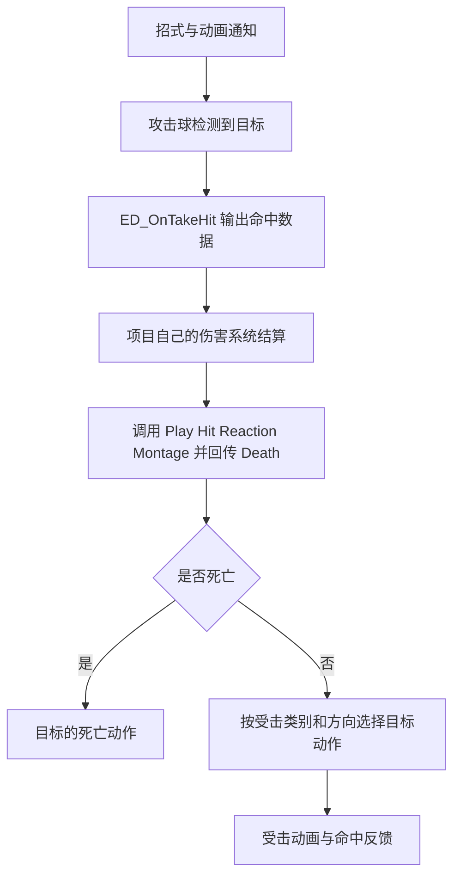
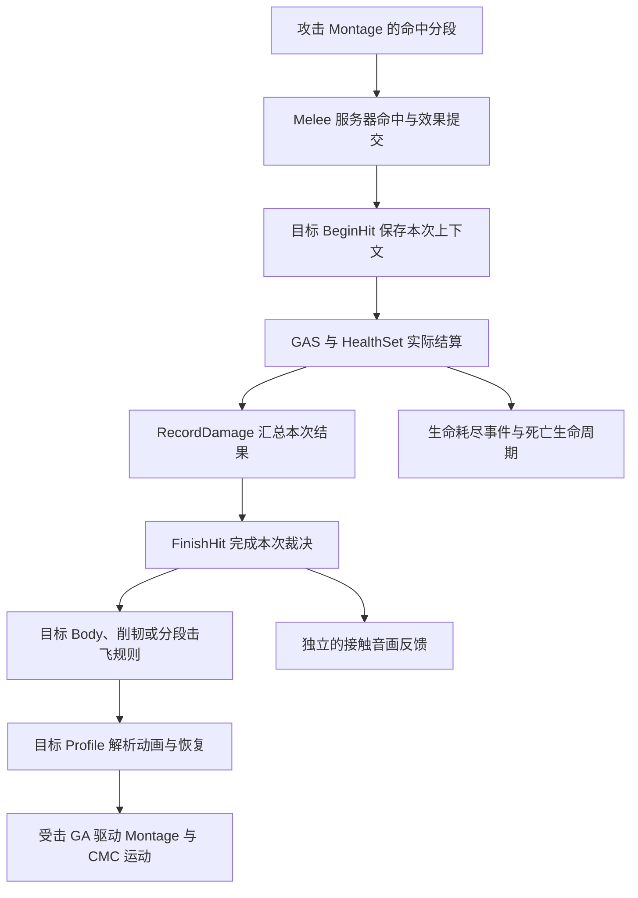

# Handy Combat System 受击设计评估

日期：2026-10-19。对象：用户提供的 Handy Combat System 教程与 Hodgepodge 当前工作区；本机 UE 5.5.4。

本文是设计评估，不改变项目现有玩法契约，也不启动代码或资产重做。插件教程里的安装、修改 ALS、绑定事件等步骤是待分析资料，本轮没有执行。

## 1. 判断与证据范围

**值得借鉴，最值得借鉴的是“招式提供命中意图、目标提供受击动作、动画标记时机、资源集中配置”的制作思路。对 Hodgepodge，建议优先重新梳理受击配置与表现组织，继续使用现有 GAS 结算、目标裁决和运动执行链。现有资料不足以支持全盘替换的决定。**

插件的优势是把常见近战战斗包装成容易使用的产品；它没有通过这份资料证明已解决本项目的全部动作控制问题。一个入口组件可以让接入简单，其内部仍可能承担很多职责，不能仅按组件数量评价架构。

本轮依据分为四类：

- **插件教程描述**：[Handy Combat System插件.txt](<C:/Users/Kenwen/Desktop/Handy Combat System插件.txt:1>)，共 301 行。多处字段表与图片没有导出，不能视为完整技术规格。
- **官方公开规格**：[Fab 商品页](https://www.fab.com/listings/a5be63b6-0881-4282-9f4e-6cbcf2cc0b2c) 当前明确标注纯 Blueprint、无美术资产、`Network Replicated: No`。这意味着它没有提供可直接使用的网络复制实现；不能理解成勾选组件复制就能补齐。
- **项目源码事实**：直接读取当前未提交工作区的 Source、项目描述、构建规则与相关设计背景。未读取本项目二进制资产内部配置，文件存在不能证明配置有效。
- **本机 Lyra 参考**：核查伤害、生命、死亡、ASC 生命周期代码，并对相关表现资产做有限引用核查。源码机制与资产字符串证据分开记述，不把后者算作运行验证。

因此，下文的“插件支持”主要表示文档声明；内部状态机质量、性能、中断正确性和实际手感均未经过插件运行验证。

## 2. 插件的核心理念

### 2.1 伤害结算交给项目，动作与反馈由组件组织

按教程，第 28–42、175–198 行给出的闭环是：



`HitSendData` 提供技能名称、ID、基础伤害、倍率、攻击类型与伤害属性。教程要求接入方自行减血，再把死亡结果回传。

这让插件能够适配不同数值系统。更关键的时序是：**先得到结算结果，再选择普通受击或死亡表现。**

但文档只明确展示了 Death 布尔回传，没有展示完整的格挡、招架、免疫、闪避、抗打断与零伤害控制结果协议。事件分发器给出了扩展入口，是否真正兼容这些规则仍取决于调用方和插件内部实现。

### 2.2 攻击方声明意图，目标方拥有自己的动画

技能的 `Hit Stun Type` 对应目标资产中的 Light、Medium、Heavy、Knockback 等类别；角色预设引用自己的 Get Hit 总资产。相同攻击打中不同目标，可以使用目标各自的骨架和动作。

这比在玩家每个攻击中直接引用所有敌人的受击 Montage 更易扩展。值得保留的是这种资源归属。

需要补充区分：攻击方要求 Heavy，只能表示希望造成某种反应。目标能否被打断、是否改用较轻表现、是否只能播放接触反馈，需要目标侧规则裁决。教程没有证明它已经具备本项目同等的目标裁决层。

### 2.3 用有限类别和方向矩阵管理表现

教程列出五个大类：Light Hit Stun、Medium Hit Stun、Heavy Hit Stun、Knockback、Normal Death；明确展示四类受击按方向组织，死亡单独分流，其资产的具体字段未完整导出。其核心是查表选片，避免为每个招式单独写分支。

这里有两个维度：一维描述反应类别，一维描述来袭方向。死亡则是终止性生命周期，虽然可与受击共用编辑界面，运行时仍应优先处理。

矩阵适合有限的人形受击动画库。若再叠加姿态、武器、部位、空中阶段等维度，组合数量会增加；不应因为界面提供八个槽，就把每个角色每类八方向设为制作前提。

### 2.4 方向回退降低素材门槛

教程第 146–151 行宣称：八方向不全时回退到四方向，再回退到前后，最后使用 Front。

这个思路适合独立开发：先有一个可信的基础动作，再逐步提高方向覆盖。它解决的是动画资源覆盖。

边界也很明确：

- 同文第 151 行要求被请求的 Heavy 类别至少配置一个动作，因此不能理解成所有错误均可自动兜底。
- 没有证据证明支持 Heavy → Medium → Light 的跨类别回退。
- “缺少某个方向时仅该方向回退”与“整组不满就全部降级”的算法细节没有给出。
- 方向的计算来源、扇区边界、根运动方向是否匹配也没有给出。

对 Hodge，方向不足可以作为表现降级；击飞不受支持等玩法能力缺失需要明确结果。若确需把击飞改成地面硬直，应作为事先定义的目标规则，不能仅因为找不到动画就静默改变控制效果。

### 2.5 1.2 版让动作时机跟随 Montage

教程第 200–239 行明确将旧版“秒数 + 资源”事件数组迁移到动画通知。连招窗、后摇结束、朝向、拖尾、碰撞、音效、震屏与时停都在 Montage 上标记。

优点是动画编辑者能直接对照动作调整时机，改播放速度或动作内容时更容易保持一致。项目当前已经使用 Notify，不需要重新创建计时 Timeline。

但 Notify 的作用是报告动作中的时点或区间。执行被取消、跳段、死亡或换 Pawn 时，仍需要动作所有者清理碰撞、拖尾、朝向和时间效果。不能把全部恢复责任交给“动画最后一个关闭通知”。Epic 的 [UE 5.5 Notify 文档](https://dev.epicgames.com/documentation/en-us/unreal-engine/animation-notifies-in-unreal-engine?application_version=5.5) 也区分单点 Notify、区间 Notify State 及不同触发设置；“使用通知”本身不足以保证任何条件下精确执行。教程还将 AN_Hit 描述为区间、将 ANS_Trail 与双开关通知的说明混用，具体生命周期应以蓝图核查为准。

## 3. 结构组织方式及其取舍

文档呈现的是一套资源装配关系：

- **角色入口：BPC_HandyCombatSystem。** 玩家与 AI 都挂载；接收 PerformAction，运行攻击、受击、死亡与反馈流程。共享的是执行机制，输入和决策仍由各自调用方提供。
- **角色装配：Preset。** 汇集角色可用招式及受击、死亡等资源。适合表达“这个角色使用哪套战斗内容”。
- **招式描述：Skill DA。** 保存本招的命中数据、攻击反馈和 Montage 等引用。
- **目标表现：Get Hit 资产。** 保存对应角色的类别与方向动作矩阵。
- **共享资源：Montage 包装、特效、音频、攻击球、震屏、时间效果。** 常用组合预先配置，再被招式和角色引用。
- **制作工具：五个编辑器 Tab。** 按作者任务组织资源，减少在内容浏览器来回查找。

五个 Tab 是编辑界面的分类，不能推导出运行时有五个职责隔离的模块。文档也明确 Attack/Get Hit/Death 的 Montage 包装字段相同，分类主要为了管理方便。

这种组织的实际价值在于降低作者需要同时记住的东西。对项目并非每层都必须照搬：只有包装资产能复用一组有意义的参数时，单独创建一层 DataAsset 才有收益；若只是再次包一个 Montage 引用，就会增加跳转和维护成本。教程中的 ResourceLibrary 也不能据名称推断成必须新增的运行时全局管理器。

## 4. 它适合的场景与需要核实的能力

**比较适合**单机近战原型、独立开发、小规模人形角色库、固定轻中重与击退表现、需要快速验证打击节奏的项目。其组件入口和配置面板能缩短从零接线的时间。

**适合局部借鉴**已有 GAS、装备、技能授予和复杂目标反应规则的 ACT/ARPG 项目。可以学习数据归属、动作矩阵、资源复用和制作流程，再由现有系统执行。

对于 Hodge 当前已涉及的联机、目标抗打断、累计削韧、终结刀击飞、空中追加命中、真实落地、倒地起身和玩家恢复窗口，这份资料没有提供同等详细方案。联机复制则是官方明确未提供。

此外，商品页明确不含美术资产。购买逻辑框架不会自动补齐高质量受击、退步、落地与起身动画，也不能据此判断它能修复现有素材的轨迹问题。

以下缺口需要看插件蓝图或运行才能回答，本次不把它们判定为已发现的 bug：

1. 同一次攻击是否有可靠命中身份、多碰撞球是否去重、多段伤害如何区分。
2. 受击如何打断攻击、连续受击如何替换或延长、倒地时收到普通命中如何处理。
3. Knockback 如何产生胶囊位移，使用 Root Motion、CMC 还是其他方式；碰墙、斜坡与空中如何处理。
4. 死亡、蒙太奇取消、换 Pawn、销毁时，是否释放所有窗口和效果。
5. 全局/局部时停重叠时谁负责恢复，且如何避免旧效果覆盖新效果。
6. 缺少整个反应类别、骨架不匹配、资源加载失败时如何诊断和退出。

教程还有两处需要收窄宣传语：

- `ED_OnDeath` 被描述为生命归零“或”死亡动画结束触发，又用于奖励与掉落。这里没有给出唯一结算时点和去重契约。死亡确认、死亡表现结束、尸体清理应有各自明确语义。
- ALS 教程实际需要修改角色、控制器、CameraManager，接入 BPI_Combat、旋转模式和移动限制，还列出 Handy Action Base 前置。它说明存在适配方法，不能证明对任何 ALS 分支均为零侵入接入。本项目实际存在的是 ALS-Refactored 4.15，不应照着 ALS_Base_CharacterBP 教程直接改第三方资源。

## 5. Hodge 当前已经具备哪些对应思想

当前事实以源码为准。历史设计曾多次调整，尤其不能用“累计破韧自动击飞”的旧文档概括现行行为。

实际链路可以压缩为：



具体证据：

- [Melee::SubmitMeleeHitEffects](E:/Project/Git/Hodgepodge/Source/Hodgepodge/Private/AbilitySystem/Abilities/HodgeGameplayAbility_Melee.cpp:473) 在同一结算身份下打开受击事务、应用效果并调用 FinishHit。
- [HealthSet 文件中的 RecordHitDamage](E:/Project/Git/Hodgepodge/Source/Hodgepodge/Private/AbilitySystem/AttributeSet/HodgeHealthSet.cpp:40) 将接受情况与实际生命损失回报给目标组件；它不是读取 Skill Base Damage 后直接假定已经造成伤害。
- [HitReactionComponent::BeginHit / FinishHit](E:/Project/Git/Hodgepodge/Source/Hodgepodge/Private/Component/HodgeHitReactionComponent.cpp:130) 先保存目标 Body 与命中来源，再检查实际结算、死亡、接受条件及目标支持情况。
- [ResolvePoise](E:/Project/Git/Hodgepodge/Source/Hodgepodge/Private/Component/HodgeHitReactionComponent.cpp:312) 当前只把累计阈值解析为 Light/Heavy；[ResolveSegmentLaunch](E:/Project/Git/Hodgepodge/Source/Hodgepodge/Private/Component/HodgeHitReactionComponent.cpp:368) 独立处理分段允许的击飞。旧 Break 字段仍保留序列化，不代表它仍驱动击飞。
- [HodgeHitReactionProfile](E:/Project/Git/Hodgepodge/Source/Hodgepodge/Public/Data/HodgeHitReactionProfile.h:102) 保存目标自己的动作；已存在 Compact 与兼容旧布局，以及方向变体、接触反馈和恢复配置。
- [HodgeGameplayAbility_HitReaction](E:/Project/Git/Hodgepodge/Source/Hodgepodge/Private/AbilitySystem/Abilities/HodgeGameplayAbility_HitReaction.cpp:20) 使用 ServerInitiated，执行计划中的动画与运动，并清理自己持有的运动来源。
- [组件初始化与解绑](E:/Project/Git/Hodgepodge/Source/Hodgepodge/Private/Component/HodgeHitReactionComponent.cpp:51) 检查当前 Avatar，管理委托、削韧样本、受击动作及表现清理。
- [HealthComponent 的死亡入口](E:/Project/Git/Hodgepodge/Source/Hodgepodge/Private/Component/HodgeHealthComponent.cpp:242) 与 [Death GA](E:/Project/Git/Hodgepodge/Source/Hodgepodge/Private/AbilitySystem/Abilities/HodgeGameplayAbility_Death.cpp:43) 承担死亡事件、能力取消与生命周期。普通受击无需再建立另一份死亡事实。

因此，插件最有价值的分工在项目中已经有对应实现。继续使用这些机制并不等于认定当前实现已经足够简洁，或动作手感已经通过验收。

项目当前的复杂度主要来自几组不同问题：

- **资格**：Body/Judgement 决定能否施加控制。
- **累计**：削韧窗口决定何时出现普通轻/重控制。
- **招式特征**：Can Launch 决定某个命中分段是否允许击飞。
- **执行阶段**：地面、空中、真实落地、倒地和起身。
- **表现与运动**：选片、左右受力、方向、控制时长、恢复尾部与运动来源。
- **工程兼容**：Legacy/PoiseDriven/ExplicitImpact、Compact/旧动画布局、网络序号和旧回调失效。

这些问题不能都靠一个 Light/Medium/Heavy 枚举解决。可以简化的是作者入口、重复配置和历史兼容的可见性；需要保留的是每件事实有唯一负责者。

## 6. 借鉴到项目时，建议明确的四层关系

以下是建议的职责解释，不是已经新增的接口或字段，也不授权在本轮重写实现。

### 6.1 命中与结算：这次接触产生了什么结果

现有 Melee、GE/Execution、HealthSet 和命中身份继续负责可信结算。伤害是否接受、实际生命损失、目标是否死亡与允许的特殊零伤害控制要能分别表达。

生命减少不应成为所有受击的唯一触发依据：免疫可能拒绝伤害，显式控制技能可能合法造成零生命伤害。项目已有 AcceptedDamage/ExplicitControl 区分，后续设计应保留这种明确契约。

### 6.2 目标裁决：目标这次进入什么反应

由目标结合自身 Body、当前阶段、削韧规则及攻击意图给出一个确定结果。攻击者提供强度、方向与击飞资格，目标决定它能否成立。

例如同一刀命中普通敌人、正在霸体出招的 Guardian、已经腾空的敌人，伤害和接触反馈都可能成立，但控制结果可以不同。单纯的动作矩阵不能代替目标裁决；教程未证明插件具有等价的裁决机制。

### 6.3 执行：谁控制动作、运动和退出

保留现有目标计划、受击 GA 与 CMC。地面退步和空中弹道可以采用不同方案，但每个阶段必须明确一个运动来源，以及中断、死亡和换 Pawn 时由谁释放。

动画中的脚步、胶囊的实际移动、玩法控制截止和动作视觉结束是不同事实。调整资产矩阵不会自动修复它们之间的时间与空间关系。

### 6.4 内容制作：目标如何表现这个结果

这里最适合吸收 Handy 的设计：用简单入口选择目标 Profile，按反应家族管理动作，共享声音、特效、震屏与时停配置，用 Montage Notify 调整动作时机。

常规作者只需要先理解“普通轻受击、普通重受击、击飞阶段、倒地起身、接触反馈”。Legacy、兼容矩阵和运动安全参数可以置于明确的高级或迁移入口。

方向覆盖应以现有素材语义为依据。左右受力动作的 Left/Right，未必等同于来自角色左侧/右侧的攻击；不能为了填满四向或八向而误标资产。缺少方向时选可信的基础动作，比填入空间方向错误的根运动动作更可靠。

## 7. 是否需要大改或重做

**当前建议是重整受击子系统的对外配置与表现组织，评估后再决定是否重写部分内部执行；不建议仅凭这份教程替换整个战斗底座。**

可以保留的基础包括 GAS 伤害与死亡、ASC Owner/Avatar、AbilitySet/GameFeature 授予、命中身份、目标 Profile、受击计划和 CMC 执行。它们与插件的制作思想并不冲突。

更值得投入的调整顺序是：

1. 固定目前普通削韧与分段击飞的规则，整理一份当前有效契约，避免继续用历史设计互相解释。
2. 选一个目标完成“普通接触 → 轻/重反应 → 终结刀击飞 → 真实落地 → 倒地起身”的代表性流程。
3. 将制作入口整理到少量任务上：攻击分段填意图，目标填抗打断/削韧和动画，Notify 填时机。
4. 对每次命中能说明“为何只有反馈、为何被打断、为何拒绝击飞、为何选择这个动作”，再处理动作混合和主观手感。
5. 只有迁移完成且引用核对之后，才评估收缩旧模式和旧字段；不直接删除 UPROPERTY 或旧资产。

如果验证发现现有反应计划无法支持需要的转换、多个系统反复争夺相同状态，且局部调整持续制造兼容分支，重写受击子系统内部是合理选择。重写时仍可保留上述输入、结算和网络边界；接受重做并不要求把已经清晰的职责一并推倒。

若最终主动缩小为纯单机、有限人形角色、固定轻中重受击，则 Handy 式更紧凑的整体框架可能更经济。当前项目已经选择了更丰富的行为，仅复制它的简单外观不会消除这些需求的成本。

## 8. Lyra 参考、依赖与适配差异

以下为本机实际核查，根目录 `E:/Project/UProject/study/Epic/LyraStarterGame`：

- [LyraDamageExecution::Execute_Implementation](E:/Project/UProject/study/Epic/LyraStarterGame/Source/LyraGame/AbilitySystem/Executions/LyraDamageExecution.cpp:36)：服务器效果计算并输出 Damage 元属性。Hodge 已有对应伤害链，继续复用；不新增第二套由表现组件直接扣血的入口。
- [LyraHealthSet::PostGameplayEffectExecute](E:/Project/UProject/study/Epic/LyraStarterGame/Source/LyraGame/AbilitySystem/Attributes/LyraHealthSet.cpp:108)：消费伤害、修改生命、发布生命变化与耗尽事件。Hodge 在对应链上增加了本次命中结算结果关联。
- [LyraHealthComponent::HandleOutOfHealth](E:/Project/UProject/study/Epic/LyraStarterGame/Source/LyraGame/Character/LyraHealthComponent.cpp:148)：发送死亡 GameplayEvent；[StartDeath](E:/Project/UProject/study/Epic/LyraStarterGame/Source/LyraGame/Character/LyraHealthComponent.cpp:235) 和 FinishDeath 分开管理阶段，并用复制状态补齐客户端转换。
- [LyraGameplayAbility_Death](E:/Project/UProject/study/Epic/LyraStarterGame/Source/LyraGame/AbilitySystem/Abilities/LyraGameplayAbility_Death.cpp:14)：ServerInitiated、取消普通能力、阻塞新能力，结束时兜底完成死亡。Hodge 已有对应实现，无需用插件的单个 Death 布尔和表现结束通知重新承担这些职责。
- [LyraPawnExtensionComponent](E:/Project/UProject/study/Epic/LyraStarterGame/Source/LyraGame/Character/LyraPawnExtensionComponent.cpp) 与 LyraAbilitySet：Owner/Avatar 初始化、旧 Avatar 清理、授予句柄与撤销机制是成熟参考。Hodge 玩家保留 PlayerState ASC，普通敌人使用自有 ASC，不为统一挂组件而抹平所有权差异。
- 伤害与 Cue 资产引用：`GA_Weapon_Fire_Rifle_Auto` 引用 `GE_Damage_RifleAuto`，其父资源链指向 `GE_Damage_Basic_Instant` 和 `GameplayEffectParent_Damage_Basic`；后者包含 `GameplayCue.Character.DamageTaken` 和 LyraDamageExecution 等引用。`/Game/GameplayCueNotifies/GCNL_Character_DamageTaken` 中可读名称与注释包含前后左右方向判断、选取 Hit Montage、播放动画和音画反馈；Lyra 的 `Config/DefaultGame.ini` 注册了该 Cue 目录。这些证据支持“伤害 GE 携带 Cue、Cue 负责方向反馈”的设计意图；本轮没有完整重建全部节点连线或运行验证。

在 Lyra 的 Source、Config 和 GameFeature 代码范围内，没有找到可直接迁入的完整“八向轻中重 + 累计削韧 + 分段击飞 + 空中/倒地/恢复仲裁”实现。这个结论限定于核查范围，不能扩大为“Lyra 完全没有受击表现”。

依赖上，GAS 使用 GameplayAbilities/GameplayTags/GameplayTasks，运动继续依赖 Engine/CMC；Lyra 的消息与 GameFeature 路线还有各自模块。本项目已经具备自己的相关依赖与适配，本轮建议不引入 CommonGame/CommonUser、新业务模块或完整 Lyra 依赖包。

## 9. 实际工作、验证和剩余边界

本轮只新增本文；没有修改业务代码、配置、二进制资产、第三方插件，也没有提交。

实际执行的只读命令包括：

```powershell
git status --short
git status --porcelain=v1 --untracked-files=all
Get-Content -LiteralPath 'C:\Users\Kenwen\Desktop\Handy Combat System插件.txt'
rg -n 'BeginHit|RecordDamage|FinishHit|ResolvePoise|ResolveSegmentLaunch' Source/Hodgepodge
rg -n 'HitReact|HitReaction|Knockback|Knockdown|DamageTaken' 'E:/Project/UProject/study/Epic/LyraStarterGame/Source' 'E:/Project/UProject/study/Epic/LyraStarterGame/Config' 'E:/Project/UProject/study/Epic/LyraStarterGame/Plugins'
```

上述读取与检索成功；另读取了项目开发约定、专项 skill、相关源文件、`.uproject`、Build.cs、ALS 描述和本机 Build.version，核实引擎为 5.5.4。通过网页工具读取了官方商品页与 UE 5.5 Notify 文档。

交付前已检查本文差异、链接目标与工作区状态：17 个本地文件链接均存在，行号没有越界，代码块标记配对，新增文档的 `git diff --no-index --check` 未报告空白错误。工作区状态对照只增加本文，原有状态条目没有减少或改变；任务开始时已有大量用户未提交改动，予以保留。

本次没有运行 C++ 构建、自动化测试、蓝图编译、PIE、联机或 Cook/打包，因为只做分析与文档交付；不沿用历史测试结论作为本次验证。插件内部蓝图、全部字段、资源加载契约、真实位移实现、版本兼容和主观手感仍未验证。
