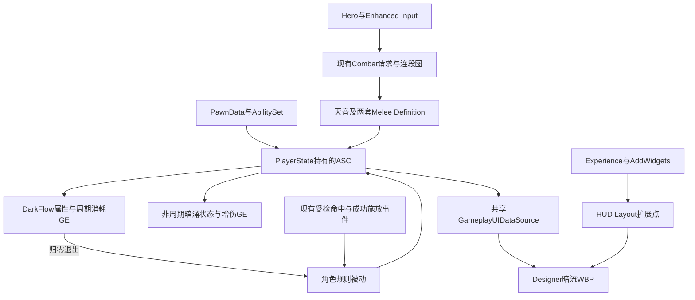

# 灭音与暗涌技能系统设计文档

版本：v0.4（首版已接入并完成本轮测试）；日期：2026-10-15；状态：用户已确认B燃料方案、HUD位置、指定动作、暂缓E换图标及GA基类复用方向，原生模块与正式资产已接入，原生自动化39项、资产检查30项及单人／Listen／PIE Dedicated／100ms延迟核心场景已通过。其余建议和待定数值分别标注，不视为全部已获确认。以用户提供的技能说明为玩法依据，不声称已核实原作内部实现或所有数值。保持UE 5.5.4和当前Experience／PawnData／GAS／Combat／UIExtension链路。

## 1. 目标与首版范围

暗流上限100，满条后可长按普攻发动灭音；灭音造成一次范围炸气伤害，允许动画根位移，随后进入暗涌。暗涌期间持续消耗暗流，破命可补充燃料，归零退出，持续时间随补充量变化。暗涌期间替换五段普攻和共鸣技能E，R的能力、动画、能量及冷却机制保持原配置。新增技能本身没有CD，不借用R的冷却。

暗涌由非周期GE授予状态和20%湮灭伤害加成，由独立周期GE消耗实际燃料；能量条始终显示真实暗流比例。普通受击只影响当前动作，不默认移除整个Buff。重击、强化重击和派生普攻不在首版实现，但保留扩展记录。

本技能归类为“共鸣回路”：灭音是其入态攻击，暗涌是后续战斗状态，暗流是其独立资源。主HUD原图中血条上方的“特殊技能能量条”即此资源的显示位置，不另加一个右下方暗流条。共鸣技能E在暗涌时会替换为破命；对应图标未来也会替换，但用户尚无UI资产，本轮不实现图标切换。

### 1.1 已确认需求编号

- HDS-01：独立暗流资源，上限100，满条才能发动灭音，灭音本身无CD。
- HDS-02：入态不扣空100点；状态中持续消耗实际暗流，破命可补充，上限仍为100，归零退出。
- HDS-03：灭音炸气造成一次范围伤害，允许动画根位移，使用现有服务器命中和去重链路。
- HDS-04：暗涌提供20%湮灭伤害加成，状态结束撤销。
- HDS-05：暗涌替换五段普攻及共鸣技能，R的技能本体与资源／CD机制不替换。
- HDS-06：区分常态攻击命中回暗流和技能成功施放回暗流；暗涌普攻命中额外回R能量1点，每角色每1秒最多一次。
- HDS-07：暗流HUD使用原始主HUD设计图中血条上方的“特殊技能能量条”，沿用现有Layout／UIExtension体系，控件树保存在WBP Designer；R环形能量显示保持独立。
- HDS-08：明确保留未实现的重击派生链及变奏收益接入记录，不用占位动作冒充完成。
- HDS-09：灭音使用`AM_Ex_Skill01_01`，破命使用`AM_Ex_Skill02`，强化普攻1～5依次使用`AM_Ex_Attack01`～`AM_Ex_Attack05`；源动画与正式Montage的对应关系必须可追溯。
- HDS-10：普通攻击、共鸣技能、共鸣解放、共鸣回路具有可复用的GA基类／模板；共享项目已有执行与命中基础，不复制四套战斗底层。

### 1.2 核心概念

暗流是资源属性；常态用于积攒入态资格，暗涌中作为燃料。共鸣能量是现有R资源，与暗流互不替代。

共鸣回路是本次特殊技能的分类名称，不等同于共鸣技能E或共鸣解放R；分类基类描述通用扩展点，角色具体子类与Definition描述灭音、破命等招式。

灭音是一次短攻击执行，暗涌是跨越多个攻击执行的持续战斗形态。ExecutionId标识一刀或一次技能，ModeSessionId标识一次完整暗涌，两者不能互换。

AbilityTag标识具体招式，InputTag标识玩家输入，状态Tag决定分支资格；元素分类与普攻／重击等伤害分类各自独立。文中拟新增名称的实际落地情况见第17节；未完成部分仍是设计名称，不能当作编辑器已有字段或资产。

## 2. 本轮源码核查

### 当前项目可复用部分

- `Data/HodgeComboDefinition.h`：跳转边已有RequiredSourceTags、BlockedSourceTags、RequiredWindowTags和TransitionPriority。
- `Component/HodgeCombatComponentBase.cpp`：实际选择边时已校验ASC状态标签；Configure会调用Shutdown，后者可能结束当前AnimatingAbility，不能用反复Configure切换普攻形态。
- `Data/HodgeAbilitySet.h`：已支持授予多份AbilityDefinition；两套动作可提前授予，不必在每次入态／退态时删除和重授技能。
- `HodgeGameplayAbility_Melee::BuildMeleeHitSpec`与命中结算：已复用服务器伤害、受击、阵营及HitGroup／AttackPhase去重。
- `TryGrantResonanceEnergy`：已有“实际造成生命伤害后，每个有效阶段回能一次”的R回能，但仍是大招专用逻辑，不是通用暗流或施放回能入口。
- `HodgeResonanceSet`：已有独立R资源、范围约束和OwnerOnly复制，可参考模式，新暗流不能复用其实际属性值。
- `HodgeGameplayUIDataSource::GetAbilityDisplayState`：当前按InputTag找到第一份Spec后即退出；替换E后必须增加明确的变体选择，不能让HUD随授予顺序显示错误技能。
- HUD已接入Experience注入与UIExtension，两个技能WBP保存Designer树；新暗流控件沿用这条链路，不在C++运行时造树。

### Lyra复用依据与边界

本轮读取本机`E:/Project/UProject/study/Epic/LyraStarterGame`：

- `AbilitySystem/LyraAbilitySet.cpp`的GiveToAbilitySystem／TakeFromAbilitySystem：服务器授予，保存来源句柄，按所属来源撤销。
- `AbilitySystem/LyraAbilitySystemComponent.cpp`的AbilityInputTagPressed／ProcessAbilityInput：匹配输入Tag的Spec进入激活队列，并不自动选出形态变体。
- `Equipment/LyraEquipmentManagerComponent.cpp`的AddEntry／RemoveEntry：来源明确的能力集管理可复用，但形态变化不等于装备替换，不应因此反复卸装武器。
- `AbilitySystem/Attributes/LyraCombatSet.cpp`：属性与GAS复制通知模式；没有直接提供本需求的暗涌／双形态五段连击完整实现。
- `AbilitySystem/Abilities/LyraGameplayAbility.h`及`Equipment/LyraGameplayAbility_FromEquipment.h/.cpp`：基础能力提供激活、成本、相机等共同契约；装备能力子类只补充来源查询和校验，不重写整套激活链。这支持按职责分层、保留小型派生类的复用方式，不能据此宣称Lyra已有本项目四类技能模板。

采用这些成熟基础及Hodge已有连段图。形态选路、暗流规则、元素增伤是本项目适配扩展，不将同名类或普通Held输入当作完整技能实现。

## 3. 技能与持续状态分离

建议资源／能力：

- `GA_MieYin`：从现有Melee／Definition派生的短攻击能力。校验满暗流、未处暗涌、存活及合法动作窗口；锁定本次入态资格，播放指定Montage并保留源动画根运动，在指定服务器提交点造成一次范围伤害并建立暗涌。入态不立即消费100点。
- `GE_DarkSurge`：Infinite、非周期，提供`State.Combat.Mode.DarkSurge`和湮灭伤害加成，预留持续表现Cue；燃料归零时移除。Infinite表示不自带固定到期时间，不表示不能正常结束。
- `GE_DarkFlowDrain`：独立的服务器周期消耗GE，只扣DarkFlow，归零后与本次状态GE配对移除。20%增伤不得放进此周期GE，避免每周期重复执行增益。
- `GA_HavocRules`：可用一份OnSpawn、Independent的被动GA，协调本角色暗流收益、暗涌进出及“拢音”触发间隔；不播放主角色Montage，不占用攻击独占组，不复制实现GAS授予和伤害系统。

灭音GA结束不等于Buff结束；Dash或普通受击取消灭音以外的攻击，也不应误取消状态规则被动。不能让一份Exclusive攻击GA持续整个Buff时长。

Buff是否存在从有效GE／其授予Tag查询，不额外复制一个独立更新的bDarkSurge。被动保存的GE句柄、入态执行身份和Avatar只用于归属、清理和拒绝迟到回调。

### 3.1 模块交互



角色规则被动协调本角色规则，既有ASC执行属性和效果修改，Combat执行动作，UI只呈现；不新增完整角色管理器、第二套连段状态机或额外Runtime模块。

### 3.2 攻击GA公共基类与四类模板

用户提出按技能类别抽取GA基类以方便迭代。采用这个复用方向；首先复用项目已经存在的公共执行层，不新增与其平行的蒙太奇或命中框架。

当前原生继承关系已核实：

```text
UHodgeGameplayAbility
  └─ UHodgeGameplayAbility_Definition
       └─ UHodgeGameplayAbility_Melee
```

职责保持：GameplayAbility负责GAS激活、成本、相机等通用能力；Definition负责动作配置、Montage、执行身份、通知资源和结束清理；Melee负责检测、伤害、受击及有效命中。普通攻击、E、R和灭音都复用这条链路。

建议在Melee之下建立可复用的蓝图模板层，只有出现确需原生复用的独立行为时再增加对应C++类。以下名称尚未创建：

```text
UHodgeGameplayAbility_Melee
  └─ GA_Attack_Base                 通用攻击蓝图模板
       ├─ GA_NormalAttack_Base      普通攻击分类模板
       ├─ GA_ResonanceSkill_Base    共鸣技能分类模板
       ├─ GA_ResonanceLiberation_Base  共鸣解放分类模板
       └─ GA_ResonanceCircuit_Base  共鸣回路分类模板
```

`GA_Attack_Base`只存放四类攻击确实共享的默认值和扩展契约，不重复播放Montage、不重新发起检测、不把本角色暗流或R成本写死在所有攻击上。若该模板最终没有任何共享内容，可以直接共用Melee，不为目录形式增加空层。

- 普通攻击基类：供常态与强化两套普攻复用；五段由五份Definition和连段图表达，不因每条动画另造一个C++类。当前应走ComboCoordinated授权。
- 共鸣技能基类：供行刃与破命复用；当前通过Standalone Definition执行，成本／CD／伤害和施放事件按具体能力配置。实际形态选择仍由前述统一入口负责。
- 共鸣解放基类：供R类攻击复用资源成本和演出接入的公共约定；本角色的100点消费、12秒CD和镜头仍沿用既有配置，不通过抽基类顺手重置。具体资源成本继续复用AdditionalCosts机制。
- 共鸣回路基类：供灭音等特殊攻击复用入态校验和一次正式提交的扩展点；满条资格、保留燃料及持续消耗由本角色规则和GE处理，不能套用R“满100立即全扣”的成本对象。

四类模板是共同攻击层下的并列分支，不让共鸣技能、解放或回路继承名为“普通攻击”的分类基类。`GA_HavocRules`是独立状态规则被动，继续从通用GameplayAbility分支实现，不继承攻击模板、不占攻击独占组。

优先通过角色具体蓝图子类、Definition、AbilitySet及GE配置扩展。需要重设现有GA父类时，实施前核对蓝图图表、覆写、默认值、InputTag、AbilityTag、成本／CD和授予引用；保持已生效技能身份及现有R行为，本轮仅记录迁移方案，不执行Reparent或重命名。

## 4. 暗流与状态条：B燃料方案已确认

新建独立`DarkFlow`／`MaxDarkFlow`属性，置于小型`UHodgeHavocSet`；由PlayerState原生创建唯一实例，AbilitySet只施加容量初始化GE，不重复授予属性集。上限首版100，初值0；不与R的ResonanceEnergy共用。收益、消费及清空均通过服务器GE。

用户已选择：暗流就是燃料，暗涌期间持续消耗，破命可以补充，归零退出。因此撤回此前对A固定时间方案的推荐，后续均以B为准；不采用先扣空属性、再用倒计时绘制假燃料的方式。

- 满100只作为入态条件，不在入态时把100点全部扣空；成功提交后保留燃料，开始持续消耗。
- 入态请求执行身份和状态Tag阻止重复变身。状态内即使破命补到100，也不能再次触发灭音或重新启动消耗GE。
- 服务器周期消耗实际属性，`本次扣除量 = DrainPerSecond × 本次有效消耗时间`，最终Clamp到0～100。周期、每秒消耗及收益值均配置化。
- 建议消耗GE应用时不立即执行首个周期，避免显示刚入态就跳减一截；这属于实现初值，需按实际手感验收。
- 破命在成功施放节点补充暗流并Clamp到100，超过上限部分不储存为额外时长。收益不重建状态GE、不重置消耗周期。
- 燃料归零是正常退出的唯一计量条件，不再维护另一个独立Buff倒计时。死亡、驱散等仍可提前终止。
- 常态和暗涌UI均显示`DarkFlow / MaxDarkFlow`，暗涌显示消耗状态并进行客户端插值，不能由UI插值结果决定退出。

若基础消耗速度固定，满条不回能时的基础时长为`100 / DrainPerSecond`；实际增加的维持时间为`本次实际补入量 / DrainPerSecond`。例如仅作解释，若每秒扣10、破命实际补入20，则增加约2秒；其中10点／秒和20点收益现已作为Hodge首版数值确认，并非原作实测。

暂不引入独立“下一轮储能”或自动循环变身。是否设置额外最大持续时间尚未确定，不能暗中保留原固定到期时间抵消用户选择的回能延时规则。

## 5. 灭音输入与炸气提交

输入放在Hero／Enhanced Input层，采用可配置Hold阈值和单次触发锁存；不能仅使用WhileInputActive，因为它意味着持续尝试激活，不等于识别一次长按。松开、死亡、失去输入或切Pawn时结束对应输入会话。

建议手感：按下先维持现有普攻即时响应，达到Hold阈值后只提交一次灭音意图，在合法攻击取消窗口切入。不能直接把现有IA_Attack整体换成Hold而让所有普攻延迟；也不能按下和松开各提交一次普攻。未到窗口可使用现有有界输入缓存，不无限等待。

服务器重新校验满暗流、未在暗涌、存活和当前动作授权；客户端长按只是请求，不能凭本地条满直接支付资源或造成伤害。暗涌中长按不再次变身，首版也不临时映射成未开发的重击。

灭音配置一条正式Standalone Definition及使用AM_Ex_Skill01_01的Montage；允许随动画位移，不制作原地副本。使用现有一次性虚拟球体／Box查询，按Montage指定通知时点获取角色周围范围，服务器每个合格目标结算一次。空挥仍能进入暗涌，不将是否击中敌人作为Buff成立条件；不启用攻击吸附，不额外添加冲刺位移；保留指定源动画本身的根运动。Box在通知提交时按当时角色变换快照生成，仅检测一次，不随之后的移动更新。

动画通知只是合法执行的时机标记，需校验本次执行／MontageInstance并锁存提交，避免客户端、服务器或重复通知重复入态和炸气。先预校验资源及Buff依赖；提交后不可逆伤害不通过整段重试“补做”。Buff施加失败或角色在通知前死亡必须有明确失败路径。

已确认灭音只允许地面起手、可打断，不额外提供霸体；提交前不消耗，提交后普通受击不移除Buff，也不补回已消耗燃料。入态精确通知帧按动作配置。灭音不继承大招金刚体。

## 6. 五段普攻替换

保留一张角色ComboDefinition，在其中增加普通1～5和强化1～5两组节点与独立AbilityTag，复用既有跳转边条件：

- 常态入口：BlockedSourceTags包含DarkSurge，转普通1。
- 暗涌入口：RequiredSourceTags包含DarkSurge，转强化1。
- 强化链后续边要求DarkSurge；五份强化Definition可以继续使用同一Melee GA类，分别配置Montage、倍率、通知和回能分类。

所有Definition提前通过原AbilitySet授予；不修改共享DataAsset，不在形态切换时调用Configure／Shutdown，不将旧五段技能清除再重新授予。

入态成功从强化第1段开始，清除旧普通连段续接记忆与未消费缓存。退态时不突兀中断已开始的强化动作；本次动作按原定义结束，下一次合法输入从普通第1段开始。实现需给既有Combat增加仅清理对应续接状态的入口，不能用全量Shutdown代替。强化节点须有退态后的合法普通入口分支，避免卡在无可用跳转的旧节点。

燃料耗尽或其他原因退态后，新构造的伤害Spec不再获得20%增伤；已开始的强化动作仍使用原动作Definition，不在同一Montage中途换招。这个退态策略是建议，需要与实际动作手感一起验收。

## 7. E替换与R保留

普通E与破命分别配置Standalone Definition、唯一AbilityTag、独立Spec，但保留玩家“共鸣技能E”这个语义入口。普通E禁止DarkSurge，破命要求DarkSurge，作为GAS第二层保护。

在现有ASC／Combat链路补一个薄的变体选择接口，供键盘、UI、必要时AI动作请求复用。必须先按形态选定Spec，再检查CD和成本；不能因为破命处于CD就回退释放普通E。UI同样返回所选Spec的显示数据，修复“找到第一份同InputTag Spec就break”的现有假设。

已确认普通E与破命共享原共鸣技能Cooldown Tag及8秒CD，进出形态不刷新冷却。无CD指灭音，不代表破命无CD。

R不替换GA、不重新授予、不清CD、不改变100能量消费。暗涌状态下仍可正常释放R。若R的伤害分类为湮灭，则按“湮灭伤害加成20%”应享受该增伤；“R不变”默认指技能本体和资源机制不替换，而非排除所有Buff收益。

### 7.1 E图标替换暂缓

用户确认：E替换为破命以后，未来应显示对应的新图标；但新UI资产尚未取得，本轮只替换能力、动画、伤害／收益和所选Spec的数据，不实现图标切换。

两个形态暂时继续显示当前共鸣技能图标，冷却／可用状态必须读取实际选中的能力。禁止为了填补美术缺口自行绘制新图标、选用不相关贴图或将图标未更换误判为技能未切换。后续获得资产后，再给同一变体配置补充表现引用并验证退态恢复。

## 8. 20%增伤与伤害分类

当前CombatSet主要是BaseDamage／BaseHeal，DamageExecution未实现湮灭元素加成。建议补充`HavocDamageBonus`，基础0；GE_DarkSurge以非周期持续Modifier增加0.20，移除后由GAS撤销。不能把基础伤害全局乘1.2冒充元素增伤，也不通过Periodic GE逐秒叠加20%。

命中配置需补一个独立元素标签维度，例如`GameplayEffect.DamageElement.Havoc`；不要把现有近战等DamageType、元素、普攻／重击分类混成同一概念。后者为后续重击预留身份。

DamageExecution仅在本次伤害元素为Havoc时应用`原伤害 × (1 + HavocDamageBonus)`，其他元素不受影响。伤害Spec按现有每次服务器命中构造，增伤按Spec构造时取值；灭音自身是否享受入态增伤需在通知先后中明确，建议灭音按入态前数值结算，随后建立暗涌。

## 9. 回能与拢音

- 常态普通攻击：只在服务器确认有效生命伤害后增加暗流。复用现有结算身份与阶段去重策略，一刀打多只怪不重复刷同阶段；具体每段收益配置化。按目前提供的获取说明，强化普攻不默认同时回暗流，其额外回R能量由拢音单独处理；若要增加强化普攻补燃料，需作为明确的后续规则。
- 行刃／破命：按成功施放节点回能一次，不等同于命中回能，空挥也可获得；失败激活、提前取消不应产生收益。破命回暗流纳入首版，直接补入当前燃料并延长可维持时间，不再暂缓。
- 变奏：首版没有变奏系统，只记录未来成功施放事件接入点，不创建假变奏GA。
- 拢音：暗涌中普攻实际命中额外回复R能量1点，每个施法者全局每1秒最多一次。限流记录属于该玩家规则被动，不能存在每段Melee实例里，否则换段绕过限制；多目标、多检测体、剑和翅膀共享同一限流。

现有大招回能继续工作；这额外1点是在原收益之上，最终受R容量限制。不因“R本体不换”而禁止该被动给R回能。状态结束、死亡或Avatar不匹配拒绝迟到收益。

建议从既有Melee结算位置发布或调用一个带来源ASC、Avatar、ExecutionId、HitGroup、AttackPhase、技能／伤害分类、AcceptedDamage的受检命中结果。普攻回暗流和拢音复用它，不另做一次碰撞查询；避免逐步扩成全局事件总线。

## 10. 生命周期、网络和UI

- 服务器决定消费、状态GE、伤害和回能；拥有者可预测动作及表现，服务器拒绝时撤销本次预测表现，不使用UI倒计时控制伤害或能力授权。
- 燃料归零、死亡、明确驱散或Pawn更换时，根据本次句柄配对清理状态GE、消耗GE和表现。已确认死亡、驱散、换Pawn清空暗流，普通受击保留Buff；不从PlayerState复活旧Pawn的Buff。
- 清理只撤销本次状态GE／被动绑定和匹配Avatar的续接记录，保留死亡GA、R冷却以及其他来源的Buff。重复事件和旧执行回调不得重复退款、补能或恢复强化形态。
- DarkFlow属性决定正常退态，状态GE／Tag表达是否在暗涌；R电影演出不会默认暂停多人世界或冻结燃料消耗。若以后需要演出期间停耗，应单独定义规则。
- HUD新增暗流WBP与专用UIExtension Slot，经既有EAS注入，Designer保存实际控件树。共享UIDataSource提供真实暗流、容量、当前模式及可选消耗速率快照，R显示继续使用原资源。
- 暗涌中显示燃料量并标识当前模式；灭音没有CD，因此不画CD倒计时遮罩。E的冷却数据跟随选定变体；图标切换按第7.1节暂缓，不影响能力切换，也不能清除实际CD。
- 归零与回能同帧按服务器实际结算顺序处理；退态一旦完成，旧模式执行的迟到回调不能重新建立暗涌或补回旧状态。相关命中／施放事件必须携带并校验执行及Avatar身份。

### 10.1 主HUD原始设计图的对应区域

参考原图：[主HUD原始设计图](../References/HUD/main-hud-reference.png)。图中黑色说明文字、白框是设计标注，不直接制作成运行界面。

- 图中屏幕中下方、生命条正上方的横向“特殊技能能量条”，就是本次共鸣回路的暗流条。按生命区域对齐、保留垂直间距；具体尺寸和偏移在HUD Designer扩展点中调整，不硬编码截图像素。
- 常态从0积攒到100，暗涌时用同一条显示真实燃料消耗，破命补充时回升；不按固定Buff时长绘制假进度。
- 左侧“退场技能能量条”不是本次暗流条；右下方R图标的共鸣能量环仍然独立，不将这三个区域混用或额外创建第二份暗流显示。
- 原图按键提示只作为原始参考；本项目既定的长按普攻发动共鸣回路、E释放共鸣技能的输入分工保持不变，不因为图中出现E标识就改绑灭音。
- `WBP_DarkFlow`的实际控件树保存到Designer，由既有AddWidgets／UIExtension注入底部区域；不能再次直接在C++中创建临时占位布局。

## 11. 明确暂缓项

后续迭代记录：普通重击、强化重击、强化重击后短按派生“重击鸣刃”、鸣刃后接强化第3段、重击与灭音的长按输入仲裁、变奏技能及其暗流收益。灭音伤害分类仍应预留Heavy身份，即使首版不提供完整重击动作链。

美术待办：获得破命对应UI图标后实现E图标切换及退态恢复；本轮暂不执行，不阻塞能力变体和冷却数据接入。指定七条角色动画已明确，翅膀对应动画、特效、音效和精确通知帧仍待后续盘点／配置。

已确认：B燃料方案、满100入态、状态中消耗、破命补充、归零退出、灭音无CD。本轮用户已确认数值：每秒消耗10点、周期0.1秒；常态普攻每有效阶段回5点，行刃／破命成功施放各回20点；长按阈值0.35秒。已追加确认：两种E共享8秒CD；只用暗流决定暗涌时长，无额外时长上限；地面起手且可打断；死亡／驱散／换Pawn清空暗流，普通受击不移除Buff。灭音入态帧待实际动画盘点调帧。未将其余建议写为已经冻结的用户决定。

## 12. 实施顺序与验收

P0：先核对既有Melee公共执行层、规划四类GA模板和现有技能的最小迁移；随后按B规则设计独立属性、满条资格校验、非周期状态GE和周期消耗GE，验证满条入态不扣空、重复提交不重复消耗、归零退出、死亡及失败清理。

P1：依据第14.4节指定动画制作／配置正式Montage，接入灭音一次范围命中与入态，验证空挥可入态、多目标每个一次、通知重复不重复提交。

P1：同一连段图扩展五段强化链；E共享变体选择；验证退态不切断当前R／动作、下一次回普通1、技能和UI同一选择结果、形态切换不洗E的CD。

P2：元素20%增伤、受检命中回暗流、破命成功施放补燃料和拢音全局1秒限流；验证补能确实延长状态且不超过100，周期扣燃料不叠加增伤，非湮灭伤害不加成，剑／翅膀／多目标不重复收益。

P2：按原主HUD图的特殊技能条区域制作Designer暗流UI及单人、Listen、PIE Dedicated回归；E只校验能力／数据切换，不实现缺少资产的图标替换。覆盖高延迟、死亡、驱散、换Pawn、输入失效和状态边界帧。构建、蓝图、PIE与独立服务器分别记录，不以C++通过代替玩法验收。

## 13. 拟新增接口契约

以下为编码边界说明，不要求照搬函数拼写；应在现有类中做最小扩展，不在文档阶段添加空实现。

### 13.1 角色规则被动

- `CanEnterDarkSurge(Avatar)`：只读查询，校验属性就绪、满条、存活、未入态；不能在此施加GE或更改燃料。动作取消窗口仍由Combat／GA校验。
- `TryEnterDarkSurge(Avatar, ActivationExecutionId)`：服务器入口；对同一提交幂等，创建本次ModeSessionId，验证状态GE和消耗GE均建立成功后发布入态结果。
- `ApplyDarkFlowGain(Context, Amount)`：服务器入口；校验来源分类、执行身份和去重记录后应用增量GE，返回实际增加量，不能把溢出100的部分计为有效延时。
- `EndDarkSurge(ModeSessionId, Reason)`：服务器入口；仅清理匹配会话的两个GE、表现和续接占用，可重复调用。其他Buff、R冷却和死亡GA不得受影响。

### 13.2 ASC与Combat

- `ResolveAbilityVariant(InputTag)`：在现有ASC／Combat补充唯一选路入口，输出当前形态应使用的Spec／Definition及失败原因。选路不支付成本，不因CD拒绝而回退其他形态；零个或多个候选都明确诊断。
- `InvalidateModeContinuation(ModeSessionId)`：现有Combat的局部清理入口，清理对应连段续接记忆和未消费输入，不结束无关能力或重绑整个Combat。
- 受检命中与成功施放事件继续从现有执行链发出；不允许蓝图任意伪造命中事件给自己加燃料。

### 13.3 共享UI数据源

- `GetHavocSnapshot()`：返回当前OwningPlayer的暗流、容量、比例、资源Ready和形态表现状态；没有绑定或Avatar不匹配时返回未就绪。
- 资源／模式变化通知供WBP更新；平滑插值允许本地显示帧执行，但服务器数据到达后必须校正，不复制另一份UI资源。
- 灭音的按钮或输入提交复用现有InputTag／Combat入口，不在Widget中直接施加状态GE。

## 14. 数据结构、配置与资产组织

### 14.1 运行数据

`FHodgeHavocResourceSnapshot`建议包含CurrentDarkFlow、MaxDarkFlow、Percent、bReady及派生显示模式；常态是否满条与暗涌是否存在均由真实资源和GE／Tag推导，不额外持久保存一份模式布尔值。

`FHodgeDarkSurgeSession`建议包含ModeSessionId、弱Avatar、触发入态的ExecutionId、StateEffectHandle、DrainEffectHandle和消耗结算时间。它归当前服务器角色规则所有，不是新的可全局访问单例；客户端只读取必要的复制结果。

`FHodgeHavocGainContext`建议包含来源ASC、Avatar、ExecutionId、可选ModeSessionId、来源技能／伤害分类、HitGroup、AttackPhase和结算身份；命中收益额外携带AcceptedDamage，施放收益不伪造该值。

拢音记录保存角色级LastSuccessfulProcTime及当前绑定Avatar。暗流阶段去重、技能施放去重和拢音1秒限流分别管理，不能用其中一种记录代替全部规则。

### 14.2 可配置参数

已冻结数值为容量100、湮灭加成0.20、拢音回R能量1和间隔1秒、每秒消耗10点、消耗周期0.1秒、长按阈值0.35秒、常态普攻每有效阶段回5点及两种E成功施放各回20点。两种E共享8秒CD；灭音范围及倍率、精确通知帧仍需按资产调试；数值保存在GE、Definition及角色能力配置中。

参数校验至少包括：容量和消耗速度为有限正数；消耗周期为有限正数；收益非负且有限；Hold阈值为正；Montage、伤害GE、状态GE、消耗GE及两套Definition引用完整；两种E的资格条件互斥且当前形态只有一个候选。

首版不额外创建通用形态配置平台。只有现有资产无法表达的角色规则字段才补一个小型配置对象，不能把运行会话或GE句柄保存进共享DataAsset。

### 14.3 建议资产清单

以下路径尚未创建，仅为实施目录建议：

- `/Game/Main/Character/Hero/Ability/Havoc/`：灭音GA／Definition、角色规则被动及状态／消耗／增量／初始化GE。
- 上述目录的`EnhancedAttack/`：强化普攻1～5的Definition及必要蒙太奇引用；原普通普攻资产继续保留。
- 上述目录的`EnhancedSkill/`：破命GA／Definition及蒙太奇引用。
- `/Game/Main/UI/HUD/WBP_DarkFlow`：Designer暗流表现；拟用扩展Tag `UI.Slot.DarkFlow`，由既有EAS配置注入。
- 四类GA模板及可选公共蓝图层：按第3.2节规划，使用项目Hodge命名与原生父类；最终资产目录在实施时统一确定，不因模板规划创建额外Runtime模块。

角色动作使用下一节用户指定资源，不另做替代动画。翅膀动画、特效资源及与目标角色骨架的兼容性仍需盘点；现有WingAction通知可复用，但本轮不默认暗涌全程显示翅膀，显示窗口由实际动作和后续表现需求决定。

### 14.4 用户指定动画及蒙太奇接入

本次新增说明已确定以下对应关系：

- 灭音／共鸣回路入态炸气：`AM_Ex_Skill01_01`。
- 暗涌状态下的共鸣技能破命：`AM_Ex_Skill02`。
- 强化普攻第1段：`AM_Ex_Attack01`。
- 强化普攻第2段：`AM_Ex_Attack02`。
- 强化普攻第3段：`AM_Ex_Attack03`。
- 强化普攻第4段：`AM_Ex_Attack04`。
- 强化普攻第5段：`AM_Ex_Attack05`。

v0.2阶段文件检索和编辑器AssetRegistry只读核查确认：七条资源均存在于`/Game/Wuwa/Anim/`与`/Game/CodexText/Anim/`，注册类型均为AnimSequence。`AM_`前缀不代表当前已经是AnimMontage；当时未加载播放或保存这些动画。只读清单在`Saved/HavocDesign/animation-inventory.json`。

实施时先核实目标Hero骨架兼容性及两个目录中资源的来源差异，再以匹配资源制作正式AnimMontage并由对应Definition引用。Montage优先放入正式Main角色能力目录，保留源动画名称和资源；不直接改动源序列来污染其他引用，也不把旧测试目录的存在当成正式接入完成。

不得自动将`AM_Ex_Skill02_Rogue`、`AM_Ex_Attack05_UP`或其他近似名称代替用户指定动画。灭音点命中、入态提交、强化普攻各阶段命中和移动取消窗口均需按实际动画调帧，不由名称或总时长比例猜测。

## 15. 状态流程与异常处理

常态积攒 → 满条可触发 → 长按请求／起手 → 正式入态提交 → 周期消耗与合法补充 → 归零退出 → 回到常态积攒。

这些是流程描述，不代表新增一套需要复制的枚举状态机。请求中由现有GA执行身份表示，暗涌由对应GE／Tag表示，满条由属性表示。

- 提交前配置不全：报告永久配置错误，不扣燃料、不炸气、不无限重试。
- 输入取消、死亡或换Pawn发生在提交前：撤销该输入会话与动作请求，不能稍后自动入态。
- 状态GE成功但消耗GE失败：只清理本次已建立的状态GE，返回失败；不能留下不耗燃料的永久增伤。已发生的范围伤害不自动重放或回滚。
- 周期结算：扣实际属性，确认归零后请求结束会话；不在PreAttributeChange里施加／移除GE。低帧率或卡顿下须验证结算时间不会重复计算，最大正常退出误差按选定周期验收。
- 任一所属GE被外部移除：配对清理另一个所属GE并退出对应会话，不按Tag粗暴删除其他来源效果。
- 周期消耗与破命同帧：按服务器实际结算顺序处理；不能先被清理的旧会话在迟到事件中复活。只接受仍有效的攻击来源收益；死亡与换Pawn拒绝旧来源，驱散先清空已有暗流，后续合法常态攻击可重新积攒。
- 正常退态：移除20%加成、恢复后续招式选路并清理旧续接；不强停当前R或已有攻击Montage。
- 死亡、驱散、换Pawn清空暗流；普通受击不移除Buff。死亡和换Pawn即使发生在常态也清空储能。入态失败回滚本身不清空燃料，过程中发生真实驱散则按驱散规则清空。

## 16. 需求验收用例

以下是完整首版验收清单，尚未全部执行；已通过的原生与Designer范围见实施记录，不能把整份清单当作测试通过报告。

- HDS-01／02：99点拒绝、100点允许；入态首帧不被整体扣空；状态内补到100仍拒绝再次灭音；没有CD GE。
- HDS-02：无回能时实际维持时长与容量／消耗速率一致，误差在规定周期内；破命补入实际燃料后相应延时，溢出部分不延时。
- HDS-02／04：周期消耗不让20%增伤逐次叠加；归零后状态、消耗和增伤均正确撤销；重复移除回调无副作用。
- HDS-03：范围内每目标一次，重复通知不重复炸气；未命中仍可入态；不伤自己或未许可友军；角色只产生源动画已有根位移，Box只在提交时采样，不额外追随位移。
- HDS-05：两套普攻完整五段，入态从强化1开始，退态后下一次输入从普通1开始；不调用Configure／Shutdown强停无关能力。
- HDS-05：E键与HUD选择相同变体，破命处于CD时不能回退普通E；两种E共享8秒CD，进出状态不刷新CD。
- HDS-04／05：湮灭伤害增加20%，非湮灭伤害不受影响；R本体、消费和CD保持原配置，元素增伤按分类生效。
- HDS-06：常态普攻以实际命中回暗流，行刃／破命以成功施放回暗流；失败不回能；剑、翅膀和多目标不重复触发同阶段收益。
- HDS-06：暗涌普攻对R的额外1点，每个角色每1秒最多一次，换段不能绕过；与原有R回能可正确叠加并受上限约束。
- HDS-07：Designer能编辑实际控件树；UI停用／恢复、HUD重建后只注入一份；拥有者只显示自己的资源。
- HDS-07：暗流只出现在主HUD图血条上方的特殊技能条区域；左侧退场条和右下R能量环不被占用，生命条布局保持正常。
- HDS-05：没有新UI资产时E保留原图标，但两种形态的能力、动画和冷却数据正确切换；图标替换仅列为后续用例，不计入本轮已实现功能。
- HDS-09：灭音、破命及强化1～5分别追溯到第14.4节指定源动画；正式Montage骨架／Slot正确，未用近似命名资源替换，未修改原始序列引用。
- HDS-10：四类GA共用现有Definition／Melee执行链；分类模板无重复Montage、重复命中或重复成本；共鸣回路不误扣空R能量或暗流，重设父类后现有普通攻击、E、R行为无回归。
- 生命周期／网络：死亡、换Pawn、取消、Buff移除、迟到回调和高延迟下无旧状态残留；服务器不依赖客户端UI或Cue完成结算。
- HDS-08：文档保留重击与变奏待办；首版资产和验收不将它们计为完成。

验证层次为纯逻辑单元测试、资产配置及蓝图编译检查、真实输入集成测试、单人／Listen／PIE Dedicated场景测试。独立服务器与Cook／打包另行安排，源码构建成功不能替代这些验收。

## 官方机制参考

UE 5.5的[Gameplay Effects说明](https://dev.epicgames.com/documentation/en-us/unreal-engine/gameplay-effects-for-the-gameplay-ability-system-in-unreal-engine?application_version=5.5)支持持续GE、Modifier、标签和Cue生命周期；[Enhanced Input说明](https://dev.epicgames.com/documentation/en-us/unreal-engine/enhanced-input-in-unreal-engine?application_version=5.5)区分Started／Ongoing／Triggered／Completed／Canceled。本文的Hodge接口适配基于本轮本地源码，不将官方通用机制视为现成项目功能。

v0.2编制阶段仅完成源码核查和设计。本轮v0.3已开始编码；实际实现与验证状态见[实施及测试记录](../Validation/havoc-dark-surge-2026-10-15.md)，未完成资产与PIE不能视为玩法已经接通。


## 17. v0.3原生接口落地说明（阶段历史）

本节保留v0.3时的阶段边界；正式资产、输入及测试已由第19节和本轮验收报告接续，不作为当前未完成清单。

已新增`UHodgeHavocSet`、`UHodgeDarkFlowInitialization`、`UHodgeDarkFlowEffect`、`UHodgeDarkSurgeEffect`及独立周期`UHodgeDarkFlowDrainEffect`。PlayerState只创建一份暗流属性集；正式能力集中的容量初始化GE尚未配置，不在构造函数中假装完成初始化。

规则被动为`UHodgeGameplayAbility_HavocRules`，采用OnSpawn、Independent和ServerOnly。其`CanEnterDarkSurge`只读查询资格；`TryEnterDarkSurge(Source)`验证活动攻击及Avatar身份；`EndDarkSurge(SessionId)`只清理匹配会话；`ApplyDarkFlowGain(Source, Amount)`只接受当前攻击来源。阶段去重留在每次Melee执行中，拢音1秒限流留在角色规则中。

周期GE通过`UHodgeDarkFlowDrainExecution`读取所属活动GE实例，以实际服务器世界时间计算消费。相同世界时间的补执行返回零消耗；退出后旧GE或Spec副本不能继续结算。状态GE非周期，只增加一次HavocDamageBonus；伤害执行仅对独立DamageElement=Havoc应用该加成。

灭音原生子类为`UHodgeGameplayAbility_ResonanceCircuit`。`UHodgeAnimNotify_DarkSurgeCommit`先创建一次Box查询，等现有PostPhysics批次完成伤害后再入态，空批次同样可以入态。查询失败、来源结束及重复提交不重放伤害。蒙太奇实际切点和正式子蓝图尚待接入。

两种E使用原生`HodgeAnimNotify_GameplayEvent`，在成功施放节点发送`GameplayEvent.Attack.CastCommitted`，Melee按本次执行锁存一次后读取Definition.DarkFlowGainOnCast。提前取消、没有真实来源及重复通知不能重复加燃料。不得将这个节点随意放到动画起始来规避提交前取消规则。

ASC的`ResolveAbilityVariant(InputTag)`只选唯一状态资格分支，零个或多个候选返回无效句柄；技能冷却继续由GAS检查。键盘与共享UI数据源复用这一选择，不以CD失败为由回退普通E。Definition的RequiredSourceTags和BlockedSourceTags是第二层激活校验。

Hero的长按识别保留普攻Started即时响应，0.35秒后只在有界窗口中等待可取消时机，随后复用Combat.RequestStandaloneAbility。等待期限由规则能力的HoldBufferSeconds配置，初值沿用现有连段缓存0.3秒；20毫秒轮询只用于本地有界等待，未成功提交不会无限重试，松开和输入重置配对结束Timer。

Combat的InvalidateModeContinuation只清理缓冲和续接记忆。真实暗涌标签变化同时通知服务器和拥有者客户端，当前动作继续结束，避免客户端恢复旧形态续接。此接口不调用Configure／Shutdown或清理R能力。

共享UI数据源新增GetHavocSnapshot和OnHavocChanged，快照包含CurrentDarkFlow、MaxDarkFlow、Percent、bReady、bDarkSurge。编辑器工具ConfigureDarkFlowHUD已生成并保存WBP_DarkFlow与血条上方DarkFlowPoint，原生蓝图编译错误0，重复执行及结构／Tag／相对位置检查通过。EAS注入和真实运行时显示尚未完成，不能据此声称HDS-07整体已完成。

本节列出原生实现边界，不代表首版全功能验收通过。七条正式Montage、两套连段图配置、E变体、四类蓝图模板、AbilitySet授予、EAS注入及PIE／网络验收须在后续资产阶段逐项记录。


v0.3只读加载核实：七条指定动作在两个目录中均启用Root Motion、无原生通知，源骨架为R2T1PlayerMaleMd10011_Skeleton；Hero的SK_Pover_LyraLab已通过CompatibleSkeletons声明接受它。并未因为骨架名称不同而重绑／重定向，也未改动源动画。实际时长、兼容声明及根位移采样记录于实施报告，精确通知帧仍未配置。


## 18. 用户追加冻结（2026-10-15）

暗涌只由实际暗流决定持续时间，无第二个最大时长计时器。满100、每秒消耗10点时不回能约10秒；破命实际补入20点可增加约2秒，超过100的部分不储存。灭音允许源动画根位移，不再要求原地；一次Box在提交通知时快照角色位置，命中批次结束后建立暗涌。

普通E／破命共享8秒冷却；地面起手、可打断。死亡、驱散、换Pawn清空暗流，普通受击保留暗涌Buff。


## 19. v0.4配置与输入接入

正式资源统一放在`/Game/Main/Character/Hero/Ability/Havoc/`。AS_Havoc由DA_Dafult_PawnData追加授予；包含灭音、强化五段及破命共七个Definition、GA_HavocRules与容量初始化GE，不授予第二份原生属性集。GA_EnhancedResonanceSkill继承现有GA_Resonance_Skill，共享其8秒CD GE；普通E与破命互斥资格均在Definition配置。

七条新蒙太奇使用指定Wuwa源序列，FullBody Slot；灭音保留源动画根运动。Box由灭音专用提交节点创建，固定于当时角色变换，一次查询后结束。强化五段及破命首版使用随角色的虚拟Box；尺寸与窗口均在Montage通知内，可替换为现有剑或翅膀来源。窗口属于首版调试初值，不代表原作精确打击帧；新动作的朝向Warp暂未开启，原普通攻击、E及R朝向配置保留。

复用现有原生Melee作为四类攻击共同基础，不增加没有共享行为的空GA_Attack_Base。强化五段共用GA_EnhancedNormalAttack蓝图模板；E继承既有模板；R保留自己的原生成本派生链；共鸣回路原生派生类仅增加资格与提交。后续按类别迭代默认值即可，不建立平行攻击执行栈。

真实输入排查发现IA_Attack原有InputTriggerPressed只在按下帧触发，下一帧Completed会提前结束长按识别。因此去掉该一次性触发器，普攻绑定改用Started，Completed/Canceled只在真实释放／取消时结束。短按依旧立即出招，按住不会逐帧重复提交普通攻击。长按阈值与有界等待仍由GA_HavocRules配置。

WBP_DarkFlow通过EAS_HodgeGameplayUI第四个Widget条目注入UI.Slot.DarkFlow，位于血条上方；不重建Layout，不占用R环形能量条。E图标仍保持既有资产。


容量、增量、状态及周期GE已有GE_DarkFlow_Init／Gain、GE_DarkSurge_State、GE_DarkFlow_Drain蓝图资产，并在AS_Havoc及GA_HavocRules中实际引用。最终验收证据和暂缓项见[实施与测试报告](../Validation/havoc-dark-surge-2026-10-15.md)。
