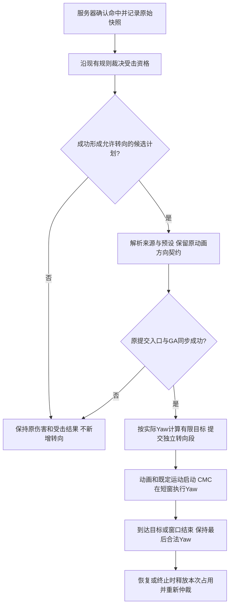

# 受击自动朝向设计（评审稿）

创建：2026-10-21；最后核对：2026-10-23，Asia/Shanghai。适用：Hodgepodge／UE5.5.4。

状态：首版代码及规定机械验证矩阵已完成。正式启用仅Hero与Dummy，Boss保持关闭；含尾重复ACK最小恢复分支的EditorBuild-13／GameBuild-09、240项原生及59项Python断言均通过。最终FullFinal01十格全部通过，共100个正式场景、170次正式命中；正式与预热分别留证，三项源码契约及资产保护检查通过。上述运行发生于2026-10-22，本次续作核对证据并更新文档，没有重跑构建或PIE。W05画面、W06真实生命周期余项及W07操作／碰撞评审仍未完成，不能据此宣布功能整体验收。旧失败保留，当前结果与边界见[实施与验证记录](../Validation/hit-reaction-facing-2026-10-21.md)，不重新开放此前暂缓重构。

本文区分三类信息：**已核实事实**为当前源码行为；**推荐方案**为本次评估建议；**待评审项**须在实施前明确。首次文档交付仅获评估与编写授权；后续开工指令及明确答复见第14节，不将笼统开工解释为所有未定契约已经确认。负责人按角色建议分工，具体人员尚未指定。

## 1. 背景与目标

角色在轻僵直、重僵直或击飞时，如果身体朝向与受击动作的表现基准不一致，可能出现侧身滑退、背对攻击者播放正面动作、连打中姿势关系不清等问题。需求希望参考《鸣潮》的画面感，使受击姿势和攻防关系更自然。

《鸣潮》在本文中仅是视觉参考；未取得其内部实现依据，不将“所有角色、所有受击都无条件面向攻击者”视为已证实规则。

推荐需求表述：

> 服务器成功提交允许转向的受击控制计划后，角色根据本次有效命中来源，在短窗口内进行有限的水平朝向对齐；达到目标或窗口结束后保持最后合法朝向。同一控制链不持续追踪攻击者，也不因普通接触反复重开转身。

目标：改善普通人形角色的连续受击可读性，保持动画、朝向和受力的一致性，并兼顾玩家操作、复杂目标及网络回放。

已确认首批目标：玩家与普通人形敌人同时覆盖，Boss暂不启用；首版为受角度、速度和时窗限制的有限补转，背击不保证完全转到正面。首版采用原地受击动画、Impact世界运动、地面轻／重僵直及首次击飞，保留原选片快照与世界运动；参数见第15.1节，映射与资产清单见第15.2、15.7节，具体动作表现仍须验收。

本需求不包含：调整伤害、削韧阈值、控制时长、攻击判定盒、攻击通知或弹道；改变相机／锁定目标；全套方向动画制作；根运动受击重做；新增Runtime模块或独立转向系统。

## 2. 术语与方向约定

| 术语 | 本文含义 |
| --- | --- |
| 普通接触／轻反馈 | 命中后音画或局部姿势反馈，本次未获得新的受击控制；不触发自动转向 |
| 轻僵直／重僵直 | 实际成功提交的地面受击控制，不能只按伤害数值或动画外观判断 |
| 强受击控制 | 包括轻僵直、重僵直、击飞等获得控制权的反应；“强”不等于仅Heavy等级 |
| 来袭来源 | 本次命中所代表的攻击者位置、投射物入射方向或爆心等，不必是当前存活施法者的位置 |
| 受击朝向 | 角色身体的水平Yaw；不直接修改Controller、摄像机、Pitch或Roll |
| 选片方向 | 用于选择受击动作的局部来源快照；有独立的坐标约定 |
| 受力方向 | 已解析的世界运动方向／速度；转身不应将其重新旋转 |
| 控制链 | 连续受击及其空中、落地、倒地、起身阶段的逻辑关联；不等于单个Sequence或Montage |
| 转向段 | 同一控制链中一次有限对齐的授权；以独立ChainId／Segment／Revision区分，不能由每刀Sequence推断 |

三个方向分别维护：**面朝哪里、播放哪一侧受击、沿什么轨迹运动**。不能用一个向量或转身后的Actor变换隐式重算全部结果。

## 3. 实施前核实基线

本节保留设计时的源码基线及问题来源；独立补转状态、提交成功门、执行与历史回放后来已完成常规构建、原生及规定单人／联机机械矩阵，不能将本节旧缺口当作当前代码仍未实现。画面、操作体验及未覆盖集成边界仍待验收，当前进展见第14节和实施记录。

### 3.1 实施前没有受击面源执行链

- [Rotation.RefreshLocalState](E:/Project/Git/Hodgepodge/Source/Hodgepodge/Private/Component/HodgeCharacterRotationComponent.cpp:118) 将受击Controlled、显式RotationLocked、MovementStopped和死亡合并为Yaw锁，记录当前Yaw。
- [CMC.PhysicsRotation](E:/Project/Git/Hodgepodge/Source/Hodgepodge/Private/Component/HodgeCharacterMovementComponent.cpp:553) 遇Yaw锁停止普通转向；[最终移动入口](E:/Project/Git/Hodgepodge/Source/Hodgepodge/Private/Component/HodgeCharacterMovementComponent.cpp:625) 仍限制最终Yaw。
- [RequestActionFacing](E:/Project/Git/Hodgepodge/Source/Hodgepodge/Private/Component/HodgeCharacterRotationComponent.cpp:337) 受同一锁约束。因此受击GA直接申请普通转向不能完成需求。

必须在原仲裁内区分“禁止输入／AI主动转向”与“允许本次受击授权转向”。直接删除Controlled锁或在GA Tick中写ActorRotation，会绕开现有唯一执行入口。

### 3.2 来源、动画与运动已分别解析

- [BeginHit](E:/Project/Git/Hodgepodge/Source/Hodgepodge/Private/Component/HodgeHitReactionComponent.cpp:131) 对普通削韧运动可使用攻击者位置快照；接触表现仍使用检测SourceOrigin，并在命中时冻结LocalSourceDirection，两者可能不同。
- [PlanBuilder](E:/Project/Git/Hodgepodge/Source/Hodgepodge/Private/Combat/HodgeHitReactionPlanBuilder.cpp:41) 使用该局部快照选片，另行按AwayFromSource、SourceForward或WorldDirection计算世界运动速度。
- [受击GA](E:/Project/Git/Hodgepodge/Source/Hodgepodge/Private/AbilitySystem/Abilities/HodgeGameplayAbility_HitReaction.cpp:85) 在服务器／拥有者执行既定RMS或Launch，不持续面向攻击者。
- [Compact解析](E:/Project/Git/Hodgepodge/Source/Hodgepodge/Private/Data/HodgeHitReactionProfile.cpp:80) 的左右变体不等于完整前后方向素材；正前／正后来源可能按变体序号交替左右。

所以不能通过转身后重写LocalSourceDirection来隐式改变现有接触表现，也不能假定现有左右素材天然支持任意180°转身。

### 3.3 计划身份与网络尚有缺口

每次成功提交均递增Sequence；同级HitStun可能续播旧Montage及旧StartedAt，活跃期间保留ChainStartedAt，恢复等待仍可能重开。阶段切换也会改变StartedAt。因此Sequence或起播时间变化都不能直接代表“重新转身”。依据：[续播计算](E:/Project/Git/Hodgepodge/Source/Hodgepodge/Private/Combat/HodgeHitReactionPlanBuilder.cpp:139)、[SubmitPlan](E:/Project/Git/Hodgepodge/Source/Hodgepodge/Private/Component/HodgeHitReactionComponent.cpp:455)。

当前SubmitPlan会先设置控制、发布计划，再确认受击GA激活及有效性；后续失败可CompletePlan。新增转向不能把“已发布候选状态”直接视为最终成功，激活／同步失败时的撤销、清理和旧状态防护必须与现有生命周期一起设计。

[FHodgeHitReactionState](E:/Project/Git/Hodgepodge/Source/Hodgepodge/Public/Combat/HodgeHitReactionTypes.h:231) 尚无完整朝向目标与转向时段；[SavedMove](E:/Project/Git/Hodgepodge/Source/Hodgepodge/Private/Component/HodgeCharacterMovementComponent.cpp:59) 保存通用朝向状态和受击控制标记，但不具备独立受击转向的历史身份与时间数据。攻击Warp的快照受Definition、Spec和预测键约束，不能直接充当受击协议。

正式角色使用自有ACharacter／CMC链路；ALS插件存在不代表它是当前朝向执行者，本需求不需要顺手修改ALS。

## 4. 方案比较与推荐选择

本节保留方案比较。用户已选择有限补转及第15节的完整首版契约；实际动画、执行和网络结果仍须按验收目标验证。

| 方案 | 优点 | 代价与风险 | 推荐位置 |
| --- | --- | --- | --- |
| 保持原朝向＋方向性受击动画 | 来袭方向直观，玩家控制和背击语义稳定 | 依赖方向素材；当前Compact不能视为完整方向库 | 玩家、大型目标及不适合转身的动作保留此路线 |
| 有限补转＋现有方向／左右受击动作 | 改动范围较小，适合现有原地动画及Impact运动 | 大角度仍可能姿势不匹配，必须逐素材审查 | 首版优先验证 |
| 面源基准动作＋专用转身过渡 | 可统一演出基准，更适合明显面源效果 | 需要定义转后选片坐标、补素材，并处理残余角度 | 后续按目标和动作单独制作 |
| 命中瞬间整体瞬转 | 响应直接、时机简单 | 大角度跳变、脚滑、弱点／附属碰撞变化、玩家方向突变 | 不作全局默认；专用动作另评审 |
| 僵直期间持续追踪攻击者 | 攻击者移动时仍保持面对 | 多人来回旋转、空中转圈、回放和轨迹风险增加 | 首版不采用 |
| 仅旋转Mesh／骨骼 | 可减少对Actor逻辑朝向的影响 | 增加视觉与逻辑偏差，Socket与骨骼碰撞仍可能变化，恢复需额外管理 | 局部反应可用，不作为全局替代方案 |

有限转向不承诺任何背后攻击都能在短时间变为完整正面。若最终需求要求180°完整面源，需明确动作资源、转身时段、角速度和对玩法朝向的影响，不能只提高插值速度。

## 5. 推荐行为规则与关键决策

### 5.1 触发、优先级与结束

1. 只在成功建立或合法接管受击控制后执行；不是收到HitId、发生伤害或当前State活跃就转身。
2. 普通接触、未达削韧阈值、霸体未被打断、不可中断、资源不合法或计划提交失败，不新增转向。
3. 受击许可仅接管本次身体Yaw，屏蔽原输入／AI／旧攻击的主动转向；显式RotationLocked、MovementStopped及死亡等外部硬约束继续优先。外部硬锁使本段永久冻结，解除后不恢复；Controlled本身不能被误判为禁止本段补转的外部硬锁。
4. 不修改Controller朝向、摄像机和锁定目标，也不因此重选AI仇恨或攻击目标。
5. 正常恢复、主动恢复、取消、死亡、Pawn更换和ASC解绑时，释放本次朝向占用，重新解析当前有效基础驱动。
6. 不无条件恢复受击前Yaw、旧布尔值或已取消攻击；旧回调不得重建旧占用。

受控资格不能简化为ReactionLevel达到Light：显式／兼容入口可能成功建立控制而ReactionLevel为None。用户已确认各现有输入模式共同按最终成功计划映射预设，具体规则见第15.2节。

### 5.2 时机、角度与过渡

伤害、僵直和运动保持原生效时机，转向授权随合法受击提交接入，实际旋转由后续有效CMC步执行。不得等待转身完成再受击，也不得为转向延长控制时长。

前期讨论曾以轻僵直约0.06～0.10秒、重僵直约0.08～0.15秒作为参考；当前已明确采用第15.1节的分目标数值，不再将旧参考范围视为待选默认值。这些新参数尚不代表实际执行或画面已经通过验收。

```text
实际允许转角 ≤ min(目标角差，最大修正角，最大转速 × 有效转身时长)
```

达到目标或窗口结束即停止；未达到时保留最后合法Yaw，不在最后一帧补齐。需有小角差死区、最短角差归一化，以及恰好180°时各端一致的转身侧规则。只调整水平Yaw，动画负责俯仰、侧倾或翻滚姿态。

转窗按服务器世界时间截止，实际补转按有效CMC步长限速；局部动画显式暂停或播放速度为0时不补转、不消费权威校正，但转窗继续消耗。恢复后仅用剩余窗口，过期不补播；具体规则见第15.5节。

### 5.3 来源选择与失效回退

首版仅采用现有近战Source角色链；下列投射物、爆炸和持续伤害来源是后续扩展建议，不代表本轮已增加这些入口。

| 命中类型 | 来源规则或后续建议 |
| --- | --- |
| 近战 | 命中时攻击者的有效水平位置快照 |
| 投射物 | 入射方向的反向，避免朝向已经远离的施法者 |
| 爆炸／径向攻击 | 命中时爆心的水平方向 |
| 持续伤害 | 默认不新增转向 |
| 自伤、无来源环境伤害、水平位置重合或无效方向 | 保持现有Yaw |

已经建立的转向使用值快照，来源销毁或离开后不重新选最近敌人。接触法线不直接当作面源方向；现有SourceOrigin与运动Origin不混用。首版角色Source及无效回退已确认；其他来源类别需在未来扩展时另行评审。

### 5.4 多段攻击与多个攻击者

- 首个成功控制建立本轮转向目标；同一攻击者连续同级受击保持，不重新启动转身，也不逐刀增加角度额度。
- 同级不同攻击者不抢占当前朝向来源；伤害、接触方向和既有受击结算仍正常处理。
- 地面Light升级Heavy、或首次进入Launch等更强反应合法接管时，允许建立新的转向段；不能只比较伤害大小。
- 同级同时命中按服务器首先成功建立的反应保持朝向，不额外引入伤害批处理、排序或合并。
- 不平均多个攻击者方向，避免相反方向抵消或朝向无人区域。

稳定朝向的取舍是：面对A时仍可能承受来自B的命中。B的音画、动作和受力仍需真实表达，不为维持朝向篡改B的命中事实。用户已确认同级保持、地面Light→Heavy或首次Launch合法接管时从当时Yaw重建一次转向段、空中追加／落地／起身不重开；中途外部硬锁使本段永久冻结，解除不恢复。预算见第15.1节，显式／兼容映射及独立控制链身份按第15.2、15.6节执行。

### 5.5 击飞、落地与目标差异

- 首次击飞初期允许一个短对齐窗口，随后保持Yaw；飞行中不追踪攻击者、不因转向修改弹道。
- 空中追加命中默认不重开转向；专用空中转体或续飞接管另行评审。
- AirLoop、真实落地、倒地和起身保持控制链朝向，不因换Montage重新瞄准。
- 玩家限制角度，避免突然反向；恢复后由现有输入和锁定规则接管身体，摄像机保持原规则。
- 玩家与普通人形敌人均属首批必验；大型、长身躯或多碰撞部件Boss不启用，局部反应或专用失衡转身留待后续评审。

圆胶囊水平轮廓不变，不代表整体旋转安全。大型敌人的附属碰撞体、Socket、弱点和攻击范围可能移动，需要墙边、包围和复杂地形验证。

## 6. 动画、运动与玩法方向契约

每组动作在制作前明确属于“保持命中方向播放”或“面源基准播放”。首版优先有限补转；完整面源路线需先定义转后参考坐标和过渡动作。

必须保留原命中LocalSourceDirection的接触语义。如果强受击需要按转后参考框选片，应从同一权威快照派生独立输入，不原地改写所有接触表现使用的快照。已有PresentationSide左右受力编排也不能自动等同于来袭者在角色哪一侧。

Impact路线继续消费已经解析的世界MotionVelocity；角色面向来源时仍可后退、斜飞或侧移。RMS／Launch速度、重力、碰撞和落地判断保持原规则。

AnimationRootMotion按角色／Mesh变换进入世界，持续转身可能弯曲局部根运动轨迹；当前角色还禁止动画根运动期间普通PhysicsRotation。该路线不能未经区分套用Impact实现，首版不顺带改动。

当前这一击的正背面、格挡和弱点判定应基于受击转身前的命中事实。Actor转身对后续命中的影响须评审，不能笼统标记为“纯表现、没有玩法影响”。

## 7. 组成部分与职责划分

以下为已批准的职责划分；Profile配置与值校验已验收，来源候选及执行／同步正在实现。新增字段或接口存在不等于其构建、运行或联机验收已通过。

| 组成部分 | 职责 | 边界 |
| --- | --- | --- |
| 目标HitReactionProfile | 保存默认关闭的Facing设置、Light／Heavy／Launch限制与死区，并检查配置值 | 仅按第15.7节清单显式启用；不由攻击资产指定目标手感 |
| HitReactionComponent | 校验本次命中与接管资格、建立值快照，成功提交并复制权威反应，管理控制链和清理 | 保留服务器唯一提交入口，不在BeginHit提前旋转 |
| FHodgeHitReactionPlanBuilder | 根据同步上下文计算候选转向结果和选片依据，返回诊断 | 保持纯计算，不写Actor、标签、动画、运动或RPC；失败部分输出契约保持 |
| CharacterRotationComponent | 仲裁受击许可、普通转向与外部硬锁，管理本次占用和退出后的重新解析 | 不增加平行旋转Tick或第二份权威Yaw |
| CharacterMovementComponent／SavedMove | 在既有移动入口执行Yaw，处理服务器模拟、拥有者历史回放及最终旋转约束 | 不复用攻击Warp身份冒充受击历史，不绕过CMC直接写Actor |
| HitReaction GA／AnimInstance | 按计划表现动画和既定运动，处理混入、续播、阶段和恢复衔接 | 不再独立追踪来源或重复执行Yaw |
| 复制与代理表现 | 传递有效计划和运动，拥有者按权威身份求值，代理消费权威运动和平滑 | 接触Unreliable表现事件不能成为转向事实来源 |
| 验证工具 | 记录身份、目标Yaw、实际Yaw、时段、运动和清理，检查参数及回放 | 日志启动成功不等于画面、联机或完整流程通过 |

继续保留玩家PlayerState ASC与普通敌人Pawn ASC差异，复用现有Experience、PawnData、GameFeature、GAS与Init State。单一Runtime模块和同类主cpp约束保持。

最小数据包括：目标启用配置、命中时的来源／目标水平位置值快照、起始与目标Yaw、有效时段／速度约束，以及独立ChainId／Segment／Revision和实际FinalYaw。来源Actor引用不是客户端求值的必要条件；ChainStartedAt不能充当跨Pawn的唯一执行身份。当前已写入`FHodgeHitReactionFacingSource`和独立`FHodgeHitReactionFacingState`，持续权威状态与本地SavedMove配套实现，不扩展现有MoveData／RPC格式；字段布局不是客户端提交转向许可的入口。

## 8. 关键流程与交互

### 8.1 单次地面受击



图示是设计流程，不是新增状态机或已实现枚举。候选计划失败仍不得执行；若原受击合法而可选转向因来源无效或被硬锁禁止，保持原朝向并继续原受击。强制面源的专用动作缺少必需资源时应明确报配置错误，不伪装支持。

图中的成功提交必须覆盖受击GA激活／同步有效性。已批准的执行门在这些条件成功后才发布独立补转许可，并以此时实际Yaw作为预算起点；失败候选不驱动Yaw。原受击提交不重构为全面回滚事务，旧失败清理也不能撤销更新的段。

### 8.2 连续受击和阶段交接

1. 第一笔允许映射的成功受击建立控制链及本级转向尝试；来源无效、重合或无法补转也占据该次同级尝试。
2. 后续同级／续播保持其朝向目标和预算；首段来源无效时同级也不补开，只沿原规则更新控制、动画或恢复等待。
3. 更强反应在合法接管且策略允许时建立新的转向段，旧段失效；既有伤害和受击优先级不由转向系统改写。
4. 首次击飞完成初始对齐后冻结，循环、落地、倒地、起身沿用控制链朝向。
5. 任何结束路径按当前Avatar与反应身份配对释放；旧段回调和迟到状态不能恢复朝向。

### 8.3 恢复与取消

成功主动恢复或正常结束时释放受击拥有的资源，基础驱动按当前输入／锁定状态重新解析，不恢复已取消的攻击。释放可能同步触发仲裁，因此按“先使补转段失效、再释放Controlled与移动缓存”的顺序清理，防止旧权威状态回填。

死亡、解绑、换Pawn和对象失效走相同身份保护，不能把旧PlayerState ASC上的回调作用到新Pawn。

## 9. 网络同步与回放约束

服务器决定转向目标及有效时段，随持续有效的受击计划传递。不能仅通过不可靠接触事件或一次性客户端旋转调用实现。

- 服务器与拥有者按同一权威快照执行；首版不新增客户端自行裁决受击的预测行为。
- 模拟代理以权威运动及CMC平滑为主，不再本地读取攻击者当前位置决定ActorYaw。
- 迟到状态按已逝服务器时间接入，不从零重演完整转身；身份过期的状态不得作用于新反应。
- 拥有者SavedMove恢复当时的受击快照、求值时间及暂停／冻结状态，不能将最新Yaw、来源或新控制链套入旧移动；服务器处理迟到移动仍使用当前权威受击和硬锁，不回滚过去伤害／受击决策。
- 不同时在OnRep、GA Tick、动画根运动和CMC中分别插值ActorYaw；不以逐帧RPC同步朝向。
- 玩家Owner／Avatar、敌人Pawn ASC、反应身份、占用身份和历史移动身份分别核对。
- 保留全部原生纠正和观测样本，以实际可见Yaw、速率、单调性、不越界及同一权威时点一致性验收；速率和方向推进约束按同一转向段／快照核对，合法接管产生新目标后不要求整条控制链始终沿原方向单调。不要求零纠正，也不跳过失败帧。

只增加Profile开关或只复制目标Yaw不足以证明网络正确；已批准的持久状态、历史快照、最终Yaw约束与代理消费方式须整体实现和验证。新验收使用第15.7节的1°／2°及收敛时点，旧攻击转向的8°容差不适用于本功能。

## 10. 已识别风险与待解决问题

| 编号 | 风险／缺口 | 推荐处理 | 责任角色 |
| --- | --- | --- | --- |
| R01 | 背击动作在转身后含义错位，现有左右素材不足 | 逐动作标明参考坐标，限定首版角度，缺素材记录缺口 | 动画／技术美术＋战斗程序 |
| R02 | 大角瞬转、脚滑或最后一帧补齐 | 同时约束角度、时间、速度，逐帧检查实际Yaw | 动画／技术美术＋QA |
| R03 | 同级多源抢转、Sequence更新导致反复瞄准 | 按控制链保持，明确升级接管与预算规则 | 战斗程序＋战斗策划 |
| R04 | 当前Yaw锁合并原因，放开后旧攻击或输入抢回 | 在现有仲裁内区分许可与硬约束，验证最终移动入口 | 移动／网络程序 |
| R05 | Actor转向影响后续背击、弱点或附属碰撞 | 分清当前命中快照与后续玩法，测试玩家和大型目标 | 战斗策划＋战斗程序＋QA |
| R06 | 将世界击退随Yaw改向，或根运动路径弯曲 | Impact世界运动保持；根运动受击单列范围 | 移动程序＋动画／技术美术 |
| R07 | 复制迟到、回放使用新计划、双重平滑导致回拉 | 权威值快照与历史身份配套，真实纠正下验收 | 移动／网络程序＋QA |
| R08 | 取消、死亡、换Pawn后旧租约恢复 | 资源配对释放、退役顺序、幂等与Avatar校验 | 战斗程序＋移动／网络程序 |
| R09 | 将来源、投射物入射、爆心和法线混用 | 定义来源类别及确定回退；无效时保持Yaw | 战斗策划＋战斗程序 |
| R10 | 停顿／变速时转向和动画不同步 | 明确有效时间基准和迟到求值，专项采样 | 动画／移动程序＋QA |
| R11 | 计划已发布但GA激活／同步失败，留下转向或占用 | 明确最终执行起点、失败撤销和新旧反应身份保护 | 战斗程序＋移动／网络程序 |
| R12 | 离线原生纠正去重仅以Avatar＋MoveTimeStamp识别，超时间戳重置周期长跑会混淆分代 | 当前采集限170秒；长跑前扩审计分代，不改生产SavedMove对象身份 | QA＋移动／网络程序 |

评审状态与剩余风险：

1. **目标与资产**：首批玩家与普通人形敌人已确认，正式启用仅第15.7节Hero／Dummy两份Profile，Boss与其他未分类目标不启用；当前命中保持原快照，后续背击／弱点和附属碰撞的实际表现仍须策划与QA复核。
2. **动画路线**：有限补转、保留原选片方向与Impact世界运动、根运动受击排除均已确认；侧／背素材适配、脚滑和恢复衔接仍为画面验收内容，不默认现有素材已合格。
3. **参数与时间**：第15.1、15.4、15.5节已确认，世界时间截止不因局部动画停顿延长；代码必须验证变速、暂停和恢复后的行为。
4. **来源与接管**：第15.2、15.6节已确认；兼容None等级、无效首源后同级不补开、升级与冻结须有回归证据。
5. **扩展来源**：首版只消费现有近战角色Source；投射物、爆心与持续伤害的分类和回退不在本轮实施范围。
6. **同步与生命周期**：独立链／段／修订、成功GA门、持续权威复制、Owner历史重放、服务器不回滚受击及移动合并范围已确认；具体编码和缓存属于实现细节，不能借此更改现有MoveData／RPC或增加逐帧RPC。
7. **验收**：第15.7节误差、时点与模式范围已确认，仍须实际构建、原生、冷启动、PIE与网络报告；现有209项配置切片证据不能替代这些结果。

已确认项不重复索要授权。实现中若出现新的行为歧义、文档冲突或必须改变上述契约的情况，暂停相关改动并附必要上下文提问，继续不依赖该问题的工作。

## 11. 后续工作、依赖与负责人分工

当前W01及W03首版契约已经用户确认；W04含尾重复ACK补丁的构建和240项原生通过，59项Python断言通过。Hero／Dummy备份保存、冷读、蓝图及最终磁盘保护证据已完成。W05单人双方完整链机械验证通过，画面未验收；W06规定十格联机机械矩阵完成，真实重生、多来源、暂停变速等集成边界仍未闭环；W07表现与操作评审未完成。下表按角色分工，具体人员尚未指定；程序角色可由同一人兼任。

| 工作项 | 优先级 | 主责角色 | 配合角色 | 前置依赖 | 交付／完成条件 |
| --- | --- | --- | --- | --- | --- |
| W01 需求评审与范围冻结 | P0 | 项目负责人／战斗主策 | 战斗、移动／网络、动画、QA | 本文 | 对第10节逐项记录决定、责任人和批准范围 |
| W02 目标与动作资源审查 | P0 | 动画／技术美术 | 战斗策划、战斗程序 | W01目标范围 | 目标／Montage／方向基准／支持角度／素材缺口清单，不覆盖源资产 |
| W03 仲裁与同步详细设计 | P0 | 移动／网络程序 | 战斗程序、QA | W01；W02的方向约定 | 数据、接口、锁优先级、控制链、回放、清理及误差契约评审通过 |
| W04 单目标实现与原生回归 | P1 | 战斗程序 | 移动／网络程序 | W02、W03批准 | 纯计算与执行分离，资格、角度、续播、接管、失效、释放回归通过 |
| W05 动画过渡与单人完整链 | P1 | 动画／技术美术 | 战斗程序、QA | W04 | 接触→Light→Heavy→Launch→真实落地→倒地起身→恢复，画面和运动均合格 |
| W06 联机、纠正与生命周期验证 | P1 | QA | 移动／网络、战斗程序 | W04、W05基础可复现 | 拥有者／服务器／观察者、真实回放及取消／换Pawn证据完整 |
| W07 首批玩家与普通人形目标差异验证 | P1 | 战斗策划 | 动画、程序、QA | W01首批范围、W06 | 玩家操作／恢复、双方受击表现及弱点／碰撞影响符合首批要求；完成后方可验收首版 |
| W08 文档、作者入口与交付 | P1 | 战斗程序（文档维护） | QA、项目负责人 | 各项实际结果 | 同步真实字段、检查、操作步骤、测试命令和未验证项，形成评审记录 |

W02动作审查与W04实现可交叉推进；正式资产只按第15.7节已批准清单在检查、备份后配置和保存。玩家与普通人形敌人均为首批必验对象；Boss暂不启用，大型／专用目标分支需另行批准，不纳入本轮实现或验收。

剩余执行顺序：动画／技术美术先完成W05画面评审，QA并行补W06未覆盖的真实集成边界；两者证据齐备后，由战斗策划完成W07双方差异与操作评审。若发现需改变角度、时窗、动画根运动或网络契约的问题，按第10节先确认具体方案。复核入口、步骤及证据要求见实施记录第6.9节。W08本次文档收口已完成，最终首版签收仍依赖上述余项。

## 12. 验收清单与验证边界

| 验收组 | 必查内容 |
| --- | --- |
| 资格与失败 | 普通接触不转、Light／Heavy／Launch按策略转；霸体、未达阈值、不可中断和失败提交不新增占用 |
| 角度与过渡 | 正前、侧面、背后、±180°、死区、水平重合、无效来源；速率、角度和时窗均合法，无末帧补齐 |
| 动画与运动 | 原始接触方向未改，选片参考明确；世界击退／击飞轨迹、碰撞与落地不随Yaw重算，无明显脚滑 |
| 连击与多源 | 同级续播不重开，双来源不抖动，更强接管与预算符合批准规则，不改变原伤害排序 |
| 空中与完整链 | 首次击飞、追加命中、Loop、真实落地、倒地、起身、恢复朝向衔接；无空中持续追踪 |
| 玩家与目标差异 | 相机／锁定保持原规则；首批玩家与普通人形目标的恢复、方向动画及碰撞表现合格；Boss保持未启用 |
| 清理与时间 | 正常结束、主动恢复、取消、GA激活／同步失败、死亡、解绑、换Pawn、旧回调、重复初始化；停顿和变速无单独转向 |
| 网络与回放 | 单人、Listen与PIE Dedicated，0／100ms及批准的其他网络条件；三端同身份，迟到不重播，纠正／旧移动不恢复旧朝向 |

实现后按项目规范执行普通Editor与Game构建，反射变化后冷启动检查受影响资产，再执行原生与PIE验证。C++通过不等于动画、画面或联机通过；独立进程、Server构建、Cook／打包仅在实际执行后报告结果。

旧转向专项的AW06含探针注入，不能替代真实服务器拒绝／纠正测试。已有[205项原生及旧五段验收](../Validation/hit-reaction-plan-builder-2026-10-19.md)属于本功能之前的基线，不是新受击转向已通过的证据。历史0xC0000409退出问题仍保持独立记录，不假定本需求会修复或解释它。

## 13. 参考、复用与关联范围

### 13.1 本机Lyra核查

参考根：`E:/Project/UProject/study/Epic/LyraStarterGame`。本次讨论已读取实现及相关调用链：

- [LyraCharacterMovementComponent.GetDeltaRotation](E:/Project/UProject/study/Epic/LyraStarterGame/Source/LyraGame/Character/LyraCharacterMovementComponent.cpp:107)：MovementStopped阻止旋转，没有完整受击面源算法。
- [LyraAnimInstance.InitializeWithAbilitySystem](E:/Project/UProject/study/Epic/LyraStarterGame/Source/LyraGame/Animation/LyraAnimInstance.cpp:20)：ASC标签映射与动画初始化；不代替受击朝向决策。
- [LyraHealthSet](E:/Project/UProject/study/Epic/LyraStarterGame/Source/LyraGame/AbilitySystem/Attributes/LyraHealthSet.cpp:124)：伤害来源与消息，不包含完整轻／重僵直及击飞朝向控制。
- [LyraPawnExtension初始化／解绑](E:/Project/UProject/study/Epic/LyraStarterGame/Source/LyraGame/Character/LyraPawnExtensionComponent.cpp:105)：幂等、旧Avatar清理与能力取消；继续复用项目已沿用的生命周期原则。

检索未找到已核实可直接复用的完整受击转向方案。Lyra二进制GameplayCue的内部本次未通过编辑器检查，不能仅凭文件名断言其能力。项目适配继续使用既有GAS／CMC，不引入CommonGame、CommonUser或新业务模块。

### 13.2 引擎与项目依据

- [UE5.5根运动说明](https://dev.epicgames.com/documentation/en-us/unreal-engine/root-motion-in-unreal-engine?application_version=5.5)、[UE5.5 Motion Warping](https://dev.epicgames.com/documentation/en-us/unreal-engine/motion-warping-in-unreal-engine?application_version=5.5)：根运动与窗口机制背景；不据此要求所有受击使用Motion Warping。
- [Epic角色移动网络说明](https://dev.epicgames.com/documentation/en-us/unreal-engine/understanding-networked-movement-in-the-character-movement-component-for-unreal-engine)：复制、纠正和平滑的一般机制；具体实现以本机5.5.4源码为准，不引入新版API。
- [本机CMC根运动转换](E:/UE/UE_5.5/Engine/Source/Runtime/Engine/Private/Components/CharacterMovementComponent.cpp:2824)、[角色根运动旋转设置](E:/Project/Git/Hodgepodge/Source/Hodgepodge/Private/Character/HodgeCombatCharacter.cpp:118)：核对转身与局部根运动的耦合。
- [受击系统现状与设计](hit-reaction-system.md)、[字段手册](../Guides/hit-reaction-configuration.md)、[战斗制作流程](../Guides/combat-production-workflow.md)：沿用既有配置、阈值、阶段和制作入口。
- [攻击者锁定五段转向补充方案](locked-combo-finisher-fix-2026-10-19.md)：已批准范围控制攻击者；本需求控制受击者，是独立行为与同步扩展，旧授权不自动覆盖。
- [职责迁移方案](combat-refactor-next-boundaries-2026-10-18.md)：纯计划解析已完成，第4～5节仍待批准；本文不恢复其他拆分、Client共鸣窗口或完整生命周期矩阵的开发授权。

## 14. 本文交付与状态维护

首次文档交付仅新增设计文档并加入文档索引，核对源码定位、文件链接、Markdown结构、流程图节点和差异；未修改C++、Python、配置、蓝图或二进制资产，未运行新的构建或PIE。

后续评审在本文中记录日期、批准人、决策编号／对应条目、参数与范围。实现结果另建验证记录，保存实际命令、报告、失败和未验证项；不将本评审稿或旧基线自动标为新功能完成。

### 2026-10-21 开工与首批范围确认

- 用户要求立即依照本文实施，并明确任何细微歧义须暂停相关改动、获得明确确认后再继续。
- 已确认：首批同时覆盖玩家与普通人形敌人，Boss暂不启用。该答复只确定对象范围，不确定玩家角度、正式资产清单或未定协议。
- 已确认：有限补转，背击不保证完全转到正面；采用同级保持、升级接管、空中不重开、外部硬锁后本段永久冻结规则。本次答复已解决此前两项提问，不重复索要这些决定。
- 参数与校验范围确认后，独立配置切片、完整资产检查及四项配置回归已完成，Editor／Game构建与209项原生通过；这些结果属于该配置切片，不自动覆盖后续执行代码。
- 用户随后明确批准第15.2节来源／最终计划映射、第15.3节同身份一次权威朝向校正，以及第15.5～15.7节时间、历史移动、量化验收和Hero／Dummy资产清单。对应实施与后续验证按独立批次记录，不将批准本身计为通过。
- 旧配置阶段已冷加载3份Profile、5份PawnData及5份角色蓝图，检查默认关闭、引用和生成类；该阶段当时未编译或保存蓝图、未启动PIE。旧玩家／假人脚本缺少本功能的侧背起点和三端Yaw采样，旧结果不能证明新转向有效。
- 最新Editor／Game常规构建及232项原生通过，其中12项FacingMovement和6项FacingLifecycle均成功。新增启用配置、有效来源下的拒绝计划组合回归，证明空接触、阈值不足、霸体、不可中断及动画缺失不新增占用；该批生产Runtime代码未改。中间失败报告保留。Hero／Dummy双备份后启用保存，各27项旧配置保持不变，Guardian仍关闭；六份蓝图内存编译均UpToDate，磁盘未变且未保存蓝图。
- SingleEnemySmoke01曾因Segment受保护属性采样失败，原报告保留；兼容修复后的Smoke02真实完成单人敌人SideLight并通过，记录1case、188样本及15条原生执行记录。Full01前四case实际完成，但Upgrade把最多90°误作必须转满90°而失败；实际Light为90→135°、Heavy新段为135→180°，整批不计通过。

### 2026-10-22 续作核对

- 上述232项原生、正式资产及冷读结果已按原始文件重新核对，没有将进程退出0视为PIE通过。
- SingleEnemyIntegration01请求SameLevel／Upgrade／AirFollow，实际完成case、样本及命中均为0。日志首因是Python生成函数不匹配原const引用委托，解绑同一未成功绑定的函数又抛错；后续探针授予异常覆盖了runtime中的首因，必须结合原生日志判断。
- 其后Integration02绑定及清理完成，但ExplicitImpact探针仍携带削韧量，被原互斥规则拒绝授予；修正为仅PoiseDriven携带削韧后，Integration03在真实近战结算调用Python结构委托转接时空指针崩溃，退出3且无runtime报告，不能补写清理成功或场景通过。
- 为避开该采集转接，在原`OnReactionResolved.Broadcast`前添加默认关闭的Verbose同步诊断`HitFacingResolved`；委托、状态和RPC不变。EditorBuild-09／GameBuild-07及`AfterNativeResolutionDiagnostics`的232项原生均通过。Python采集改用Actor与HitId关联轮询和原生日志；本次崩溃不等同于历史`0xC0000409`。
- 新采集路径已完成SingleEnemyFull02、SinglePlayerFull02及ListenEnemy0Full01，各10场景均通过离线审计；包含普通接触、成功同级／升级、真实空中GE、活动窗取消及同目标FullChain。1秒专用同级／升级探针与正式控制时序分开报告，未改正式参数。
- ListenPlayer0Full01运行时10场景完成但离线失败；帧归因偏移、Owner硬锁旧缓存回拉及首个Light冷卡顿分开定位。Final缓存修复通过EditorBuild-10／GameBuild-08和233项原生；随后采用日志标记因果归帧、独立预热且保留原参数的ListenPlayer0CausalSmoke01三场景及ListenPlayer0Full02十场景均通过，旧失败仍保留。
- DedicatedEnemy0Full01和ListenEnemy100Full01各10场景通过。独立预热及其原始记录不计正式场景数；Dedicated敌人的30组Proxy Final含24组正式与6组预热，均收敛，不能全部写成正式验收。
- DedicatedPlayer0Full01运行时10场景及清理完成，但唯一离线失败为Upgrade两次结算相隔0.400753秒，超过Hero原GroundRecovery约0.4秒而成为合法新链。用户明确批准仅Hero SameLevel／Upgrade内存关闭`bEnableGroundRecovery`使已有1秒探针生效，结束／异常即恢复、不保存，FullChain及其他场景保持正式控制；实现及两项失败注入自测完成，随后DedicatedPlayer0RecoverySmoke01三场景通过，完整矩阵仍待新版批次。
- 专项隔离后DedicatedPlayer0Full02实际10场景通过，两个scope均恢复。随后ListenPlayer100Full01虽运行时10场景完成且清理成功，但预热WarmupKnockback中Owner经原生Yaw纠正42.2383118→39.5095825°后，回放收尾错误落到21.3519287°；后续Final收敛不能抹掉该失败，矩阵在此停止。
- 用户明确批准第15.9节原生纠正边界；EditorBuild-11仅引入真实复现测试并编译成功，`NativeRotationRepro-BeforeFix`的1项测试实际失败、6条错误，证明修前缺陷，不是通过结果。生产修复尚待落地，新版Python原生纠正解析／独立验收加三项回归后全目录57项通过。
- 随后生产修复初版通过EditorBuild-12和`AfterNativeAnchorBeforeDuplicate`的239项原生，原真实红测已绿。交叉复核发现合法ACK锚点已消费且无历史后，UE RMS尾重复LastAck仍可写Yaw，不能伪记为新NativeCorrection；当前补同身份有效Impact的最小恢复分支、完整Super保留，后续构建和实跑尚待结果。新Python共59项通过；旧Listen玩家100ms日志用新schema重审仍失败，没有靠新规则抹去旧失败。
- 尾重复分支随后通过EditorBuild-13／GameBuild-09及`AfterNativeRejectedRestore`的240项原生，新增真正尾重复回归成功；独立复核与59项Python重跑未新增阻断项。原Build纯算法及MoveData两定义的三项静态契约保持不变。P0补丁的构建／原生已闭环，最终FullFinal01十格仅刚开始真实Listen玩家100ms，不能提前写网络通过。
- 最终首格`ListenPlayer100FullFinal01`随后实际10场景通过：5356份正式样本、1392份预热样本、17次正式GE，因果证据完整，清理成功且两个Hero覆盖均恢复。25次原生RMS纠正含实际跳变并独立验收，未记新的Rejected恢复；其余最终格继续采集，完整十格未验收。
- 此时W05画面、W06剩余网络格、W07双方视觉／碰撞及操作尚未闭环；后续最终矩阵结果见下节，Mesh组件Yaw始终不能替代画面验收。
- 本轮资产保护复核通过：11份未授权修改的基线资产、两份批准原件的raw备份、六份蓝图磁盘及备份SHA、两份Content备份LFS均符合记录。保护脚本首轮误推Dummy带下划线的名字已单独保留失败，按`asset-enable.json`真实路径重验成功，不是实际备份缺失。

### 2026-10-23 最终证据核对与文档收口

- 核对2026-10-22已执行的最终FullFinal01十格：每格10个正式场景及17次正式GE全部通过，53206份正式样本与13201份预热样本分开；96组正式Proxy Final及24组预热组均收敛。所有批次因果采样完整、UE退出0、清理完成且无脏包，没有用旧批次补齐最终格。
- 玩家100ms两格被测Owner分别保留25与23次合法原生RMS纠正并独立验收；全日志共58次NativeCorrection，另外10次属于敌人格中的其他Hero，不能计作Dummy目标的Owner证据。十格没有自然触发NativeRejectedRestore，该尾重复分支由240项原生中的专项回归覆盖。
- Hero五格共10个SameLevel／Upgrade隔离scope均在case_end恢复；FullChain保持正式恢复配置。最终两份Profile的SHA与批准启用后完全一致，11份其他受保护资产、六份蓝图磁盘及备份保护均通过。
- `final-execution-manifest.json`记录最终源码五项SHA与验证时冻结值一致、三项源码契约不变、两目标常规构建和全部验收结果。原始245条工作区记录全部保留，当前252条，无本项目UE进程残留；未提交或推送。
- 本次只核对已有证据与同步文档，不重复构建和运行矩阵。W05画面、W06真实重生／多来源／暂停变速等边界、W07操作与碰撞，以及长周期审计仍待专项；没有执行独立专服、Cook或打包验证。

## 15. 已确认的首版实施契约

本节逐项记录本次讨论中用户明确批准的首版及补充契约。批准不等于实现或验证完成；当前实现、命令及报告见关联验证记录，不再将这些条目列为待答复。

### 15.1 已确认参数

配置仍归目标受击Profile；新增配置默认关闭，默认数值采用玩家保守组，启用的敌人Profile显式覆盖。不改现有控制时长、伤害、削韧、运动及动画速度。

| 目标 | 预设 | 最大修正角 | 转向窗口 | 最大角速率 |
| --- | --- | --- | --- | --- |
| 玩家 | Light | 30° | 0.08s | 720°/s |
| 玩家 | Heavy | 60° | 0.12s | 720°/s |
| 玩家 | 首次Launch | 60° | 0.12s | 720°/s |
| 普通人形敌人 | Light | 45° | 0.08s | 720°/s |
| 普通人形敌人 | Heavy | 90° | 0.14s | 720°/s |
| 普通人形敌人 | 首次Launch | 90° | 0.14s | 720°/s |

统一死区3°；恰好180°时固定选择正Yaw方向，不按端随机选侧。每段按实际起始Yaw限幅，不追加累计角度；按实际CMC步长限制单步速度，到达目标或时窗结束即保持，不补齐。空中后续命中不重新取得Launch预设。

用户已明确选择上述分玩家／敌人的数值组；代码默认采用玩家保守组，Dummy按第15.7节在备份后显式覆盖为敌人参数。第15.4节规定可编辑范围与禁用兼容策略；配置基础和校验本身不申请或执行朝向控制。

### 15.2 已确认的来源与预设映射

当前生产BeginHit调用来自Melee共同提交，传入攻击Avatar；现有接口没有投射物／爆心／持续伤害类别。首版只消费该现有角色来源链：在BeginHit冻结有效、非自身角色Source和目标的水平位置，来源无效、自身、方向退化时保持Yaw。不借检测体原点或法线猜测来源，不新增投射物／爆炸／持续伤害分类。

转向预设按**最终成功计划**而非请求数组第一个Impact选择，各InputMode共用规则：

- 地面Controlled＋HitStun使用Light；最终ReactionLevel为Heavy时使用Heavy。
- 地面Controlled＋Knockback使用Heavy；等级None的合法显式／兼容计划也适用。
- 原地面状态首次进入Launch使用Launch预设，不能以ReactionLevel为None排除。
- 当前处于空中、倒地或起身时不新建转向；AirHit、Slam、Knockdown及未映射等级不新增转向。实际运动来源为AnimationRootMotion时保持旧朝向规则。
- 保留命中LocalSourceDirection、PresentationSide及实际选片，不重新定义方向动画；已经解析的世界MotionVelocity不变。可选转向失败不取消原本合法的伤害与受击。

上述来源与映射已获用户明确批准；命中后来源销毁或移动不重采样。正式启用只限第15.7节清单，修改前执行当次资产检查、引用核对和备份，不按角色名自动推断Boss或扩大资产范围。

### 15.3 已确认的短窗口与迟到状态处理

已核实的短窗约束：0.08～0.14s的转窗可能在100ms网络条件下先于Owner获知受击而结束；未预测受击、原时窗不延长、所有可见帧严格限速、立即完成权威朝向收敛不能同时保证。用户因此批准以下同身份权威校正方案；有限补转不要求完整背击面源。

普通CMC纠正并不自动保证站立HitStun的OwnerYaw：原生ShouldCorrectRotation默认false，纯Yaw误差也未必产生位置纠正；普通ReplicatedMovement主要供模拟代理使用。不能将根运动纠正能够携带Yaw概括为全部受击已经具备朝向同步。

已批准方案：

1. 服务器为受击控制链、转向段和修订建立独立身份，并持久保留实际冻结／结束Yaw；现有每刀Sequence和客户端通用FacingSequence不能代替这些身份。
2. Owner按仍有效的权威时段执行有限补转，不从零重播过期转窗。服务器最终Yaw到达且当前Avatar、受击段仍匹配时，由CMC在当前移动或回放收尾处消费一次同身份权威Yaw校正；不在OnRep直接写Actor。
3. 该权威校正允许瞬时角度变化，与正常补转的速率约束分开验收；必须记录全部可见样本及校正事件，不隐藏回拉或改写旧报告。最终误差、收敛时点按第15.7节执行。
4. 新受击接管、主动恢复后的新动作、死亡或换Pawn后，旧段校正永久失效，不为补齐旧Yaw打断新动作；不新建逐帧RPC。
5. 朝向许可仅在原受击GA激活及同步成功、Avatar与反应身份仍匹配后提交；失败候选不驱动Yaw。仅补转向提交门，不将原受击提交重构成全面回滚事务。

未选替代方案：所有可见朝向始终限速且平滑，需要另行设计预测或额外表现恢复时段，明确逻辑Yaw与视觉姿势关系；用户本轮选择允许同身份一次权威校正，不实施该替代路线。

权威身份、SavedMove合并与时间恢复、冻结复制及局部动画停顿按第15.5～15.6节执行。历史回放不能读取最新GameState时间或来源，客户端提交的Yaw／Elapsed不得成为服务器许可。本轮不新增原生packed移动响应的完整历史纠正，也不回滚服务器受击时间线。

### 15.4 已确认的配置校验与禁用兼容规则

- 启用时，三组MaxCorrectionAngle必须有限且在(0°,180°]；WindowDuration、MaxYawSpeed必须有限且大于0。
- DeadZoneAngle必须有限、非负，且不大于三组最大修正角的最小值；等于边界合法。
- 禁用时，不因上述休眠数值非法而阻止旧资产加载，不清空调用方已有诊断。
- 完整资产检查覆盖全部启用预设并提供字段路径；运行时某组无效只停止该次可选转向并报告，不取消原本合法的伤害或受击。运行时接线与这一故障隔离规则须有独立验证。
- 参数校验是无副作用值检查，返回值仅表示本次调用是否追加错误，沿用现有增量诊断约定。

### 15.5 已确认的时间与停顿规则

1. 转向窗口按现有服务器世界时间截止，不延长原受击控制；补转终点同时受原计划结束时间约束。
2. 正常补转按实际有效CMC步长限速，不用RPC到达间隔、最新GameState时间或动画播放位置替代历史步长。
3. 受击动画被显式暂停或播放速度为0时，本步不补转，也不消费权威朝向校正；窗口仍按世界时间消耗，不新建独立HitStop时钟。
4. 停顿解除后仅执行剩余窗口；已过期不补播、不延长预算。若已收到仍匹配本段的最终权威Yaw，在首个允许的有效移动或回放收尾消费校正。
5. 全局暂停而无有效移动时等待恢复；Actor局部时间缩放不会自动延长世界时间截止，实际步长沿用既有CMC缩放和校验结果。

选择理由：沿用既有权威时间基准和控制期限，避免增加暂停累计进度复制；代价是局部动画停顿可能耗尽短转窗，恢复后依靠已批准的一次同身份校正收敛。

### 15.6 已确认的控制链、历史移动与合并规则

- 服务器生成独立ChainId、链内Segment和Revision。每刀Sequence变化不重开转向段；同级保持，合法升级才新建段，冻结／结束修订保留实际FinalYaw。
- 首个同级反应即使来源无效而无法转向，后续同级也不补建；升级时重新冻结并使用该次命中来源。无效来源不能被后续接触绕过同级保持规则。
- 服务器处理迟到输入时，当前权威Controlled、外部硬锁及已提交受击段继续优先；不回滚过去的伤害／受击裁决，旧通用FacingSequence不能恢复旧补转段。
- 拥有者SavedMove保存当时的完整补转值快照、求值时间、暂停／冻结状态；重放只恢复该历史步，结束后恢复当前许可和已消费的冻结约束，不重新排入同一修订的校正。
- 补转活动期间，以及建立、冻结、结束、待校正边界禁止移动合并；其余移动沿用既有规则。该保守策略增加短时间的移动样本成本，须在真实联机日志中保留证据。
- 首版不扩展现有MoveData／RPC格式，客户端不提供权威目标Yaw、有效Elapsed或控制许可；不新增受击预测、逐帧RPC或并行旋转Tick。
- 取消、恢复、死亡、解绑和换Pawn先使当前段失效，再释放占用及移动缓存。晚到回调、旧SavedMove和旧权威修订均不得恢复旧段。

选择理由：服务器保持当前战斗事实，拥有者仅重放自己的历史移动；复用既有CMC回放和Avatar清理入口，避免本轮扩展为服务器战斗回滚协议。

### 15.7 已确认的验收标准与正式资产清单

下列数值是用户批准的验收目标，不是已完成的实测结论：

1. 正常补转单步变化满足`|ΔYaw| ≤ 720°/s × 有效CMC步长 + 0.05°`，不越过限幅目标，不在末帧补齐。
2. 拥有者收到同一Avatar、控制链、转向段及最终修订的权威Yaw后，在首个允许消费的当前移动或回放收尾校正；ActorYaw与该FinalYaw误差不超过1°。局部停顿中的等待按第15.5节处理。
3. 模拟代理收到同段冻结状态后，在持续相关且无新动作接管的条件下，于0.25秒内使ActorYaw误差收敛至2°以内。Actor的数值不能代替Mesh的实际可见朝向，后者另行采样和评审。
4. 记录所有Step、Correction、ReplayBegin／ReplayEnd、FrozenRestore及可见样本；只有身份和时间区间对应的真实校正事件可与正常限速分开验收，不能因为`bFinal=true`就跳过超速帧。
5. 校正按同段最终修订去重；恢复已消费的当前冻结约束属于回放状态恢复，必须单独记录，不能借此反复触发新的可见校正。新动作、升级、死亡或换Pawn后旧段校正失效。
6. 首版验证覆盖玩家与普通人形敌人、单人及Listen／PIE Dedicated的0／100ms、真实回放与清理边界。没有实际执行的模式格子须明确标记未验证；独立进程、独立Server与Cook／打包不自动获得通过结论。

正式启用仅限以下两份Profile，配置检查和引用核对通过后先备份，再修改并保存：

- 玩家：`/Game/Main/Character/Hero/Anim/HitReactions/DA_Hero_HitReaction`，使用第15.1节玩家参数。
- 普通人形假人：`/Game/CodexText/HitReactionValidation/Dummy/DA_DummyHitReaction`，显式覆盖为第15.1节普通敌人参数。

Guardian及其他未明确体型／Boss分类的Profile保持未启用，不自动扩展清单。备份、保存、冷加载、实际参数及哈希结果分别记录；资产清单获批不表示这些操作已经执行。

### 15.8 已批准的确定性测试夹具隔离

2026-10-22用户明确批准以下测试范围，属于验收夹具，不改变第15.1节的正式玩法参数：

- 仅Hero目标的SameLevel和Upgrade两个专项，在内存中临时将当前Profile的`bEnableGroundRecovery`设为false，使先前已设的1秒ExplicitImpact探针控制窗实际生效。
- 进入专项前记录原值；每项结束或异常立即恢复，不保存资产。报告必须记录覆盖和恢复，恢复失败不能计清理成功。
- FullChain和其他场景保持正式GroundRecovery与约0.4秒Light控制，补转窗口、限速、角度和网络误差目标不变。
- 选择理由是隔离“正式控制自然结束”与“控制窗内同级保持／升级接管”两个问题；不能为适配测试修改正式Profile或放宽判定。隔离前Dedicated玩家失败证据保留，隔离后结果独立记录。

实现及新增异常恢复自测已完成，该阶段Python全目录54项通过。DedicatedPlayer0RecoverySmoke01已通过SameLevel／Upgrade／FullChain三场景：两项覆盖均case_end恢复原值，FullChain全部采样保持正式GroundRecovery，清理完成且无脏包；它不代替完整10场景及其余网络格重验。

### 15.9 已批准的原生Yaw纠正与当前锚点边界

用户在Listen玩家100ms真实失败后明确批准以下边界，保留现有协议、正式参数与容差：

- 仅接受确实通过原生新ACK校验、并实际应用Yaw的RMS／显式Rotation响应；不能把位置纠正、旧ACK或仅存在响应入口视为旋转已应用。
- 仍为同一Avatar、当前受击段及有效Impact driver时，将原生实际应用Yaw同步为这次当前移动／回放的锚点，避免旧历史锁覆盖它。
- 已到目标而本次零步进，也须同步相应锁缓存；不能因本步没有正常补转量而留下旧朝向。
- 每次合法原生Yaw纠正均独立留证，允许瞬时变化；与720°/s普通补转及同身份唯一Final校正分别验收，不将其伪算为普通转速，也不重复消费Final。
- RootAnim、换Pawn、新动作或Retired段保持原有机制和失效边界，不借此放宽历史身份或扩展MoveData／RPC。

选择理由是保留引擎已接受的实际权威Yaw，同时由现有CMC约束维护当前段锚点；不能让稍后的Final纠正掩盖期间真实回放错误。

实现初版通过EditorBuild-12及239项原生后，复核发现尾重复ACK：合法锚点已消费、历史已空时，UE RMS对重复LastAck时间戳仍可能写入Yaw，但它不满足“新ACK”边界。最小补丁保留完整Super，仅对仍同身份且有效Impact恢复未新ACK写入前的Yaw，单列`NativeRejectedRestore`并验收Before≈After净变化为0；不改变Anchor、Pending、Final或协议。它及新增尾重复真实回归随后通过EditorBuild-13／GameBuild-09和240项原生，最终PIE十格也已通过；十格未自然触发尾重复分支，不将专项原生覆盖写成真实网络重复包覆盖，239项旧结果不替代最终证据。
