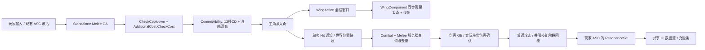

# 共鸣解放大招：GA_Resonance_Liberation 设计与关键代码结构

更新：2026-10-15。资源、成本、阶段回能、电影镜头、动画、固定Box和HUD已实现。当前生效的接口与配置见下方第0节及[配置指南](../Guides/resonance-liberation-configuration.md)，验证范围见[实施验收](../Validation/resonance-liberation-2026-10-15.md)。第1～11节保留2026-10-14方案与评审背景，其中“拟新增／尚未实现／本轮不修改”描述仅代表当时状态，不作为当前接线说明。

## 0. 当前实施规格（2026-10-15，优先于历史草案）

### 0.1 已冻结需求与范围

- RES-01：容量100，初始0；普攻与共鸣技能按每次执行的HitGroup＋AttackPhase，在首次实际生命扣除后回能一次；同阶段多个目标不增加次数。配置初值普攻5／技能20，大招0。
- RES-02：R键，满充消耗当前最大容量，独立12秒CD；冷却中允许回能，取消、打空不退款。成本只在AdditionalCosts中配置一次，不再给GA原生CostGameplayEffectClass重复配置。
- RES-03：属性属于持久PlayerState；死亡服务器清空能量，现有冷却不撤销；重复授予初始化GE只设置容量，不恢复已经消耗的能量。
- RES-04：右下方独立充能条，显示“共鸣解放 R”、当前／容量及独立冷却；按钮走共享输入Tag入口；生命条保持现有配置。
- RES-05：AM_Burst01中的单次Box通知，一次世界位置快照、一批查询、范围内每目标一次；不跟随玩家、不补扫移动路径。冲击时刻与尺寸是可调原型初值。
- CIN-01～08：沿用相机评估文档的需求编号；电影前半段、三构图、精确源实例、执行归属、正常／取消恢复、本地作用域与回归验证。
- 自身体状态和攻击输出分别配置为金刚体；同等级仍可通过控制比较。无敌、禁止Dash或新增Impact没有批准，不附加这些效果。

### 0.2 模块和实际接口

业务实现保持单一Hodgepodge Runtime模块；编辑器资产装配、只读诊断及PIE夹具放既有HodgeAbilityEditor模块，不进入Game依赖。

1. `UHodgeResonanceSet`：`ResonanceEnergy`、`MaxResonanceEnergy`，`IsResourceReady()`；拥有者复制、GAS RepNotify、有限值与容量约束。PlayerState创建唯一默认子对象。
   PlayerState沿用Lyra在`PostInitializeComponents()`绑定ASC并注册Experience回调；不能在PreInitialize注册可能立即执行的授予，否则晚加入玩家的ASC尚未发现属性集，初始化Instant GE会丢失。
2. `UHodgeResonanceEnergyInitialization`：Instant GE，只设置最大容量100；`UHodgeResonanceEnergyEffect`：Instant GE，使用`SetByCaller.ResonanceEnergyDelta`对当前值做增量。
3. `UHodgeAbilityCost_ResonanceEnergy`：`CheckCost()`只校验，`ApplyCost()`使用激活PredictionKey提交负容量增量；可配`CostGameplayEffectClass`，`ValidateEffect()`严格要求单一Instant能量修饰器。
4. `UHodgeGameplayAbility_Melee`：临时监听同一结算GUID的`OnDamageAccepted`；`TryGrantResonanceEnergy()`验证权威、执行、存活和资源，先占用阶段机会，再应用Gain GE，防止回调重入。NPC无此资源时跳过；不另造伤害管线。
5. `UHodgeGameplayAbility_Definition::GetCinematicSource()`：返回本次执行的Montage、InstanceId和实际Position；停止、预测取消、Avatar或ASC绑定错误时返回不可用。
6. `UHodgeHeroComponent::RefreshCinematicCamera()`：相机求值前核对当前Definition与原生电影窗口；按ExecutionId＋InstanceId重绑合法会话。`SetAbilityCameraMode()`返回完整句柄，`ClearAbilityCameraMode(Handle)`仅释放匹配归属；`EndCinematicCameraForExecution()`和`AbortCinematicCamera()`负责正常结束保障及安全失败退出。
7. `UHodgeCameraMode_Cinematic`：消费Profile及源位置，转换角色水平局部坐标、骨骼锚点、FOV、进入／跨分镜混合与安全检测。没有新CameraActor、PlayerCameraManager或独立计时轴。
8. `UHodgeCameraComponent`／Stack：保留电影下面的游戏模式求值，正常返回权重依源位置，取消返回依本地实时时长；仍是最终旋转写回入口。电影视觉Rotation与游戏ControlRotation分离；锁定恢复使用保留的操作方向种子。
9. `UHodgeGameplayUIDataSource`：`FHodgeUIResonanceSnapshot`、`GetResonance()`、`OnResonanceChanged`；复用PlayerState／ASC／Avatar绑定与清理。`UHodgeResonanceEnergyWidget`约0.1秒刷新真实快照及CD，按钮调用`SubmitInput()`，不维护玩法资源或CD时钟。

### 0.3 数据结构与配置契约

`FHodgeAbilityCameraHandle`包含`SpecHandle`、本地`ExecutionId`、`Generation`；客户端和服务器不要求GUID或实例ID相同。Hero保存GC可见Profile和通知资源、弱GA及运行状态，资产和AnimNotify对象不保存玩家状态。

`FHodgeCinematicCameraState`为只读诊断：`Handle`、`MontageInstanceId`、`SourcePosition`、`WindowStart/End`、`Weight`、`ShotId`、`bActive`。该状态不授权服务器伤害。

`UHodgeCinematicCameraProfile.Shots`连续覆盖电影窗口归一化0～1。每段`FHodgeCinematicCameraShot`包含唯一`ShotId`、`Start/End`、`Anchor/LookAt`骨骼、`StartOffset/EndOffset/LookAtOffset`厘米、`FOV`起止角、可选绝对局部位置／FOV曲线、跨段`BlendFraction`。不继承头骨旋转，只读取其位置。

Profile还包含`BlendFractions`、`CancelBlendSeconds`、`bSuppressLookInput`、`ProbeRadius`、`MinLookAtDistance`、`PitchLimits`、显式`FallbackAnchor`、`PostProcess/Weight`和可选`LocalEvents`。事件以本窗口0～1源进度触发，同执行不重复；音效只支持非循环短音，震屏拒绝共享单例，避免清理别人资源。

`UHodgeAbilityDefinition`增加`ResonanceEnergyGainPerPhase`和`ResonanceEnergyGainEffect`。`FHodgeResonancePhaseLedger`仅保存本次执行已回能的Group／Phase，结束清空；回能值与生命伤害倍率分离。

`FHodgeUIResonanceSnapshot`包含`Energy/Capacity/Percent/bReady`；可释放状态另外复用`FHodgeUIAbilityDisplayState`成本、CD与输入约束，满条不等于可释放。

### 0.4 当前资产与时间轴

正式目录：`/Game/Main/Character/Hero/Ability/ResonanceLiberation`。GA继承Melee、Standalone Definition；AS授予该Definition及Init GE，不重复创建AttributeSet。原生标签为`Ability.Type.Action.Melee.ResonanceLiberation`、`InputTag.Ability.ResonanceLiberation`、`Cooldown.Hero.ResonanceLiberation`。

新AM_Burst01引用已有`/Game/Wuwa/Anim/AM_Burst01`序列，约4.533333源秒，主角FullBody Slot。AM_Wing_Burst01位于`/Game/Main/Character/Hero/Wing/Montages`，引用已有G_Burst01，翼DefaultSlot。

- 电影窗口0～2.266667源秒：Acquire、FaceHands、WingReveal三个可调构图；进入比例0.16、退出比例0.20，取消返回0.25实秒。
- WingAction和武器窗口0～4.533333源秒：翼蒙太奇按主动画源时间同步，结束淡出；武器选择FadeAtHand。
- Status.Attack到0.82T；Recovery与MoveCancel为0.82T～T。Dash沿用已有中断映射。
- 单次命中初值0.68T≈3.082667源秒：AvatarRoot／Box／SnapshotOnEventEnter，半尺寸(600,450,200)厘米，局部中心(400,0,0)，HitGroup=ResonanceLiberation，AttackPhase=Burst。继承默认伤害与金刚体Reaction，Impacts留空。
- 主蒙太奇自然退出从末尾开始；不使用提前BlendOut结束主体动作来冒充全程翼显示。
- HUD父Canvas锚点(1,1)、对齐(1,1)、偏移(-40,-70)、尺寸250×48；字体、颜色与布局可调整。

### 0.5 核心流程与异常处理

R输入→现有ASC／Standalone请求→CheckCooldown＋AdditionalCost→Commit一次→主体蒙太奇与金刚体→电影／翼通知消费实际源位置→服务器单次Box结算→结束清理自身句柄、体状态、翼与武器。正式伤害不等待本地镜头，也不新增网络RPC。

正倍率与连续电影窗口是首版配置约束。运行时暂停／进度跳跃按实际位置求值；预测恢复的新实例从当前源时间继续，已消费本地事件不重播。不支持倒放／循环电影配置。

永久配置错误与运行依赖失效分别诊断；相机Profile、曲线、锚点或安全距离无效时放弃本次电影，不终止服务器技能、不退款、不无限重试同一失效实例。严重遮挡回游戏相机，不移动角色或穿墙凑构图。取消、死亡、换Pawn和新GA覆盖使旧申请失效；旧回调不能清理新申请。

电影与屏幕后处理只在本地拥有者生效，其他玩家仍显示正常角色和翼；PIE专服不创建电影或屏幕资源。Look抑制只作用于当前电影窗口，不重置其他系统输入计数；UI覆盖时尊重UI，不补播已经过去的表现事件。不使用全局时间缩放。

每帧只求当前分镜与一次安全探测；资源是现有强引用资产，不每帧同步加载或扫描世界。回能观察者仅在有玩家资源且配置回能>0的伤害提交期间注册，并配对解绑。

### 0.6 交付边界

C++、蓝图装配、测试工具及原型构图已落地；运行结果与未验证项以验收报告为准。正式掌心／暗翼／爆发Niagara、音效及震屏资源尚未制作，LocalEvents是可替换接口，不能计作正式美术效果。当前Box尺寸、0.68T命中帧、伤害倍率2、相机偏移和5／20回能是资产中的原型初值，不是《鸣潮》逐帧测量数据。

后续按实际姿势和灯光调构图、命中点及效果资产；必要时再评估Camera-only Sequencer后端。独立Server Target、Cook／打包及所有相机修饰叠加场景不属于已验证范围。

## 1. 目标与已确定规则

创建 HodgeGameplayAbility_Melee 的蓝图派生大招 GA_Resonance_Liberation，保持 Standalone Definition 路由，和 GA_Resonance_Skill 分开授予、输入及冷却。

已确认：最大充能100；普通攻击每个有效命中阶段回能一次；共鸣技能每阶段回能更多；大招自身不回能。满100才能释放，提交成功时消耗100。独立冷却12秒；冷却中仍可充能，满充不清除冷却，CD结束不自动补满。

建议初始调参值：普攻每阶段5、共鸣技能每阶段20、大招0；这三个数尚未由用户冻结，放进对应攻击 Definition，不写入伤害公式。无被动时间回能、挨打回能或击杀额外回能，后续可单独增加来源。

一次命中暂按“一次空间查询，区域内每个有效敌人一次”设计；如果用户实际希望固定区域持续存在，则采用第7.4节替代配置，不混淆这两种语义。

2026-10-14补充确认：主动作使用已有 `/Game/Wuwa/Anim/AM_Burst01` 创建的同名蒙太奇，不制作新的角色动画；电影特写只覆盖主蒙太奇前半段，翅膀仍覆盖整个技能。自身体状态和输出攻击判定都为最高等级金刚体；两者分别配置，保留现有同级可打断规则。相机复核、接口与分阶段任务见[大招前半段电影镜头评估](resonance-liberation-cinematic-review-2026-10-14.md)。本轮只修订方案，尚未创建这些资产或实现电影镜头。

## 2. 现有项目与 Lyra 核查

本轮已读 AGENTS.md、开发准则、Source 与当前资产；工作区既有未提交内容保留。

Lyra 参考：

- LyraGameplayAbility.cpp::CheckCost／ApplyCost 已有 AdditionalCosts 分工，本项目 HodgeGameplayAbility.cpp 已迁入；直接使用，不再给大招重造消耗管理器。
- LyraAbilityCost.h 已定义额外消耗接口；本项目 HodgeAbilityCost.h 已存在。
- LyraAbilitySet.cpp::GiveToAbilitySystem 负责服务器授予与资源归属；本项目 AbilitySet 另有 GrantedAbilityDefinitions，继续沿用。
- Lyra 的 AttributeSet 复制／RepNotify 模式已体现在 HodgeHealthSet，新增资源集沿用相同机制。

项目现有能力：

- Definition::ActivateAbility 已执行 CommitAbility，然后使用现有蒙太奇／转向／结束清理链路。
- Melee::BeginNotifyHit 已支持 AvatarRoot、ExecutionAnchor、Box、SnapshotOnEventEnter；WaitHitResults 支持 OnceOnEnter。
- Melee 已按目标 ASC、HitGroup＋AttackPhase 去重，RepeatHitInterval=0 表示每目标一次。
- WingAction 通知状态直接配置 WingMontage；WingComponent 根据主动作源时间求翼姿势，取消时配对清理并淡出。
- HealthSet.OnDamageAccepted 在实际生命扣除大于零时触发；Melee 的受击结算也可取得 ActualDamage。
- HodgeGameplayUIDataSource 已有本地玩家／Pawn／ASC 生命周期与技能冷却查询，UI 应在这里扩展。

没有发现已经实现的正式大招充能属性或回能服务，不能把既有 AdditionalCosts 当作已有充能功能。

## 3. 动画资源事实与拟创建资产

只读编辑器查询确认：

- /Game/Wuwa/Anim/AM_Burst01 实际类型是 AnimSequence，长度约4.533333秒，使用 R2T1PlayerMaleMd10011_Skeleton，与当前 AM_Resonance_Skill1 相同骨架。
- /Game/Wuwa/Wing/BaseAnim/G_Burst01 也是 AnimSequence，长度约4.433333秒，使用 EDarkNanzhuWingMd10011_Skeleton。
- /Game/qiuyuan/Anim/CommonAnim/AM_Burst01 是另一骨架、约11.1秒的序列，不应根据同名误选。
- 源资源尚未在本轮预览关键帧，因此不填写猜测的伤害秒数。Slot 内部数组受 Python 保护，本轮没有通过该数组宣称完成 Slot 检查。

补充盘点：编辑器 AssetRegistry 中名称含 Burst 的 AnimMontage 查询结果为空，同名资源仍为动画序列。用户确认尚未创建蒙太奇，后续从上述主角序列创建 `/Game/Main/Character/Hero/Ability/ResonanceLiberation/AM_Burst01`；保持源序列不改名，正式执行配置引用新蒙太奇，不再拟用 `AM_Resonance_Liberation` 作为主动作资产名。

拟放在 /Game/Main/Character/Hero/Ability/ResonanceLiberation：

- GA_Resonance_Liberation：蓝图父类 HodgeGameplayAbility_Melee；显示名可为 GA_Resonance Liberation，资产名使用下划线。
- DA_Resonance_Liberation：UHodgeAbilityDefinition；Standalone；主角蒙太奇、伤害与体状态。
- AM_Burst01：把已有 /Game/Wuwa/Anim/AM_Burst01 序列包装成真正的 AnimMontage，使用主角现有 FullBody Slot；不另做角色动画。
- AM_Wing_Burst01：把 G_Burst01 包装成翼蒙太奇，使用翼 AnimBP 的 DefaultSlot。
- GE_Resonance_Liberation_Cooldown：HasDuration，12秒，授予 Cooldown.Hero.ResonanceLiberation。
- GE_Resonance_Liberation_Damage：Instant，使用现有 HodgeDamageExecution。
- AS_Resonance_Liberation：只授予大招 Definition，不重复创建资源 AttributeSet。
- DA_Resonance_Liberation_HitProfile：一次 Overlap 查询及范围／遮挡配置。
- DA_Resonance_Liberation_Camera：拟新增电影镜头配置，使用主蒙太奇前半段窗口和角色局部构图，具体结构见相机评估文档。

另建共享资源资产 GE_ResonanceEnergy_Init／Gain／Cost；初始化、增加与消耗职责分开。按键可建议R，但尚未确认，不修改现有映射。

## 4. 核心结构与职责



推荐新增原生类：UHodgeResonanceSet 和 UHodgeAbilityCost_ResonanceEnergy。大招自身不要求新建 C++ GA；蓝图继承现有 Melee 即可。回能逻辑补在现有 Melee 结算链路，UI补在现有数据源，不新建独立 Tick 管理器。

所有新类继续属于 Hodgepodge Runtime，Public／Private 对应，同类函数集中一个主cpp；沿用反射宏与中文注释，不新增模块或 Editor 依赖。

## 5. 资源属性与生命周期

### 5.1 属性集

建议独立 UHodgeResonanceSet，包含 ResonanceEnergy 和 MaxResonanceEnergy。当前值范围0～最大值；最大值初版100，必须有限且大于零才算资源准备完成。

玩家 ASC 属于 PlayerState。建议在 AHodgePlayerState 构造中创建一次原生 ResonanceSet 默认子对象并保存 UPROPERTY 引用，和 HealthSet／CombatSet 采用相同所有权。不得同时在技能 AbilitySet／装备中再次授予同类型 Set。

初始化100／0通过共享初始化GE及现有一次性授予流程完成；原生默认值可保持0／0，避免未初始化却显示可用。不要在 Pawn 更换、属性重建、重复 Experience 回调或 UI 绑定时重新清空能量。

建议 Energy 与 Max 使用 COND_OwnerOnly＋REPNOTIFY_Always；服务器和拥有者需要完整值，模拟代理不依赖充能属性决定大招表现。RepNotify 必须调用 GAMEPLAYATTRIBUTE_REPNOTIFY。

PreAttributeChange、PreAttributeBaseChange 以及 GE 执行后统一约束有限值与上下界；最大值降低时同步截断当前值；不按容量比例自动补充能量。

### 5.2 回能

在当前 Melee 单目标伤害提交链路取得真实 AcceptedDamage>0 后，由服务器应用 Gain GE 到攻击者 ASC。

不能仅以碰撞命中、GE句柄有效、DamageMultiplier>0、硬直成功或 HitReaction Outcome 成功判断回能。Instant GE 执行后不一定返回持续效果句柄；免疫、闪避、挡墙、无效／已死亡目标、零生命伤害均不回能。击杀产生的实际扣血仍是有效伤害。

优先利用 HealthSet.OnDamageAccepted 的同步结算事实；若复用当前 HitReaction Result.ActualDamage，必须补齐没有受击组件的目标。建议在 SubmitMeleeHitEffects 的当前提交范围内读取／捕获伤害确认，配对解绑临时委托，不订阅地图全部敌人，也不把回能绑到目标眩晕动画。

新增 Definition 参数 ResonanceEnergyGainPerPhase（FScalableFloat，默认0）。普攻建议5，共鸣技能建议20，大招必须0。正回能配置要求明确的 HitGroup 与 AttackPhase；缺少阶段身份应报配置错误，不能悄悄按碰撞组件回能。

回能去重与伤害去重分开：同一 ExecutionId＋HitGroup＋AttackPhase 只回一次，不包含 TargetASC。一刀打10个敌人也仅回一次；真正不同攻击阶段分别回能。只有首次真实伤害发生才占用回能阶段，免疫目标不会占用回能机会。

在现有 Melee 实例保存本轮已回能阶段集合，进入执行／结束时清理；委托或回调核对执行GUID、弱ASC、当前Avatar及死亡状态；先占用回能键再应用 Gain GE，防止属性委托重入。

### 5.3 消耗与冷却

可释放条件为：资源已初始化、能量满、CD结束、现有激活标签／死亡限制通过。

额外消耗对象 CheckCost 只检查，不扣除。ApplyCost 在现有 CommitAbility 中通过 Instant Cost GE 扣除满充资源；初版是100。推荐以最大能量作为满充阈值和扣除量，容量后续调整时仍保持“满充全消耗”语义。

Cost GE 使用 SetByCaller.ResonanceEnergyDelta，设置为 -MaxResonanceEnergy；Gain GE 用同一属性增量语义，金额由服务器攻击配置给出。Cost 在拥有者预测和服务器提交时通过有效 PredictionKey 应用，让 GAS 处理预测确认／拒绝，不能客户端直接 SetResonanceEnergy，再让服务器额外扣一次。

大招成本的 bOnlyApplyCostOnHit 必须为 false。当前 AdditionalCosts 的该选项是在 ApplyCost 当下查询 TargetData，不是以后自动等近战命中；本大招也明确是释放时支付，与打空无关。

服务器拒绝预测时由 GAS撤销未确认的预测修改；服务器已经接受后再被Dash／受击／死亡取消、打空或取消后摇，不自动返还能量／冷却，与现有共鸣技能提交规则一致。

GAS CommitAbility 不是任意额外消耗的事务系统。Cost GE 类型、目标属性、SetByCaller、资源Set、蒙太奇和授予配置须在使用前预校验。ApplyCost 返回void，不能声称任意运行失败都会自动退还CD；异常要中止技能并诊断，玩法退款另定。

死亡清零／切换角色是否共享资源尚待确定。推荐死亡清零、CD沿用现有PlayerState持有策略；仅在明确的死亡事件应用重置GE，不在解绑时清零。此推荐未纳入已确认契约。

固定100消耗也可通过GA原生CostGameplayEffectClass的Additive -100 Modifier检查和扣除，UE的CheckCost／ApplyCost已有实现。本方案采用现有AdditionalCosts扩展点，是为了显式检查资源Set／容量准备与满充条件，并兼容未来容量调整；不重复实现整个成本框架。两种成本入口只能选择一种。

## 6. 翅膀全程显示与同步

主角蒙太奇添加一条 Hodge Wing Action Window，覆盖从开头到技能视觉结束，不在普通 Tick／GA蓝图中再写一套显隐计时。

通知配置 WingMontage=AM_Wing_Burst01，StartPosition=0，PlayRate先为1，FadeOutSeconds沿用Profile。翼Slot／AnimBP保持现有独立实例，不能通过角色ASC播放翼蒙太奇来替换主动作。

同步继续使用当前组件的主动作源时间；暂停、播放倍率改变和蒙太奇位置修正都影响翼姿势，不能用世界秒独立播放。大招结束、取消、死亡与换Pawn都清理当前执行拥有的翼会话，正常结束淡出，翼NoCollision。

原始翼序列比主角短约0.1秒，不能默认已完全同步。建议先保持关键动作1:1并在翼尾帧保持到主动作结束；只有预览证明需要整体缩放时才用约4.433333/4.533333=0.977941倍率。最终以抬翼／挥翼关键帧对齐为准。

注意 Definition 会在自然 BlendOut 开始时结束执行并清理翼；不能仅把通知拖到文件末尾就宣称最后帧仍全亮。应在包装蒙太奇中核实自然退出起点、BlendOutTriggerTime、Definition.NaturalBlendOut与翼最后动作时间。可先试自然退出0.1秒，确保翼主体动作播完后才进入淡出；不为这一个技能全局改父类结束机制。

若缺翼资源／Slot／骨架，应明确报错并阻止将配置标记为已完成，不能静默退回旧普攻翼动画。

## 7. 大范围固定 Box 判定

### 7.1 查询与伤害次数

在主角蒙太奇的确定冲击点 T_Hit 添加一个 Hodge 单次命中通知。该秒数需要动作预览后选定；可调入口是现有蒙太奇通知，不在C++中硬编码等待几秒。

本方案查询只执行一次，但可覆盖多个敌人；范围内每目标一次。此后新进入范围的敌人不命中；不补扫玩家移动路径。

### 7.2 具体配置

Hodge 单次命中通知：

- Source=AvatarRoot，Shape=Box。
- TransformPolicy=SnapshotOnEventEnter。
- TargetPolicy=AnyInVolume。
- HitGroup=ResonanceLiberation，AttackPhase=Burst。
- RepeatHitInterval=0，bAllowFriendlyFire=false。
- bUseDefaultDamage=true，伤害GE由本技能Definition指定。
- bUseDefaultReaction=true，继承本技能Definition的金刚体输出判定；显式覆盖时也必须填同一判定标签。
- Profile=DA_Resonance_Liberation_HitProfile。

Definition配置：`ExecutionBodyTag=State.Combat.Body.Vajra`；`DefaultHitConfig.Reaction.AttackJudgementTag=Combat.Attack.Judgement.Vajra`。已有原生标签无需再创建另一套同义标签。前者由现有Definition在提交成功后添加、结束时释放；后者随本次命中请求传给目标。通知继承伤害与继承Reaction是两个独立开关，不能只勾选bUseDefaultDamage。

现行判定为攻击等级>=目标体状态等级，因此大招金刚体攻击可通过1～4级体状态的等级比较；同级金刚体攻击也可打断自身金刚体。通过比较后是否真正控制，还取决于接受策略、伤害／免疫结果、Impacts、目标受击配置及存活状态。尚未决定大招的具体Impact，不擅自加入击退、击倒或挑飞。自身金刚体不代表无敌、不阻止生命扣除或死亡，也不自动覆盖Dash／GAS标签中断关系。

Profile：QueryMode=Overlap，SampleMode=OnceOnEnter，FilterFrame=DetectionAnchor，ObjectTypes按现有敌人受击对象类型配置，HalfAngleDegrees=180。建议保留 bRequireLineOfSight=true，避免穿墙；若确实需要穿墙则显式关闭。

BoxHalfExtent 可先试(600,450,200)厘米，实际全尺寸12×9×4米；LocalTransform.Translation可先试(400,0,0)，中心在触发时角色前方4米。均为调参样例，未经技能动画／场景测试，不是最终尺寸。UE本项目查询单位为厘米，半尺寸不能误填成全尺寸。

位置与朝向在通知进入时捕获服务器角色世界变换加局部偏移，采样由现有Task安排到合适更新阶段；随后玩家移动／转向不改变该会话的几何。Profile过滤原点选DetectionAnchor，避免固定区域还根据移动玩家的位置裁剪。

### 7.3 去重与权限

服务器几何查询 → 现有Melee目标筛选 → 按ASC去重 → HitGroup／Phase历史 → 伤害GE／受击结算。单个敌人的胶囊和多个网格返回多条Overlap结果也只扣一次。

只配置一个逻辑伤害点；剑、手、翼如果也有同刀通知必须共用Group／Phase，否则仍可能重复扣血。OnceOnEnter限制采样频率，RepeatHitInterval=0限制每目标次数，两者不是同一个开关。

碰撞盒是现有查询式几何，不要求生成BoxActor／挂载BoxComponent，不依赖Overlap事件。范围不跟随翼骨骼，翼在这里仅是表现。服务器不需要翼骨骼采样来算这个AvatarRoot Box。

点通知绑定执行GUID与蒙太奇实例，服务器真正提交伤害；客户端不能上传一个任意巨大的Box。取消发生在T_Hit之前就没有伤害；查询已结束则伤害不撤销。

现有去重不会把重复通知变成“全局只查询一次”；因此资产校验应限制本大招只有一个逻辑Burst命中点、无额外独立伤害通知，并排除点通知与其他Branching Point恰好同时间的已知冲突。

### 7.4 固定持续区域的替代方案

如果最终选“在时间段内持续检查、每个敌人一次”，则使用 Hodge 持续命中通知状态 [T_Start,T_End]：SnapshotOnEventEnter＋Overlap＋EveryFrame＋RepeatHitInterval=0。区域创建后不跟随角色，后进入敌人可受伤一次。

这是不同玩法，不能用OnceOnEnter模拟持续捕捉。其余伤害与去重链路保持，跨阶段仍须共享同一Group／Phase。

若区域必须固定在大招起手位置，而不是伤害触发位置：用现有 Melee.SetHitAnchor 在服务器起手捕获命名锚点，通知Source=ExecutionAnchor／AnchorKey=BurstOrigin；不把它解释为AvatarRoot在命中时快照。

## 8. 关键代码骨架（拟新增，非已编译实现）

以下接口展示归属与调用点，未包含完整构造、配置校验或清理实现；本轮不会将代码片段写入Source或声称可直接编译。

### 8.1 属性集

```cpp
#pragma once
#include "AbilitySystem/AttributeSet/HodgeAttributeSet.h"
#include "HodgeResonanceSet.generated.h"

/** 玩家大招资源；实际值由GAS属性与GE维护。 */
UCLASS(BlueprintType)
class HODGEPODGE_API UHodgeResonanceSet : public UHodgeAttributeSet
{
    GENERATED_BODY()
public:
    /** 构造时保持未初始化，初始化GE设为最大100、当前0。 */
    UHodgeResonanceSet();
    ATTRIBUTE_ACCESSORS(UHodgeResonanceSet, ResonanceEnergy);
    ATTRIBUTE_ACCESSORS(UHodgeResonanceSet, MaxResonanceEnergy);
    /** 注册拥有者属性复制，RepNotify执行GAS修正。 */
    virtual void GetLifetimeReplicatedProps(TArray<FLifetimeProperty>& Out) const override;
    /** 约束GE修改后的上下界，处理最大值下降。 */
    virtual void PostGameplayEffectExecute(const FGameplayEffectModCallbackData& Data) override;
    /** Clamp与有限值检查同时覆盖基础值和当前值修改。 */
    virtual void PreAttributeBaseChange(const FGameplayAttribute& Attr, float& Value) const override;
    virtual void PreAttributeChange(const FGameplayAttribute& Attr, float& Value) override;
protected:
    /** 接收当前值复制并通知GAS/UI。 */
    UFUNCTION() void OnRep_ResonanceEnergy(const FGameplayAttributeData& Old);
    /** 接收容量复制并通知GAS/UI。 */
    UFUNCTION() void OnRep_MaxResonanceEnergy(const FGameplayAttributeData& Old);
    // 不由Widget或动画通知直接写入当前资源。
    UPROPERTY(ReplicatedUsing=OnRep_ResonanceEnergy)
    FGameplayAttributeData ResonanceEnergy;
    // 初版初始化100，后续容量变化不自动补满。
    UPROPERTY(ReplicatedUsing=OnRep_MaxResonanceEnergy)
    FGameplayAttributeData MaxResonanceEnergy;
};
```

主cpp使用UE_INLINE_GENERATED_CPP_BY_NAME、DOREPLIFETIME_CONDITION_NOTIFY和GAMEPLAYATTRIBUTE_REPNOTIFY，与现有HealthSet对应实现一致。

### 8.2 满充成本对象

```cpp
/** 嵌入GA.AdditionalCosts，检查满充并通过预测GE支付。 */
UCLASS(DefaultToInstanced, EditInlineNew)
class HODGEPODGE_API UHodgeAbilityCost_ResonanceEnergy : public UHodgeAbilityCost
{
    GENERATED_BODY()
public:
    // 必须是对ResonanceEnergy应用增量的Instant GE。
    UPROPERTY(EditAnywhere) TSubclassOf<UGameplayEffect> CostGameplayEffect;
    /** 满充与成本配置都合法才返回true，不在此修改属性。 */
    virtual bool CheckCost(const UHodgeGameplayAbility* Ability,
        FGameplayAbilitySpecHandle Handle, const FGameplayAbilityActorInfo* Info,
        FGameplayTagContainer* FailureTags) const override;
    /** 使用本次激活的PredictionKey提交负的最大能量增量。 */
    virtual void ApplyCost(const UHodgeGameplayAbility* Ability,
        FGameplayAbilitySpecHandle Handle, const FGameplayAbilityActorInfo* Info,
        FGameplayAbilityActivationInfo ActivationInfo) override;
};
```

CheckCost核心：ASC.GetSet<UHodgeResonanceSet>()存在；Max有限且>0；当前值有限且>=Max；成本GE预校验通过；失败添加已有Ability_ActivateFail_Cost并分别诊断配置未就绪与资源不足。

ApplyCost核心：从同一个ASC读取Max → 构造成本GE Spec → SetByCaller增量=-Max → ASC.ApplyGameplayEffectSpecToSelf并使用当前有效预测键。禁止在这个对象里播放蒙太奇、回能或写CD计时器。

### 8.3 现有Definition／Melee的增补

```cpp
// 拟增补到UHodgeAbilityDefinition；实际伤害后按阶段回能，默认0。
UPROPERTY(EditDefaultsOnly, BlueprintReadOnly, Category="Hodge|Resonance")
FScalableFloat ResonanceEnergyGainPerPhase = 0.f;

/** 拟增补到现有Melee主cpp，由服务器真实伤害结算点调用。 */
void TryGrantResonanceEnergy(const FHodgeHitDetectionBatch& Batch,
    const FHodgeHitEffectConfig& Binding, float AcceptedLifeDamage);
```

该帮助函数必须验证实际伤害>0、当前服务器执行、源ASC资源、阶段身份及配置金额；按执行／阶段占用一次机会，再应用Gain GE。已有EndAbility／OnExecutionEnding负责清理本轮集合，不在蓝图另写第二份回能。

### 8.4 蓝图执行图

GA_Resonance_Liberation 保留父类执行，Class Defaults配置 AdditionalCosts 的资源成本对象与12秒CooldownGameplayEffectClass。GA的原生CostGameplayEffectClass保持空，成本GE仅填入这个额外成本对象，避免两条路径重复扣能。不要覆盖ActivateAbility再重复CommitAbility或PlayMontage。

AS授予Definition → 现有InputTag进入ASC → 父类检查／Commit → 父类播放主蒙太奇 → 通知负责翼与固定Box → 父类结束清理。尚未添加的拟用标签：Ability.Type.Action.Melee.ResonanceLiberation、InputTag.Ability.ResonanceLiberation、Cooldown.Hero.ResonanceLiberation及资源GE的SetByCaller标签。

## 9. 充能条UI

拓展现有HodgeGameplayUIDataSource：绑定本地玩家ASC的 Energy／Max 属性变化委托，输出能量、容量、进度、冷却剩余及是否可释放。按Pawn／PlayerState／ASC变化解绑再绑定，处理初始化晚到和预测修正。

UI只读资源，不计时回能、不直接扣能量；可释放状态不能仅根据进度条看起来100%，应综合成本、CD、死亡及激活约束。

位置建议大招按钮附近的独立条或环形填充，与共鸣技能E的能量／CD显示分开。最终布局、Widget资产和R按键尚待确定；本轮不修改当前HUD。

## 10. 实施顺序与验收

P0-A：新增ResonanceSet并接PlayerState、一次性初始化GE；测试0／100、上限截断、异常值、复制、重复初始化不重置。

P0-B：新增成本对象，创建大招蓝图／Definition／伤害及12秒CD；测试99不能放、100可放、消费一次、CD独立、预测接受／拒绝、取消不退款。

P0-C：在现有Melee增加实际伤害后阶段回能；测试打空／免疫／闪避不回、杀死目标可回、单阶段多敌／多组件只回一次、不同阶段分别回、大招自身不回、NPC无资源时不误创建属性。

P1-A：用已有序列创建主角AM_Burst01和翼蒙太奇、全程WingAction、冲击点Box；预览选定T_Hit，测试暂停／变速／位置修正、翼尾时长、正常淡出、取消／死亡／换Pawn清理。

P1-B：固定Box单次验证：通知触发后玩家移动／转向不能移动区域，范围外／墙后／友方／死亡敌人过滤，多组件和同刀来源去重；确认无第二次独立伤害点。

P1-C：UI事件绑定与输入映射；测试初始化晚到、换Pawn无旧委托、预测回滚、CD中能量满仍不可放、CD结束能量不足仍不可放。

按准则完成Editor／Game常规构建、原生测试、单人／Listen／PIE专服与延迟测试；真实专服须确认主角蒙太奇通知和骨骼Tick策略。AvatarRoot Box不需要翼服务器采样，但仍需要可靠的主角动画通知。

本轮仅执行源码／配置检索与编辑器只读资产核查，没有实现、构建、PIE或联机大招测试。以前其他技能测试通过不等于本大招已通过。

电影镜头优先单独做灰盒：仍以AM_Burst01正式角色动作为基准，先不实现充能、伤害或新Niagara；完成切入、特写、展翼构图和回归后，再连接上述模块。相机实施顺序与测试条目见相机评估文档，不能把电影镜头完成事件作为服务器伤害授权条件。

## 11. 尚需冻结的细节

1. 单次查询还是固定持续区间：当前方案主线按一次查询，保留明确替代方案。
2. T_Hit实际冲击帧、Box尺寸和偏移：源动作预览后确认，不能根据动画文件名猜秒数。
3. 普攻5／技能20的建议回能值、R键、死亡清零与切换角色资源归属。
4. 自身与输出金刚体已确认；无敌、是否禁止Dash打断或后摇移动取消仍未确认，沿用现有Melee、中断映射与通知许可，不擅自加入特权。
5. 充能条最终视觉布局与素材；本轮只约定数据接线。

已批准的是资源获取原则、满100消耗100、独立12秒CD、同名AM_Burst01蒙太奇、前半段特写及自身／输出金刚体；以上未决项不妨碍审阅方案，但应在正式资产调参与对应实现前冻结。
