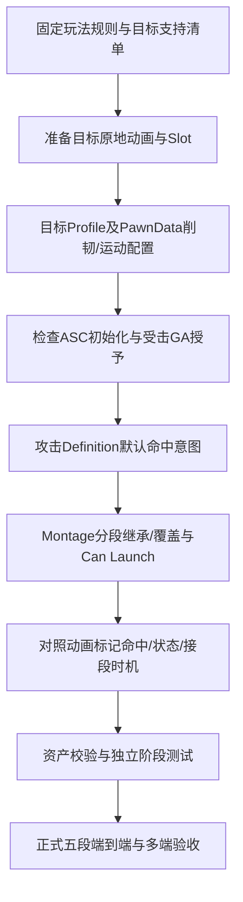

# 战斗制作执行文档：配置重组、受击全流程与端到端验收

版本日期：2026-10-19。适用项目：`E:/Project/Git/Hodgepodge/Hodgepodge.uproject`；引擎：UE 5.5.4。

本文把“攻击分段配置命中意图、目标配置抗打断/削韧/动画、Montage 配置时机”的建议展开为制作步骤。主例使用当前百万血假人及正式 Hero 五段，不安装 Handy Combat System，不替换既有 GAS、Experience、PawnData 或 CharacterMovement。

**交付状态：本文是执行说明；第11.5节的现有资产 Details 入口已进入实现与实测阶段。** 本次代码、构建、自动化和单目标回归的具体范围见[实施记录](../Development/combat-details-refactor-2026-10-19.md)。文中的“基线值”来自首次编写时的源码和只读资产查询；未在实施记录列出的验收项仍需执行，历史报告仅作定位依据。

## 0. 阅读路线与完成标准

第一次制作按第 1～10 节执行；整理旧资产再执行第 11 节；涉及特殊运动再读第 12 节；提交验收按第 13～16 节执行。源文件与 Lyra 对应关系见第 17 节。

快速定位：[目标配置](#target-setup) · [攻击意图](#attack-setup) · [Montage时机](#montage-timing) · [完整演示](#end-to-end) · [迁移入口](#migration) · [验证命令](#validation) · [故障定位](#troubleshooting)。

本流程分为三个可独立验收的工作包：

1. **常规制作路线**：使用现有真实字段完成一套角色、攻击和 Montage 配置，走通单目标流程。
2. **配置重组/迁移路线**：将存量资产归类、备份、转换、核对，保持唯一有效配置来源；统一的入口首先是本文第 11 节的操作路径。
3. **验证路线**：资产检查、原生测试、实际输入、真实接地、多端状态与释放、主观动画验收分别取证。

完成必须同时满足：

- [ ] 读者能指出每个参数属于攻击、目标还是动画时机，能说明覆盖优先级。
- [ ] 同一假人能依次展示普通接触、轻受击、重受击、终结刀 Fly、真实接地、倒地停留、起身和控制释放。
- [ ] 免疫、低判定、空中追加命中与缺少目标动画都有明确结果。
- [ ] 没有重复扣血、重复能力授予、旧动作清理新动作、无限浮空或残留控制。
- [ ] 资产和代码变更范围可核对，旧布局退出有记录，所有未执行项明确列出。

本文不将“有一个动画在播放”“脚本返回 Started”“进程退出码为 0”作为端到端通过。

## 1. 先固定规则，再组织资产

### 1.1 本流程采用的当前规则

1. 攻击通过现有 Melee → GE/HealthSet → 目标 `FinishHit` 链路结算。
2. 普通 `PoiseDriven` 要求本次实际正生命伤害；伤害免疫、拒绝和普通零伤害不累积削韧。
3. 目标 Body 与攻击 Judgement 比较使用 `AttackRank >= BodyRank`；无目标 Body 时为内部等级 0。
4. 普通削韧只产生 Light 或 Heavy；旧 Break 阈值不再生成击飞。
5. 击飞资格由 Montage 每个命中分段的 `Hit.bCanLaunch` 唯一决定；默认 Reaction 不授予资格。
6. `Can Launch=true` 且伤害、判定和目标支持均通过时，该命中走 Fly，**不再同时消费一份普通削韧控制**。
7. 目标使用自己的 Profile 选动画；攻击资产不引用假人的受击 Montage。
8. 当前 Compact 路线使用原地动作，胶囊由 CMC/RMS 或 Launch 运动；Compact 解析后的各阶段运动来源固定为 `Impact`。
9. Fly 的 Landing 在 CMC 确认真实接地后播放，随后按倒地/起身状态恢复。
10. 死亡由现有 HealthComponent/Death GA 负责；普通受击发现死亡后退出普通反应。

### 1.2 四类信息分别由谁负责

| 要回答的问题 | 唯一事实来源/配置入口 | 最终执行者 |
| --- | --- | --- |
| 这一刀是否命中、造成多少实际伤害 | 检测会话、GE/Execution、HealthSet | 服务器 Melee/GAS |
| 目标能否被打断 | 目标 ASC 有效 Body、攻击 Judgement、目标能力能否取消 | 目标 HitReactionComponent |
| 普通命中何时升级为轻/重反应 | 攻击 Poise Damage + 目标 PawnData.Poise | 服务器目标裁决 |
| 本分段是否允许击飞 | Montage Hit 的 Can Launch | 目标受击计划与 GA |
| 选哪一个受击动作 | 目标 HitReactionProfile | 服务器解析，GAS Montage/客户端应用 |
| 什么时候判定、接段、收招 | 攻击 Montage 的原生 Notify/Notify State | 当前能力执行实例 |
| 胶囊如何移动、何时真实落地 | 解析后的运动计划与 CMC 物理状态 | CharacterMovement |
| 什么时候开放行动 | 权威受击计划、恢复规则、GAS 准入 | 目标组件/能力/移动链 |

“接触反馈”指命中后的音画或局部动作；“轻受击”指 Light 阈值产生的玩法控制。两者分别验收，不能因为都叫“轻”而混用。

### 1.3 制作顺序与相互依赖



先明确目标能执行哪些反应，可以避免攻击已经要求 Fly、目标却缺少落地与起身动作。攻击配置分两遍完成：先确定每段语义，再在 Montage 上调整实际时机；两者最终使用同一份通知，不另建时间表。

修改目标动画时回归选片和骨架；修改阈值时回归实际命中时间；修改 Montage 时机时同时回归去重、连段和阈值窗口；修改任一运动来源时重新验证碰撞与各端释放。

## 2. 准备工作与变更保护

### 2.1 核实工程和工具

1. 打开上述 `.uproject`，确认使用 `E:/UE/UE_5.5` 的 UE 5.5.4；不接受自动升级引擎或插件。
2. 执行 `git status --short`，保存开始时的文件清单；记录当前分支和 HEAD。已有修改属于当前工作，不能通过回退获取“干净环境”。
3. 先保存自己正在编辑的资产。需要常规 C++ 构建时，保存后关闭本项目编辑器；不要强制结束含未保存工作的进程。
4. 检查已编译的 Editor 工具与当前源码匹配。若 Python 中找不到 `HodgeCombatValidationLibrary` 等类型，先按第 13 节构建，不能用缺接口的旧 DLL 执行新脚本。
5. 首次主线使用平坦、无天花板、无贴身障碍的位置，保持正常世界时间。碰墙/斜坡在独立用例检查。

### 2.2 修改前备份

在 Content Browser 中将本次确实要修改的资产逐个 Duplicate 到一个**新批次**，例如 `/Game/Tests/Combat/ProductionWorkflow/Backups/20261019_01/`。此路径是建议新建路径，本文没有创建它；批次已存在时换新批次，不覆盖。

最小备份集：

- 假人 `DA_DummyPawnData`、`DA_DummyHitReaction`。
- 要修改授予时才备份 `AS_Dummy`；要修改血量时才备份 `DA_DummyStats`。
- 真正要修改的 `DA_Attack_*` 和它引用的 Montage；仅核查不修改的资产不重复保存。
- 真正修改 AnimBP、Sequence 或共享资源时，分别备份这些对象。复制 Profile 不会复制其引用的动画本体。

逐项记录“原路径 → 备份路径 → 修改原因”。恢复也逐项处理并重新校验引用，不通过删除目录或全仓回退恢复。二进制资产按项目 Git LFS 规则管理。

### 2.3 两条测试路径的边界

**本教程主线**使用现有假人及正式 Hero 输入，便于与现有工具对照。只在列出的测试目标上调整，不扩大修改到其他怪物。

**独立新目标路线**可以复制 BP、PawnData、Profile、Stats 并重新连接引用，但现有验证脚本大量固定读取原假人地图与资产路径。复制目标后，必须先适配验证工具的选择逻辑；不能认为创建一个相似名字的角色后原脚本会自动测试它。

## 3. 单目标演示的资产清单

### 3.1 场景和目标

| 用途 | 当前资产路径/要求 |
| --- | --- |
| 演示地图 | `/Game/Tests/Combat/L_HitReactionDummy` |
| 目标角色 | `/Game/CodexText/HitReactionValidation/Dummy/BP_HitReactionDummy` |
| 目标 PawnData | `/Game/CodexText/HitReactionValidation/Dummy/DA_DummyPawnData` |
| 目标 Profile | `/Game/CodexText/HitReactionValidation/Dummy/DA_DummyHitReaction` |
| 目标能力包 | `/Game/CodexText/HitReactionValidation/Dummy/AS_Dummy` |
| 目标属性 | `/Game/CodexText/HitReactionValidation/Dummy/DA_DummyStats`，样例最大生命 1,000,000 |
| 受击原地动作目录 | `/Game/Main/Character/Hero/Anim/HitReactions/Behit/InPlace` |

服务器测试世界应恰有一个该假人。假人保留正常 Controller、CharacterMovement 和碰撞，使用 Pawn 自有 ASC；无需增加 PlayerState。不要通过移除 Controller、DisableMovement、GodMode 或伤害免疫来“固定”它。

### 3.2 攻击方和动作

正式定义在 `/Game/Main/Character/Hero/Ability/BasicAttack/DA_Attack_1` 至 `DA_Attack_5`，**实际顺序为 01 → 02 → 03 → 05 → 04**。Montage 位于 `/Game/Main/Character/Hero/Anim/Montages/AM_Attack01_Montage` 至 `AM_Attack05_Montage`，以每份 Definition 的 `ExecutionConfig.Montage` 实际引用为准。

默认伤害 GE 为 `/Game/Main/Character/Hero/Ability/BasicAttack/GE_MeleeDamage_Instant`。它应为 Instant，并包含项目 `HodgeDamageExecution`。本轮制作不修改伤害公式、装备收益和输入体系。

主角 Profile 为 `/Game/Main/Character/Hero/Anim/HitReactions/DA_Hero_HitReaction`，与本次目标的 Dummy Profile 是两个对象。调整假人配置不会自动调整玩家受击；共享动画本体仍会影响所有引用者。

<a id="target-setup"></a>

## 4. 先完成目标：抗打断、削韧和能力接线

### 4.1 检查 ASC 和授予

1. 打开 `BP_HitReactionDummy` 的 Class Defaults，核对其 EnemyPawnData 指向 `DA_DummyPawnData`，InitialLevel=1。当前 CDO 的 HitReactionComponent.OverrideProfile 为空。打开测试地图后还要确认实际放置类及运行中的最终 Profile；本轮只读查询未切换到该地图，未核实地图实例覆盖。
2. 打开目标 PawnData，检查 `HitReactionProfile` 为独立 Dummy Profile，`StatProfile` 为 DummyStats，`AbilitySets` 包含 `AS_Dummy`。
3. 检查 `AS_Dummy.GrantedGameplayAbilities` 中恰有一份原生 `HodgeGameplayAbility_HitReaction` 或其合适子类，等级 1，InputTag 留空。它不放到 `GrantedAbilityDefinitions`。
4. 不重复添加默认 HitReactionComponent，不重复授予原生角色已有的 HealthSet/CombatSet。
5. PIE 就绪时检查 ASC Avatar 是当前假人，Profile 非空，Health/MaxHealth 有效。仅有 ASC 指针不代表初始化完成。

现有 Enemy 初始化入口负责按 PawnData 授予；玩家仍由 PlayerState 持有 ASC，经 Hero/PawnExtension 初始化。两类角色共用反应协议，所有权保持各自设计。

### 4.2 抗打断配置从哪里来

**PawnData 没有一个名为 Body 的永久抗打断字段。** 有效 Body 来自目标 ASC 当前持有的精确叶子 Tag：

| Body Tag | 等级 | 典型来源 |
| --- | --- | --- |
| 无有效 Body | 0 | 静止且没有相关状态的假人 |
| `State.Combat.Body.Normal` | 1 | 目标普通动作的 ExecutionBodyTag |
| `State.Combat.Body.Skill` | 2 | 目标技能动作/效果 |
| `State.Combat.Body.SuperArmor` | 3 | 目标霸体技能或状态通知窗口 |
| `State.Combat.Body.Vajra` | 4 | 目标明确配置的金刚体状态 |

多个来源同时存在时取最高等级；各来源只释放自己持有的贡献。

主线假人保持无额外 Body，即等级 0。需要演示出招抗打断时，在目标实际动作的 `Definition.ExecutionBodyTag` 或 `Hodge 状态区间.StateTag` 配置相应 Body；不要将攻击输出 Judgement 添加到目标身上冒充其防御状态。

高抗回归使用第 14 节的现有 Armor 用例临时添加并配对移除标签。普通碰撞测试保持目标没有免疫，避免把“没有实际伤害”误判为削韧不工作。

### 4.3 目标削韧与运动的基线值

打开 `DA_DummyPawnData` → `Poise`。下列为本主线基线，不是所有敌人都应使用的平衡参数。

| 字段 | 基线值 | 单位/合法性 | 作用 |
| --- | --- | --- | --- |
| `bEnabled` | true | 布尔 | 开启目标普通削韧 |
| `Window` | 1.5 | 秒，>0 | 正削韧样本的滑动窗口 |
| `LightThreshold` | 20 | >0 | 轻受击阈值 |
| `HeavyThreshold` | 55 | >LightThreshold | 重受击阈值 |
| `HeavyDistance` | 65 | cm，>=0 | 地面重受击基础距离 |
| `MoveDuration` | 0.25 | 秒，>0 | 重受击 RMS 运动时间 |
| `DisplacementScale` | 1 | 0～4 | 目标位移/默认击飞速度系数 |
| `MaxDistance` | 200 | cm，>=0 | 普通重受击期望距离上限 |
| `LaunchHorizontalSpeed` | 180 | cm/s，>=0 | 无显式 Launch 参数时的水平速度 |
| `LaunchVerticalSpeed` | 650 | cm/s，>=0 | 无显式 Launch 参数时的向上速度 |
| `bAccumulateUnderArmor` | false | 高级选项 | 默认低判定不积累；打开也不绕过 Body |
| `MaxSamples` | 128 | 高级选项，1～1024 | 削韧样本容量；超限诊断，不静默吞旧数据 |

普通重受击期望距离：`min(MaxDistance, HeavyDistance × 攻击 ImpulseScale × 目标 DisplacementScale)`。基线系数均为 1 时为 65cm；实际碰撞或峰值限速可以缩短距离。

旧 `BreakThreshold`、`BreakProtection`、`BreakImpact` 只保留序列化。不要寻找它们的常规编辑格，也不要把旧 100 点参数写入当前验收条件。

### 4.4 削韧窗口必须这样理解

- 每次新命中先移除到期样本，再加入本次正值；按实际命中时刻计时。
- 同一轮只消费比上次更高的阈值。Light 成功一次后，同轮再次超过 Light 不重播；达到 Heavy 后才能再升级。
- 一次大额命中只提交本次最高等级，不先播放 Light 再播放 Heavy。
- 窗口完全清空才开始下一轮阈值消费。样本过期不会取消仍在执行的控制。
- 零削韧不追加或续期；伤害值与削韧值分别配置。
- 普通空中、倒地、起身命中不重新累积地面削韧。Can Launch 分段走独立规则。
- Timer 只清到期样本，不在时间到达时自动触发受击。

因此，正式动作之间存在间隔时不能只算五个削韧数值之和。第 9 节同时提供隔离阈值例子与正式连段验收。

## 5. 配置目标动作、Slot 与恢复

### 5.1 选择唯一布局

打开 `DA_DummyHitReaction`，将 `bUseCompactAnimations` 设为 true，并只编辑 `Compact`。当前示例已经选择该布局，应先读回核对，不无条件重写。

开启 Compact 后隐藏的 `Animations` 不参与选片，也不会在 Compact 缺资源时自动接管。保留旧数组用于兼容和回退，不双填两套并期待运行时合并。

### 5.2 Compact 动作对应表

下列名称均位于前述 `Behit/InPlace` 目录。选择器可以粘贴完整目录再定位对象，保存前核对引用。

| Compact 字段 | 对应资源/基线 | 执行意义 |
| --- | --- | --- |
| `Light.Left` / `Right` | `AM_IP_Behit_S_L` / `AM_IP_Behit_S_R` | Light/HitStun 动作 |
| `Light.ControlDuration` | 0.4s | 轻受击控制时间 |
| `Heavy.Left` / `Right` | `AM_IP_Behit_B_L` / `AM_IP_Behit_B_R` | Heavy/Knockback 动作 |
| `Heavy.ControlDuration` | 0.55s | 重受击控制时间，独立于 0.25s 运动 |
| `Fly.Start` | `AM_IP_Behit_Fly_Start` | 被允许的击飞/续飞开始 |
| `Fly.Loop` | `AM_IP_Behit_Fly_Loop` | 空中保持 |
| `Fly.Landing` | `AM_IP_Behit_Fly_Fall` | 真实接地后的落地/倒地姿态 |
| `Push.Start` / `Loop` / `Landing` | `AM_IP_Behit_Push_Start` / `Loop` / `Fall` | 特殊 AirHit/Slam 家族；主线 Fly 不改播 Push |
| `Downed` | `AM_IP_Behit_Fly_Fall` | 独立 Knockdown 的主片与必要回退 |
| `GetUp` | `AM_IP_StandUp` | 公共起身动作 |
| `AirLoopTransitionTime` | 0.18s | 正值时，经过此时间且已实际下落才切 Loop |

有 Fly/Push 家族时 Start/Loop/Landing 三片必须齐备；主线还需要有效 Downed/GetUp 才能展示完整恢复。左右素材至少有一个可用；样例配齐左右。Automatic 对正前/后来源可以按服务器反应身份交替左右，不能称为八方向原创素材。

### 5.3 检查动画原地契约

1. 打开每个实际引用 Montage，检查 Skeleton 与目标 Mesh 兼容，主 Slot 为项目当前 `FullBody`。
2. 检查其引用的项目 Sequence：`Enable Root Motion=false`、`Force Root Lock=true`，根锁使用 `Anim First Frame`。检查的是最终引用片段，不只看文件名是否含 InPlace。
3. 不修改 `/Game/Wuwa/Anim/BaseAnim` 源包。需要修素材时复制为项目专用资产，并更新明确引用。
4. 当前 S 片段使用前约 0.70s；B_R 约 1.00s；B_L 仅前 1.10s，用来避开原始约 1.18～1.27s 的已知坏区间。不可为延长控制而把 B_L 尾部重新纳入。
5. 受击 Montage 不添加攻击伤害通知，不用 Notify 直接修改 Health 或写目标 Phase。

Compact 没有逐阶段 `MotionSource` 编辑入口。其生成条目固定 Impact，最终 Montage 需要 `HasRootMotion=false`。角色 AnimBP 保持 `RootMotionFromMontagesOnly`，攻击和闪避继续使用自己的根运动，不全局关闭。

### 5.4 接触反馈与全身受击分别接入

1. `LightFeedbackMontage` 或 `DirectionalLightFeedback` 用于不获得强控制的合法接触。
2. 局部反馈需使用无根运动、独立的 `HodgeHitFeedback` Group / `AdditiveHitReact` Slot；FullBody 位于主 Group。不同名字本身不等于已经接好加法混合，需核对 AnimBP 的实际姿态链。
3. 当前 Hero 动画基线有局部 Additive 处理；假人使用兼容动画配置。修改 AnimBP 后 Compile 并检查错误。
4. `ContactEffect`、`ContactSound` 可填匹配资源；为空表示该资源未配置，不能宣称音画已经制作完成。
5. `LightFeedbackCue` 是既有 Cue 扩展入口；使用时核对是否与 ContactEffect/ContactSound 重复播放。只让一处负责同一种输出。

### 5.5 控制、倒地和恢复参数

| 字段 | 主线设置/核查方法 | 验收意义 |
| --- | --- | --- |
| `DownedDuration` | 使用有效正值，示例可从 1.0s 开始 | 接地后倒地至少保持该时间，同时考虑落地片长 |
| `bAutoGetUp` | true | 倒地到期自动起身 |
| `MaxControlDuration` | 保持有效总上限，源码默认 6s；按第 9 节实际链预算核对 | 连续控制不能无限延长 |
| `MaxAirborneDuration` | 源码默认 4s，保持 >0 | 空中最长控制预算 |
| `MaxLaunchHeight` / `MaxLaunchSpeed` | 源码默认 600cm / 2500cm/s | 运动安全限制，不是每刀期望值 |
| `MaxAirHits` | 源码默认 6，记录样例实际值 | 限制续飞次数 |
| `ReplacementBlendOut` | 示例 0.05s | 强受击替换时的混出 |
| `bEnableGroundRecovery` | 当前假人为 false，主线先保持关闭 | 仅地面 HitStun 的主动恢复规则 |
| `DodgeRecoveryDelay` / `AttackRecoveryDelay` / `MovementRecoveryDelay` | 如启用，可用 0.2/0.3/0.4s 作为初始配置；非通用平衡结论 | 分别控制闪避、普攻和移动准入 |

地面主动恢复不放行 Knockback、Airborne、Downed 或 GettingUp。玩家测试还需对应 Dash/攻击 Definition 的实际恢复许可；普通假人演示不能代替玩家输入验收。

当前假人 `bSustainGroundHitStun=true`、`bAllowNaturalRecoveryTail=true`、`bAllowRootMotionRecoveryTail=false`。先保持这些实际值，控制释放后可能仍有被管理的原地视觉尾部；最终释放检查要等尾部完成。它们属于第 12 节高级调试，不能用延长尾部掩盖控制或素材错误。

<a id="attack-setup"></a>

## 6. 配置攻击 Definition：先定义意图

### 6.1 逐份核对默认配置

依次打开正式五段 Definition，按实际顺序记录：

| 动作序号 | Definition | 普通削韧值 | 表现力度/受力侧 | 对应 Montage 分段 Can Launch |
| --- | --- | --- | --- | --- |
| 第 1 刀 | `DA_Attack_1` | 15 | 0.65 / Left | false |
| 第 2 刀 | `DA_Attack_2` | 20 | 0.8 / Right | false |
| 第 3 刀 | `DA_Attack_3` | 25 | 1.15 / Left | false |
| 第 4 刀 | `DA_Attack_5` | 25 | 1.0 / Right | false |
| 终结刀 | `DA_Attack_4` | 80 | 1.6 / Left | true |

80 是存量普通削韧数值；终结刀开启 Can Launch 后走独立 Fly，它不需要先达到 80 或旧 100 点，也不因总和足够而获得资格。

每份 Definition 核对：

1. `AbilityTag` 唯一，与当前连段图引用对应。
2. `AbilityClass` 为现有 Melee 路线；`ExecutionRoute=ComboCoordinated`。不为五段另接 Standalone InputTag。
3. `ExecutionConfig.Montage` 指向对应动作，`PlayRate>0`；保持原输入、消耗、冷却、攻击收益和装备授予。
4. `ExecutionBodyTag` 表示攻击者动作期间自己的 Body。当前五段保持 `State.Combat.Body.Normal`；不要用它替代输出 Judgement。
5. `DefaultHitConfig.DamageEffect` 为有效现有 GE，`DamageMultiplier` 等保持原值。
6. 在 `DefaultHitConfig.Reaction` 设置/核对以下字段。

### 6.2 默认 Reaction 的正常作者字段

| 字段 | 普通主线设置 | 不应承担的职责 |
| --- | --- | --- |
| `InputMode` | `PoiseDriven` | 不保留默认 Legacy 来猜测新规则 |
| `AttackJudgementTag` | 当前五段均为 `Combat.Attack.Judgement.Normal`（等级1） | 不选择具体动画，不从 DamageType 推导 |
| `ReservedPoiseDamage` | 界面显示 **Poise Damage**；填写上表值，>=0 | 不作为生命伤害，也不自动赋予击飞 |
| `Impacts` | 空 | PoiseDriven 不同时手填 HitStun/Knockback/Launch |
| `HitAcceptancePolicy` | `AcceptedDamage` | 不为免疫目标强行打开普通削韧 |
| `ImpulseScale` | 1，合法 0～4 | 缩放目标运动，不改变伤害/削韧 |
| `PresentationStrength` | 当前五段保留上表值；新招初始可用1，合法0.1～2 | 只控制表现力度，不选择 Light/Heavy 阈值 |
| `PresentationSide` | 当前五段保留上表左右；新招可用Automatic | 不冒充完整来袭方向素材 |

当前也兼容四个合法 `State.Combat.Body.*` 叶子作为输出等级，但新作者流程统一优先使用 `Combat.Attack.Judgement.*`，便于辨认攻防职责。父 Tag、未知子 Tag、空判定均不能当作合法输出。当前终结刀 DamageType 为空而其他四刀为 Melee，这是资产事实，本教程不顺手统一它；DamageType 不参与受击等级裁决。

## 7. 配置 Montage 分段：确定继承、覆盖和几何

### 7.1 每个命中分段只有一份最终意图

打开 Definition 实际引用的 Montage，在 **Montage 本身**的通知轨选择既有 `Hodge 持续命中` 或 `Hodge 单次命中`，展开 `Hit`。

最终反应按以下顺序解析：

1. `bUseDefaultReaction=true` 时取 Definition.DefaultHitConfig.Reaction。
2. false 时整份使用 `ReactionOverride`；没有逐字段自动继承。只想改一个参数也要保证覆盖结构其他必要字段有效。
3. 无论前两步选谁，最终 `bCanLaunch` 都取本通知 `Hit.bCanLaunch`。

伤害独立解析：`bUseDefaultDamage` 选择默认或通知 Damage，之后乘 `DamageScale`。关闭伤害继承不会自动关闭反应继承。

`Hit.Damage` 内旧嵌套 Reaction 当前已由 Editor customization 隐藏，Melee 不从这里解析反应。不要把这个位置当作第三个入口。

### 7.2 五段的具体核对

1. 五段既有通知的 `bUseDefaultReaction` 均为 true；伤害继承保留各通知现值。`AM_Attack02_Montage:ANMigration_3`、`AM_Attack05_Montage:ANMigration_3` 和 `ANMigration_4` 的 `bUseDefaultDamage=false`，使用通知自带Damage，其余窗口为true。受击整理不统一重写伤害来源。
2. 01/02/03/05 所有实际命中记录的 Can Launch 关闭。
3. 04 仅在预定终结命中分段打开 Can Launch；当前正式样例由既有迁移开启，核对后不要重复运行迁移脚本。
4. 单次通知有 `AdditionalHits` 时逐项核对，不能只改主 Hit 后假设附加来源也继承开关。
5. 同一刀若包含多个来源，检查它们共享命中组，避免第一来源消耗普通反应后第二来源再单独施加击飞。应按设计让同一刀拥有一致语义。

### 7.3 命中几何与去重

| 需要编辑的字段 | 操作与验收 |
| --- | --- |
| `Source` | 现有剑用 EquippedWeapon；身体攻击用实际 CharacterMeshSocket 等来源；不为简化教程统一替换来源 |
| `WeaponSourceTag` | 剑使用实际已注册来源，如 `Combat.Source.Weapon.MainHand`；检查装备实例的 HitSources |
| `BoneOrSocket` | 身体/命名组件来源填写真实骨骼/插槽；正式终结刀使用 WingMesh 的 `Bone_Wing000`，不存在时明确失败 |
| `Shape/Radius/BoxHalfExtent/CapsuleHalfHeight` | 使用真实接触范围；半尺寸与总尺寸分清，半高>=半径；不靠无限扩大范围掩盖时机错误 |
| `LocalTransform` | 相对来源的偏移和旋转；Scale=1，尺寸使用形状字段 |
| `TransformPolicy` | Follow 跟随动作；确需固定区域才使用 SnapshotOnEventEnter |
| `Profile` | 可空以使用默认 Pawn/Sweep/视线过滤；指定资产时核对其筛选与查询策略 |
| `TargetPolicy` | 主线范围命中使用 AnyInVolume；特定目标模式仍需服务器目标入口和距离验证 |
| `DamageScale` | 基线保持 1 或原值；只改生命伤害倍率 |
| `RepeatHitInterval` | 普通一刀填 0，表示本记录每个目标一次；持续多段需显式设计 |
| `HitGroup` / `AttackPhase` | 单独来源可都空；同一刀多来源使用相同非空 Group+Phase，下一刀用新 Phase |

同一目标多个碰撞组件会归并到 ASC。一次新的 GA 执行有新身份；不要通过重复通知或两个开关事件“补一次没扣到的伤害”。

<a id="montage-timing"></a>

## 8. 配置 Montage 时机：动作与规则对齐

### 8.1 推荐通知轨分工

可按 `Hit`、`Body/State`、`Combo/Cancel`、`Weapon`、`VFX/SFX` 命名轨道，名称只服务制作阅读，不新增运行协议。

1. 先确认接触帧：刀刃/手臂实际经过目标的位置，而不是只看起手姿势。
2. 持续命中用一个 `Hodge 持续命中` State 区间；点状爆发用一个 `Hodge 单次命中`。已有连续检测无需再放同义点通知。
3. 若检测依赖武器注册/手持，先决窗口早于命中开始；保留原拔刀、收回与消隐配置。
4. 连段衔接沿用当前连段图与 `Status.Attack.Cancel.NextAttack` 等状态区间；移动取消使用现有 `Status.Attack.Cancel.Move`。保持本项目实际 Tag，不复制 Handy 的 AN_ReleaseTime 名称。
5. 需要目标动作短时霸体时，用其动作自己的 `Hodge 状态区间` 持有合法 Body Tag；结束只释放自己的计数。
6. 音效、拖尾和粒子与挥动帧对齐；真实命中音画由接触结果决定，不因空挥播放一套命中特效。

### 8.2 时机记录方法

为每个实际 Hit 记录：Montage 路径、Notify 类型、源动画秒数/区间、PlayRate、来源、Group/Phase、Can Launch。以下为本轮实时读回的正式基线，当前 PlayRate 均为1；修改素材后需重新核对，不机械复制旧时间：

| Montage | Hodge持续命中区间（动画源秒） | 来源与去重 |
| --- | --- | --- |
| `AM_Attack01_Montage` | 0.133333～0.366667 | EquippedWeapon / MainHand；Group=DA_Attack_1、Phase=Strike |
| `AM_Attack02_Montage` | 0.132586～0.266667；0.366667～0.566667 | 同上来源；两窗口共享Group=DA_Attack_2、Phase=Strike |
| `AM_Attack03_Montage` | 0.153858～0.433333 | 同上来源；Group=DA_Attack_3、Phase=Strike |
| `AM_Attack05_Montage` | 0.100000～0.233333；0.233333～0.400000；0.433333～0.633333 | 同上来源；三窗口共享Group=DA_Attack_5、Phase=Strike |
| `AM_Attack04_Montage` | 0.566667～0.866667 | NamedComponent=WingMesh、BoneOrSocket=Bone_Wing000、Shape=Box；Group=PoverWingFinisher、Phase=Strike |

前四刀查询 Profile 为 `/Game/Main/Combat/HitProfiles/DA_Hit_WeaponSweep`，终结刀为 `/Game/Main/Combat/HitProfiles/DA_Hit_VolumeSweep`。02/05 的多窗口共享同刀去重，因此不能按窗口数量预期多次伤害。终结刀依赖当前翼组件与真实骨骼更新，不能仅按旧左手示例重新配置。

玩法通知保留项目 Branching Point 契约。两个单次 Branching Point 不放在同一精确时间；同帧多来源用 AdditionalHits；需要先执行的手持/状态通知提前。通知放到 Sequence 上而没有 Montage 实例上下文时，不应被当作有效玩法通知。

### 8.3 保存与校验

1. 只保存本次目标的 Definition/Montage/Profile/PawnData 等明确资产。
2. 对这些资产使用 Content Browser 的 Validate Assets；查看实际错误和警告，不以保存成功代替配置合法。
3. BP/AnimBP 受影响时分别 Compile。Skeleton、Slot、继承/反射有变化时按第 13 节冷启动验证。
4. 检查攻击伤害 GE、倍率、来源、时机是否意外变化；核对所有共享引用者。

预期：目标资源、普通削韧和分段击飞的检查均合法；缺少 Fly、动画骨架不匹配或 MotionSource 不匹配时在进入玩法验收前修正。

<a id="end-to-end"></a>

## 9. 同一目标的端到端演示

### 9.1 启动和观测

1. 打开 `L_HitReactionDummy`。在Play下拉设置 `Number of Players=1`、`Play Net Mode=Play Standalone`，使用普通PIE，不选Simulate；保持正常时间倍率，等待正式Hero、假人和Experience初始化完成。
2. 先确认游戏窗口已获得输入焦点，并核对当前IMC中 `IA_Attack`、`IA_LockOn`、`IA_Move`、`IA_Sprint` 的实际键位。这些InputAction位于 `/Game/Main/Input/InputAction/`；可通过Reference Viewer定位引用它们的IMC，不假设用户键位没有改过。用正式锁定输入确认假人，再靠近到武器实际能接触的位置，保留地面碰撞。主线用正式攻击输入；自动注入只算脚本输入验证。
3. 在 Output Log 切换 Python 模式，启动现有观察器：

```python
# 监听真实扣血和目标反应；不会修改正式配置。
import sys
sys.path.insert(0, 'E:/Project/Git/Hodgepodge/Tools/HitReactionDummy')
import control as dummy
dummy.start()
```

关注 `[HitDummy]` 的 Health、Reaction 和 State。GetLastResult 是最近一次结果，同帧多次结算可能被覆盖；需要完整逐接触证据时使用专用验证报告，而不是只截图最后一行。

观察器的 `dummy.reset()` 只取消当前受击、清运动并恢复站位，**不恢复生命、不明确清空削韧窗口，也不重置攻击方全部连段记忆**。隔离某一步优先结束并重新启动 PIE；仅重置站位时，至少等待窗口样本清空并确认攻击从预期第一段开始。

### 9.2 普通接触

操作：在干净一轮只命中正式第 01 刀，然后停止输入。

- 攻击：Poise Damage=15，Can Launch=false，合法 Judgement。
- 目标：窗口 1.5s，Light=20，Heavy=55。
- 触发：实际伤害>0，目标接受，Body 检查通过，但累计 15 不到 Light。
- 预期结果：`Outcome=NoImpact`、本次 `ReactionLevel=None`，产生合法接触反馈；不建立新的强受击控制，不由本次命中移动胶囊。
- 验收：有新的 HitId 与真实扣血；不能以看到火花却未扣血作为通过，也不能把局部反馈误记为 Light。

完成后重新开始一轮，再进行后续连续流程，避免本次样本干扰阈值解释。

### 9.3 轻受击

操作：正常连段命中 01→02，保证两次**实际命中间隔**小于 1.5s。记录真实时间，而不是按键时间。

- 若两份样本都仍在窗口：15+20=35，跨过 Light、未到 Heavy。
- 目标裁决 Light，构建 HitStun，选 Compact.Light 的 S 左/右片。
- 预期 `Outcome=Applied`，`ReactionLevel=Light`，受控阶段为 Controlled/HitStun。
- 基线控制 0.4s；普通轻受击不创建击退 RMS，胶囊保持原地。
- 持续接触可以有反馈，但同一未清空窗口不会再次消费 Light。

若只得到 20 而非 35，只要本次确实到 Light 也不一定错误；先查第 01 刀样本是否已经到期。若始终低于阈值，先查实际命中、正伤害和目标配置。

### 9.4 重受击

继续命中第 03 刀。如果 01/02/03 都在窗口，累计为 60，跨过 Heavy；实际窗口只剩部分样本时以日志为准。

- 裁决 Heavy，构建 Knockback，选 Compact.Heavy 的 B 左/右片。
- 预期 `Outcome=Applied`、`ReactionLevel=Heavy`、Controlled/Knockback。
- 期望运动 65cm/0.25s，控制 0.55s；这两个时长分别验证。
- 原地 B 动作与 RMS 同步；胶囊在有障碍时可以移动不足 65cm，但不能穿墙，也不能在无障碍场景出现已知坏帧式突然反向回弹。

正式五段按实际命中时刻和窗口内仍有效的样本验收，不要求固定第三刀Heavy。2026-10-20用户已确认参数保持：窗口1.5s、Heavy=55；可能第三刀触发，也可能第四刀才触发，若普通刀均未达到阈值则本轮没有Heavy也合法。首次Heavy之前出现达到阈值却未裁决Heavy须失败；实际Heavy必须有Knockback，消费Heavy后同轮不重复触发仍合法。确定时序的HeavyR/HeavyL由第14节12场景专项单独保证，不能用专项通过替代正式五段伤害、终结刀和恢复检查。本批不因窗口结果改伤害、削韧、检测框或通知时机。

### 9.5 同轮后续接触

继续执行第 05 刀。只要窗口未完全清空且 Heavy 已成功消费，新的同级命中应继续伤害/接触反馈，不因为仍超过阈值就无限重开重硬直。

允许看到 `Outcome=NoImpact` 和本次 `ReactionLevel=None`；这不是把已有目标 State 的反应等级倒退。Result 记录本次结算，State 记录当前活动计划，两者分别观察。

### 9.6 终结刀击飞

执行第 04 刀。前提是该分段实际命中并且 `Can Launch=true`。

- 本次伤害接受、目标存活、AttackRank>=BodyRank、Fly/Downed 资源和运动依赖合法。
- 直接生成 Launch/Fly，不依赖累计削韧；本次 ReactionLevel 可以为 None。
- 验收必须是 `Outcome=Applied` 且 `AppliedImpacts` 包含 Launch，随后真实进入 Airborne/Falling；仅看到 Fly 动画不够。
- 主线无显式 Launch 参数时使用目标 180/650cm/s 与系数；若复制了特殊技能的显式参数，要明确该来源，不能同时称为消费目标默认速度。
- 播放 `AM_IP_Behit_Fly_Start`，运动由 CMC Launch 与重力执行。

若终结刀没有新的 HitId/实际扣血，属于攻击未完成有效命中，不能归因于“削韧不足”。2026-10-20已按获批规则仅为正式五段开启原Warp窗口内的确认目标追踪；Deferred交接、Recovery释放和回放缺口经单独授权修复后，单机及Dedicated0/100ms正式链均复验通过，见第16.4节。当前批次出现漏判仍应判失败并保留证据，隔离 Fly 通过不能替代正式输入结果。

### 9.7 空中保持与追加命中

1. CMC 至少真实进入一次 Falling 后记录已离地。
2. `AirLoopTransitionTime=0.18` 时，经过该时间且竖直速度<=0 后切 Fly_Loop；不会仅因 Start 动画播完就假定接地。
3. 暂不追加攻击时，保留弹道，等待真实接地。
4. 专项追加命中时：Can Launch=true 会在限制允许下重新起播 Fly_Start，并消耗续飞次数；false 保留当前 Fly 身份/弹道，标记落地倒地，不改播 Push 或地面动作。
5. 续飞沿用原 AirStartedAt/ChainStartedAt，不能重置全部时间预算。

主线先不追加空中攻击，确认基础 Fly 稳定后再测试续飞，便于定位。

### 9.8 真实接地与倒地

触发条件是组件已经观察到 Falling，随后 `CharacterMovement.IsMovingOnGround()` 成立。禁止用 Montage 时长、固定 Timer、落地 Notify 或直接写 Actor.Z 代替。

分段 Fly 当前会标记落地倒地，因此接地后直接进入 `Phase=Downed`，优先播放 `Fly.Landing`（本例 Fly_Fall）。这是同一个阶段的落地冲击与倒地表现。

**当前没有“先播放 Fly.Landing，再自动切第二个 Compact.Downed Montage”的连接步骤。** Compact.Downed 服务独立 Knockdown 和必要回退；主线应让 Fly.Landing 的内容覆盖接地到倒地姿态。若需要两个独立连续 Montage，必须先扩展代码，不能要求读者寻找不存在的字段。

倒地截止通常为本阶段开始加 `max(DownedDuration, Landing片长)`，再受整条 MaxControlDuration 截断。不要要求刚播放完 Landing 就立即恢复移动。

### 9.9 起身与控制释放

- Downed 到期且 `bAutoGetUp=true` 时，由服务器调用现有起身逻辑。
- 有 GetUp 则进入 GettingUp，播放 `AM_IP_StandUp`；无 GetUp 会直接结束，因而不能通过“完整起身演示”。
- GettingUp 使用起身片长并受剩余总控制预算限制。没有被死亡、取消或总上限提前终止时，完成后进入 None。
- 所有端最终 Controlled=false，没有本次 RMS/PendingLaunch/动画根运动占用，没有任何本次受击 Montage 实例仍在播放或有残留权重。
- 目标可再次正常进入下一轮受击；玩家侧另需验证能重新移动、闪避、攻击。

检查总预算：当前控制链已用时间 + 实际空中时间 + max(倒地配置, Landing片长) + GetUp片长，应能容纳在 MaxControlDuration 中。安全上限先作为保护；若设计要求更长链，再记录理由与测试后调整，不能用无上限值保证动画播完。

### 9.10 一次完整演示的记录模板

每次重启 PIE 记录一个运行编号，至少记录以下节点：

| 节点 | 必须记录的证据 | 通过条件 |
| --- | --- | --- |
| 初始化 | 地图、目标、ASC Owner/Avatar、Profile、Health | 当前 Pawn 已就绪，无重复授予 |
| 普通接触 | HitId、实际伤害、累计量、Result | 有伤害与反馈，无新控制 |
| Light | Light结果、S片实例、Controlled | 阈值成立，原地控制 |
| Heavy | Heavy结果、B片实例、RMS和位移 | 正确选片、运动与控制分开结束 |
| 后续接触 | 新伤害、阈值消费记录 | 同轮无重复阈值控制 |
| 终结刀 | 本段CanLaunch、Launch结果、Falling | 实际命中后获得击飞 |
| 接地 | Falling→Ground、Fly_Fall、Downed | 接地先于落地表现 |
| 起身 | GettingUp、StandUp实例 | 倒地到期后正确衔接 |
| 释放 | None、控制/运动/全实例快照 | 完整清理，下一轮可用 |

正式五段的快照只证明这一轮成功。慢按、漏刀、目标移动或样本到期时，不承诺仍按同样阈值顺序产生轻重反应。

## 10. 每个制作阶段的退出检查

按顺序通过后再扩大范围，不在未确认命中前调整落地或起身。

- **目标配置完成**：PawnData/Profile/AbilitySet/Stats 引用有效，目标当前 Avatar 正确，所有主线动画兼容。
- **普通攻击完成**：一个命中分段只产生一次合法伤害，反应继承符合预期，无错误隐藏入口。
- **时机完成**：命中发生在正确接触区间，取消后检测关闭，连段与手持窗口配对清理。
- **轻重反应完成**：窗口到期、最高阈值、同轮不刷新、左右选片、RMS距离分别核对。
- **空中链完成**：分段资格、真实离地、Start/Loop、真实接地、Downed/GetUp及上限完整。
- **多端完成**：服务器、拥有者、观察者对应同一目标，最终运动和所有动画实例都释放。
- **内容验收完成**：正常速度能读懂反应，接触、脚步、混合和恢复自然；日志通过不能替代这一项。

制作到此可进入迁移和更完整验证；下文不要求重新运行历史一次性迁移脚本。

<a id="migration"></a>

## 11. 配置重组：常规、高级与迁移的统一操作路径

### 11.1 当前已经具备的界面能力

- Profile 的 `bUseCompactAnimations` 互斥显示 Compact 与旧 Animations。
- Body/Judgement、InputMode 与通知继承/覆盖字段真实存在。
- 部分安全参数、查询参数、命中组已经使用 AdvancedDisplay。
- 通知 Damage 下不会被消费的旧 Reaction 已定向隐藏。
- 旧 Break 参数保留序列化，不向作者提供编辑格。

本节通过资产台账和固定操作顺序统一迁移流程。**现有资产 Details 的高级、兼容、检查和无损转换入口见第11.5节**；转换需要先预览再明确执行，不能把布局开关当作自动迁移按钮。

### 11.2 先给存量资产分类

为每个 PawnData/Profile/攻击 Definition/相关 Montage 记录一行，不能只扫描类默认值：

```text
资产路径：
角色/骨架：
当前反应模式：Legacy / PoiseDriven / ExplicitImpact
当前动画布局：Compact / Animations
引用者与授予来源：
实际使用的动画/运动来源：
是否支持Fly、Downed、GetUp：
当前伤害、Body、通知、命中组快照：
备份路径：
迁移决定：保留 / 转换 / 暂缓 / 专项
负责人、日期、验证报告：
```

按四类处理：

| 分类 | 进入条件 | 操作 |
| --- | --- | --- |
| 新的普通攻击 | 需要目标累计轻重反应 | 使用 PoiseDriven + Compact，按第4～9节制作 |
| 新的特殊控制 | 确需显式击退/击倒/下砸等 | ExplicitImpact、削韧为0；另核对适用阶段和运动，击飞仍需Can Launch |
| 存量兼容资产 | 仍依赖Legacy或旧布局、暂不迁移 | 保持既有语义，登记引用者与退出条件，不自动改值 |
| 动画根运动/特殊方向条目 | 确需旧布局的逐阶段来源、Sustain/Recovery或方向力度矩阵 | 放高级专项；不得混进普通削韧主线 |

Guardian 没有兼容 Fly 家族时，保留明确 Unsupported 边界。不要为追求“全资产统一”把 Hero 骨架的动作塞给 Guardian。

### 11.3 手工迁移一份目标 Profile

1. 确认该目标需要的 Light、Heavy、Fly/Push、Downed/GetUp 支持清单；对没有需求的家族明确留空，而非填不兼容动画。
2. 备份目标 Profile、PawnData 和所有要修改的共享动画；记录旧 Animations 导出值/截图。
3. 保持旧数组不动，在当前编辑会话切换 `bUseCompactAnimations=true`，先让隐藏的Compact字段显示出来；尚未填齐时不保存或运行PIE。
4. 填写Compact对应资源，并将目标PawnData.Poise配为有效规则，尤其检查HeavyThreshold>LightThreshold、窗口、运动参数和样本上限。根运动旧片不能直接拿来填Compact；先有合规原地项目副本。
5. Validate Assets，检查实际解析结果；若失败，先修配置或取消本次切换，不用隐藏旧数组冒充已完成迁移。
6. 只保存明确资产，重启 PIE，依次验证普通接触、Light、Heavy、Fly完整链及不支持结果。
7. 再核对正式引用者，避免只测试新副本但正式 PawnData 仍指向旧 Profile。
8. 通过后台账标记“迁移完成、旧数据只保留兼容”。失败时记录失败原因，逐项恢复备份并重新测试。

切换 bool 只是选择布局，**不是自动数据转换**。未完成第3步便切换会造成缺资源；隐藏旧条目不会替代新布局的错误配置。

### 11.4 手工迁移攻击和通知

1. 对每份攻击先冻结伤害 GE、DamageMultiplier、DamageType、ExecutionBodyTag、Montage、播放/混合、攻击收益与消耗。
2. 将普通攻击的 Reaction 明确切到 PoiseDriven，清空 Impacts，配置合法 Judgement、Poise Damage 与 AcceptedDamage。
3. 特殊攻击选择 ExplicitImpact 时将削韧设0，只配置实际需要的一种主要运动；保持合法目标阶段，不同时叠加两套运动。
4. 逐个通知确认 bUseDefaultReaction/Override，清理作者对被忽略的嵌套 Damage.Reaction 的依赖；不要只看Definition默认值。
5. 对当前分段明确 Can Launch。新流程既不能从旧 Launch 参数隐式继承资格，也不能让普通削韧达到旧 Break 后自动击飞。
6. 逐个 AdditionalHits 和多窗口核对 HitGroup/AttackPhase，保留原一刀一次语义。
7. 比较迁移前后冻结字段；若设计确实要改其中某项，单列原因与验收，不将其混在“仅配置整理”中。
8. 每批只迁移一个目标与一组明确攻击，先跑通第9节，再批量推广。

不要删除旧 UPROPERTY、枚举值、类名、Tag或资产路径来让界面“看起来干净”。需要删除或重命名时，先查蓝图引用、配置、序列化和 CoreRedirects，完成另一个有验证的变更批次。

### 11.5 现有资产 Details 的统一制作入口

2026-10-19 已确认采用**现有资产 Details 定制**，复用 HodgeAbilityEditor，不新增 Runtime 模块或独立编辑窗口。以下是实现与验收约束；构建和测试实际结果见本次交付记录：

1. 将常规字段按“命中意图/目标反应/动画时机”组织，使用现有字段，不创建第二份削韧或击飞开关。
2. 将运动安全、查询、恢复尾部、显式Impact放到对应高级区域；正常作者仍能找到生效值。
3. 迁移工具先展示“读取结果、引用者、差异、备份目标”；默认先检查，明确选择目标后才转换。
4. 转换遇到已有备份、未知骨架、缺资源、歧义方向或非法模式时停止当前资产并报告；不覆盖已有手调，不自动修正所有角色。
5. 支持再次检查，不重复保存无变化资产；转换操作和只读验证分别提供结果。
6. 通过数据有效性、旧资产加载、反射布局/Details回归、Editor/Game构建和实际玩法验证后，再把它作为日常入口。

验收应是“作者能看见唯一生效来源，迁移不改变冻结字段”，而非仅完成一个面板。

#### 11.5.1 当前 Details 入口

- 打开现有 `UHodgeAbilityDefinition`：先配置“攻击分段 · 命中意图”，再配置“动画时机 · Montage”；具体通知仍在该 Montage 上配置。旧收益字段放入默认折叠的“兼容配置与迁移”，正式收益仍沿用现有 AttackRules。
- 打开现有 `UHodgePawnData`：在“目标 · 基础与受击规则”配置 PawnClass、StatProfile、AbilitySets、HitReactionProfile、Poise。普通削韧和目标运动预设保持常规入口，样本上限、最大距离和霸体累计放高级组。
- 打开现有 `UHodgeHitReactionProfile`：依次配置受击动画、普通接触、倒地起身与恢复。安全上限、曲线与恢复尾部放高级分类；旧 Animations 放兼容分类。布局选择继续只控制当前生效来源，不会自动迁移。
- Montage 命中通知继续编辑原 Hit 与 AdditionalHits；查询和去重参数放高级组。伤害继承与反应继承仍然独立，运行态 Reaction.bCanLaunch 与旧 Break 序列化字段不会变成作者控件。
- 三类资产均提供“检查当前资产（不保存）”，调用当前 `IsDataValid` 校验链并单独显示结果。配置检查通过不等于蓝图、PIE、联机或打包通过。

#### 11.5.2 单 Profile 无损迁移

用户已明确确认：**只转换能无损映射的现有原地配置；其他情况报告并停止；备份成功保存后自动保存转换后的目标。** 不生成、裁剪或改写动画，不自动修改攻击模式、通知、PawnData 或引用者。

1. 只选一份 Profile，在“兼容配置与迁移”填写新的 `/Game/.../Backups/批次` 目录。备份包为该目录下的原资产名，已有同名磁盘包或内存包即停止，不覆盖。
2. 点击“只读迁移预览”，核对读取目标、当前布局、资产注册表包引用者、差异、具体备份目标及停止原因。该步骤不修改或保存目标；目标修改或备份目录改变后必须重新预览。
3. 无损意味着当前 Runtime 支持范围、方向/受力侧、力度阈值和轻重等级解析保持一致。根运动、未知/不兼容骨架、缺资源、方向/力度歧义、阶段起身不一致、无法共享的空中切换时机等均停止。旧 HitStun 在 Heavy 等级仍选原条目，而 Compact 会选 Heavy；不同资源或时长无法保持原语义时也停止。AirHit/Slam 在 Compact 共用 Push，支持范围或内容不同不能自动合并。
4. 预览可转换后，点击“备份并转换、保存当前目标”。执行前重新核查源配置与资源；先保存完整原 Profile 备份，再写入 Compact 并选择新布局，自动保存当前目标。旧 Animations 与其余字段继续保留；不会保存没有变化的已 Compact 资产。
5. 备份失败则目标保持原值；目标保存失败时明确报告备份位置和失败阶段，恢复内存中的旧布局字段，不能把内存恢复宣称为磁盘回滚。修复原因后重新预览；不覆盖既有备份重试。
6. 转换成功后再次只读检查，并按第9节验证实际目标的接触、Light/Heavy、Fly、真实落地、倒地起身与恢复。无法无损自动迁移的资产继续按第11.3节人工评估，不降低自动迁移门槛。

### 11.6 一次性脚本与当前日常流程的区别

以下工具是历史批次制作/迁移工具，存在目录或备份时会拒绝，不能当日常刷新按钮：

- `Tools/ACTCombat/migrate_poise_reactions.py`：会备份并写 Hero/Dummy/Guardian、相关PawnData、五段/R，创建InPlace资源。
- `configure_segment_launch.py`：会备份并保存正式终结刀/R的分段开关。
- `migrate_authored_behit.py`、`complete_authored_behit.py`：旧完整根运动路线。
- `configure_player_recovery.py`、`configure_resonance_launch.py`：历史恢复/R接线，可能写正式资产。
- `create_reaction_slice.py`：历史程序骨骼动作制作，已停止使用。
- `Tools/HitReactionDummy/create_assets.py`：首次创建假人、探针和地图；当前已有目标无需再生成。

不要通过删除备份目录、强制覆盖或改掉存在性断言来重跑。只有计划清单与真实脚本写入范围一致时，才为一个新的迁移批次执行它。

## 12. 高级参数的调试顺序

### 12.1 地面击退

先固定合格原地B动作、控制时长和来源方向，再只改一个运动参数：

1. 基线65cm/0.25s，在空旷地面采胶囊轨迹。
2. 调距离，检查脚步与胶囊同步；距离过大可能滑步，需要改动作内容或选择，不靠增加控制时长解决。
3. 调运动时间，检查起止突变及控制剩余时间。
4. 最后选择 `KnockbackStrengthCurve`。空值表示恒定权重；曲线时间在0～1、值非负、积分和峰值有效。执行器按积分归一化并限制峰值，不能以任意曲线保证精确距离。
5. 加入墙、斜坡、边缘和角色碰撞；以碰撞后的实际位置记录，允许期望距离被阻挡缩短。

普通 PoiseDriven 使用 PawnData 的目标运动预设。明确特殊 Knockback 才从显式 Impact 读取自己的 KnockbackDistance/MoveDuration；不要改一个未被当前模式消费的字段后判断系统无效。

### 12.2 空中、落地与安全上限

先固定水平/垂直速度，确认 Start/Loop/真实接地，再加入：

- Can Launch=false 的空中追加命中：伤害和接触继续，弹道/动作不被地面受击替换。
- Can Launch=true 的追加命中：新Fly实例，次数增加，原预算不重置。
- 达到 MaxAirHits：新续飞不再执行，按实际结果记录，不伪报 Applied。
- 低天花板/墙/斜坡：实际碰撞决定运动，真实接地才能落地表现。
- 高度/时间超限：安全结束控制，不伪造一次正常落地动画或完整起身通过。

若要求不同地形下完全固定的演出轨迹，需要另外设计运动与碰撞规则；不能直接把 CharacterMovement 改成 Flying 来绕过真实重力。

### 12.3 玩家分时恢复

在玩家自己的 Profile 中独立开启 `bEnableGroundRecovery`；不要因为假人完整链通过就宣称玩家可操作恢复正常。

- 条件：Controlled/HitStun、在地面、无本次运动、非Landing、未死亡。
- 闪避/普攻：到对应延迟后仍需动作正常通过GAS准入并成功提交，才能交接受击控制。
- 普攻还需对应Definition `bAllowHitRecoveryAttack=true`；该配置属于玩家攻击许可，不放在受击动画上。
- 移动：到 MovementRecoveryDelay 后由 TickPlan 自然结束该类控制，不要求当帧先收到移动输入。
- 新强受击重设恢复等待起点；旧Sequence的迟到请求不能解除新受击。
- 这些窗口不适用于重击Knockback、空中、倒地和起身。

先分别测试“过早输入拒绝”“合法输入成功”“资源/状态拒绝后不提前解控”，再调动画混合与手感。延迟值改动后，不能继续使用旧测试脚本内的固定注入时刻作为通用标准。

### 12.4 恢复尾部与旧根运动布局

`bAllowNaturalRecoveryTail=true` 可以让控制释放后保留具体原地Montage实例的视觉尾部。它不继续持有控制、伤害窗口或运动；新动作、移动、死亡、解绑等应结束旧尾部。

旧布局 `Animations` 的逐阶段 `MotionSource/LandingMotionSource/GetUpMotionSource`、Sustain/Recovery、GroundReplayInterval 等，只在明确专项资产中使用。动画根运动与外部RMS在同一阶段互斥；普通Poise计划实际采用的阶段要求Impact，不能通过切回旧布局绕过普通路线契约。

若确需重做根运动受击，先另列需求、素材和运动来源，逐阶段检查Root轨迹、骨架、碰撞、取消和网络。不要仅勾Enable Root Motion后继续照本文Compact验收。

<a id="validation"></a>

## 13. 验证环境、构建与静态检查

### 13.1 验证分类

文档修改只检查文档与差异；修改C++、Editor界面或Runtime依赖时，按下面条件执行。本次 Details 实现的实际命令与结果见实施记录：

- 只改文档：链接、字段、示例语法与差异检查。
- 只改数据/通知：资产校验、受影响BP/AnimBP编译、PIE与相关回归；先确认DLL与源码版本匹配。
- 改C++/反射/构建：常规Editor构建；涉及Runtime/依赖再Game构建。保存并关闭编辑器后构建，反射/继承/默认子对象变化后冷启动。

### 13.2 常规构建命令

在项目根目录PowerShell执行，两个目标顺序运行：

```powershell
# 已保存并关闭本项目编辑器后，验证Editor目标。
Set-Location -LiteralPath 'E:/Project/Git/Hodgepodge'
& 'E:/UE/UE_5.5/Engine/Build/BatchFiles/Build.bat' HodgepodgeEditor Win64 Development '-Project=E:/Project/Git/Hodgepodge/Hodgepodge.uproject' -WaitMutex -architecture=x64 -NoHotReloadFromIDE
if ($LASTEXITCODE -ne 0) { throw "Editor构建失败：$LASTEXITCODE" }

# Runtime或依赖改变时，再验证非Editor目标。
& 'E:/UE/UE_5.5/Engine/Build/BatchFiles/Build.bat' Hodgepodge Win64 Development '-Project=E:/Project/Git/Hodgepodge/Hodgepodge.uproject' -WaitMutex -architecture=x64
if ($LASTEXITCODE -ne 0) { throw "Game构建失败：$LASTEXITCODE" }
```

记录目标、配置、退出码与实际日志路径。Live Coding不替代常规构建；Game构建不等于Cook或打包。

### 13.3 资产检查的可执行入口

1. Content Browser逐项选择本次目标Profile、PawnData、攻击Definition和必要资产，使用Validate Assets，记录错误/警告。
2. 打开受影响角色BP与AnimBP，Compile后检查实际诊断；不批量重存无关包。
3. 打开Skeleton检查主/局部Slot的Group与AnimGraph最终接法。
4. 打开每个实际引用Montage核对片长、Slot、原地与骨架；通知完整读回。
5. PIE中用最终GetProfile/Avatar验证实际接线，防止地图类/实例与CDO不同。

`validate_poise_assets.py` 会读取 `Saved/PoiseReaction/migration.json` 和历史备份，并编译AnimBP。只有这些批次依赖存在且匹配时才适用；它不是新机器上的自包含入口，不要为了跑它而重新执行迁移。

`audit_assets.py` 可以只读导出对象T3D与hash，但摘要中有旧字段；查看当前Compact/Poise应读取完整对象或本节逐项核查，不能只看旧摘要。

### 13.4 原生与离线自动化

将下列批次目录换为一个新的本次编号，拒绝覆盖旧报告。目录可由命令或工具创建，生成物不纳入源码。

```powershell
# 拒绝旧Automation输出，确保下一条命令产生本批证据。
$workflowAutomation = 'E:/Project/Git/Hodgepodge/Saved/CombatProduction/20261019_01/Automation'
$workflowAutomationLog = 'E:/Project/Git/Hodgepodge/Saved/CombatProduction/20261019_01/Automation.log'
foreach ($workflowExisting in @($workflowAutomation, $workflowAutomationLog)) {
    if (Test-Path -LiteralPath $workflowExisting) { throw "已有报告或日志，请使用新批次：$workflowExisting" }
}
New-Item -ItemType Directory -Path (Split-Path -Parent $workflowAutomation) -Force | Out-Null

# 在独立命令行进程中执行原生测试，并等待测试队列完成。
& 'E:/UE/UE_5.5/Engine/Binaries/Win64/UnrealEditor-Cmd.exe' 'E:/Project/Git/Hodgepodge/Hodgepodge.uproject' -unattended -NullRHI -nosplash -nosound '-ExecCmds=Automation RunTests Hodge' '-TestExit=Automation Test Queue Empty' '-ReportExportPath=E:/Project/Git/Hodgepodge/Saved/CombatProduction/20261019_01/Automation' '-abslog=E:/Project/Git/Hodgepodge/Saved/CombatProduction/20261019_01/Automation.log'
if ($LASTEXITCODE -ne 0) { throw "原生测试进程失败：$LASTEXITCODE" }

# 离线测试验证采样断言与独占入口保护，不运行UE玩法。
& 'E:/Python/python.exe' -B -m unittest discover -s 'Tools/ACTCombat/tests' -v
if ($LASTEXITCODE -ne 0) { throw "离线断言测试失败：$LASTEXITCODE" }
```

本机Python路径执行前确认存在；其他机器使用已核实的Python，不改变UE或项目配置迁就路径。

检查Automation/index.json的实际键 `failed`、`notRun` 和每项状态；退出码0不足以判断测试通过。测试数量以当前源码为准，不将历史188项硬编码成永远正确的数量。

重点过滤器包括 `Hodge.HitReaction`、`Hodge.HitReaction.Poise`、`Hodge.HitReaction.SegmentLaunch`、`Hodge.HitReaction.RecoveryWindows`、`Hodge.HitReaction.FinalAnimationDependency`、`Hodge.Editor.MontageAllInstances` 和 `Hodge.Combo.DeferredServerPipeline`。范围缩小时记录真实过滤器，最终验收再选择完整受影响回归。

## 14. 实际PIE、网络与报告

### 14.1 正式五段先手工走，再脚本复现

第9节完成后，补一次正常速度的真实键鼠/手柄输入：锁定、五段、站位调整、目标恢复，再移动、闪避和闪避后攻击。记录输入设备、帧率条件、锁定状态及录像。

`Tools/ACTCombat/validate_action_loop.py` 可在专用会话注入真实Enhanced Input，输出 `action-loop.json`，当前有7项检查：五段顺序、逐刀伤害与反应、仅终结刀Launch，以及移动/闪避/闪避后攻击等。它不是物理键鼠测试，也不自动覆盖联机正式五段。

`validate_resonance_launch.py` 提供R的独立9项交叉检查，输出 `r-input-smoke.json`；R通过不能替代终结刀通过。

### 14.2 目标受击套件的入口保护

`Tools/ACTCombat/validate_poise_runtime.py` 在加载地图和覆盖探针前要求：

1. 进程命令行有精确 `-HodgeCombatValidationExclusive`。
2. 启动上下文 `POISE_EXCLUSIVE_EDITOR_PID=os.getpid()`，必须是当前专用编辑器PID。
3. 没有初始脏内容包或脏地图。

不要在用户现有编辑器里直接 `py validate_poise_runtime.py`；不要删除或绕过保护。验证会临时改共享探针配置及PIE设置，只允许新启动的专用会话。

每个job使用一个新编辑器进程。即便属性已恢复，上一组探针可能仍被标脏；同进程继续下一组会正确拒绝，不能因此放宽检查或保存临时包。

### 14.3 一次一进程的启动器模板

下面是供执行者保存的启动器正文；本次按模板执行的组合见实施记录，不能据此宣告整个矩阵通过。用文本编辑器保存到 `E:/Project/Git/Hodgepodge/Saved/CombatProduction/launch_workflow.py`；先创建该Saved子目录。每次只修改头部JOB/BATCH/MODE/LAG/PLAYER_TARGET，其他逻辑保持一致。

JOB可选 `poise`、`action`、`r`。action/r只用single、0ms、非玩家目标；每个输出目录只允许使用一次。模板会检查断言并写本次 `batch.json`，随后退出它所在的专用编辑器。

```python
"""在全新专用编辑器中运行一个战斗专项；不保存临时测试资产。"""
import json
import os
import re
import time
import traceback
from pathlib import Path
import unreal

# 每次使用新的批次；同一批次内每个参数组合也有独立目录。
JOB = 'poise'
BATCH = '20261019_01'
MODE = 'single'
LAG = 0
PLAYER_TARGET = False

root = Path(unreal.Paths.project_dir()).resolve()
assert root == Path('E:/Project/Git/Hodgepodge')
assert '-HodgeCombatValidationExclusive' in unreal.SystemLibrary.get_command_line().split()
assert JOB in ('poise', 'action', 'r')
assert MODE in ('single', 'listen', 'dedicated') and LAG in (0, 100)
assert not PLAYER_TARGET or MODE in ('listen', 'dedicated')
assert JOB == 'poise' or (MODE == 'single' and LAG == 0 and not PLAYER_TARGET)
log_match = re.search(r'(?i)(?:^|\s)-abslog=(?:"([^"]+)"|(\S+))', unreal.SystemLibrary.get_command_line())
assert log_match, '启动时必须提供独立的-abslog路径'
log_path = Path(log_match.group(1) or log_match.group(2))
label = JOB + '-' + MODE + '-' + str(LAG) + 'ms' + ('-player' if PLAYER_TARGET else '-dummy')
relative = 'CombatProduction/' + BATCH + '/' + label
output = Path(unreal.Paths.project_saved_dir()) / relative
report_name = ('runtime-' + MODE + '-' + str(LAG) + 'ms.json' if JOB == 'poise'
               else 'action-loop.json' if JOB == 'action' else 'r-input-smoke.json')
report_path = output / report_name
batch_path = output / 'batch.json'
cleanup_marker = ('POISE_RUNTIME_CLEANUP ' + MODE + ' ' + str(LAG) + ' None' if JOB == 'poise'
                  else 'ACT_ACTION_LOOP_CLEANUP_OK' if JOB == 'action'
                  else 'RESONANCE_LAUNCH_SMOKE_CLEANUP None')
assert not report_path.exists() and not batch_path.exists(), '本组合已有报告，请使用新批次'
output.mkdir(parents=True, exist_ok=True)
unreal.EditorPythonScripting.set_keep_python_script_alive(True)
state = {'started': False, 'boot': time.monotonic(), 'scope': {}, 'failure': None}


def exit_owned_editor(result):
    """只退出当前专用实例；将失败明确写入独立报告。"""
    batch_path.write_text(json.dumps(result, ensure_ascii=False, indent=2), encoding='utf-8')
    unreal.unregister_slate_post_tick_callback(state['callback'])
    print('COMBAT_PRODUCTION_BATCH ' + str(batch_path) + ' error=' + str(result.get('error')))
    unreal.SystemLibrary.quit_editor()


def validate_report(data):
    """同时核对报告身份、完成数量、断言和最终释放证据。"""
    assert 'error' in data and data['error'] is None, data.get('error', '缺少error字段')
    if JOB == 'action':
        checks = data.get('checks', [])
        assert len(checks) == 7 and all(isinstance(row, str) and row for row in checks), '动作闭环检查不完整'
        assert data.get('sequence') == ['DA_Attack_1', 'DA_Attack_2', 'DA_Attack_3', 'DA_Attack_5', 'DA_Attack_4'], '五段顺序错误'
        return len(checks)
    if JOB == 'r':
        checks = data.get('checks', [])
        assert len(checks) == 9, '专项检查数量不完整'
        assert all(row.get('passed') is True for row in checks), '专项存在失败断言'
        return len(checks)
    assert data.get('mode') == MODE and data.get('lag_ms') == LAG, '模式或延迟不匹配'
    cases = data.get('cases', [])
    assert len(cases) == (4 if PLAYER_TARGET else 12), '场景未全部完成'
    assert all(row.get('checks') for row in cases), '场景缺少断言'
    checks = [item for row in cases for item in row['checks']]
    assert all(row.get('passed') is True for row in checks), '受击存在失败断言'
    snapshots = data.get('release_snapshots', [])
    worlds = 1 if MODE == 'single' else 2 if MODE == 'listen' else 3
    assert len(snapshots) == len(cases) * worlds, '逐端释放快照不完整'
    assert all(not row['controlled'] and row['rms'] == 0 and row['animation_root'] == 0
               and row['playing_root'] == 0 and not row['active_reaction_montages']
               for row in snapshots), '控制、运动或动画实例仍有残留'
    return len(checks)


def tick(delta):
    """等待实际收尾；超时与失败保留证据，不把启动成功当通过。"""
    try:
        worlds = unreal.EditorLevelLibrary.get_pie_worlds(True)
        if state['failure']:
            if worlds and time.monotonic() - state['failed_at'] < 15:
                return
            if not worlds:
                state.setdefault('quiet', time.monotonic())
                if time.monotonic() - state['quiet'] < 1.5:
                    return
            exit_owned_editor({'error': state['failure'], 'job': label, 'report': str(report_path)})
            return
        assert time.monotonic() - state['boot'] < 700, '专项等待超过700秒'
        if not state['started']:
            assert not worlds, '专用进程开始前已有PIE'
            dirty = list(unreal.EditorLoadingAndSavingUtils.get_dirty_content_packages())
            dirty += list(unreal.EditorLoadingAndSavingUtils.get_dirty_map_packages())
            assert not dirty, '专用进程开始前存在未保存包'
            state['started'] = True
            names = {'poise': 'validate_poise_runtime.py',
                     'action': 'validate_action_loop.py', 'r': 'validate_resonance_launch.py'}
            script = root / 'Tools/ACTCombat' / names[JOB]
            scope = {'__name__': '__main__', '__file__': str(script),
                     'POISE_MODE': MODE, 'POISE_LAG_MS': LAG,
                     'POISE_PLAYER_TARGET': PLAYER_TARGET,
                     'POISE_EXCLUSIVE_EDITOR_PID': os.getpid(),
                     'POISE_REPORT_DIR': relative,
                     'ACTION_REPORT_DIR': relative, 'R_REPORT_DIR': relative}
            state['scope'] = scope
            exec(compile(script.read_text(encoding='utf-8-sig'), str(script), 'exec'), scope)
            return
        if not report_path.exists() or worlds:
            state.pop('quiet', None)
            return
        state.setdefault('quiet', time.monotonic())
        if time.monotonic() - state['quiet'] < 1.5:
            return
        data = json.loads(report_path.read_text(encoding='utf-8'))
        checks = validate_report(data)
        if not log_path.exists() or cleanup_marker not in log_path.read_text(encoding='utf-8', errors='replace'):
            return
        exit_owned_editor({'error': None, 'job': label, 'checks': checks, 'report': str(report_path)})
    except Exception:
        state['failure'] = traceback.format_exc()
        state['failed_at'] = time.monotonic()
        state.pop('quiet', None)
        try:
            finish = state['scope'].get('finish')
            if callable(finish):
                finish(state['failure'])
        except Exception:
            state['failure'] += '\n收尾错误：' + traceback.format_exc()
        unreal.get_editor_subsystem(unreal.LevelEditorSubsystem).editor_request_end_play()


# 保持回调引用，让地图加载之后仍可推进验证与收尾。
state['callback'] = unreal.register_slate_post_tick_callback(tick)
```

模板检查当前脚本的用例数量。未来脚本新增或删除用例时，先复核覆盖内容再更新数量；不要为了得到绿灯将断言改成任意非零。

保存当前工作并关闭日常编辑器后，用PowerShell启动一个隐藏的专用实例；log命名与JOB参数对应，以下为默认poise/single样例：

换JOB/MODE/LAG/PLAYER_TARGET或BATCH时，同时修改下面PowerShell中的日志、`workflowJob`、`workflowBatch`和`workflowReport`为Python所生成的同一组合；不一致会被明确拒绝，不能将其他组合的报告当作本次通过。

```powershell
# 只启动本次专用编辑器，等待它自行收尾退出。
$workflowEditor = 'E:/UE/UE_5.5/Engine/Binaries/Win64/UnrealEditor.exe'
$workflowProject = 'E:/Project/Git/Hodgepodge/Hodgepodge.uproject'
$workflowLauncher = 'E:/Project/Git/Hodgepodge/Saved/CombatProduction/launch_workflow.py'
$workflowLog = 'E:/Project/Git/Hodgepodge/Saved/CombatProduction/20261019_01/Editor-poise-single-0ms.log'
$workflowJob = 'poise-single-0ms-dummy'
$workflowBatch = 'E:/Project/Git/Hodgepodge/Saved/CombatProduction/20261019_01/poise-single-0ms-dummy/batch.json'
$workflowReport = 'E:/Project/Git/Hodgepodge/Saved/CombatProduction/20261019_01/poise-single-0ms-dummy/runtime-single-0ms.json'
foreach ($workflowExisting in @($workflowBatch, $workflowReport, $workflowLog)) {
    if (Test-Path -LiteralPath $workflowExisting) { throw "已有本组合报告或日志，请使用新批次：$workflowExisting" }
}
New-Item -ItemType Directory -Path (Split-Path -Parent $workflowLog) -Force | Out-Null
$workflowStartedUtc = [DateTime]::UtcNow
$workflowProcess = Start-Process -FilePath $workflowEditor -ArgumentList @(
    "`"$workflowProject`"", '-unattended', '-nosplash', '-nosound',
    '-windowed', '-ResX=1280', '-ResY=720', '-HodgeCombatValidationExclusive',
    "-ExecutePythonScript=`"$workflowLauncher`"", "-abslog=`"$workflowLog`""
) -WindowStyle Hidden -Wait -PassThru
if ($workflowProcess.ExitCode -ne 0) { throw "专用编辑器异常退出：$($workflowProcess.ExitCode)" }

# 退出码为0后，仍检查本次batch和受测脚本的实际报告。
if (-not (Test-Path -LiteralPath $workflowBatch)) { throw '没有生成本次batch报告，检查启动日志' }
if ((Get-Item -LiteralPath $workflowBatch).LastWriteTimeUtc -lt $workflowStartedUtc) { throw 'batch不是本次启动生成' }
$workflowResult = Get-Content -LiteralPath $workflowBatch -Raw | ConvertFrom-Json
if ($workflowResult.PSObject.Properties.Name -notcontains 'error') { throw 'batch缺少error字段' }
if ($workflowResult.job -ne $workflowJob) { throw 'batch的专项身份不匹配' }
if ([IO.Path]::GetFullPath($workflowResult.report) -ne [IO.Path]::GetFullPath($workflowReport)) { throw 'batch的报告路径不匹配' }
if ($null -ne $workflowResult.error) { throw $workflowResult.error }
if (-not (Test-Path -LiteralPath $workflowReport)) { throw '实际专项报告缺失' }
$workflowResult
```

引擎或项目在进入启动脚本前崩溃时可能没有batch.json，应判失败并检查日志。不要查旧批次来补齐本次结果。脚本受控等待有上限；外部启动卡在插件/引擎启动阶段时，由执行者确认并处理自己启动的专用PID，不结束日常编辑器。

### 14.4 建议执行矩阵

每行单独启动进程并保留独立输出；顺序先单机，再网络，最后玩家与生命周期。

| JOB | MODE | LAG | PLAYER_TARGET | 主要覆盖 |
| --- | --- | --- | --- | --- |
| action | single | 0 | false | 正式五段、移动、闪避、闪避后攻击，当前7检查 |
| poise | single | 0 | false | 假人12类基础与边界 |
| poise | listen | 0/100分别跑 | false | 假人12类及服务器/客户端收敛 |
| poise | dedicated | 0/100分别跑 | false | 同进程PIE专服+两客户端，假人12类 |
| poise | listen | 0/100分别跑 | true | 真实玩家目标4类、PlayerState ASC、拥有者与主机观察 |
| poise | dedicated | 0/100分别跑 | true | 玩家4类、拥有者与独立观察客户端 |
| r | single | 0 | false | R实际输入、消耗、命中与Fly完整链，当前9检查 |

假人12类为：LightL、HeavyR、HeavyL、HugePoise、Knockback、Cancel、Armor、FlyRehitEnabled、FlyRehitDisabled、FlyLimit、DenseNoRefresh、DenseThresholds。

其中：

- HugePoise 验证没有Can Launch时，大额削韧也只到Heavy。
- DenseThresholds 用受控节奏15/20/25/50验证None→Light→Heavy与无Break；这是隔离样例，不改正式终结刀80。
- Knockback 验证显式150cm与普通65cm分别消费正确来源。
- Armor 验证高Body只反馈、不非法控制，默认不积累。
- FlyRehitEnabled/Disabled/FlyLimit分别检查新实例、保留原弹道和次数封顶。

100ms表示脚本设置 `Net PktLag=100`，不是测得RTT=100ms。dedicated表示同进程PIE专服，不等于独立进程专服构建或实际公网传输。

### 14.5 多端通过必须看什么

1. 服务器记录可信伤害与裁决；客户端不重新计算削韧窗口。
2. 玩家用PlayerId匹配跨世界目标，确认真正受击拥有者；不把各客户端Player0混为同一人。
3. Listen双人中的主机观察不冒充第三个独立远端观察者。
4. 各端实际接收到受控/空中/落地阶段与正确Montage，迟到状态不能重新施加旧运动。
5. 最终每端位置与权威位置收敛，当前套件使用<5cm；同时检查途中轨迹与明显校正，终点一致不等于过程流畅。
6. 控制解除、RMS=0、动画根运动=0、所有用过资源的全部Montage实例无播放/混出残留。
7. 临时装备授予按本次Spec句柄配对撤销，旧授予不能代替当前动作；等待失败有明确期限。

每组检查实际runtime JSON中 `error=null`、场景完整、全部checks.passed=true、release_snapshots完整，并核对日志 `POISE_RUNTIME_CLEANUP`。action与R分别核对 `ACT_ACTION_LOOP_CLEANUP_OK`、`RESONANCE_LAUNCH_SMOKE_CLEANUP None`；若报告生成但收尾异常，仍不能宣告完整通过。

不要用旧 `Tools/ACTCombat/check_reports.py` 聚合本批：它固定读取历史文件与旧检查数量。也不要用旧Behit全根运动验证器反向判当前Compact/InPlace配置失败。

### 14.6 玩家主动恢复专项

此专项另用新的专用会话，不能在普通编辑会话执行，不属于上述poise自动套件：

1. 先创建输出目录 `Saved/ACTCombat`，拒绝本次同名旧恢复报告，再执行 `prepare_player_fixture.py`，等待 `ACT_FIXTURE_READY`。
2. 执行 `validate_player_recovery.py`，等待共享夹具结果PASS；默认报告 `Saved/ACTCombat/player-recovery-0ms.json`。
3. 100ms专项在夹具就绪后先执行 `Tools/HitReaction/set_network_lag.py`，使用新的 `RECOVERY_REPORT_NAME` 再跑恢复脚本。
4. 最后执行 `finish_player_fixture.py`，等 `ACT_FIXTURE_CLEANUP_OK` 再退出该专用实例。

使用UE Python执行文件可采用：

```python
# 在专用会话中执行一份脚本；每一步等到说明中的完成标志再继续。
from pathlib import Path
import unreal
output = Path(unreal.Paths.project_saved_dir()) / 'ACTCombat'
output.mkdir(parents=True, exist_ok=True)
path = Path('E:/Project/Git/Hodgepodge/Tools/ACTCombat/prepare_player_fixture.py')
exec(compile(path.read_text(encoding='utf-8-sig'), str(path), 'exec'), {'__name__': '__main__'})
```

夹具就绪后执行恢复测试时，显式传入本批唯一报告名。以下为0ms例子；100ms应先在同一专用会话执行所述网络设置脚本，再换新的报告名：

```python
# 已有夹具就绪后再执行；不读取或覆盖上一批报告。
from pathlib import Path
import unreal
name = 'player-recovery-0ms-20261019_01.json'
output = Path(unreal.Paths.project_saved_dir()) / 'ACTCombat'
assert not (output / name).exists(), '恢复专项已有报告，请使用新批次'
path = Path('E:/Project/Git/Hodgepodge/Tools/ACTCombat/validate_player_recovery.py')
exec(compile(path.read_text(encoding='utf-8-sig'), str(path), 'exec'),
     {'__name__': '__main__', 'RECOVERY_REPORT_NAME': name})
```

收尾脚本按同样方式明确换为 `finish_player_fixture.py`。恢复测试依赖已建立的 `builtins.HODGE_REACTION_TEST`，不能跳过夹具。此夹具会临时调整探针与碰撞用于隔离恢复准入，收尾不保存临时包；它不证明正式多人碰撞运动已经通过。

已知七项注入样例包含过早/合法闪避、过早/合法普攻、服务器拒绝闪避/普攻以及移动恢复。注入时刻针对0.2/0.3/0.4s基线；新Profile改了延迟，需要同步校准测试，不能照抄旧时间判失败。

### 14.7 尚需人工或补专用用例的范围

以下每项写“通过/失败/未执行”，当前没有一份上述脚本自动覆盖全部：

- 受控中死亡、死亡与新命中同帧、死亡后不播放站立反馈；使用已配置死亡能力的目标，百万血假人本身不作为完整死亡制作范例。
- 受击中换Pawn、重生、ASC解绑与再次绑定；旧委托/Timer/Sequence不得操作新Avatar。
- 不能取消的目标能力、初始化依赖晚到、最终动画实例不存在；拒绝计划不能先取消旧动作。
- 缺Fly或骨架不兼容，返回Unsupported；非法配置与依赖等待分别诊断。
- 正式五段在Listen/独立客户端、移动目标和复杂地形下的真实输入。
- 独立进程专服、Cook/打包、长时间压力和同负载性能；另有目标和环境后再执行。

<a id="troubleshooting"></a>

## 15. 故障定位表

按“输入/授予→通知/命中→伤害→裁决→选片→运动→退出”的顺序定位，避免同时改多个层面。

| 现象 | 先查证据 | 修正方向 |
| --- | --- | --- |
| 动画播放但没有新HitId/扣血 | 实际能力、通知实例、来源组件/骨骼、几何/视线、目标Avatar | 先修命中，不提高削韧或把控制强行Applied |
| 02/05有多个窗口但只扣一次 | Group/Phase是否共享、RepeatHitInterval=0 | 同一刀共享去重是预期；真要多刀需重新设计Phase |
| 伤害有、累计始终0 | InputMode、目标Poise启用、正实际伤害、Body等级、空中/倒地 | 修实际资格/配置，不用免疫维持高血量 |
| 第03刀未Heavy | 每次真实命中时间与到期样本、漏刀、已消费等级 | 调节奏/削韧/窗口并回归，不按整套静态总和判错 |
| 削韧很高却不Fly | 本分段Can Launch、实际结果 | 大额削韧只Heavy是当前规则 |
| 终结刀配置正确仍未Fly | 有没有新命中；AttackRank/Body；目标Fly/Downed；Unsupported日志 | 区分漏判与目标拒绝，不让旧Launch参数绕过开关 |
| Compact填了但播放旧动作 | 最终GetProfile、OverrideProfile、实际布局、服务器State | 查真实引用，不在隐藏Animations继续补字段 |
| 只有一侧动作或方向怪 | PresentationSide、局部来源、Automatic交替、素材语义 | 先核对左右受力含义，不虚构八方向 |
| 轻反馈打断主攻击 | MontageGroup、Additive、AnimGraph、bStopAllMontages契约 | 保持局部与全身独立组并核实际混合 |
| Heavy滑步或反向回弹 | RMS/动画根运动是否叠加、B_L片段范围、胶囊/Root/Pelvis轨迹 | 使用合规InPlace片，逐一调整运动与素材 |
| Fly播了但未离地 | Movement是否有效、Launch资格/速度、下一次物理更新 | 不手写Airborne状态冒充真实运动 |
| 落地片在空中先播 | 是否用Timer/通知猜测接地、Falling/Ground实际记录 | 恢复真实CMC接地入口 |
| 落地后没切另一个Downed片 | 期望是否超出当前状态机 | 当前Landing直接作为Downed主片；独立两片链需先扩展实现 |
| 起身被截断 | MaxControl剩余预算、死亡/取消、片长、bAutoGetUp | 明确提前终止原因，不能宣称完整起身通过 |
| Controlled已无但仍看到动作 | 自然恢复尾部、全部Montage实例及权重 | 等合法尾部结束并核对全实例，不只查最新指针 |
| 脚本一开始拒绝 | 专用启动标记、PID、初始dirty包 | 新建专用会话，不放宽保护或保存临时包 |
| 进程退出0但报告失败 | error、Failed/NotRun、场景数、收尾标志 | 按断言判失败，保留日志和当前批次 |

## 16. 最终验收、回滚与交付

### 16.1 每项验收记录的最小格式

```text
批次/日期：
分支/HEAD/Editor DLL与工具版本：
本次实际改动的资产/代码：
目标Actor、Profile、PawnData、ASC Owner/Avatar：
地图、输入来源、网络模式、客户端数量、延迟设置：
执行命令/操作：
预期：
实际：
通过/失败/未执行：
日志、JSON、录像及关键HitId/Sequence/实例ID：
残留问题、是否阻塞交付、后续负责人：
```

### 16.2 交付清单

- [ ] 常规作者只需要沿Definition意图→Montage分段/时机→目标PawnData/Profile流程配置，不存在两份相互竞争的生效值。
- [ ] 精简布局/旧布局、普通/显式模式、常规/高级参数和迁移台账清楚。
- [ ] 正式五段顺序、实际窗口、WingMesh终结来源、去重及Can Launch核对完整。
- [ ] 一次单目标完整流程有证据，控制、运动、视觉结束分别核对。
- [ ] 原生测试、资产/BP编译、单机、网络、物理输入和视觉分别报告。
- [ ] 服务器与客户端身份正确，所有旧动作资源能释放，死亡/Pawn切换未验证项如实保留。
- [ ] 旧字段/资产保留或删除都有引用核查，不自动重命名Dafult等现有拼写。
- [ ] 保存范围明确，原有用户改动保留；Saved日志/缓存/生成报告不纳入源码。
- [ ] 对比开始与结束 `git status --short`、相关文件diff/资产清单；不自动提交或推送。

### 16.3 失败时怎么处理

1. 停止扩大资产范围，保存本次失败日志/报告与复现步骤。
2. 判断失败在命中、资格、配置、播放、运动还是收尾；不要只用“受击系统有问题”概括。
3. 仅对本批次已备份的明确资产逐项恢复或修正，重查引用，再复测受影响步骤。
4. 若进入需改代码的边界，列明具体缺口、现有调用者、Lyra/引擎可复用机制与验证范围，再实施独立变更；不靠不存在字段让读者补洞。
5. 配置检查或隔离探针通过，只证明对应层；正式输入失败仍保留失败状态。

### 16.4 现有已知限制

Client共鸣回路前普攻窗口异常和完整真实网络生命周期矩阵仍暂缓。2026-10-19已单独批准并实施职责迁移第3节的纯计划解析提取，第4～5节的其他拆分仍待另行批准。终结刀按另外批准的[转向补充方案](../Design/locked-combo-finisher-fix-2026-10-19.md)实现；同日又获准修复Deferred激活清掉提前方向数据的交接问题，仅在原ASC边界保留并经原校验入口重投同身份数据，窗口与网络格式保持。

2026-10-20最终现状：第3节及另行获批补充修复已完成。最终Editor/Game及全量原生205项通过；转向Dedicated0ms、Listen100ms各11场景83项通过；正式单人五段七项、Dedicated0/100ms各七项流程与十一项三端检查通过；确定时序假人12场景89项通过。五段每刀31真实伤害、仅终结刀Launch；1.5s窗口和Heavy55不改，普通刀按真实窗口验收，重击左右片由专项覆盖。当前报告断言的首次Heavy前缀加强仅离线复核4份实际报告及6个反例，没有新增PIE或改写旧报告。

大角度物理验收已获批准，核对推进、速率、单调和不越界并保留跨端8°，其余场景仍保留原到达容差。Recovery先退役再同步释放，回放倒回后只重建原真实Warp窗口；协议、参数与纠正规则保持。最终两模式保留全部采样和原生纠正日志，Listen有两次实际纠正，不能宣称零纠正。所有最终批次退出0；此前三次玩法清理后的0xC0000409仍保留且原因未知。当前为同进程PIE与Enhanced Input注入，未验证独立Server、多进程、物理键盘或Cook/打包。实际命令、批次及边界见[本批验证记录](../Validation/hit-reaction-plan-builder-2026-10-19.md)。

历史2026-10-18曾有完整假人套件和正式五段通过记录；2026-10-19另有最终依赖、玩家受击、全实例释放和独占入口回归。它们覆盖范围不同，均不能替代执行者当前批次的复跑结果。

## 17. 依据、Lyra复用与本文验证边界

### 17.1 当前项目源码依据

- [命中通知与作者字段](E:/Project/Git/Hodgepodge/Source/Hodgepodge/Public/Animation/HodgeCombatAnimNotifies.h:17)、[反应继承解析](E:/Project/Git/Hodgepodge/Source/Hodgepodge/Private/Animation/HodgeCombatAnimNotifies.cpp:45)。
- [命中配置/目标Poise类型](E:/Project/Git/Hodgepodge/Source/Hodgepodge/Public/Combat/HodgeHitReactionTypes.h:115)、[合法性与Body映射](E:/Project/Git/Hodgepodge/Source/Hodgepodge/Private/Combat/HodgeHitReactionTypes.cpp:24)。
- [Melee共同提交与HitSettlementId](E:/Project/Git/Hodgepodge/Source/Hodgepodge/Private/AbilitySystem/Abilities/HodgeGameplayAbility_Melee.cpp:473)。
- [目标FinishHit](E:/Project/Git/Hodgepodge/Source/Hodgepodge/Private/Component/HodgeHitReactionComponent.cpp:176)、[ResolvePoise](E:/Project/Git/Hodgepodge/Source/Hodgepodge/Private/Component/HodgeHitReactionComponent.cpp:313)、[ResolveSegmentLaunch](E:/Project/Git/Hodgepodge/Source/Hodgepodge/Private/Component/HodgeHitReactionComponent.cpp:369)、[真实落地与起身](E:/Project/Git/Hodgepodge/Source/Hodgepodge/Private/Component/HodgeHitReactionComponent.cpp:690)。
- [单次计划快照门面](E:/Project/Git/Hodgepodge/Source/Hodgepodge/Private/Component/HodgeHitReactionComponent.cpp:399)、[纯计划计算](E:/Project/Git/Hodgepodge/Source/Hodgepodge/Private/Combat/HodgeHitReactionPlanBuilder.cpp:8)：只迁移计算，提交、复制和后续阶段仍沿用原组件与GA。
- [Profile字段](E:/Project/Git/Hodgepodge/Source/Hodgepodge/Public/Data/HodgeHitReactionProfile.h:102)、[Compact解析及恢复规则](E:/Project/Git/Hodgepodge/Source/Hodgepodge/Private/Data/HodgeHitReactionProfile.cpp:19)。
- [忽略的嵌套入口隐藏](E:/Project/Git/Hodgepodge/Source/HodgeAbilityEditor/Private/HodgeNotifyDamageCustomization.cpp:39)。
- [专用验证入口](E:/Project/Git/Hodgepodge/Tools/ACTCombat/validate_poise_runtime.py:14)、[正式五段验证](E:/Project/Git/Hodgepodge/Tools/ACTCombat/validate_action_loop.py:1)、[观察器](E:/Project/Git/Hodgepodge/Tools/HitReactionDummy/control.py:71)。

### 17.2 本机Lyra的保留机制和适配差异

参考根目录：`E:/Project/UProject/study/Epic/LyraStarterGame`。

- [LyraDamageExecution](E:/Project/UProject/study/Epic/LyraStarterGame/Source/LyraGame/AbilitySystem/Executions/LyraDamageExecution.cpp:36)：服务器结算、从EffectContext取命中与来源；Hodge继续使用已有GAS等价链，增加逐命中结算身份，不新增表现组件扣血。
- [LyraHealthSet](E:/Project/UProject/study/Epic/LyraStarterGame/Source/LyraGame/AbilitySystem/Attributes/LyraHealthSet.cpp:108) 与 [HealthComponent](E:/Project/UProject/study/Epic/LyraStarterGame/Source/LyraGame/Character/LyraHealthComponent.cpp:148)：生命变化/耗尽事件与死亡阶段分开；Hodge已迁入对应职责并保留自己的接受/实际伤害反馈。
- [LyraDeath GA](E:/Project/UProject/study/Epic/LyraStarterGame/Source/LyraGame/AbilitySystem/Abilities/LyraGameplayAbility_Death.cpp:32)：ServerInitiated、取消普通能力、结束兜底；不由一个死亡Montage通知承担所有死亡事实。
- [LyraPawnExtension](E:/Project/UProject/study/Epic/LyraStarterGame/Source/LyraGame/Character/LyraPawnExtensionComponent.cpp:152)：旧Avatar清理与初始化；Hodge玩家保留PlayerState ASC，普通假人/怪物保留Pawn自有ASC。
- LyraAbilitySet/GameFeature授予句柄及撤销继续作为现有机制，本文不新增平行授予服务或CommonGame/CommonUser依赖。

本机Lyra有DamageTaken Cue方向反馈的资产引用证据，但未找到可直接迁入的完整近战削韧/分段击飞/真实落地倒地恢复体系；本项目在既有受击组件与GA上实现这些扩展。查到简单表现不等于已经有同等动作仲裁，未找到完整体系也不等于Lyra没有受击。

### 17.3 首次文档编写阶段的核查记录

首次文档编写阶段使用 `Get-Content`、`rg`、`git status` 读取开发约定、Source、工具和相关文档，并通过现有UE桥的只读项目身份/属性/CDO查询读取假人及正式五段配置；该阶段没有切地图、保存资产、Compile蓝图或启动PIE。

实时核查确认：编辑器为本项目5.5.4；Dummy的PawnData/Profile/Stats/能力授予；Compact动作、部分片长与Sequence原地标记；正式五段Reaction/来源/时机/去重/Can Launch；当前默认地图仍为主菜单，因此测试地图实例覆盖仍须执行者检查。

首次文档交付只修改文档；检查包括25个本地文件链接、7个导航锚点、4个Python示例的AST语法、3个PowerShell示例的原生语法解析，以及4个纯报告格式/错误拒绝小样，均通过。另检查文档差异与工作区状态，保留原有改动。该阶段未运行UE验证；后续 Details 实现与第13～14节命令的实际执行结果单独记录于[本次实施记录](../Development/combat-details-refactor-2026-10-19.md)，报告格式小样不替代引擎实际执行。

相关入口：[攻击配置手册](attack-ability-configuration.md)、[受击字段手册](hit-reaction-configuration.md)、[分段击飞契约](../Design/attack-segment-launch.md)、[最新收尾验证](../Validation/combat-review-final-fixes-2026-10-19.md)、[Handy设计评估](../Design/handy-combat-system-review-2026-10-19.md)。
